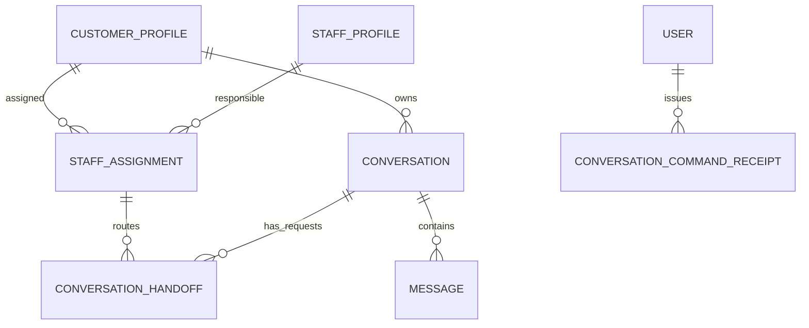
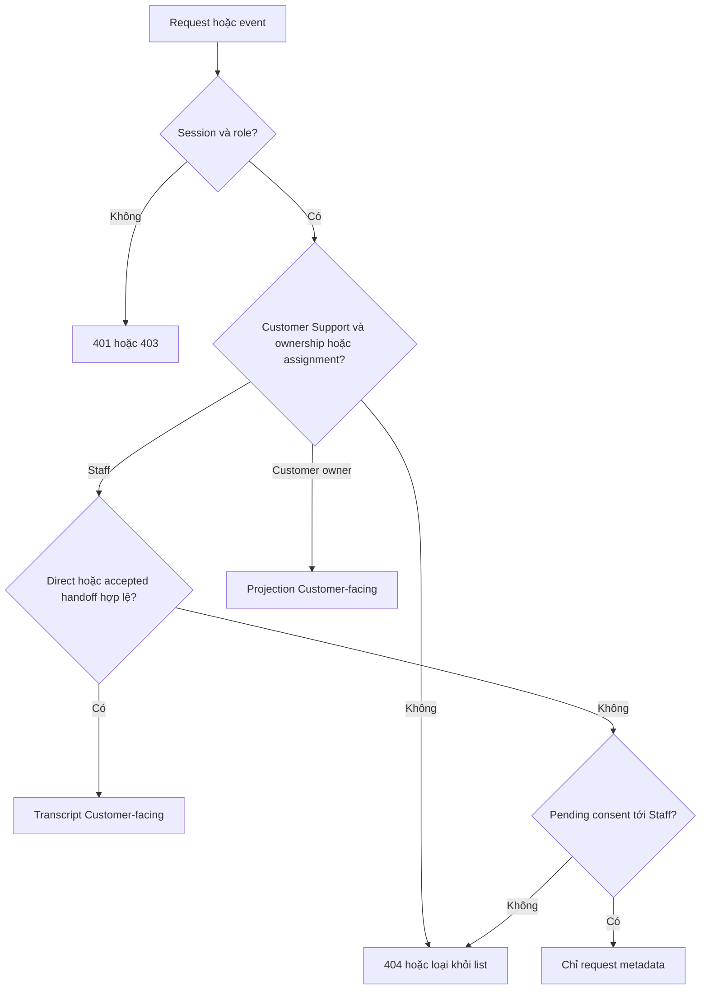

# I01 — Model, quyền và migration Inbox

Cập nhật 04/11/2026 · **Đã triển khai và kiểm chứng I01** · [Chỉ mục/contract chung](../03-inbox-contract.md) · [Nghiệp vụ](00-inbox-spec.md) · Tiếp: [I02](02-inbox-read-api.md).

## 1. Kết quả và phạm vi

Core phân biệt chat AI riêng, Direct và cuộc Customer cho phép chuyển/Staff Accept; cùng policy dùng cho REST và event. Không dựa vào assignedStaffId/status để suy quyền. Chuẩn bị message order/idempotency vừa đủ cho các phase sau.

Không thêm endpoint chat, UI, Agent runtime, Ticket workflow hoặc counts. Enum chat ba giá trị đã có; không làm lại migration xóa CLOSED hoặc sửa migration đã apply.

## 2. Vị trí triển khai

| File hiện có | Thay đổi dự kiến |
| --- | --- |
| `apps/core/prisma/schema.prisma` | Model/field/index bên dưới; không thêm package model trùng Prisma |
| `apps/core/prisma/migrations/` | Migration additive mới, giữ nguyên năm migration hiện có |
| `apps/core/src/database/database.service.ts` | Readiness yêu cầu migration mới khi model phụ thuộc đã deploy |
| `apps/core/src/admin/main.ts` | Compatibility đồng bộ migration mới |
| `apps/core/src/accounts/services/account-management.service.ts` | Assignment mutation thu hồi quyền/control cùng transaction |
| `apps/core/src/auth/services/auth.service.ts` | Tái sử dụng me/authorizeWrite; không đưa nghiệp vụ chat vào auth |
| `apps/core/src/app.module.ts` | Import ConversationsModule khi có service/controller cần dùng |

Đã tạo `conversations.module.ts`, `services/conversation-access.service.ts`, `services/conversation-command.service.ts`, `services/conversation-message.service.ts` và helper `services/conversation-revocation.ts` trong `apps/core/src/conversations/`. Chưa thêm controller/response DTO public; các phần đó thuộc I02/I03. Module chỉ export service nội bộ, không có endpoint chat.

## 3. Schema đã triển khai

### 3.1. Conversation

| Field mới | Type/default | Ràng buộc |
| --- | --- | --- |
| supportOrigin | AI / DIRECT / LEGACY_UNKNOWN; nullable cho Copilot | Customer Support bắt buộc có; bất biến sau tạo. Legacy không tự thành Direct |
| createdByCustomerId | UUID nullable | Core lấy actor khi tạo mới; bằng customerId, không backfill actor giả |
| subject | varchar(180) nullable | AI subject chưa cho Staff đọc trước Accept |
| directAssignmentId | UUID nullable FK StaffAssignment | Chỉ DIRECT, lưu assignment cụ thể lúc tạo |
| controlVersion | int default 0 | Tăng khi request/Accept/reassignment; không tăng chỉ vì một tin mới |
| nextMessageSequence | bigint default 0 | Cấp sequence dưới khóa conversation |
| lastCustomerFacingActivityAt | timestamptz nullable | Chỉ từ CUSTOMER_VISIBLE, không tool/Copilot activity |

assignedStaffId là controller hiện tại, không là chứng cứ cấp quyền. Grant ràng buộc **assignment id còn active**: cùng Staff được gán lại ở assignment mới cũng không tự lấy lại grant cũ. linkedPolicyId không đổi khi mở policy; linkedContextConvId không cấp quyền Copilot.

### 3.2. ConversationHandoff — bảng mới

Lưu bền vững yêu cầu/chứng cứ chia sẻ/Accept, nhiều lần theo thời gian. Không dùng SupportTicket/aiSummary thay nó.

| Field | Ràng buộc |
| --- | --- |
| id, conversationId, customerId | UUID; composite FK bảo đảm cùng Customer/conversation |
| assignmentId, recipientStaffId | FK assignment; customer/staff khớp assignment đó |
| state | PENDING / ACCEPTED / REVOKED; state request, **không** thêm status chat |
| sharedSubject, sharedReason | 1–180 / 0–1000 ký tự; Customer nhập hoặc xác nhận rõ để chia sẻ |
| consentScope | ENTIRE_CUSTOMER_VISIBLE_CONVERSATION, giá trị cố định |
| consentTextVersion, confirmedByCustomerId, confirmedAt | Core chọn bản thông báo, actor ownership, thời gian server |
| acceptedByStaffId, acceptedAt | Cùng null trước Accept; sau Accept đúng recipientStaffId |
| revokedAt, revokeReason | Metadata thu hồi; không xóa chứng cứ/lịch sử |

Partial unique một handoff PENDING hoặc ACCEPTED chưa revoked cho mỗi conversation. Reassignment revoke record hiện hành trước request mới. Grant suy từ record ACCEPTED + assignment hiện hành; không boolean do client gửi.

Đề xuất consent gồm toàn bộ Customer-facing đã có và phát sinh khi Staff hỗ trợ trong cùng cuộc; UI nêu rõ. Không chia sẻ Copilot hoặc tự cấp tài liệu Private ngoài scope.

### 3.3. Message

Đã thêm `sequence bigint`, `audience CUSTOMER_VISIBLE / INTERNAL / LEGACY_REVIEW`, `clientMessageId UUID nullable` và `internalMessageId UUID nullable` cho trusted AI/SYSTEM writer (unique theo conversation). Unique `(conversationId,sequence)`; partial unique `(conversationId,senderId,clientMessageId)` khi sender/key non-null. AI/SYSTEM writer dùng receipt/internal operation id riêng, không giả senderId Customer.

Audience do trusted Core writer/channel quyết định, không từ body người dùng. SYSTEM chỉ CUSTOMER_VISIBLE khi được phép hiển thị cho Customer. toolCallsMetadata không vào transcript DTO; citations qua projection kiểm document/version/quyền riêng.

Legacy gán sequence ổn định `(createdAt,id)` theo từng cuộc, không sửa content/citations/tool metadata/timestamps/id. Customer Support cũ chưa có chứng cứ dùng LEGACY_REVIEW; Copilot INTERNAL. Không tự suy CUSTOMER_VISIBLE từ SenderType. Dữ liệu chưa review chưa hiện trong transcript, vẫn giữ DB để phân loại có bằng chứng. Phương án này đã áp dụng: dữ liệu cũ cần phân loại có bằng chứng trước khi hiện transcript. Provenance bất biến; việc review/backfill sau này cần migration/tool có audit riêng, chưa có API sửa origin.

### 3.4. ConversationCommandReceipt

Field: id, actorId, operation, clientRequestId, requestHash, resourceId, resultVersion, createdAt. Unique `(actorId,operation,clientRequestId)`. Operation allowlist CREATE_AI/CREATE_DIRECT/REQUEST_HANDOFF/ACCEPT_HANDOFF/SEND_MESSAGE. resourceId được service xác minh đúng loại; receipt id không là quyền.

Hash canonical DTO gồm expectedVersion/resource/content cần chống trùng. Chỉ lưu resource reference/hash/minimal result, không transcript/body/response Private nguyên khối. SEND_MESSAGE thêm unique clientMessageId tại Message. Bản đầu giữ receipt trong DB, **chưa TTL/xóa tự động**; retention chốt riêng. Replay phải reauthorize, không phát lại response đã cache khi mất quyền.

### 3.5. Index/constraints

- Conversation unique `(id,customerId)` cho composite FK; index `(customerId,status,lastCustomerFacingActivityAt,id)`.
- Handoff index `(recipientStaffId,assignmentId,state,confirmedAt,id)` và `(conversationId,state)`; FK/check bảo đảm assignment/customer/staff đúng nhau.
- Message index `(conversationId,audience,sequence)` cho before/after; không full-text search nội dung.
- DIRECT phải có creator/direct assignment hợp lệ lúc tạo; AI/LEGACY_UNKNOWN không directAssignmentId. Copilot không đi qua support endpoints.
- CHECK accepted fields/state/timestamps nhất quán, version/sequence không âm. SQL migration thể hiện partial unique nếu Prisma chưa biểu diễn đủ.
- Giữ FK linkedPolicy cùng Customer và constraints hiện có, không nới để migration pass.

## 4. Policy dùng chung

Quan hệ đề xuất bổ sung, không thay ERD của các module Account/Policy:



Direct trỏ assignment lúc tạo; handoff lưu assignment từng lần chuyển. Receipt resource reference được service kiểm đúng operation; không vẽ FK giả từ một UUID đa loại sang mọi bảng.

Service trả capability `NONE`, `REQUEST_METADATA`, `TRANSCRIPT`, kèm canAccept/canSend. Predicate query và kiểm resource cùng quy tắc; không tải transcript rồi lọc/xóa sau paginate.

| Staff case | Capability | Accept/send |
| --- | --- | --- |
| AI riêng/Copilot/legacy thiếu chứng cứ | NONE | Không |
| Pending consent tới assignment hiện tại | REQUEST_METADATA | Accept có, send không |
| Handoff ACCEPTED bởi đúng Staff/assignment còn active | TRANSCRIPT | Send khi STAFF_ACTIVE/controller khớp |
| DIRECT với creator/assignment provenance hiện hành | TRANSCRIPT | Send khi STAFF_ACTIVE/controller khớp |
| Assignment hết hạn/user khóa/phiên mất | NONE | Không |
| Chỉ Ticket/notification/link/cursor/assignedStaffId | Không đổi capability | Không tự cấp |

Customer chỉ đọc CUSTOMER_SUPPORT ownership, projection đúng audience; không STAFF_COPILOT dù customerId trùng. Legacy chưa review trả trạng thái không khả dụng an toàn, không suy consent từ actor cũ.



## 5. Locks, reassignment và Agent fence

Chuẩn hóa writer: **users liên quan theo UUID tăng dần → CustomerProfile/assignment hiện hành → Conversation theo UUID tăng dần → handoff/message/receipt**. Account management hiện khóa users có thứ tự; review advisory locks cũ để không đảo thứ tự. Không khóa conversation rồi quay lại users. Auth/revocation đọc lại trong transaction, không từ cache ngoài transaction.

Assignment mutation cùng transaction: kết thúc assignment cũ → revoke handoff → tăng controlVersion → bỏ controller cuộc bị ảnh hưởng. STAFF_ACTIVE/PENDING về AI_ACTIVE; AI writer vẫn bị chặn nếu provenance/routing chưa hợp lệ. Direct cũ Customer vẫn đọc lịch sử nhưng không gửi Staff, không tự bật AI. Không xóa messages/receipts. Staff mới cần request/Accept mới hoặc Direct mới; không đổi origin cuộc AI.

AI append tương lai nhận expectedControlVersion, kiểm origin AI + status AI_ACTIVE + audience dưới cùng lock. Request/Accept/revoke tăng version làm output cũ bị từ chối. Đề xuất dừng AI ngay khi request commit. Không thêm public endpoint giả mạo AI; transport/Agent auth phải có kế hoạch riêng.

## 6. API trong phase

**Không thêm public endpoint I01.** Internal interface đã có:

| Interface | Input | Kết quả |
| --- | --- | --- |
| `access.staffScope(actorId,filter)` | Actor từ session | Predicate Prisma dùng trong tx trước group/cursor |
| `access.requireMetadata(tx,actorId,id)` | UUID | Safe projection hoặc 404 |
| `access.requireTranscript(tx,actorId,id)` | UUID | Grant hiện hành hoặc 404 |
| `commands.execute(tx,actorId,operation,key,payload,authorize,work)` | DTO validated, callback authorize bắt buộc | Canonical hash, reauthorize cả replay, receipt tối thiểu |
| `messages.send(actor,id,key,expectedVersion,text,authorize)` | Trusted actor + callback session bắt buộc | Append/receipt/audit/outbox atomic |
| `messages.appendAI(customerId,id,internalMessageId,expectedVersion,text,authorizeService)` | Trusted service callback bắt buộc, không public endpoint | Internal idempotency + control fence, không giả actor Customer |

Access/execute nhận tx; send/appendAI là transaction boundary và dùng các helper tx bên trong, không gọi lồng hai boundary. `commands.transaction` retry tối đa3 lần cho routing discovery race/serialization/deadlock; lỗi nghiệp vụ không retry. Không phát event ra socket trước commit; outbox chỉ ghi DB, worker I06 chưa có. Controller tương lai phải lấy actor từ session, không body.

## 7. Các bước migration

1. Kiểm enum/dependencies/legacy bằng số liệu tổng hợp, không log nội dung.
2. Migration additive mới: fields/tables/types/index/constraints. Legacy origin LEGACY_UNKNOWN; audience/order theo phương án review, không tạo handoff/receipt giả.
3. Backfill sequence/counter atomic, locks khi cần. Dừng writer chưa tương thích trong deploy local; không hứa zero downtime.
4. Kiểm grants bảng/type mới: Core/admin DML, viewer chỉ đọc, Agent không business DB.
5. Generate client/build, compatibility Core/operator; deploy Docker migrate; đối chiếu hash nội dung/link/time trước/sau.
6. Deploy lại không duplicate/pending. Migration fail rollback transaction; không reset DB/volume. Rollback app dùng bản tương thích, không drop cột/bảng có chứng cứ.

## 8. Kiểm thử

Test **đã thêm/chạy**: `apps/core/test/conversation-permissions.test.cjs`, `conversation-model-migration.test.cjs`. Chạy integration trong test container với PostgreSQL Docker; fixtures runId tự dọn. Giữ test CLOSED đã có như regression độc lập.

| ID | Kiểm tra | Kết quả |
| --- | --- | --- |
| I01-T01 | Assignment + AI riêng/legacy STAFF_ACTIVE | NONE, không grant từ status |
| I01-T02 | Pending đúng/sai recipient, Customer, assignment | Chỉ metadata đúng scope, transcript luôn deny |
| I01-T03 | Accepted đúng/sai Staff, gán lại cùng Staff | Chỉ assignment id hiện hành có grant |
| I01-T04 | Direct mới và đổi origin cuộc AI | Direct mới hợp lệ, đổi origin bị chặn |
| I01-T05 | Copilot/SYSTEM internal/tool payload | Không vào transcript Customer-facing |
| I01-T06 | Hai append/cùng clientMessageId | Sequence unique, cùng key một message |
| I01-T07 | Migration empty/legacy/timestamp tie | Order ổn định, không mất content/link/time hoặc tạo grant |
| I01-T08 | FK/check/partial unique sai | DB từ chối, không chỉ DTO |
| I01-T09 | Reassignment đua send/Accept/AI | Thứ tự commit rõ, quyền cũ bị chặn, bounded retry |
| I01-T10 | Migration fail/redeploy | Atomic rollback, không duplicate/xóa dữ liệu |

## 9. Điều kiện hoàn tất

- [x] Review audience legacy, pending AI, reassignment trước migration.
- [x] Schema/policy/index/constraint/compatibility và tests pass.
- [x] Không grant từ assignedStaffId/status hoặc backfill consent giả.
- [x] Cập nhật model/runtime docs; chưa đánh dấu API/UI Inbox xong.

**Checkpoint:** Bắt đầu I02 khi policy chứng minh deny-before-Accept ở query/service. Chưa có thao tác UI mới để manual test.


## 10. Kết quả triển khai 04/11/2026

Migration `202611040001_inbox_foundation` đã apply bằng Docker; deploy lại không pending. Thêm hai bảng business `conversation_handoffs`, `conversation_command_receipts`, tổng19 bảng ứng dụng/6 migrations. PostgreSQL constraints/triggers giữ provenance/consent bất biến, cùng Customer/assignment và một handoff hiện hành; grant/query không suy từ status/controller. Index/FK có map tên PostgreSQL giới hạn63 ký tự, Prisma migrate diff trả empty.

Đã chạy16 ca `conversation-permissions.test.cjs` trong container, 3 ca migration trên schema test riêng và 5 ca HTTP foundation trong container: 24 pass. Kiểm dữ liệu trước/sau xác nhận nội dung/time/link của conversation/message và Ticket/policy giữ nguyên; legacy không được backfill grant/audience Customer-visible. Đây là service/DB/HTTP foundation tests, chưa phải browser E2E Inbox.

Lệnh chạy lại từ root, khi PostgreSQL Docker và migration đã sẵn sàng:

```powershell
node --test apps/core/test/conversation-model-migration.test.cjs
docker compose --profile tests build core-tests
docker compose --profile tests run --rm --no-deps core-tests
docker compose --profile tests run --rm --no-deps core-tests node --test test/http-foundation.test.cjs
```

Test profile dùng credential volumes readonly và fixture synthetic theo runId, tự dọn đúng ID; không seed bootstrap, không mở Core/Web trên host, không xuất credential. Không có script/file tạm hoặc `.local` mới. Core local qua gateway vẫn `http://localhost:8080`; không tạo file riêng ngoài repo hoặc credential mới. Đây chưa là public send API: giới hạn/normalization trong service chuẩn bị nền, I03/I05 còn phải làm HTTP/CSRF/rate limit/DTO/reconcile/UI đúng kế hoạch.
