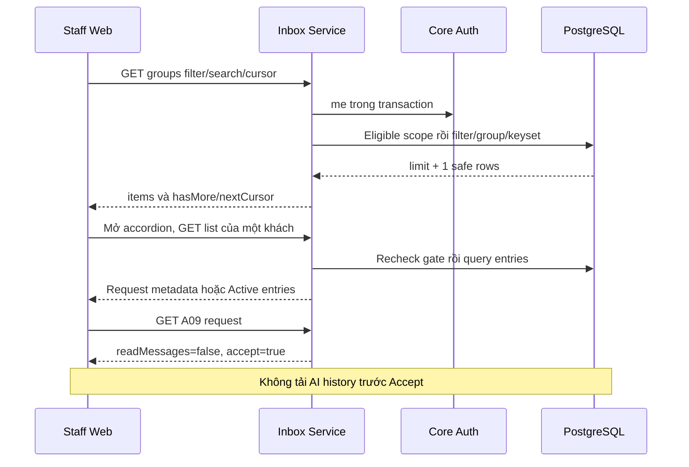

# I02 — Read API nhóm khách, danh sách cuộc và request metadata

Cập nhật 04/11/2026 · **Đã triển khai và kiểm chứng I02** · [Contract chung](../03-inbox-contract.md#9-contract-kỹ-thuật-dùng-chung--đề-xuất) · Trước: [I01](01-model-permissions.md) · Tiếp: [I03](03-handoff-transcript.md).

## Data model và phạm vi ảnh hưởng

Bảng bên dưới mô tả tác động của phase, gồm cả ghi gián tiếp qua Core. Tên bảng thuộc schema `business` trừ nơi ghi rõ; cột còn đề xuất được đánh dấu **P**. Web không truy cập DB trực tiếp.

| Bảng/model | Cột hoặc dữ liệu liên quan | Thao tác của phase | Quan hệ/ràng buộc cần giữ | Mức ảnh hưởng và nơi bị tác động |
| --- | --- | --- | --- | --- |
| users + auth_sessions | users.id/role/status, auth_sessions.user_id/token_hash/expires_at/revoked_at | Đọc | AuthSession.user_id → User.id; session phải còn hạn, không bị thu hồi | Cao — mọi API dùng session; không trả token/hash trong DTO |
| staff_assignments + customer_profiles + staff_profiles | staff_id/customer_id/is_active/ended_at, assignment_version, user_id/full_name | Đọc | Assignment gắn đúng Customer/Staff; Inbox còn ràng buộc assignment id cụ thể | Cao — Customers, Policy Lookup, Ticket và Inbox cùng phụ thuộc phân công |
| conversations + conversation_handoffs | customer_id/channel_type/support_origin/direct_assignment_id/assigned_staff_id/status/control_version/subject, state/assignment_id/recipient_staff_id/shared_subject/shared_reason/accepted_at/revoked_at | Đọc | Direct đúng assignment lúc tạo hoặc handoff ACCEPTED còn grant; PENDING chỉ shared metadata, không AI subject/transcript | Cao — Inbox filter/deep link/REST/WS phải cùng gate; không suy grant từ status/assigned_staff_id |
| rate_limit_buckets | client_token/endpoint_group/window_start/request_count/blocked_until | Ghi phụ trợ khi endpoint áp quota | PK (client_token,endpoint_group); tăng atomic, giới hạn theo actor/nhóm endpoint | Trung bình — quota có thể ghi dù nghiệp vụ bị từ chối; không log định danh nhạy cảm |

**Schema/migration:** Không migration; dùng index/keyset I01. Không thêm count/unread/status enum.

**Nhất quán và hồi quy:** Scope trước search/filter/cursor. Pending không select nội dung Message; kiểm A08/A09, cursor actor/filter và metadata parity.

## 1. Kết quả và ranh giới

Staff đọc nhóm khách/cuộc đúng gate, All/Requests/Active, search tên/mã và lazy load từng khách. Pending chỉ metadata Customer chia sẻ. Không counts, preview hoặc AI history. Trong mốc I02 chỉ có read; I03 hiện đã có nguồn tạo request/Accept/transcript thật, public send vẫn ở I05; test dùng fixture synthetic độc lập tự dọn.

## 2. Vị trí triển khai

Đã tạo các file trong `apps/core/src/conversations/`: `controllers/staff-inbox.controller.ts`, `controllers/staff-conversation.controller.ts`, `services/staff-inbox.service.ts`, `dto/inbox-query.dto.ts`, `dto/conversation-response.dto.ts`. Dùng access service I01, AuthModule/DatabaseModule và import ConversationsModule tại `app.module.ts`.

Read quota dùng RateLimitBucket DB qua helper nhỏ `services/conversation-rate-limit.service.ts`, đã áp dụng240 request/phút/actor theo [I05](05-messaging-customer.md#41-quota-local-đề-xuất); tạo phần cần dùng ngay I02, không chờ phase gửi tin hoặc dùng private AuthService.limit.

Không gắn chat vào CustomersModule/PoliciesModule. Không bỏ total ở CustomerService.list: Customers có phân trang riêng. A09 projection tái dùng cho response Accept I03.

| Vị trí từ root repo | Hiện trạng | Trách nhiệm trong phase | Mức ảnh hưởng | Phạm vi cần kiểm lại |
| --- | --- | --- | --- | --- |
| [apps/core/src/conversations/controllers/staff-inbox.controller.ts](<../../../../../apps/core/src/conversations/controllers/staff-inbox.controller.ts>) | Hiện có | A08 grouped customers/conversations | Cao | Inbox accordion/search/filter |
| [apps/core/src/conversations/services/staff-inbox.service.ts](<../../../../../apps/core/src/conversations/services/staff-inbox.service.ts>) | Hiện có | Gate + keyset + safe metadata DTO | Cao | A09 và response Accept |
| [apps/core/src/conversations/services/conversation-access.service.ts](<../../../../../apps/core/src/conversations/services/conversation-access.service.ts>) | Hiện có | Một gate cho metadata/transcript/send | Cao | REST Staff/Customer, realtime, future Copilot |
| [apps/core/src/conversations/dto/inbox-query.dto.ts](<../../../../../apps/core/src/conversations/dto/inbox-query.dto.ts>) | Hiện có | Cursor/filter/search validation | Trung bình | URL deep link và lazy loading |

## 3. API spec đã triển khai — A08/A09 E

Chỉ Staff; auth/errors/no-store theo contract chung. Không trả raw Prisma entity.

### 3.1. A08 — Nhóm khách

`GET /api/v1/staff/inbox/customers`

| Query | Quy tắc |
| --- | --- |
| filter | all mặc định; chỉ all/requests/active |
| search | Trim, 0–100 ký tự, literal substring fullName/accountCode, case-insensitive, không bỏ dấu |
| customerId | UUID tùy chọn, chỉ thu hẹp phạm vi |
| limit | Integer 1–50/default 20 |
| cursor | Versioned theo contract chung, không offset/page |

```json
{
  "items": [{
    "customer": {"id": "10000000-0000-4000-8000-000000000001", "fullName": "Synthetic Customer A", "accountCode": "CUS-000001"},
    "lastActivityAt": "2026-11-03T08:00:00.000Z"
  }],
  "pageInfo": {"hasMore": false, "nextCursor": null}
}
```

Chỉ group có ít nhất một item visible trong filter; không email/phone/KYC/assignment metadata/tổng số. customerId ngoài quyền dùng như filter nhận items rỗng, không xác nhận account tồn tại.

### 3.2. A08 — Lazy list từng khách

`GET /api/v1/staff/inbox/customers/:customerId/conversations?filter=all&limit=10&cursor=...`

limit 1–50/default 10. Không nhận search ở endpoint này: search cấp group đã chọn khách. Unknown query trả 400. Không assignment trả 404; có assignment nhưng không item đủ gate trả items rỗng.

```json
{
  "items": [{
    "id": "20000000-0000-4000-8000-000000000001",
    "subject": "Cần Staff giải thích quyền lợi",
    "status": "PENDING_HANDOFF", "entryType": "REQUEST",
    "activityAt": "2026-11-03T08:00:00.000Z"
  }],
  "pageInfo": {"hasMore": true, "nextCursor": "opaque-cursor"}
}
```

entryType REQUEST/DIRECT/TRANSFERRED là DTO, không status chat mới. Request subject từ sharedSubject, fallback “Yêu cầu Staff hỗ trợ”; activityAt=confirmedAt, không last AI message. Active subject đủ grant mới trả; activityAt dùng lastCustomerFacingActivityAt hoặc mốc tạo/Accept an toàn. Không preview tin cuối.

Thứ tự derive entryType: pending hiện hành → REQUEST; accepted handoff hiện hành → TRANSFERRED; còn Direct provenance hợp lệ → DIRECT. Nhờ vậy Direct cũ được chuyển tới Staff mới bằng xác nhận/Accept mới không bị hiển thị như grant Direct cũ tự sống lại.

### 3.3. A09 — Metadata một cuộc

`GET /api/v1/staff/conversations/:conversationId`, không query.

Pending response:

```json
{
  "conversation": {
    "id": "20000000-0000-4000-8000-000000000001",
    "customer": {"id": "10000000-0000-4000-8000-000000000001", "fullName": "Synthetic Customer A", "accountCode": "CUS-000001"},
    "subject": "Cần Staff giải thích quyền lợi", "status": "PENDING_HANDOFF",
    "entryType": "REQUEST", "controlVersion": 3,
    "request": {"id": "30000000-0000-4000-8000-000000000001", "sharedReason": "Tôi muốn được nhân viên hỗ trợ.", "requestedAt": "2026-11-03T08:00:00.000Z"},
    "allowedActions": {"readMessages": false, "accept": true, "send": false}
  }
}
```

Không lastSequence/messageCount/summary/aiTitle/createdAt cuộc AI/linked context/citations. Chỉ requestedAt đã chia sẻ, không activity riêng. Active bỏ request nếu không cần, entryType DIRECT/TRANSFERRED; allowedActions do policy tính, không nhúng messages. send có thể true theo nghiệp vụ nhưng UI I04 chưa bật trước I05; không giả capability theo phase FE.

No grant/AI riêng/Copilot/not found cùng 404. UUID sai 400. Biết id hoặc truyền query khác không đổi quyền.

### 3.4. A10 ở mốc I02

Pending đọc messages bằng URL trực tiếp luôn404. Sau I03, A10 đã là route thật và vẫn deny trước grant; không còn dùng route vắng để chứng minh quyền. Test I02 đã cập nhật theo A10/Accept thật, public send vẫn không có.

## 4. Query và cursor

1. Session/role/scope trong một RepeatableRead transaction, tham khảo CustomerService hiện có.
2. Eligible relation: assignment hiện hành + Direct grant hoặc handoff pending/accepted đúng recipient; loại Copilot/legacy thiếu chứng cứ/AI riêng.
3. Requests=pending metadata; Active=transcript grant; All=union không trùng conversation. Áp search tên/mã/customerId trước group.
4. Permitted activity theo entry; group lấy MAX activity của **item đã lọc**. Không dùng updatedAt nếu có thể đổi do tool/AI riêng.
5. Keyset groups `(activityAt DESC,customerId DESC)`; list `(activityAt DESC,conversationId DESC)`. limit+1 tính hasMore, không COUNT/window total.
6. Chỉ select DTO allowlist. Cursor cuối item hiển thị, hasMore=false thì nextCursor=null. Rỗng items=[], không lỗi.

Dùng parameterized SQL nếu Prisma group/union/keyset không biểu diễn gọn. Không N+1 theo khách hoặc tải tất cả vào JS để group. Escape LIKE `%`, `_`, `\` thành literal; ORDER BY cố định, không input SQL.

Cursor group bind actor/filter/normalized search/customerId/endpoint kind/keyset; cursor list bind actor/customerId/filter/kind. Format/size theo contract chung. Đổi actor/query hoặc dùng sai endpoint: 400, FE reset danh sách. Revoke giữa pages không trả data cũ, resource ngoài quyền safe 404/rỗng theo contract endpoint.

Tập live có thể đổi thứ tự, keyset không là snapshot dài hạn. FE dedup/reset đầu danh sách khi invalidation. Performance kiểm query count bounded, EXPLAIN/index và không scan nội dung messages; không hứa số ms mọi máy.

## 5. Sơ đồ hoạt động



## 6. Các bước triển khai

1. DTO transform/allowlist, Swagger enums/examples/errors.
2. Scope query I01 và projections; unit tests trước controller.
3. Groups/list keyset; test scope/search/filter trước paginate.
4. A09 safe metadata/404/no-store; recursive forbidden field assertions.
5. Regression auth/Customers/Policies; chỉ chuyển A08/A09 thành E khi controller và tests thật có.

## 7. Test cases

Các ca dưới đây là **đặc tả kiểm thử**, không phải báo cáo kết quả. Kiểm từng lớp API/service/DB/browser đúng nhãn; mock UI không thay kiểm quyền Core hoặc E2E thật.

**Quy ước dữ liệu:** S-A/S-B là hai Staff synthetic; C-A/C-B là hai Customer synthetic khác nhau. Thay alias bằng UUID/token của fixture cô lập; các path HTTP dùng prefix /api/v1 nếu chưa ghi đầy đủ. Chỉ thay assignment, khóa account, inject lỗi hoặc migration trong harness/môi trường test, không trên tài khoản/dữ liệu đang sử dụng.

### I02-T01 — Groups và lazy list lọc đúng gate

**Lớp kiểm thử:** API.
**Điều kiện và dữ liệu:** C-A có Direct/pending/accepted/AI riêng; C-Z chỉ AI riêng; C-B thuộc S-B.

**Các bước:**

1. S-A GET /staff/inbox/customers với all/requests/active.
2. GET lazy conversations của C-A và C-Z.
3. GET lazy C-B.

**Kết quả mong đợi:** Groups/lazy đúng filter; C-Z không lộ chat riêng; C-B404; không COUNT/preview/summary/sequence pending.

### I02-T02 — Search tên/mã literal

**Lớp kiểm thử:** API.
**Điều kiện và dữ liệu:** C-A có tên chứa dấu/%/_ và mã synthetic; email/phone khác token tìm.

**Các bước:**

1. Search tên/mã bằng case khác, có khoảng trắng đầu/cuối.
2. Search %/_ như ký tự literal.
3. Search token chỉ có trong email/phone/message.

**Kết quả mong đợi:** Chỉ fullName/accountCode được tìm, trim/case đúng; wildcard không mở rộng; không suy ra nội dung chat.

### I02-T03 — Cursor không mang quyền

**Lớp kiểm thử:** API.
**Điều kiện và dữ liệu:** Hơn2 batch groups/cuộc, timestamps tie; lưu cursor của S-A/filter requests.

**Các bước:**

1. Đi hết các trang với limit=1, đối chiếu fixture tĩnh.
2. Dùng cursor bằng S-B hoặc đổi filter/endpoint/customer.
3. Revoke assignment rồi gọi trang sau.

**Kết quả mong đợi:** Tập tĩnh không thiếu/trùng; cursor sai400; trang sau không trả dữ liệu đã mất quyền.

### I02-T04 — A09 không thay A10

**Lớp kiểm thử:** API.
**Điều kiện và dữ liệu:** Request pending đúng S-A, AI riêng và UUID không tồn tại.

**Các bước:**

1. GET /staff/conversations/:id cho từng loại.
2. GET messages của pending với UUID/cursor biết trước.
3. Gửi query lạ/limit 51/UUID sai.

**Kết quả mong đợi:** A09 pending chỉ metadata/actions an toàn; A10 trước Accept 404; input 400 và lỗi safe envelope/no-store.

**Suite tham khảo:** [inbox-read.test.cjs](../../../../../apps/core/test/inbox-read.test.cjs). Tên suite là vị trí tự động hóa, không phải chứng nhận các ca đã chạy.

**Dọn sau kiểm thử:** xóa đúng fixture/session/object/schema theo runId; phục hồi fault injection và đóng context/socket test. Không reset DB/credential, sửa bootstrap hoặc xóa volumes. Với PDF kiểm metadata/bytes/hash; với UI kiểm DOM/focus/network, không cần screenshot.

## 8. Điều kiện hoàn tất

- [x] A08/A09 thật có HTTP/integration tests qua Docker.
- [x] Không counts ở DTO/OpenAPI/response, GET không đổi conversation/status/control/grant/history; quota bucket là bookkeeping riêng.
- [x] Pending deny transcript bằng query/policy, không CSS che.
- [x] API map E/P đúng, chưa tuyên bố chat hai chiều.

**Checkpoint:** I02 đã qua HTTP/Swagger và gateway/Core/DB integration. I03 tạo AI/Direct/request/Accept/transcript hiện đã hoàn tất; tiếp theo UI ở I04. Dữ liệu legacy không tự có grant, không seed tạm hoặc bật composer từ read capability.


## 9. Ghi chú triển khai

Đã thêm `services/inbox-cursor.ts` và `http/safe-api.exception.ts` cho cursor/public error allowlist; API dùng DTO/Swagger riêng, không serialize raw entity. Ba GET đã deploy trong Core Docker qua gateway: groups, lazy list theo khách và A09 metadata. Không migration/schema/dependency mới; giữ 19 bảng/6 migrations I01. UI Inbox vẫn khung cũ, chưa nối FE ở phase này. Tại mốc I02 chưa có workflow; I03 hiện đã thêm A10/Accept/Customer entry, public send/UI còn ở phase sau.

Read identity được kiểm trước quota, rồi session/assignment/resource đọc trong cùng RepeatableRead snapshot. Quota INBOX_READ riêng, 240/phút/actor trong RateLimitBucket; upsert autocommit ngoài snapshot để tránh serialization conflicts khi nhiều request đọc đồng thời. Không gọi HTTP auth/me thêm từ FE. SQL representation của policy đặt trong ConversationAccessService và có parity test với Prisma scope I01 trên hai actor/ba filter.

SQL lọc quyền trước group/search/keyset; pending subject/time chỉ từ handoff, active activity là greatest(lastCustomerFacingActivityAt,acceptedAt,createdAt), không updatedAt/tool activity. Query bounded theo page size, EXPLAIN không đọc bảng messages, không COUNT/N+1 hoặc group toàn tập ở Node. Active fallback subject “Cuộc trò chuyện”; accepted handoff ưu tiên entryType TRANSFERRED kể cả origin DIRECT.

A09 thực tế có thêm activityAt an toàn theo cùng item projection; request chỉ pending. allowedActions mô tả capability nghiệp vụ, không đồng nghĩa Accept/send endpoint đã được triển khai. Không xuất raw model/AI title/summary/citations/tool payload/lastSequence hoặc Inbox counts.

Error giữ foundation hiện có: 400 VALIDATION_ERROR cho DTO và BAD_REQUEST cho UUID/query A09, 401 UNAUTHORIZED, 403 FORBIDDEN, 404 NOT_FOUND, 500 INTERNAL_SERVER_ERROR cho lỗi bất ngờ (thông điệp an toàn). Hai code mới allowlist trong SafeApiException: 400 INVALID_CURSOR và 429 RATE_LIMITED + Retry-After1–60 giây. Không phát lại arbitrary HttpException body, SQL hoặc input. Cursor chỉ nhận ISO UTC chuẩn năm0001–9999, exact keyset shape/version/query/actor binding, tối đa2 KB; không là credential hoặc token cấp quyền.


Lệnh chạy lại từ root (PostgreSQL/migration I01 và stack Docker hiện hành đã sẵn sàng):

```powershell
docker compose --profile tests build core core-tests
docker compose up -d --no-deps --wait core
docker compose restart gateway
docker compose --profile tests run --rm --no-deps core-tests node --test test/inbox-read.test.cjs test/conversation-permissions.test.cjs test/http-foundation.test.cjs
```

Gateway test yêu cầu Core image hiện tại đã deploy; test container tạo Nest HTTP harness loopback riêng cho các ca còn lại, không mở host server. URL dùng ứng dụng `http://localhost:8080`; không tạo file host ngoài repo/credential mới. Fixtures synthetic/session/quota/outbox theo runId tự dọn; không thêm bootstrap/personal seed, không tạo `.local` hoặc report.md. Các tài khoản local/legacy hiện có không được chuyển thành Direct/accepted chỉ để có dữ liệu demo.
