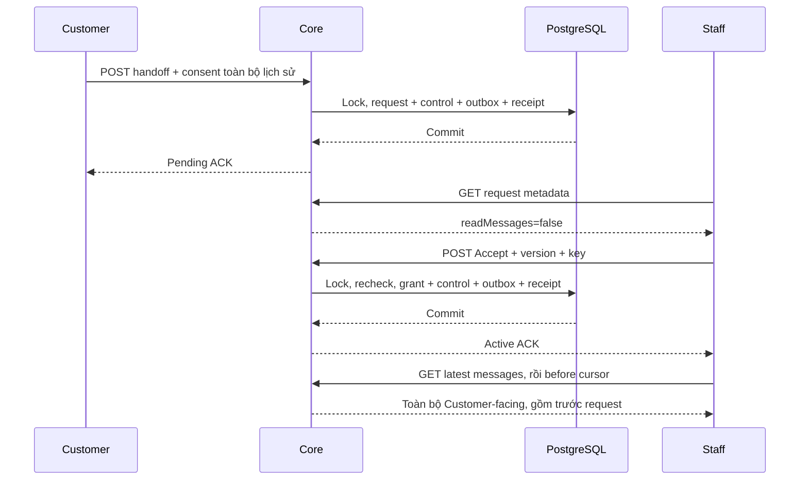

# I03 — Customer entry, handoff, Accept và toàn bộ lịch sử

Cập nhật 04/11/2026 · **Đã triển khai và kiểm chứng I03** · [Contract chung](../03-inbox-contract.md#9-contract-kỹ-thuật-dùng-chung--đề-xuất) · Trước: [I01](01-model-permissions.md), [I02](02-inbox-read-api.md) · Tiếp: [I04](04-staff-inbox-ui.md).

## 1. Kết quả

Có nguồn tạo request thật từ Customer, Direct có provenance, Staff Accept atomic và A10 đọc toàn bộ Customer-facing history. Không phải tự cấp grant qua fixture để UI chạy. Customer entry API có trước UI Customer I05 để test Core độc lập.

Phase gồm API entry/read/Accept, **chưa gửi tin người dùng hoặc tích hợp LLM thật**. Fixture AI trước request chỉ phục vụ integration test tự dọn. Không thêm public endpoint cho browser giả danh AI. Không tự tạo Ticket hoặc notification row; request và outbox bền vững được tạo, I06 mới giao thông báo.

## 2. File triển khai

Đã thêm trong `apps/core/src/conversations/`: `controllers/customer-conversation.controller.ts`, `services/conversation-entry.service.ts`, `services/conversation-handoff.service.ts`, `dto/conversation-entry.dto.ts`, `dto/conversation-workflow-response.dto.ts`, `dto/message-query.dto.ts`. Bổ sung Staff controller I02, access/command/message services I01. Chỉ tách các lớp theo trách nhiệm thật, không module/package mới ngoài ConversationsModule.

Rate limit cho các endpoint ghi đã có từ phase này: helper `services/conversation-rate-limit.service.ts` dùng RateLimitBucket hiện có, quota đề xuất tại [I05 mục 4.1](05-messaging-customer.md#41-quota-local-đề-xuất). I05 chỉ bổ sung quota/send consumer, không đợi tới I05 mới bảo vệ create/request/Accept. Đọc I02 cũng cần read quota khi triển khai endpoint, có thể tạo helper tối thiểu ở I02 rồi mở rộng tại đây.

`http/safe-api.exception.ts` đã bổ sung409 allowlist; foundation không phát raw exception. Assignment mutation dùng revoke/lock I01. I03 không cần migration/schema mới. Có thêm `services/conversation-session.service.ts`, `conversation-events.ts`, `message-cursor.ts` và `conversation-transcript.service.ts`; session/CSRF/quota/locks được dùng chung, không copy auth vào controller.

## 3. API spec Customer — đã triển khai

Chỉ role CUSTOMER, actor từ session. Không nhận customerId/staffId/senderType như quyền. Read no-store; write JSON/Origin/X-Auth-Request/CSRF. Mọi UUID trong ví dụ là synthetic.

### 3.1. Khả năng hỗ trợ và nội dung xác nhận

`GET /api/v1/customers/me/chat-support`, không query.

```json
{
  "availability": "AVAILABLE",
  "assignmentVersion": 7,
  "staff": {"fullName": "Synthetic Staff A"},
  "handoffConsent": {
    "textVersion": "handoff-v1",
    "scope": "ENTIRE_CUSTOMER_VISIBLE_CONVERSATION",
    "text": "Đồng ý để nhân viên tiếp nhận toàn bộ nội dung bạn và AI đã trao đổi trong cuộc này, cùng các tin nhắn tiếp theo khi được hỗ trợ."
  }
}
```

availability AVAILABLE/UNASSIGNED/STAFF_UNAVAILABLE; khi không AVAILABLE staff=null. Không lộ internal role/credential. assignmentVersion là routing concurrency token, không quyền. Nội dung consent server-controlled; client không tự chọn scope rộng/hẹp khác.

### 3.2. Tạo một cuộc mới

`POST /api/v1/customers/me/conversations`

AI body: `{clientRequestId: UUID, kind: "AI", subject?: string}`. Direct body:

```json
{
  "clientRequestId": "40000000-0000-4000-8000-000000000001",
  "kind": "DIRECT", "subject": "Tư vấn phí bảo hiểm",
  "expectedAssignmentVersion": 7
}
```

subject trim, tối đa 180, rỗng dùng fallback. kind là ý định tạo mới, không cho đổi origin cuộc có sẵn. Core AI→origin AI/status AI_ACTIVE/controller null; Direct→origin DIRECT/status STAFF_ACTIVE/directAssignmentId/creator/controller từ session+assignment hiện tại. AI body không nhận expectedAssignmentVersion; Direct bắt buộc có. Không có Staff/Staff khóa 409 STAFF_UNAVAILABLE; version đổi 409 ROUTING_CHANGED, không âm thầm gửi tới Staff khác.

201 lần đầu / 200 replay: `{conversation:{id,subject,status,controlVersion,entryType},replayed:boolean}`. AI entryType AI chỉ phía Customer; không thêm filter AI cho Staff. Create ghi conversation/provenance + audit tối thiểu + receipt + outbox CONVERSATION_CREATED cùng transaction. Không tạo tin nhắn rỗng/SYSTEM giả/Ticket. Chưa gọi Agent hoặc báo Agent đã trả lời.

### 3.3. Customer list/detail

`GET /api/v1/customers/me/conversations?limit=20&cursor=...`: limit 1–50, keyset `(activityAt DESC,id DESC)`, cursor actor/kind binding; không search/counts/filter state ở bản đầu. items `{id,subject,status,activityAt,entryType}`, pageInfo `{hasMore,nextCursor}`. Chỉ CUSTOMER_SUPPORT ownership, không Copilot. Không dùng endpoint Staff để thay ownership.

entryType phía Customer nhận AI/REQUEST/DIRECT/TRANSFERRED/LEGACY_REVIEW. Ưu tiên request/accepted hiện hành như I02, sau đó origin; LEGACY_REVIEW chỉ là DTO giúp giải thích chưa khả dụng, không status/filter Staff. AI subject riêng chỉ owner thấy trước Accept. Activity fallback createdAt khi chưa có message.

`GET /api/v1/customers/me/conversations/:conversationId`: `{conversation:{id,subject,status,controlVersion,entryType,availability,staff,request,allowedActions}}`. allowedActions `{readMessages,send,requestStaff}` do Core tính. request chỉ của chính Customer, có state/requestedAt/acceptedAt khi phù hợp; staff tên người nhận hiện hành hoặc null, không data assignment lịch sử không cần thiết. availability AVAILABLE/REVIEW_REQUIRED là DTO, không status chat mới. Legacy chưa phân loại trả REVIEW_REQUIRED, các actions false, không giả cho gửi hoặc tự cấp quyền; không export aiSummary/tool metadata làm lý do chi tiết.

### 3.4. Customer xác nhận chuyển giao

`POST /api/v1/customers/me/conversations/:conversationId/handoff-requests`

```json
{
  "clientRequestId": "40000000-0000-4000-8000-000000000002",
  "expectedVersion": 0, "expectedAssignmentVersion": 7,
  "sharedSubject": "Cần giải thích quyền lợi",
  "sharedReason": "Tôi muốn nhân viên hỗ trợ tiếp.",
  "consent": {
    "confirmed": true, "textVersion": "handoff-v1",
    "scope": "ENTIRE_CUSTOMER_VISIBLE_CONVERSATION"
  }
}
```

sharedSubject 1–180/sharedReason 0–1000 ký tự, trim/text an toàn; bản đầu yêu cầu Customer tự nhập hoặc xác nhận rõ, không tự copy AI title/summary thành shared metadata. consent false/thiếu/scope khác/bản không còn hợp lệ → 400 INVALID_INPUT. Đây là xác nhận do người dùng qua phiên, không lời đồng ý do LLM tự suy.

201/200 replay: `{request:{id,state:"PENDING",requestedAt},conversation:{id,status:"PENDING_HANDOFF",controlVersion},replayed}`. State/status khác miền. Request mới khi đang pending khác key → 409 HANDOFF_ALREADY_PENDING; khi đang active có grant không tạo thêm. Không tạo SupportTicket.

AI_PRIVATE đủ ownership có thể yêu cầu; Direct cũ bị revoke có thể xin chuyển lịch sử tới Staff mới sau xác nhận mới. Legacy chưa review không tự biến thành Direct/grant; xử lý riêng trước khi dùng luồng này. Không endpoint cancel/reject/close/reopen trong phase đầu; Customer không đồng ý thì không gửi POST.

### 3.5. Reconcile entry command

`GET /api/v1/customers/me/conversation-commands/:clientRequestId?operation=CREATE_AI|CREATE_DIRECT|REQUEST_HANDOFF`

200 `{state:"COMMITTED",resourceId,conversationId,controlVersion}` chỉ receipt của actor hiện tại. Không nhận actorId; UUID/operation sai 400. Không có receipt hoặc resource không còn được đọc: 404. **404 không chứng minh command trước không commit**: request ban đầu có thể còn đang chạy; retry cùng POST/key/payload an toàn, không tạo key mới. Lookup không tự sửa nghiệp vụ.

## 4. API Staff — A10/A11 đã triển khai

### 4.1. A11 Accept

`POST /api/v1/staff/conversations/:conversationId/accept`

Body `{clientRequestId: UUID, expectedVersion: integer}`. Không nhận transcript scope/consent/customerId/staffId từ Staff. Thành công 200 `{conversation: <A09 active projection>, replayed:boolean}`; chỉ lúc này FE được gọi A10. Không nhúng history vào ACK.

401/403/404 theo contract chung. Metadata đủ quyền nhưng version đổi →409 STALE_CONVERSATION; request đã nhận bởi hành động khác →409 ALREADY_ACCEPTED. Cùng key/payload đã commit →200 replay sau recheck current grant. AI riêng chưa request →404, không cho proactive takeover.

Reconcile `GET /api/v1/staff/conversations/:conversationId/commands/:clientRequestId?operation=ACCEPT_HANDOFF`: 200 minimal committed receipt của Staff đó hoặc safe404. Sau timeout ưu tiên lookup + A09, replay cùng POST khi còn unknown; không báo “chưa nhận” chỉ vì lookup404.

### 4.2. A10 transcript, Customer cùng contract projection

Staff: `GET /api/v1/staff/conversations/:conversationId/messages?limit=50&before=...`

Customer: `GET /api/v1/customers/me/conversations/:conversationId/messages?limit=50&before=...`

limit 1–100/default50; before/after opaque cursor, không đồng thời cả hai, exclusive. Không query→batch mới nhất. Items luôn sequence tăng dần. Cursor bind actor/conversation/direction, vẫn recheck gate. Staff trước Accept safe404, không response rỗng tiết lộ lastSequence. Customer owner đọc đúng audience kể cả AI private/pending.

```json
{
  "items": [{
    "id": "50000000-0000-4000-8000-000000000001", "sequence": "128",
    "senderType": "AI_AGENT", "sender": {"displayName": "AI assistant"},
    "content": "Nội dung synthetic đã hiển thị cho Customer trước yêu cầu Staff.",
    "createdAt": "2026-11-03T07:00:00.000Z", "citations": []
  }],
  "pageInfo": {"beforeCursor": "opaque-before", "afterCursor": "opaque-after", "hasMoreBefore": true, "hasMoreAfter": false}
}
```

afterCursor của batch cuối giúp catch-up; nếu rỗng trả cursor boundary hợp lệ hoặc null ở cuộc chưa có tin, không giả sequence. after chỉ tiến qua những item có quyền; bị giới hạn batch thì hasMoreAfter=true, tiếp tục tới hết. Sequence có thể có khoảng trống do INTERNAL/legacy; không total/số tin ẩn.

Sau Accept không thêm `createdAt>=acceptedAt/requestedAt` vào query. Lịch sử Customer-facing trước đó phải tải tới đầu; “toàn bộ” là phạm vi quyền, không tải tất cả một lần. SenderType CUSTOMER/STAFF/AI_AGENT/SYSTEM là nhãn tác giả, không delivered/read.

citations chỉ allowlist `{documentId,versionId,page,label}` sau kiểm quyền phiên bản; không objectKey/signedUrl/rawtool. Citation mất quyền thì bỏ citation hoặc trả unavailable marker không metadata Private, giữ text đã là Customer-facing; mở PDF dùng quyền riêng, không transcript grant thay tài liệu grant.

## 5. Transaction và luồng hoạt động

### 5.1. Request

Auth/CSRF → locks I01 → recheck ownership/assignment/version → receipt lookup → validate consent/routing → create PENDING handoff + status PENDING_HANDOFF + tăng controlVersion → audit allowlist + outbox HANDOFF_REQUESTED → receipt → commit →ACK. Bất kỳ bước fail rollback toàn bộ. LLM đề xuất chỉ là gợi ý UI, không được gọi bước xác nhận thay Customer.

Đã áp dụng AI dừng từ request commit. AI output đang chạy mang version cũ bị Core fence chặn; Customer vẫn được gửi tiếp ở I05, pending Staff không thấy các tin này cho đến Accept. Writer AI của Core đã kiểm status/controlVersion; không có endpoint browser giả danh AI, chưa nối Agent runtime.

### 5.2. Accept

Auth/CSRF → locks I01 → recheck assignment/user/request consent/recipient → replay receipt nếu có và quyền còn hiệu lực → kiểm expectedVersion/state → cập nhật ACCEPTED/accepted actor/time + controller/STAFF_ACTIVE/controlVersion+1 → audit + outbox HANDOFF_ACCEPTED + receipt → commit. Grant và control cùng transaction, không “status trước, grant sau”.



### 5.3. Reassignment

Theo I01: revoke grant cũ, bỏ controller, tăng version; Staff mới không tự thấy transcript. Customer phải xác nhận request mới tới assignment mới. Consent/request cũ giữ audit, không sửa recipient để biến thành consent mới. Trước khi Customer xác nhận mới không phát transcript qua WS/REST/notification cho Staff mới.

## 6. Các bước triển khai

1. Entry/availability/consent DTO + contract Swagger; chốt pending AI/routing/reassignment.
2. Receipt/locks/create AI/Direct; proof bất biến origin.
3. Handoff request atomic + safe pending metadata; no Ticket.
4. Accept grant atomic và fence; test race bằng barrier, không sleep mong đợi may rủi.
5. Transcript before/after/projection cho Staff/Customer; citation scope.
6. Command reconcile và HTTP errors; API map giữ endpoint chưa làm là P.

## 7. Test plan

Test đã gộp trong **`apps/core/test/conversation-workflow.test.cjs`** (23 ca) và helper lâu dài `test/support/conversation-test.module.cjs`; không tạo ba file trùng setup/fixtures. Docker test container, test fixtures >120 Customer-facing messages gồm trước/sau request, timestamp trùng, INTERNAL/Copilot/citations ngoài quyền; hai Staff/hai Customer/unassigned/locked. Fixture không thuộc bootstrap.

| ID | Kiểm tra | Kết quả |
| --- | --- | --- |
| I03-T01 | Tạo AI/Direct với actor đúng/sai routing | Provenance server ghi, không đổi AI cũ thành Direct |
| I03-T02 | Consent thiếu/false/scope/bản sai, caller giả Customer | Không request/status/outbox/receipt side effect |
| I03-T03 | Request hợp lệ | Pending metadata đủ, transcript Staff404, Ticket không tăng |
| I03-T04 | Accept hợp lệ, tải before tới đầu | Cả tin AI trước request/Accept, không cắt theo timestamp |
| I03-T05 | Cùng key/payload retry; khác body; ACK mất | Một grant/audit/outbox, replay hoặc409 đúng |
| I03-T06 | Hai Accept keys/Staff đua, Accept đua assignment | Một transition thắng; Staff sai không lấy history |
| I03-T07 | AI output cũ sau request/Accept | Core fence từ chối, không ghi tin muộn |
| I03-T08 | Transaction fail sau status trước receipt/outbox | Toàn bộ rollback, không grant nửa chừng |
| I03-T09 | before/after/limit/tie/cursor sai actor/cuộc | Order/dedup/boundary đúng, không bypass quyền |
| I03-T10 | Audience/Copilot/citation ngoài quyền | Không raw tool/Private data ngoài scope |
| I03-T11 | Reassignment hoặc khóa sau Accept/replay | Quyền cũ mất, receipt không phát lại history |
| I03-T12 | Query forbidden/CSRF/role/rate limit | Safe HTTP contract và no-store |
| I03-T13 | Lookup404 khi command còn chạy | Retry cùng key không tạo command mới |

## 8. Điều kiện hoàn tất

- [x] Review pending AI/routing/reassignment và DTO đề xuất.
- [x] Entry/request/Accept/history/reconcile HTTP + PostgreSQL race tests pass.
- [x] Request có nguồn Customer thật; grant không fixture giả trên production.
- [x] Toàn bộ Customer-facing trước Accept kiểm bằng nhiều batch; Ticket độc lập.
- [x] Không gọi đây là chat hai chiều/AI runtime hoàn chỉnh; send và Customer UI ở I05.

**Checkpoint:** Có thể bắt đầu I04 với request/Direct/accepted thật qua API. Mọi kiểm thử dùng HTTP ở đây vẫn chưa là browser E2E.


## 9. Kết quả triển khai 04/11/2026

Đã deploy10 endpoint I03 trong Core Docker: Customer support/create/list/detail/request/command lookup/messages (7) và Staff Accept/Accept lookup/messages (3). Swagger có DTO request/response/enum/error; Staff Accept trả200, create/request201 lần đầu và200 replay. Không sửa Web, schema, bootstrap hoặc credential; vẫn19 bảng/6 migrations. Read/safe metadata I02 giữ hoạt động.

Create/request/Accept đều Origin/JSON/X-Auth-Request/CSRF, role từ session, auth recheck sau locks, current assignment và receipt hash/key. Tạo Direct không đổi origin cuộc AI, receipt không cấp quyền sau reassignment. 409 codes: STALE_CONVERSATION, IDEMPOTENCY_CONFLICT, ROUTING_CHANGED, STAFF_UNAVAILABLE, HANDOFF_ALREADY_PENDING, ALREADY_ACCEPTED. Đọc dùng RepeatableRead; command lookup quota120/phút, create10, request5, Accept30, read240 theo actor, Retry-After khi429. Không có event phát socket trước commit; notification delivery/worker ở I06.

Customer list/detail cho thấy các cuộc ownership; legacy chỉ REVIEW_REQUIRED/LEGACY_REVIEW với actions false, Copilot không xuất hiện. requestStaff chỉ có khi classified AI_ACTIVE và Staff hiện hành khả dụng; Direct/transfer đã revoke không tự gửi tiếp hoặc bật AI lại. New request tới assignment mới cần xác nhận mới; Staff mới chưa Accept vẫn không thấy transcript.

Transcript lọc CUSTOMER_VISIBLE, order theo bigint string, before/after exclusive và cursor ràng actor/role/cuộc/direction. Có before/after flags theo dữ liệu visible, không counts/lastSequence hoặc tool metadata. Cuộc trống trả afterCursor boundary0 (mốc trước tin đầu tiên, không tạo tin/sequence giả); beforeCursor=null. Rỗng sau một cursor giữ boundary để tiếp tục catch-up. Body query before+after/limit ngoài1–100 bị từ chối.

Citations tối đa20/message được kiểm kiểu/id/page và batch lookup. Nếu có linkedPolicyId, dùng lại exact-applied catalog hiện có (documents.main/terms/guide/endorsements), Staff theo assignment, Customer theo ownership. Nếu không linked policy, chỉ tài liệu PUBLIC active/exact version, không tài liệu Private tùy ý. Label lấy từ title đã có quyền, không echo nhãn/raw object key trong citation JSON. Mất quyền/phiên bản inactive/ngoài binding thì bỏ citation, không bỏ nội dung Customer-facing đã chia sẻ. Không cấp signed URL hoặc thêm Customer PDF API trong I03.

Đã chạy **63 ca pass**: 23 workflow I03 +19 read API +16 I01 +5 HTTP foundation. Có gateway/Core/DB thật với hai actor sessions, lịch sử130 tin trước chuyển giao, bigint vượt Number.MAX_SAFE_INTEGER, gap INTERNAL/LEGACY_REVIEW, pending denial, same-key races, unknown outcome lookup404 trong lúc chưa commit, stale routing/reassignment và citations exact version. Barrier tests chứng minh grant chưa commit không đọc được, assignment chờ Accept rồi thu hồi; failure injection rollback cả handoff/controller/version/audit/outbox/receipt. Không gọi đây là browser E2E hoặc Agent thật.

```powershell
docker compose --profile tests build core core-tests
docker compose up -d --no-deps --wait core
docker compose restart gateway
docker compose --profile tests run --rm --no-deps core-tests node --test test/conversation-workflow.test.cjs test/inbox-read.test.cjs test/conversation-permissions.test.cjs test/http-foundation.test.cjs
```

Stack ở `http://localhost:8080`; test HTTP harness chỉ mở loopback trong container, gateway case dùng deployment hiện hành. Fixture synthetic gồm sessions/messages/policy/document metadata tự dọn, không upload PDF giả hoặc thêm shared/personal seed. Không tạo file credential ngoài repo/`.local`/report.md. UI Staff ở I04, public send và Customer UI ở I05, realtime/notification ở I06.
