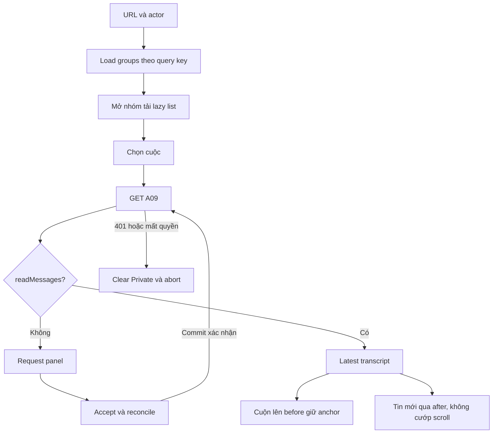
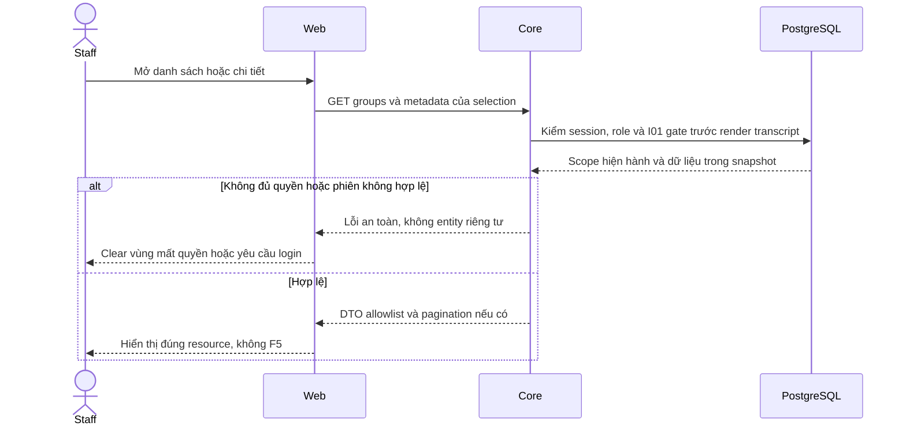

# I04 — Giao diện Inbox Staff, accordion và chat cuộn

Ngày 03/11/2026 · **Đã triển khai/kiểm chứng 04/11/2026** · [Chung](../03-inbox-contract.md) · Trước: [I02](02-inbox-read-api.md), [I03](03-handoff-transcript.md) · Tiếp: [I05](05-messaging-customer.md).

## Data model và phạm vi ảnh hưởng

Bảng bên dưới mô tả tác động của phase, gồm cả ghi gián tiếp qua Core. Tên bảng thuộc schema `business` trừ nơi ghi rõ; cột còn đề xuất được đánh dấu **P**. Web không truy cập DB trực tiếp.

| Bảng/model | Cột hoặc dữ liệu liên quan | Thao tác của phase | Quan hệ/ràng buộc cần giữ | Mức ảnh hưởng và nơi bị tác động |
| --- | --- | --- | --- | --- |
| users + auth_sessions | users.id/role/status, auth_sessions.user_id/token_hash/expires_at/revoked_at | Đọc | AuthSession.user_id → User.id; session phải còn hạn, không bị thu hồi | Cao — mọi API dùng session; không trả token/hash trong DTO |
| staff_assignments + customer_profiles + staff_profiles | staff_id/customer_id/is_active/ended_at, assignment_version, user_id/full_name | Đọc | Assignment gắn đúng Customer/Staff; Inbox còn ràng buộc assignment id cụ thể | Cao — Customers, Policy Lookup, Ticket và Inbox cùng phụ thuộc phân công |
| conversations + conversation_handoffs | customer_id/channel_type/support_origin/direct_assignment_id/assigned_staff_id/status/control_version/subject, state/assignment_id/recipient_staff_id/shared_subject/shared_reason/accepted_at/revoked_at | Đọc | Direct đúng assignment lúc tạo hoặc handoff ACCEPTED còn grant; PENDING chỉ shared metadata, không AI subject/transcript | Cao — Inbox filter/deep link/REST/WS phải cùng gate; không suy grant từ status/assigned_staff_id |
| messages | conversation_id/sequence/audience/sender_type/sender_id/content/citations/created_at | Đọc | Unique (conversation_id,sequence); chỉ CUSTOMER_VISIBLE sau transcript gate; sequence bigint ra DTO dạng string | Cao — không lộ INTERNAL/LEGACY_REVIEW/tool_calls_metadata cho Customer/Staff transcript |
| conversations + conversation_handoffs | conversations.status/assigned_staff_id/control_version/support_origin/created_by_customer_id/direct_assignment_id; handoffs.state/consent_scope/consent_text_version/confirmed_by_customer_id/confirmed_at/accepted_by_staff_id/accepted_at | Ghi gián tiếp qua Accept I03 | Composite FK conversation/customer và assignment/customer/recipient; partial unique một handoff PENDING/ACCEPTED; provenance/consent bất biến | Cao — quyền transcript chỉ sau Direct hợp lệ hoặc Accept, đổi assignment phải thu hồi grant |

**Schema/migration:** Không migration; frontend không tự đổi status/consent/grant.

**Nhất quán và hồi quy:** UI key theo actor/resource, giữ accordion/scroll và bỏ response cũ. Accept dùng command key/version I03, không tự mở transcript trước commit. Kiểm I04 keyboard/mobile và không F5.

## 1. Kết quả để review

Giao diện Staff dùng Core thật: All/Requests/Active, accordion theo khách, search tự động/Enter, Accept request, xem chat cuộn. Không dựng lại màn history bằng các bảng metadata. Composer chưa gửi trong I04; không nút Send/Templates/attachment giả. Tới I05 mới bật chức năng gửi.

Account/Customers/Policy/PDF và sidebar chung giữ hành vi đã kiểm thử. Nội dung Inbox thay tại slot của workspace, không viết lại toàn Staff shell.

## 2. File và tích hợp


File **cần tạo**: `apps/web/src/lib/conversation-api.ts`, `components/staff-inbox.tsx`, `staff-inbox-directory.tsx`, `conversation-transcript.tsx`, `handoff-request-panel.tsx`. Chỉ thêm hook hỗ trợ khi có lifecycle thực sự cần tách. API wrapper Inbox parse error code/requestId có allowlist, dùng coreApiUrl/credential/no-store hiện có, nhận AbortSignal; không tạo package/network stack mới.

Đọc guide Next trong node_modules theo AGENTS trước viết code, nhất là History API/useSearchParams/navigation. Tailwind4 prefix `tw:`; không stylesheet, inline style, CSS Modules hoặc @apply.

| Vị trí từ root repo | Hiện trạng | Trách nhiệm trong phase | Mức ảnh hưởng | Phạm vi cần kiểm lại |
| --- | --- | --- | --- | --- |
| [apps/web/src/components/staff-inbox.tsx](<../../../../../apps/web/src/components/staff-inbox.tsx>) | Hiện có | Selection/request/transcript workspace | Trung bình | Staff shell và tab policy lookup |
| [apps/web/src/components/staff-inbox-directory.tsx](<../../../../../apps/web/src/components/staff-inbox-directory.tsx>) | Hiện có | Accordion/search/filter/cursor | Trung bình | Deep link, expanded groups, focus |
| [apps/web/src/components/conversation-transcript.tsx](<../../../../../apps/web/src/components/conversation-transcript.tsx>) | Hiện có | Cuộn và dedup sequence | Trung bình | Staff và Customer dùng chung |
| [apps/web/src/lib/conversation-api.ts](<../../../../../apps/web/src/lib/conversation-api.ts>) | Hiện có | DTO, CSRF, command key, AbortSignal | Cao | Hai đầu chat và Accept |
| [apps/web/src/components/staff-reference-workspace.tsx](<../../../../../apps/web/src/components/staff-reference-workspace.tsx>) | Hiện có | Nhận filter mới/mount Inbox, bỏ logic khung legacy cho Inbox; không sửa data flow Customers/Policies | Trung bình | Kiểm caller và luồng hiện có mô tả trong hàng này |
| [apps/web/src/components/staff-reference-template.tsx](<../../../../../apps/web/src/components/staff-reference-template.tsx>) | Hiện có | Thay nhãn sidebar All/Requests/Active; bỏ New/chi tiết thừa ở nhánh Inbox | Trung bình | Kiểm caller và luồng hiện có mô tả trong hàng này |
| [apps/web/src/components/staff-portal.tsx](<../../../../../apps/web/src/components/staff-portal.tsx>) | Hiện có | Giữ key theo actor.id, không theo query/route | Trung bình | Kiểm caller và luồng hiện có mô tả trong hàng này |
| [apps/web/src/components/auth-screen.tsx](<../../../../../apps/web/src/components/auth-screen.tsx>) | Hiện có | Truyền session.csrfToken trong memory xuống action Accept; giữ refresh/focus/expiry đã tối ưu | Cao | Kiểm caller và luồng hiện có mô tả trong hàng này |
| [apps/web/src/app/staff/(workspace)/inbox/page.tsx](<../../../../../apps/web/src/app/staff/(workspace)/inbox/page.tsx>) | Hiện có | Hiện là route shell; giữ ownership render ở workspace, không mount thêm bản chat trùng | Trung bình | Kiểm caller và luồng hiện có mô tả trong hàng này |
| [apps/web/src/lib/auth-api.ts](<../../../../../apps/web/src/lib/auth-api.ts>) | Hiện có | coreRequest hiện chỉ ném AuthError(status); không đổi toàn bộ caller để parse lỗi Inbox | Cao | Kiểm caller và luồng hiện có mô tả trong hàng này |

## 3. Bố cục và hành vi

```text
Sidebar chung | Danh sách nhóm khách       | Cuộc đang chọn
All           | ô tìm tên hoặc mã         | header tên/mã + tiêu đề
Requests      | ▾ Customer A · CUS-...     | request metadata + Accept
Active        |   Chủ đề 1 · thời gian    | HOẶC transcript cuộn
              |   Chủ đề 2 · thời gian    | không panel details mặc định
              | ▸ Customer B · CUS-...     |
```

Desktop dự kiến từ 1024px: list 280–360px, chat min-width0 chiếm phần còn lại, mỗi vùng tự cuộn. Hệ thống layout có min-height0 để không đẩy composer/transcript xuống ngoài màn. Không lồng nhiều scrollbar toàn trang. Mobile: chỉ list hoặc chat, nút quay về **danh sách Inbox** giữ context; không thêm nút Customer profile/Back to Inbox thừa trên desktop.

Icon thu gọn list nằm trong header list, aria-label/tooltip và aria-expanded, không chữ “Hide results”. Thu gọn giữ chỗ mở lại và lựa chọn hiện tại. Panel metadata phụ đóng mặc định, không tự bật khi mở cuộc/Accept.

### 3.1. Accordion

Tên + mã Customer, không số cuộc/badge/tổng số. Có thể mở nhiều nhóm. Enter/Space trên button; aria-expanded/controls, list item dùng Link/aria-current. Mỗi nhóm lazy request một lần cho key actor/filter/customer, có retry/tải thêm riêng. Đóng nhóm không tự tải thêm hoặc xóa cuộc đang đọc.

Active row: subject, thời gian an toàn, nhãn Direct/Transferred nếu cần. Pending row: chỉ sharedSubject/request time/status Requests; không lastMessage/AI preview. Không mã CHT hoặc số thứ tự giả.

### 3.2. Search

Placeholder “Customer name or code”; input draft tách applied search. Debounce 300ms, Enter chạy ngay và hủy timer; event.isComposing/compositionstart/end để không submit IME sớm. Không Search/Clear buttons; xóa input là bỏ lọc sau debounce/Enter.

Trim/case/literal/100 ký tự theo I02, không thêm email/phone/policy/message search ở FE. Đổi search/filter abort group/list requests cũ, reset cursors, giữ focus, không remount workspace. Stale response không ghi đè key mới. Không prefetch mọi transcript khi render rows.

### 3.3. Request và Accept

Khi A09 readMessages=false: chỉ request metadata và Accept, không gọi A10. Accept dùng CSRF session memory, expectedVersion A09 và UUID key một lần cho action; disable khi pending. ACK thành công hoặc reconcile chứng minh commit mới gọi A10. Timeout giữ cùng key/payload và hiển thị trạng thái “Đang kiểm tra kết quả”, không tự tạo key mới.

STALE_CONVERSATION revalidate A09, không auto-Accept lần nữa. Mất quyền clear ngay, 401 auth xử lý đúng Staff login. Không tạo Ticket từ Accept.

### 3.4. Transcript

Initial latest batch50 tin, render tăng dần, cuộn cuối sau mount nội dung. Customer trái; AI/Staff phải nhưng có nhãn tác giả, không gộp AI thành Staff. SYSTEM Customer-facing hiển thị nhẹ. Render text có xuống dòng, không dangerouslySetInnerHTML. Citations chỉ link quyền riêng khi có contract.

Cuộn gần đầu tải before, tối đa một request cùng direction/key. Trước prepend lưu first visible message id + offset hoặc scrollHeight delta; sau DOM cập nhật khôi phục anchor. Không dùng inline style để bố trí. Không jump cuối khi tải lịch sử/realtime refresh.

Merge dedup theo id/sequence, sort bằng BigInt hoặc comparator thập phân an toàn, không Number(sequence). Đang ở cuối mới auto-scroll tin mới; đang đọc trên giữ vị trí và nút xuống tin mới **không badge đếm**. Chuyển cuộc abort read cũ; lỗi batch cũ giữ history đang có và retry tại đầu.

## 4. API sử dụng và state

Không thêm Core API I04; consume A08 groups/lazy, A09 metadata, A11 Accept + command lookup, A10 before/after từ I02/I03. Không A07/read marker/Copilot/Ticket endpoints.

| State | Render / network |
| --- | --- |
| Chưa chọn | Directory + lời nhắc ngắn, không request transcript |
| Loading groups | Skeleton vùng list, input/sidebar còn dùng |
| Không có cuộc | Empty state theo filter, không “0 conversations” |
| Pending selected | Request panel, không A10/composer |
| Active selected | A09 rồi A10 sau readMessages gate |
| Network read fail | Retry vùng list/chat, không F5 |
| Quyền bị thu hồi | Abort, clear transcript/selection cache liên quan, metadata recheck |
| Lỗi background chưa xác minh quyền | Không để nội dung Private tiếp tục tương tác; theo fail-closed auth hiện có |

Keys: actorId + conversationId cho transcript; actorId/filter/appliedSearch/customerId cho directory. Revisions để retry không làm logical key đổi hoặc remount input. Cache/scroll/expanded groups trong memory, xóa khi logout/actor/scope đổi; không localStorage transcript/CSRF.

## 5. URL và điều hướng

`/staff/inbox?filter=requests&search=...`; All bỏ filter hoặc all. Deep link `/staff/inbox/:conversationId` giữ query; customerId tùy chọn thu hẹp list. Không cursor, transcript, signed URL trên URL.

Legacy request→requests, recent→active, all→all; new/AI-active/Closed hoặc unknown normalize về All bằng replace, recheck Core. Không tạo enum mới từ nhãn URL.

Query cùng màn dùng History API tích hợp useSearchParams sau khi đọc guide; chọn cuộc dùng Next Link/router. Back/Forward khôi phục applied search/filter/expanded group/selection/scroll trong memory đúng actor, không document navigation. Cuộc còn quyền nhưng ngoài kết quả được giữ với notice nhỏ; quyền mất phải clear, không giữ vì deep link.

Deep link A09 cấp quyền trước, mở đúng group theo customer từ safe response, không suy từ URL rồi tải history. Không đổi customer/profile breadcrumb của màn Customers/Policy.

## 6. Sơ đồ lifecycle



## 7. Các bước triển khai

1. API wrapper/errors/AbortSignal, route/query normalization và tests state.
2. Thay nhãn sidebar/mount Inbox slot; regression các màn còn lại.
3. Search/accordion/cursor/local retry/deep links.
4. Request Accept/reconcile; chứng minh không có A10 trước commit.
5. Transcript/order/scroll/anchor/mobile/keyboard; không bật gửi.
6. Review DOM/accessibility/network và E2E đọc/Accept với Docker Core thật; cập nhật checklist đúng phạm vi.

## 8. Test cases

Các ca dưới đây là **đặc tả kiểm thử**, không phải báo cáo kết quả. Kiểm từng lớp API/service/DB/browser đúng nhãn; mock UI không thay kiểm quyền Core hoặc E2E thật.

**Quy ước dữ liệu:** S-A/S-B là hai Staff synthetic; C-A/C-B là hai Customer synthetic khác nhau. Thay alias bằng UUID/token của fixture cô lập; các path HTTP dùng prefix /api/v1 nếu chưa ghi đầy đủ. Chỉ thay assignment, khóa account, inject lỗi hoặc migration trong harness/môi trường test, không trên tài khoản/dữ liệu đang sử dụng.

### I04-T01 — Accordion, Enter/IME và Back

**Lớp kiểm thử:** Browser.
**Điều kiện và dữ liệu:** S-A có hai khách, mỗi khách có nhiều cuộc đủ quyền.

**Các bước:**

1. Tìm tên/mã; nhập bằng IME và Enter khi composition chưa kết thúc.
2. Mở đồng thời hai accordion, chọn một cuộc.
3. Back/Forward và đổi All/Requests/Active.

**Kết quả mong đợi:** Không search/send sớm khi IME; nhóm mở độc lập, context/URL đúng, không badge counts hoặc F5.

### I04-T02 — Pending không render transcript

**Lớp kiểm thử:** Browser + API mock.
**Điều kiện và dữ liệu:** A09 pending trả readMessages=false/accept=true/send=false.

**Các bước:**

1. Mở request.
2. Kiểm request Network và các vùng chat.
3. Accept thành công rồi trả metadata/transcript đủ quyền.

**Kết quả mong đợi:** Trước Accept không gọi/hiện transcript hoặc composer Staff; sau ACK mới hiện lịch sử đúng cuộc.

### I04-T03 — Accept unknown giữ intent

**Lớp kiểm thử:** Browser + API barrier.
**Điều kiện và dữ liệu:** Giữ ACK Accept sau commit; ghi key/payload request đầu.

**Các bước:**

1. Bấm Accept hai lần nhanh.
2. Mô phỏng timeout rồi reconcile/retry.
3. Trả conflict cho biến thể riêng.

**Kết quả mong đợi:** Không tạo key mới hoặc accept lần2 trong pending; unknown dùng intent cũ; conflict revalidate, không tự nhận bằng version mới.

### I04-T04 — Scope revoke và response cũ

**Lớp kiểm thử:** Browser + API mock.
**Điều kiện và dữ liệu:** Cuộc A đang mở và có request transcript chậm; cuộc B đủ quyền.

**Các bước:**

1. Chọn B rồi trả responseA muộn.
2. Phát scope revoke cho B và trả 404.
3. Dùng Tab/mobile 375px để mở cuộc còn quyền.

**Kết quả mong đợi:** Không lẫn transcript/Customer; revoke clear cache/composer; UI thao tác được, không giữ Private stale.

**Suite tham khảo:** [staff-inbox.spec.mjs](../../../../../apps/web/tests/browser/staff-inbox.spec.mjs). Tên suite là vị trí tự động hóa, không phải chứng nhận các ca đã chạy.

**Dọn sau kiểm thử:** xóa đúng fixture/session/object/schema theo runId; phục hồi fault injection và đóng context/socket test. Không reset DB/credential, sửa bootstrap hoặc xóa volumes. Với PDF kiểm metadata/bytes/hash; với UI kiểm DOM/focus/network, không cần screenshot.

## 9. Điều kiện hoàn tất

- [x] UX đúng All/Requests/Active, không counts/Search/Clear/metadata thừa.
- [x] DOM/keyboard/mobile/scroll/no-F5 tests pass; HTTP và E2E thật báo riêng.
- [x] Accept đúng gate, transcript có history trước handoff, không gọi A10 lúc pending.
- [x] Composer gửi chưa bật; tại mốc I04 I05 chưa hoàn tất, không nhận cả phần AI vào milestone này.


## 10. Ghi chú triển khai

- Code: `lib/conversation-api.ts`, `staff-inbox.tsx`, `staff-inbox-directory.tsx`, `conversation-transcript.tsx`; mount tại slot `StaffReferenceWorkspace`. CSRF từ session trong bộ nhớ, không gọi auth/me riêng trước Accept.
- All/Requests/Active, normalize legacy, debounce 300ms/Enter/IME; không counts/Search/Clear/New. Nhiều nhóm mở độc lập; tải thêm bằng cursor, retry theo vùng. Query dùng History API, lựa chọn dùng Next Link; Back/Forward không reload document.
- Pending chỉ metadata; Accept giữ UUID/payload gốc khi chưa biết kết quả, reconcile rồi replay cùng command nếu chưa tìm thấy receipt. Conflict chỉ revalidate, không auto-Accept. Mất quyền xóa transcript/cache; 401 về Staff login.
- Transcript latest/before/after, thứ tự BigInt, dedup, giữ anchor khi prepend và nút Jump to latest khi đang đọc trên. Bộ nhớ chỉ trong phiên UI theo actor; không lưu transcript/CSRF vào browser storage. Citation chỉ hiển thị label/page đã được Core cấp, chưa tạo link PDF không có policy context.
- 15 ca Inbox browser mock kiểm UI/network/keyboard/IME/no-F5/scroll/mobile/error/reconcile; 1 browser E2E gateway thật tạo Customer consent/request, Staff Accept, đọc 125 tin Customer-facing trước handoff, chặn internal/AI riêng/Staff khác. 78 ca Account/Session/Customers/Policy/PDF hồi quy. Không đồng nhất HTTP test với browser E2E.
- Fixture thật dùng `apps/core/test/support/browser-inbox-fixture.cjs` trong core-tests, session ngắn hạn qua pipe riêng và tự dọn theo runId; không thay bootstrap hoặc dữ liệu người dùng. Không có screenshot/report Markdown/credential file mới.
- Tại mốc I04 chưa gửi tin nhắn/UI Customer/realtime; I05/I06 hiện đã bổ sung gửi hai đầu, SYSTEM, outbox/realtime/catch-up và handoff notification. Refresh Inbox/chat đã được loại; các kết quả I04 bên trên là mốc lịch sử, không mô tả thiếu realtime ở hiện tại.

## Sequence diagram

Luồng chính và nhánh quyền/lỗi; test case ở trên chỉ rõ dữ liệu và điểm kiểm tương ứng.


