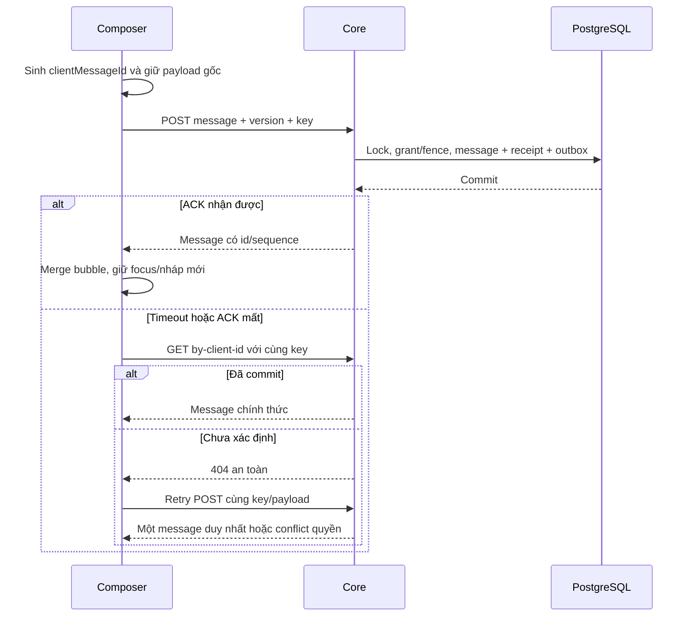

# I05 — Gửi tin chống trùng và giao diện Customer hai đầu

Ngày 03/11/2026 · **Đã triển khai 04/11/2026 — REST hai chiều; realtime/Agent riêng** · [Chung](../03-inbox-contract.md) · Trước: [I03](03-handoff-transcript.md), [I04](04-staff-inbox-ui.md) · Tiếp: [I06](06-realtime-routing.md).

## 1. Kết quả

Customer tạo AI/Direct/yêu cầu Staff từ UI; Staff Accept và hai bên gửi/đọc cùng cuộc qua Core thật. Tin nhắn chống trùng, có trạng thái đang gửi/chưa rõ kết quả/lỗi rõ ràng. Chưa có realtime chat tự cập nhật cho đến I06: dùng thao tác tải lại **vùng hội thoại**, không F5. Không coi đây là Agent trả lời thật hoặc delivery/read receipt.

Không attachments/templates/typing/edit/delete/read markers. Customer chat AI có thể lưu tin nhưng không hứa có câu trả lời khi Agent runtime chưa cấu hình; UI nói rõ tình trạng, không bịa tin AI hoặc bật endpoint impersonation để demo.

## 2. File triển khai

Core: thêm methods/controllers tại ConversationsModule, `dto/send-message.dto.ts`, dùng `conversation-message.service.ts`/command/access I01. Mở rộng `services/conversation-rate-limit.service.ts` đã cần từ I02/I03 bằng quota send/reconcile, dùng RateLimitBucket hiện có; không mở private method AuthService.limit hoặc refactor auth rộng chỉ cho chat.

Web đã tạo `components/conversation-composer.tsx`, `customer-conversations.tsx`, `customer-handoff-dialog.tsx`, mở rộng `lib/conversation-api.ts` và transcript I04. Tích hợp nhánh chat trong `components/customer-workspace.tsx`, không thay toàn Customer shell hoặc giả mở quyền Staff. `auth-screen.tsx` truyền CSRF/session theo props/context nhỏ trong memory; Staff composer nối component I04.

Customer entry ở `/customer` hiện có; đề xuất query `conversationId=<uuid>` để chọn cuộc, không cần thêm ứng dụng hoặc route tree lớn. Chỉ lưu id/query công khai cần navigation, không body/CSRF/cursor vào URL.

## 3. API gửi tin — đã triển khai

### 3.1. A12 Staff

`POST /api/v1/staff/conversations/:conversationId/messages`

### 3.2. Customer

`POST /api/v1/customers/me/conversations/:conversationId/messages`

Cả hai dùng body:

```json
{
  "clientMessageId": "60000000-0000-4000-8000-000000000001",
  "expectedVersion": 4,
  "content": "Tôi muốn hỏi thêm về kỳ đóng phí."
}
```

clientMessageId UUID sinh một lần cho ý định gửi, là receipt key SEND_MESSAGE. expectedVersion integer từ metadata, không sequence của message cuối. content text tối đa **4000 Unicode code points** sau chuẩn hóa CRLF→LF, từ chối toàn whitespace nhưng giữ nội dung còn lại; FE/server cùng phép đo. Không sender/customer/staffId/audience/citations/toolCallsMetadata trong body.

Response201 lần đầu /200 replay:

```json
{
  "message": {
    "id": "50000000-0000-4000-8000-000000000002", "sequence": "129",
    "clientMessageId": "60000000-0000-4000-8000-000000000001",
    "senderType": "STAFF", "sender": {"displayName": "Synthetic Staff A"},
    "content": "Tôi muốn hỏi thêm về kỳ đóng phí.",
    "createdAt": "2026-11-03T08:30:00.000Z", "citations": []
  },
  "controlVersion": 4, "replayed": false
}
```

Ví dụ content synthetic dùng chung shape, sender thực do endpoint/actor quyết định. ACK không có delivered/read. clientMessageId chỉ thêm ở ACK/reconcile của chính tác giả, không phải field bắt buộc mọi message history. Không tăng controlVersion do append nên hai người gửi với controlVersion hiện hành vẫn hợp lệ; sequence cấp riêng dưới lock.

### 3.3. Reconcile message

Staff A12: `GET /api/v1/staff/conversations/:conversationId/messages/by-client-id/:clientMessageId`.

Customer: `GET /api/v1/customers/me/conversations/:conversationId/messages/by-client-id/:clientMessageId`.

200 `{message:<own message projection>,controlVersion}`. Chỉ tin của chính actor có key đó; không tra key của người khác dù cùng cuộc. Recheck ownership/grant hiện tại. 404 có thể chưa commit/chưa có/không đủ quyền, **không đủ kết luận thất bại**; retry cùng POST/key/payload, không key mới. Key đúng nhưng nội dung/version gốc bị sửa khi replay →409 IDEMPOTENCY_CONFLICT.

Errors theo contract chung: 400 size/blank/body, 401/403 auth/CSRF, 404 no gate, 409 stale/routing/idempotency, 429 quota, 503 dependency. Client timeout cũng là unknown outcome, không mặc định server rollback.

## 4. Quyền và transaction

| Sender | Có thể gửi khi |
| --- | --- |
| Customer → AI | Own CUSTOMER_SUPPORT origin AI, AI_ACTIVE, không legacy chưa review; lưu tin, Agent integration riêng |
| Customer chờ Staff | Own cuộc có pending request hợp lệ; tin mới Customer-facing, Staff chưa đọc trước Accept |
| Customer → Staff | Own Direct/grant hoặc transferred STAFF_ACTIVE còn routing hợp lệ |
| Staff | TRANSCRIPT grant hiện hành + STAFF_ACTIVE + controller đúng + active assignment |
| Staff pending/AI_PRIVATE/Copilot/legacy | Không gửi, không tự mở quyền |
| AI writer | Chỉ trusted Core interface, origin AI + AI_ACTIVE + expectedControlVersion đúng; không pending/Staff active |

Customer trên Direct bị revoke không gửi tiếp cho Staff cũ; UI cho mở Direct mới hoặc request chuyển lịch sử cũ theo I03. Không đổi origin/status tự động để bật AI. Reassignment/khóa và session kiểm ở từng mutation.

Transaction: auth/CSRF → locks I01 → current scope/control check → receipt lookup → replay hoặc validate expectedVersion → cấp sequence → insert message/audience/sender server → cập nhật lastCustomerFacingActivityAt/counter → audit tối thiểu + outbox MESSAGE_COMMITTED + receipt → commit → ACK. Rate limit bounded trước phần nặng; lỗi không giữ transaction/lock qua gọi Agent hoặc network WS.

Audit chỉ message id/conversation id/operation, không content. Outbox không body để worker giao sau. Event/message ACK mất không tạo duplicate; message/sequence/outbox fail giữa chừng rollback cùng nhau. Unique constraint là hàng rào cuối, xử lý conflict bằng đọc receipt sau transaction retry có giới hạn.

### 4.1. Quota local đề xuất

RateLimitBucket DB theo actor+operation, không theo IP gateway chung. Bản đầu send60/phút, create10/phút, handoff request5/phút, Accept 30/phút, command/message lookup 120/phút, read240/phút. Quota dùng cho cả phase I03/I05 khi endpoint tương ứng triển khai, Retry-After rõ. Đây là cấu hình local đề xuất cần kiểm load, không SLO production. Replays vẫn chịu request-abuse limit nhưng không tính như message mới.

## 5. UI Staff/Customer

### 5.1. Composer

Enter gửi, Shift+Enter xuống dòng; IME không gửi khi composing. Button có accessible name; chống double submit/keypress bằng pending intent/key. Blank/oversize báo tại composer, focus không mất sau ACK. Không remount toàn chat theo revision/từ khóa.

Nháp tách actorId/conversationId trong memory. Đổi cuộc không trộn nháp/unknown intent; logout/mất scope xóa nháp liên quan. Không localStorage/sessionStorage content/CSRF. Sau ACK chỉ xóa nội dung đúng snapshot đã gửi; nếu user đã gõ nội dung mới không xóa nó.

Tin optimistic có temporary key/clientMessageId, nhãn “Sending”/“Checking result”/“Failed”, không sequence giả. ACK hoặc reconcile thay đúng bubble, merge/dedup cùng REST after/WS. Chưa rõ kết quả không cho sửa/reuse key với content mới; cho kiểm tra/retry cùng payload. Gửi nội dung chỉnh sửa là intent/key mới chỉ sau khi đã giải quyết intent cũ hoặc người dùng hiểu có thể là tin mới.

Không hiện “delivered/read” từ HTTP201. Lỗi quyền clear transcript/intent Private; lỗi mạng giữ nháp an toàn trong memory, không điều hướng/F5.

### 5.2. Customer entry/handoff

Danh sách nhiều cuộc tương tự ChatGPT: tiêu đề/thời gian, cuộc mới AI hoặc nhắn Staff. Gọi availability trước Direct/request; server vẫn recheck version khi POST. AI không khả dụng phải nói rõ, không tạo cảm giác Agent đang chạy.

Nút nhờ Staff mở dialog: hiển thị Staff hiện hành, sharedSubject/reason do Customer nhập/xác nhận và **toàn bộ lịch sử cuộc này sẽ được chia sẻ sau Staff tiếp nhận**. Nút xác nhận hành động rõ, không checkbox checked sẵn thay sự đồng ý. Escape/hủy không mutation. Focus trap/restore khi đóng, action pending không double click.

Customer tự chủ động nhờ Staff hoặc Agent gợi ý đều về cùng dialog/Core confirmation. Agent không tự POST consent, thông điệp AI “đã gửi” không là bằng chứng thành công. Nếu routing đổi, giữ draft và cho Customer xác nhận lại Staff mới.

Pending hiển thị đang chờ hỗ trợ; Customer tiếp tục gửi trong cùng cuộc, AI dừng theo đề xuất I03. Staff chưa Accept không transcript. Accept xong Customer thấy người hỗ trợ và tiếp tục cùng conversationId; không tạo chat mới khiến mất ngữ cảnh.

## 6. Luồng gửi và timeout



## 7. Các bước triển khai

1. Chốt text normalization/limits/quota/unknown-outcome policy.
2. Core send/receipt/sequence/fence/reconcile; race và rollback tests trước UI.
3. Staff composer và lỗi/optimistic merge, không phụ thuộc WS.
4. Customer list/detail/create/Direct/handoff dialog/transcript/composer qua API I03.
5. E2E hai browser contexts qua gateway, dùng refresh vùng để nhận tin ở đầu kia trước I06.
6. Cập nhật docs theo mốc: I05 cung cấp REST hai chiều; I06 hiện đã có realtime. Agent còn chưa triển khai; không để nút lỗi ngầm hoặc ghi realtime vẫn thiếu ở hiện tại.

## 8. Test cases

Các ca dưới đây là **đặc tả kiểm thử**, không phải báo cáo kết quả. Kiểm từng lớp API/service/DB/browser đúng nhãn; mock UI không thay kiểm quyền Core hoặc E2E thật.

**Quy ước dữ liệu:** S-A/S-B là hai Staff synthetic; C-A/C-B là hai Customer synthetic khác nhau. Thay alias bằng UUID/token của fixture cô lập; các path HTTP dùng prefix /api/v1 nếu chưa ghi đầy đủ. Chỉ thay assignment, khóa account, inject lỗi hoặc migration trong harness/môi trường test, không trên tài khoản/dữ liệu đang sử dụng.

### I05-T01 — Direct gửi hai chiều

**Lớp kiểm thử:** Browser E2E + DB.
**Điều kiện và dữ liệu:** C-A/S-A có Direct hợp lệ, hai context đăng nhập riêng.

**Các bước:**

1. Customer gửi một câu synthetic.
2. Staff trả lời bằng Send hoặc Enter.
3. Kiểm bubbles/sequence qua API hai phía.

**Kết quả mong đợi:** Một tin mỗi intent, đúng sender/content/order; ACK không giả delivered/read; không F5.

### I05-T02 — Cùng key retry và key bị đổi payload

**Lớp kiểm thử:** API + DB.
**Điều kiện và dữ liệu:** Client key K, expectedVersion hiện hành, content synthetic cố định.

**Các bước:**

1. POST cùng K/payload đồng thời hai lần.
2. Replay K với content hoặc expectedVersion khác.
3. POST key mới cùng text.

**Kết quả mong đợi:** K chỉ một message; replay khác payload 409; key mới tạo intent khác, không gộp chỉ vì text giống nhau.

### I05-T03 — ACK mất sau commit và lookup 404 tạm thời

**Lớp kiểm thử:** Browser + API barrier.
**Điều kiện và dữ liệu:** Harness giữ request đầu, cho lookup theo clientId trả 404 trước khi commit xong.

**Các bước:**

1. Gửi tin và ngắt ACK.
2. Bấm kiểm kết quả rồi retry theo UI.
3. Cho commit/lookup trả message đã lưu.

**Kết quả mong đợi:** 404 tạm không bị coi là thất bại chắc chắn; retry cùng key/payload, một bubble, không tự sinh UUID mới.

### I05-T04 — Boundary content và bàn phím

**Lớp kiểm thử:** API + Browser.
**Điều kiện và dữ liệu:** Các chuỗi synthetic blank,4000/4001 Unicode code points, CRLF và HTML literal.

**Các bước:**

1. Gửi từng biến thể qua API.
2. Trong composer dùng Shift+Enter và Enter.
3. Gõ IME đang composition rồi kết thúc và Send.

**Kết quả mong đợi:** Blank/4001 bị 400;4000 hợp lệ, CRLF nhất quán; HTML không thực thi; IME không gửi nhầm, Shift+Enter xuống dòng.

### I05-T05 — Quyền pending/revoke và rollback

**Lớp kiểm thử:** API + DB barrier.
**Điều kiện và dữ liệu:** C-A pending, sau đó accepted; có fixture outbox failure.

**Các bước:**

1. Customer gửi thêm lúc pending, S-A cố gửi.
2. Sau Accept inject lỗi giữa insert/outbox.
3. Revoke rồi replay tin cũ bằng S-A.

**Kết quả mong đợi:** Customer gửi đúng owner; Staff pending/revoked bị deny; rollback không message/counter/receipt/outbox nửa chừng.

**Suite tham khảo:** [conversation-send.test.cjs](../../../../../apps/core/test/conversation-send.test.cjs), [conversation-send.spec.mjs](../../../../../apps/web/tests/browser/conversation-send.spec.mjs). Tên suite là vị trí tự động hóa, không phải chứng nhận các ca đã chạy.

**Dọn sau kiểm thử:** xóa đúng fixture/session/object/schema theo runId; phục hồi fault injection và đóng context/socket test. Không reset DB/credential, sửa bootstrap hoặc xóa volumes. Với PDF kiểm metadata/bytes/hash; với UI kiểm DOM/focus/network, không cần screenshot.

## 9. Điều kiện hoàn tất

- [x] Core/DB race/idempotency/fence/HTTP tests và browser tương tác pass riêng.
- [x] E2E hai actor thật qua Docker; no F5 chứng minh bằng DOM/network.
- [x] Timeout không duplicate, nháp/focus đúng; không client actor/grant giả.
- [x] Customer consent rõ và request/Ticket tách biệt.
- [x] Milestone ghi REST hai chiều; I06 realtime và Agent runtime còn riêng.


## 10. Ghi chú triển khai

Core thêm `dto/send-message.dto.ts`, `services/conversation-sending.service.ts`, mở rộng hai controller, quota SEND60/phút và Swagger ACK/lookup DTO. Dùng lại transaction/locks/receipt/sequence/outbox I01; không migration/schema/dependency mới. ACK được chiếu lại dưới session/grant hiện hành sau commit; nếu quyền vừa mất trả lỗi an toàn, client xử lý unknown/reconcile, không hoàn tác tin đã commit.

Web thêm composer dùng chung, Customer conversations và handoff dialog; transcript I04 nhận ACK để merge/dedup mà không remount. Customer tại `/customer?conversationId=...`, Staff tại route hiện hành. Mỗi snapshot gửi có UUID/content/version riêng; lưu nháp/intent chỉ trong memory theo actor/cuộc, xóa khi mất quyền. Enter/Shift+Enter/IME, pending lock, giữ draft mới sau ACK, unknown cùng key, 409 revalidate và 429 chờ/retry đúng ý định. Không endpoint giả danh AI, no F5, không delivered/read giả.

Dialog dùng modal native và vòng Tab/Shift+Tab; Escape/Cancel không ghi. Pending/unknown không cho đổi nội dung/key hoặc hủy kết quả chưa xác định. Routing conflict tải availability mới và yêu cầu Customer xác nhận lại; không tự chuyển người nhận. Direct bị revoke ngừng gửi; Customer vẫn đọc lịch sử và có thể tạo Direct mới. Có thể yêu cầu chia sẻ lại lịch sử Direct cũ sau reassignment khi Core trả action requestStaff; phải Customer xác nhận và Staff mới Accept, không tự cấp grant.

Kiểm tra Core: `docker compose --profile tests run --rm --no-deps core-tests node --test test/conversation-send.test.cjs test/conversation-workflow.test.cjs test/inbox-read.test.cjs test/conversation-permissions.test.cjs test/http-foundation.test.cjs` — 72 ca, gồm 9 ca send mới và các race/fence/rollback I01/I03.

Browser: `conversation-send.spec.mjs` (8), `customer-conversations.spec.mjs` (5), `conversation-flow.integration.spec.mjs` (1 gateway thật hai browser contexts), cùng I04 (16) và hồi quy Account/Session/Customers/Policy (78). Bộ đầy đủ 108 ca. Fixture thật tự tạo/dọn qua core-tests, không bootstrap seed, không ghi credential/transcript ra host hoặc tạo report Markdown. Kết quả browser/HTTP phân biệt rõ; không chụp ảnh.
