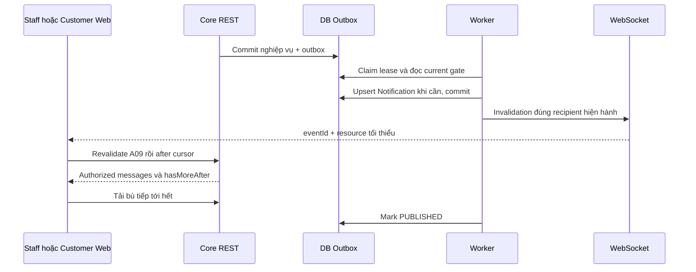

# I06 — Realtime, outbox, thông báo handoff và thu hồi quyền

Ngày 03/11/2026 · **Đã triển khai/kiểm chứng 04/11/2026 — local một Core process** · [Chung](../03-inbox-contract.md) · Trước: [I01](01-model-permissions.md)–[I05](05-messaging-customer.md) · Tiếp: [I07](../tickets/06-agent-confirmation.md).

## Bổ sung bảo vệ dữ liệu Customer — 12/11/2026

**P — chưa triển khai phần bảo vệ bổ sung; giữ trạng thái baseline của phase.** Theo [ma trận dữ liệu chung](../../../../configuration-and-data.md#customer-sensitive-data); email/phone Customer được che mặc định theo định dạng A ngày 13/11, Staff có Hiện/Ẩn để liên hệ theo cập nhật 14/11. Core kiểm lại quyền khi reveal, phần triển khai và các quyết định còn mở theo ma trận chung. Vị trí code/API và data model của phase bên dưới là nơi rà tác động; bổ sung này không tự yêu cầu migration hoặc sửa dữ liệu gốc.

**Thay đổi của phase:** Producer/outbox/notification/WS chỉ metadata tối thiểu, không profile/transcript/PII dư. Fingerprint nội bộ không thành snapshot payload; REST refetch vẫn chịu projection/quyền.

**Kiểm thử cần bổ sung, chưa chạy:** Core/WS/network: canary không trong frame/log; reconnect/catch-up đúng recipient, revoke dọn state và không phát preview cũ.

**Chat mới sau Staff — quyết định 14/11/2026.** Cuộc cũ theo trạng thái và allowedActions hiện hành. Customer chọn New AI chat để mở cuộc mới có thread/context riêng. UI/send/realtime và source Copilot kiểm đúng conversation/grant, callback hoặc event cuộc cũ không gắn sang cuộc mới. New AI chat/create đã có, kiểm tích hợp Agent/Core còn P. [Quyết định chuẩn](../../../../specifications/Agent_Design.md#new-ai-chat-after-staff).

## Data model và phạm vi ảnh hưởng

Bảng bên dưới mô tả tác động của phase, gồm cả ghi gián tiếp qua Core. Tên bảng thuộc schema `business` trừ nơi ghi rõ; cột còn đề xuất được đánh dấu **P**. Web không truy cập DB trực tiếp.

| Bảng/model | Cột hoặc dữ liệu liên quan | Thao tác của phase | Quan hệ/ràng buộc cần giữ | Mức ảnh hưởng và nơi bị tác động |
| --- | --- | --- | --- | --- |
| users + auth_sessions | users.id/role/status, auth_sessions.user_id/token_hash/expires_at/revoked_at | Đọc | AuthSession.user_id → User.id; session phải còn hạn, không bị thu hồi | Cao — mọi API dùng session; không trả token/hash trong DTO |
| staff_assignments + customer_profiles + staff_profiles | staff_id/customer_id/is_active/ended_at, assignment_version, user_id/full_name | Đọc | Assignment gắn đúng Customer/Staff; Inbox còn ràng buộc assignment id cụ thể | Cao — Customers, Policy Lookup, Ticket và Inbox cùng phụ thuộc phân công |
| conversations + conversation_handoffs | customer_id/channel_type/support_origin/direct_assignment_id/assigned_staff_id/status/control_version/subject, state/assignment_id/recipient_staff_id/shared_subject/shared_reason/accepted_at/revoked_at | Đọc | Direct đúng assignment lúc tạo hoặc handoff ACCEPTED còn grant; PENDING chỉ shared metadata, không AI subject/transcript | Cao — Inbox filter/deep link/REST/WS phải cùng gate; không suy grant từ status/assigned_staff_id |
| messages | conversation_id/sequence/audience/sender_type/sender_id/content/citations/created_at | Đọc | Unique (conversation_id,sequence); chỉ CUSTOMER_VISIBLE sau transcript gate; sequence bigint ra DTO dạng string | Cao — không lộ INTERNAL/LEGACY_REVIEW/tool_calls_metadata cho Customer/Staff transcript |
| outbox_events | aggregate_type/aggregate_id/event_type/payload/status/retry_count/next_attempt_at/lease_owner/lease_expires_at/last_error | Thêm trong transaction nguồn; worker cập nhật trạng thái/lease | Index status/next_attempt_at/lease_expires_at; aggregate_id là reference kiểm bởi service, không FK đa loại | Cao — retry/reclaim/dedup, commit nghiệp vụ khác delivery; REST vẫn là nguồn dữ liệu |
| notifications | recipient_staff_id/conversation_id/kind/dedup_key/is_read/delivered_at | Consumer thêm handoff notification | HANDOFF_REQUESTED target conversation, unique dedup_key; recipient là Staff hiện hợp lệ | Cao — retry không trùng, revoke không gửi nhầm transcript |
| messages + conversations | messages.sequence/audience/client_message_id/internal_message_id/sender_type/sender_id/content; conversations.next_message_sequence/last_customer_facing_activity_at | Append ghi, không sửa/xóa nội dung cũ | Unique sequence và key theo conversation/sender; counter cấp dưới conversation lock | Cao — Accept tạo SYSTEM duy nhất, send/retry không trùng; send thường không tăng control_version |

**Schema/migration:** I06 đã thêm lease_owner/lease_expires_at Outbox và kind Notification/check constraints. Không cần bảng socket/presence/unread mới. SYSTEM message do I03 append khi Accept, không do WS client.

**Nhất quán và hồi quy:** Nguồn commit trước dispatch; worker claim/lease và recheck recipient, upsert dedup rồi publish. WS chỉ invalidate, REST catch-up theo sequence; kiểm reconnect/reclaim/duplicate/revoke/phiên hết hạn.

## 1. Kết quả

Staff thấy request mới, Customer/Staff nhận cập nhật tin và trạng thái không F5; mất WS rồi nối lại vẫn tải bù đủ qua REST. Request được lưu bền vững và có thông báo handoff riêng, không cần Ticket. Quyền event giống REST, pending không bị lộ history/preview/sequence.

Chọn phương án **local một Core process**, PostgreSQL outbox và WebSocket invalidation hiện có; không thêm Redis/BullMQ/service cloud hoặc hứa exactly-once. Queue production/đa replica/Agent checkpoint cần quyết định riêng.

### 1.1. Bổ sung đã chốt 04/11 — tin hệ thống sau Accept

Trong cùng ô chat Customer–Staff, sau khi Staff Accept thành công phải có một tin hệ thống thông báo đã tiếp nhận và sẽ phản hồi sớm nhất. Yêu cầu này đã triển khai ở I06; tại mốc I05 chưa có. Không chỉ hiện toast hoặc đổi badge, không thay bằng thông báo ở danh sách Notification.

- Copy UI tiếng Anh: `Staff {displayName} has accepted your request and will respond as soon as possible.` Ý nghĩa tiếng Việt: “Nhân viên {tên} đã tiếp nhận yêu cầu và sẽ phản hồi cho bạn sớm nhất có thể.” Tên hiển thị lấy từ Core; không cam kết thời hạn hoặc trạng thái đã đọc/đã giao.
- Core ghi `Message` với `senderType=SYSTEM`, `senderId=null`, `audience=CUSTOMER_VISIBLE` trong chính conversationId đã được Customer đồng ý chia sẻ. Không ghi dưới danh nghĩa Staff hoặc AI_AGENT.
- Ghi **trong transaction Accept**, cùng acceptance/controller/controlVersion/receipt/audit/outbox; cấp sequence dưới lock bằng quy trình append dùng chung. Có thứ tự rõ với các tin Customer đang gửi đồng thời. Nếu insert tin hệ thống hoặc outbox lỗi thì Accept rollback toàn bộ.
- Một lần chuyển trạng thái hợp lệ chỉ sinh một tin. Dedup gắn với handoffId và loại sự kiện; chốt cách ánh xạ vào unique key server-owned hiện có trước code. Retry/reconcile Accept, hai Staff đua nhận hoặc worker phát lại không tạo tin thứ hai. Một handoff mới sau revoke/consent mới có thể có tin tiếp nhận mới.
- Worker **không tạo tin này sau transaction**: chỉ chuyển invalidation từ sự kiện đã commit. Có thể phát `MESSAGE_COMMITTED` bên cạnh `HANDOFF_ACCEPTED`; Web batch/catch-up và dedup, không tự ghép thêm bubble từ badge/WS/ACK.
- A10/Customer history trả tin qua projection SYSTEM hiện có; không thêm endpoint browser tạo system message. Customer/Staff thấy tin sau Refresh ở giai đoạn chưa realtime; khi I06 hoàn tất tin tự xuất hiện qua REST catch-up. Reload/reconnect vẫn còn đúng một tin.
- Pending chưa Accept không có tin báo thành công; Staff không được đọc transcript sớm. Direct không cần Accept nên không tự chèn thông báo “đã chấp nhận yêu cầu”. Không tự tạo Ticket. Không backfill hàng loạt vào các lần Accept cũ nếu chưa có yêu cầu riêng.

Tách bước để review: **I06-A** mở rộng Accept + transcript + tests tin hệ thống trước; **I06-B** outbox/realtime/notification/catch-up bên dưới. Không cần đợi worker để lưu tin tiếp nhận bền vững.

## 2. Điểm xuất phát và file

`apps/core/src/realtime/realtime.service.ts` hiện chỉ account/profile/assignment fingerprint mỗi2 giây, frame ready/invalidate/session-expired, receive-only. `apps/web/src/lib/realtime.ts` dispatch core:data-changed, AuthScreen dùng refresh phiên. Không phải chat transport và không được phát một invalidate auth cho mỗi tin.

File dự kiến:


Không thêm WebSocket server song song hoặc để browser gửi mutation qua socket; gửi tin vẫn REST/CSRF.

| Vị trí từ root repo | Hiện trạng | Trách nhiệm trong phase | Mức ảnh hưởng | Phạm vi cần kiểm lại |
| --- | --- | --- | --- | --- |
| [apps/core/src/outbox/services/outbox-dispatcher.service.ts](<../../../../../apps/core/src/outbox/services/outbox-dispatcher.service.ts>) | Hiện có | Lease/claim/retry/dispatch | Cao | Chat và Ticket event consumer |
| [apps/core/src/conversations/services/conversation-event.service.ts](<../../../../../apps/core/src/conversations/services/conversation-event.service.ts>) | Hiện có | Event allowlist và current recipient | Cao | Handoff notification, invalidation hai role |
| [apps/core/src/realtime/realtime.service.ts](<../../../../../apps/core/src/realtime/realtime.service.ts>) | Hiện có | Session/grant gate trước frame | Cao | Mọi WebSocket subscriber |
| [apps/web/src/lib/chat-realtime.ts](<../../../../../apps/web/src/lib/chat-realtime.ts>) | Hiện có | Chat invalidation/reconnect | Trung bình | Staff/Customer transcript và directory |
| [apps/web/src/components/staff-notifications.tsx](<../../../../../apps/web/src/components/staff-notifications.tsx>) | Hiện có | Chuông/target/mark read | Trung bình | Inbox và Tickets dùng chung |

## 3. Outbox event contract

Ghi cùng transaction nghiệp vụ I03/I05. aggregateType CONVERSATION, aggregateId conversationId; payload allowlist `{schemaVersion:1,controlVersion,requestId?}`. eventType CONVERSATION_CREATED/HANDOFF_REQUESTED/HANDOFF_ACCEPTED/MESSAGE_COMMITTED/CONVERSATION_ACCESS_REVOKED. Không content/sharedReason/AI summary/rawtool/credential/signedURL trong outbox payload.

requestId ở payload là handoff id khi event cần, không dùng để thay auth. Event.id là dedup id; request HTTP correlation id nếu cần là field riêng trong audit, không nhầm handoff id. Worker đọc DB hiện hành để chọn actor/metadata.

MESSAGE_COMMITTED loại này chỉ phát từ writer CUSTOMER_SUPPORT với audience CUSTOMER_VISIBLE. INTERNAL/LEGACY_REVIEW/Copilot không phát event chat khách; không dùng một invalidation chứa id cuộc để gián tiếp lộ hoạt động nội bộ. Điều kiện này cần assertion tại producer, không chỉ filter ở Web.

### 3.1. Claim và lease

Đã thêm OutboxEvent `leaseOwner varchar(100)?`, `leaseExpiresAt timestamptz?`; index `(status,nextAttemptAt,leaseExpiresAt)`. Không thay OutboxStatus hiện có PENDING/PROCESSING/PUBLISHED/FAILED_DLQ.

1. Timer local khoảng500ms, batch20, một vòng xử lý/process; không tạo timer song song khi lần cũ còn chạy.
2. Transaction ngắn `FOR UPDATE SKIP LOCKED`: chọn PENDING đến hạn hoặc PROCESSING hết lease, đặt PROCESSING/leaseOwner/leaseExpiresAt=now+30s, tăng retryCount, commit.
3. Handler recheck aggregate/recipient, tạo Notification nếu cần bằng dedupKey và commit DB **trước** phát WS. Retry không tạo trùng row.
4. Gửi invalidation tối thiểu tới peers còn phiên/quyền; offline không là lỗi vì REST catch-up/Notification bền vững.
5. Mark PUBLISHED khi xử lý xong, chỉ nếu leaseOwner còn đúng. Crash giữa send/mark có thể gửi lại cùng eventId; client dedup. PUBLISHED là đã xử lý, không phải khách đã đọc/đã nhận.
6. Lỗi transient: trả PENDING với nextAttemptAt backoff1/2/4…60s + jitter; sau8 attempts →FAILED_DLQ. lastError chỉ mã allowlist, không raw exception/payload. Requeue là tool/operator action có kiểm quyền/audit riêng, không public endpoint tùy tiện.

Lease phải renew nếu handler gần hết30s; bản local handler ngắn không chờ network external. Restart reclaim lease hết hạn; shutdown ngừng claim, hoàn tất phần đang chạy có giới hạn rồi để lease recover. Không keep DB row lock trong vòng chờ WS/network.

Không dùng outbox payload recipient cũ làm quyền. Nhiều Core replicas cần broker/fanout peers giữa process trước production; thiết kế local không tự giải quyết việc đó.

## 4. Recipient và thu hồi

| Event | Ai có thể được invalidation/notification |
| --- | --- |
| CONVERSATION_CREATED | Customer owner; nếu Direct mới còn grant thì thêm Staff nhận. AI mới không báo assigned Staff |
| HANDOFF_REQUESTED | Customer owner, recipient Staff của pending consent còn hợp lệ; Staff chỉ safe request |
| HANDOFF_ACCEPTED | Customer owner, Staff accepted/grant còn hiệu lực |
| MESSAGE_COMMITTED trong AI riêng | Chỉ Customer owner, không assigned Staff |
| MESSAGE_COMMITTED khi pending | Chỉ Customer owner; Staff không sequence/activity từ tin riêng |
| MESSAGE_COMMITTED active Direct/transferred | Customer owner và Staff grant hiện hành |
| ACCESS_REVOKED/reassignment | Staff cũ nhận **scope invalidation không nội dung** để clear; Customer revalidate routing; Staff mới không transcript/event cuộc cũ nếu chưa consent mới |

Nếu request đã Accept trước worker xử lý HANDOFF_REQUESTED, không gửi notification pending lỗi thời; revalidate current state và chỉ invalidation được phép. Event cũ sau revoke không phát nội dung/sequence theo grant cũ. Link notification không chứng minh quyền.

Recheck session/resource ngay trước send, nhưng không thể thu hồi byte đã gửi trước revoke commit; không hứa atomic giữa PostgreSQL và socket. Payload tối thiểu, REST authoritative, client clear scope khi invalidation và session-expired; không gửi transcript trên WS để giảm rủi ro này.

## 5. WebSocket spec

Giữ `WS /api/v1/realtime` cookie + exact Origin, receive-only, frame client gửi đóng1008, session revoked4001, lỗi dịch vụ 1013, heartbeat/backoff/limits hiện có. Không tin X-Forwarded-For để nhận diện người dùng hoặc cho client chọn recipient.

Frame mới:

```json
{"type":"chat-invalidated","eventId":"70000000-0000-4000-8000-000000000001","conversationId":"20000000-0000-4000-8000-000000000001"}
```

```json
{"type":"chat-scope-invalidated","eventId":"70000000-0000-4000-8000-000000000002"}
```

```json
{"type":"notifications-invalidated","eventId":"70000000-0000-4000-8000-000000000003"}
```

Không sequence/count/subject/customerId/content trong frame. chat-invalidated có conversationId chỉ khi actor được metadata hoặc transcript lúc gửi; pending không nhận message events. Scope invalidation không cần resource id đã mất quyền.

Web dispatch event chuyên biệt `core:chat-changed`, `core:chat-scope-changed`, `core:notifications-changed`; không dispatch core:data-changed cho mỗi frame chat. AuthScreen vẫn chỉ xử lý auth ready/invalidate/session-expired như trước. assignment fingerprint hiện có có thể gây một auth invalidation hợp lệ, nhưng message không kéo `/auth/me` liên tục.

## 6. API REST Notification tối thiểu

A27 `GET /api/v1/staff/notifications?limit=20&cursor=...`: 1–50, keyset `(createdAt DESC,id DESC)`, no-store, actor Staff. Bản phase này trả notification handoff; khi I07 thêm Ticket cùng contract. Không cần unreadCount/total/badge Inbox; isRead phục vụ trạng thái riêng của notification.

```json
{
  "items": [{
    "id": "80000000-0000-4000-8000-000000000001", "kind": "HANDOFF_REQUESTED",
    "title": "Staff support requested", "isRead": false,
    "createdAt": "2026-11-03T08:00:00.000Z",
    "target": {"type":"CONVERSATION","id":"20000000-0000-4000-8000-000000000001"}
  }],
  "pageInfo": {"hasMore": false,"nextCursor": null}
}
```

Đã thêm Notification `kind varchar(50)?` allowlist HANDOFF_REQUESTED (I07 thêm các loại Ticket); row cũ null giữ nguyên, không suy loại từ body Private. Endpoint phase này chỉ chọn kind đã hỗ trợ, không tự xóa notification legacy. Notification row title generic/body null, không chép AI/private chat. dedupKey=`eventId:recipientStaffId:kind`, recipient do Core chọn. Nếu target không còn metadata quyền, loại khỏi list sau scope query **trước** pagination, không hiển thị link cũ kèm tên/subject. Không xóa audit/notification cũ để né revoke.

A28 `POST /api/v1/staff/notifications/:notificationId/read`, body `{}`, CSRF; 200 `{id,isRead:true}`. Idempotent, chỉ recipient + target scope còn hợp lệ; người khác/not found404. Đọc notification không Accept chat/mark messages read hoặc tạo Ticket. Click thông báo phải A09 revalidate trước render, pending vẫn chỉ request.

## 7. Catch-up và UI



Frame có thể trùng/mất/out-of-order. Client debounce/batch invalidation ngắn, single-flight mỗi key, dirty flag nếu có event khi đang fetch; fetch tiếp sau lần hiện tại, không bỏ event cuối. Reconnect/ready, tab visible sau offline và thao tác thủ công đều A09 recheck + REST after tới hết backlog; không chỉ tin WS.

Nếu chưa có afterCursor, fetch latest; nếu đang có history cũ giữ anchor. Dedup id/sequence cả optimistic ACK và REST. Đang đọc trên không auto-scroll; nút xuống tin mới không count. Scope invalidation abort/clear Private trước revalidate, không chờ network giữ transcript cũ tương tác được.

Hiển thị mất kết nối ngắn, retry/backoff không F5. Có thể gửi REST khi WS mất và phiên/quyền còn xác minh; UI không giả “đã giao”. Không polling transcript toàn bộ theo fingerprint2 giây.

## 8. Test cases

Các ca dưới đây là **đặc tả kiểm thử**, không phải báo cáo kết quả. Kiểm từng lớp API/service/DB/browser đúng nhãn; mock UI không thay kiểm quyền Core hoặc E2E thật.

**Quy ước dữ liệu:** S-A/S-B là hai Staff synthetic; C-A/C-B là hai Customer synthetic khác nhau. Thay alias bằng UUID/token của fixture cô lập; các path HTTP dùng prefix /api/v1 nếu chưa ghi đầy đủ. Chỉ thay assignment, khóa account, inject lỗi hoặc migration trong harness/môi trường test, không trên tài khoản/dữ liệu đang sử dụng.

### I06-T01 — Recipient và frame tối thiểu

**Lớp kiểm thử:** WS + API integration.
**Điều kiện và dữ liệu:** Ba sockets C-A/S-A/S-B; cuộc AI riêng, pending và accepted riêng biệt.

**Các bước:**

1. Commit message/event ở từng trạng thái.
2. Quan sát frame từng socket rồi REST recheck.
3. Gửi thử client mutation qua WS.

**Kết quả mong đợi:** Không phát dữ liệu transcript cho S-A chưa grant/S-B; frame không content/tool payload; WS receive-only từ chối mutation.

### I06-T02 — Worker crash, lease và dedup

**Lớp kiểm thử:** DB + Worker harness.
**Điều kiện và dữ liệu:** Outbox synthetic pending; hai worker test, lease clock/barrier điều khiển được.

**Các bước:**

1. Claim đồng thời bằng hai worker.
2. Inject crash sau notification commit, trước publish ACK.
3. Cho lease hết hạn và retry bằng worker mới.

**Kết quả mong đợi:** Không hai owner giữ lease hợp lệ; recover được, notification unique; event trùng không tạo bubble/thông báo trùng.

### I06-T03 — Mất mạng và catch-up nhiều trang

**Lớp kiểm thử:** Browser E2E.
**Điều kiện và dữ liệu:** Cuộc Staff-active, tab Customer offline; hơn100 tin được commit trong lúc offline.

**Các bước:**

1. Kết nối lại tab Customer.
2. Đợi REST after tải tới hasMoreAfter=false.
3. Đối chiếu tập message IDs và draft/focus.

**Kết quả mong đợi:** Không thiếu/trùng, drain hết backlog; draft/anchor đúng và không document reload.

### I06-T04 — Event tới trong lúc đang fetch

**Lớp kiểm thử:** Browser + API barrier.
**Điều kiện và dữ liệu:** Giữ chậm metadata/transcript request đầu.

**Các bước:**

1. Phát invalidation thứ nhất.
2. Trong lúc fetch chưa xong commit tin mới/phát event thứ hai.
3. Thả response đầu rồi quan sát resync tiếp.

**Kết quả mong đợi:** Dirty flag giữ update cuối; dữ liệu cuối có cả tin mới, không gọi auth/me theo từng message.

### I06-T05 — Revoke trước send và SYSTEM sau Accept

**Lớp kiểm thử:** WS + DB barrier.
**Điều kiện và dữ liệu:** Pending có consent; recipient resolve xong nhưng publish chưa chạy.

**Các bước:**

1. Accept và kiểm SYSTEM chỉ xuất hiện sau commit.
2. Revoke assignment trước bước WS send.
3. Inject append SYSTEM/outbox failure cho request fixture khác.

**Kết quả mong đợi:** SYSTEM một lần cho acceptance hợp lệ; WS recheck không gửi Private sau revoke; failure rollback acceptance/SYSTEM/sequence chung.

**Dọn sau kiểm thử:** xóa đúng fixture/session/object/schema theo runId; phục hồi fault injection và đóng context/socket test. Không reset DB/credential, sửa bootstrap hoặc xóa volumes. Với PDF kiểm metadata/bytes/hash; với UI kiểm DOM/focus/network, không cần screenshot.

## 9. Điều kiện hoàn tất

- [x] Local worker có lease/retry/restart/dedup tests, không broker ngầm.
- [x] I06-A: SYSTEM tiếp nhận bền vững trong transaction Accept, đúng một lần mỗi handoff; browser/HTTP/race/rollback tests pass.
- [x] REST và WS cùng gate, pending không lộ nội dung/activity riêng.
- [x] Notification handoff bền vững, không tạo Ticket hoặc Inbox count.
- [x] E2E hai context nhận tin/request/Accept/revoke tự cập nhật, no F5.
- [x] Auth/PDF/Customers regression phạm vi ảnh hưởng pass; báo riêng limitation một Core process.

**Checkpoint:** Đây là mốc Inbox local hoạt động liên tục. Không vì I06 hoàn tất mà đánh dấu Agent/checkpoint/Copilot/Ticket workflow đã có.


## 10. Ghi chú triển khai

- Migration `202611040002_inbox_realtime`: OutboxEvent leaseOwner/leaseExpiresAt + index; Notification.kind nullable, allowlist HANDOFF_REQUESTED/null. Giữ 19 bảng, dữ liệu/credential/volumes hiện hữu, không seed hoặc backfill SYSTEM cũ.
- Accept append SYSTEM Customer-visible cùng transaction bằng `ConversationMessageService.acceptedSystemMessage`, key `internalMessageId=handoffId` dưới unique conversation/internal key; counter/sequence/receipt/outbox rollback chung. Tin hiện qua history, không bubble do FE tự sinh.
- `ConversationEventService` chọn recipient từ scope hiện hành, không dùng LLM/payload cũ làm quyền. Handoff notification generic/body null, dedup eventId+Staff+kind; Bước cuối tạo notification dùng cùng thứ tự khóa user/customer/assignment/conversation với Accept/reassignment rồi kiểm pending lại; request đã được Accept không tạo notification chờ muộn. A27/A28 trong NotificationsModule lọc scope trước phân trang, read chỉ recipient/target scope và không Accept.
- OutboxModule/Dispatcher: claim batch20 bằng SKIP LOCKED, lease30s renew mỗi10s, một vòng500ms/process, retry 1–60s+jitter/8attempts/DLQ, lastError chỉ DISPATCH_FAILED. Reclaim PROCESSING lease hết hạn/null; update/mark phải đúng owner. Không claim sự kiện Ticket hoặc event type chưa hỗ trợ. Không giữ row lock trong khi gửi WS; graceful shutdown chờ giới hạn5s.
- RealtimeModule dùng đúng server/socket hiện có. Mỗi lần publish recheck session và grant trước frame; pending không nhận MESSAGE_COMMITTED của Customer. ACCESS_REVOKED gửi scope frame không conversationId tới Staff cũ. Giữ Origin/receive-only1008/revocation4001/service1013/heartbeat/peer limits và giới hạn buffered bytes. Không tạo socket server song song.
- Web `lib/chat-realtime.ts` debounce100ms/single-flight/dirty flag, scope change abort cả request khởi tạo và live response trước clear, kèm permission generation để chặn phản hồi cũ khôi phục Private; reconnect/online/visible resync. Transcript nhận refreshToken sau metadata recheck, drain after tới hết, merge BigInt/dedup/giữ anchor/Jump to latest; không remount composer hoặc auth request cho mỗi message. Notifications button trong Inbox, list/read/open request/Escape và no counts.
- Tests Core trong `test/conversation-realtime.test.cjs` (11 ca: SYSTEM/rollback/new handoff, recipient, notifications/cursor/read, lease/retry/DLQ, WS minimal/receive-only/revoke) cùng72 ca hồi quy: tổng83. Browser realtime mock (7) và gateway E2E thật (1) bổ sung bộ 108 hiện có: tổng116. Báo kết quả HTTP/service riêng với browser E2E.
- E2E thật chứng minh: notification → pending không transcript → Accept xuất hiện SYSTEM ở cả hai đầu → tin nhận tự động không Refresh → offline/reconnect tải130 tin theo nhiều trang → không trùng/mất nháp/F5 → reassignment thu hồi composer/transcript Staff cũ. Fixture synthetic tự dọn, không bootstrap riêng hoặc credential file/screenshot/report Markdown.
