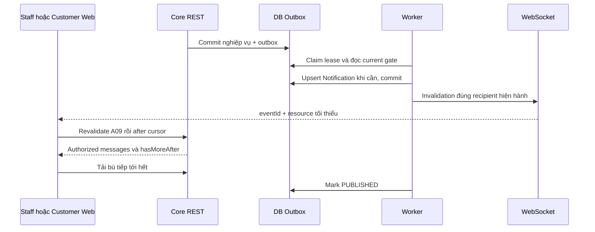

# I06 — Realtime, outbox, thông báo handoff và thu hồi quyền

Ngày 03/11/2026 · **Đã triển khai/kiểm chứng 04/11/2026 — local một Core process** · [Chung](../03-inbox-contract.md) · Trước: [I01](01-model-permissions.md)–[I05](05-messaging-customer.md) · Tiếp: [I07](../tickets/06-agent-confirmation.md).

## 1. Kết quả

Staff thấy request mới, Customer/Staff nhận cập nhật tin và trạng thái không F5; mất WS rồi nối lại vẫn tải bù đủ qua REST. Request được lưu bền vững và có thông báo handoff riêng, không cần Ticket. Quyền event giống REST, pending không bị lộ history/preview/sequence.

Chọn phương án **local một Core process**, PostgreSQL outbox và WebSocket invalidation hiện có; không thêm Redis/BullMQ/service cloud hoặc hứa exactly-once. Queue production/đa replica/Agent checkpoint cần quyết định riêng.

### 1.1. Bổ sung đã chốt 04/11 — tin hệ thống sau Accept

Trong cùng ô chat Customer–Staff, sau khi Staff Accept thành công phải có một tin hệ thống thông báo đã tiếp nhận và sẽ phản hồi sớm nhất. Yêu cầu này đã triển khai ở I06; tại mốc I05 chưa có. Không chỉ hiện toast hoặc đổi badge, không thay bằng thông báo ở danh sách Notification.

- Copy UI tiếng Anh: `Staff {displayName} has accepted your request and will respond as soon as possible.` Ý nghĩa tiếng Việt: “Nhân viên {tên} đã tiếp nhận yêu cầu và sẽ phản hồi cho bạn sớm nhất có thể.” Tên hiển thị lấy từ Core; không cam kết thời hạn hoặc trạng thái đã đọc/đã giao.
- Core ghi `Message` với `senderType=SYSTEM`, `senderId=null`, `audience=CUSTOMER_VISIBLE` trong chính conversationId đã được Customer đồng ý chia sẻ. Không ghi dưới danh nghĩa Staff hoặc AI_AGENT.
- Ghi **trong transaction Accept**, cùng acceptance/controller/controlVersion/receipt/audit/outbox; cấp sequence dưới lock bằng quy trình append dùng chung. Có thứ tự rõ với các tin Customer đang gửi đồng thời. Nếu insert tin hệ thống hoặc outbox lỗi thì Accept rollback toàn bộ.
- Một lần chuyển trạng thái hợp lệ chỉ sinh một tin. Dedup gắn với handoffId và loại sự kiện; chốt cách ánh xạ vào unique key server-owned hiện có trước code. Retry/reconcile Accept, hai Staff đua nhận hoặc worker phát lại không tạo tin thứ hai. Một handoff mới sau revoke/consent mới có thể có tin tiếp nhận mới.
- Worker **không tạo tin này sau transaction**: chỉ chuyển invalidation từ sự kiện đã commit. Có thể phát `MESSAGE_COMMITTED` bên cạnh `HANDOFF_ACCEPTED`; Web batch/catch-up và dedup, không tự ghép thêm bubble từ badge/WS/ACK.
- A10/Customer history trả tin qua projection SYSTEM hiện có; không thêm endpoint browser tạo system message. Customer/Staff thấy tin sau Refresh ở giai đoạn chưa realtime; khi I06 hoàn tất tin tự xuất hiện qua REST catch-up. Reload/reconnect vẫn còn đúng một tin.
- Pending chưa Accept không có tin báo thành công; Staff không được đọc transcript sớm. Direct không cần Accept nên không tự chèn thông báo “đã chấp nhận yêu cầu”. Không tự tạo Ticket. Không backfill hàng loạt vào các lần Accept cũ nếu chưa có yêu cầu riêng.

Tách bước để review: **I06-A** mở rộng Accept + transcript + tests tin hệ thống trước; **I06-B** outbox/realtime/notification/catch-up bên dưới. Không cần đợi worker để lưu tin tiếp nhận bền vững.

## 2. Điểm xuất phát và file

`apps/core/src/realtime/realtime.service.ts` hiện chỉ account/profile/assignment fingerprint mỗi2 giây, frame ready/invalidate/session-expired, receive-only. `apps/web/src/lib/realtime.ts` dispatch core:data-changed, AuthScreen dùng refresh phiên. Không phải chat transport và không được phát một invalidate auth cho mỗi tin.

File dự kiến:

| Vị trí | Việc |
| --- | --- |
| Core `realtime/realtime.service.ts` | Gửi frame chat tới peers của actor sau authorization; giữ origin/session/limits/close semantics |
| Core `outbox/outbox.module.ts`, `services/outbox-dispatcher.service.ts` | Worker local claim/lease/retry/shutdown cho outbox đã có; module mới vì có consumer thật |
| Core `conversations/services/conversation-event.service.ts` | Event recipient/projection dùng access I01, không LLM/router client |
| Core `conversations/services/conversation-handoff.service.ts`, `conversation-message.service.ts` | I06-A: append SYSTEM sau chuyển trạng thái Accept, chung transaction/sequence/receipt; không expose browser writer |
| Core `notifications/notifications.module.ts`, controller/service/DTO | List/read tối thiểu A27/A28, recipient server-controlled |
| Core `app.module.ts`, Prisma schema/migration | Import consumer thật, thêm lease fields/index cần thiết |
| Web `lib/realtime.ts` | Frame typed riêng cho chat/notification, không kích auth refresh mỗi message |
| Web Inbox/Customer/transcript I04/I05 | Revalidate scope, after catch-up/dedup/scroll, clear khi revoke |
| Web `components/staff-notifications.tsx` | Thông báo request tối thiểu, link tới request/Accept đúng quyền |

Không thêm WebSocket server song song hoặc để browser gửi mutation qua socket; gửi tin vẫn REST/CSRF.

## 3. Outbox event contract

Ghi cùng transaction nghiệp vụ I03/I05. aggregateType CONVERSATION, aggregateId conversationId; payload allowlist `{schemaVersion:1,controlVersion,requestId?}`. eventType CONVERSATION_CREATED/HANDOFF_REQUESTED/HANDOFF_ACCEPTED/MESSAGE_COMMITTED/CONVERSATION_ACCESS_REVOKED. Không content/sharedReason/AI summary/rawtool/credential/signedURL trong outbox payload.

requestId ở payload là handoff id khi event cần, không dùng để thay auth. Event.id là dedup id; request HTTP correlation id nếu cần là field riêng trong audit, không nhầm handoff id. Worker đọc DB hiện hành để chọn actor/metadata.

MESSAGE_COMMITTED loại này chỉ phát từ writer CUSTOMER_SUPPORT với audience CUSTOMER_VISIBLE. INTERNAL/LEGACY_REVIEW/Copilot không phát event chat khách; không dùng một invalidation chứa id cuộc để gián tiếp lộ hoạt động nội bộ. Điều kiện này cần assertion tại producer, không chỉ filter ở Web.

### 3.1. Claim và lease

Đã thêm OutboxEvent `leaseOwner varchar(100)?`, `leaseExpiresAt timestamptz?`; index `(status,nextAttemptAt,leaseExpiresAt)`. Không thay OutboxStatus hiện có PENDING/PROCESSING/PUBLISHED/FAILED_DLQ.

1. Timer local khoảng500ms, batch20, một vòng xử lý/process; không tạo timer song song khi lần cũ còn chạy.
2. Transaction ngắn `FOR UPDATE SKIP LOCKED`: chọn PENDING đến hạn hoặc PROCESSING hết lease, đặt PROCESSING/leaseOwner/leaseExpiresAt=now+30s, tăng retryCount, commit.
3. Handler recheck aggregate/recipient, tạo Notification nếu cần bằng dedupKey và commit DB **trước** phát WS. Retry không tạo trùng row.
4. Gửi invalidation tối thiểu tới peers còn phiên/quyền; offline không là lỗi vì REST catch-up/Notification bền vững.
5. Mark PUBLISHED khi xử lý xong, chỉ nếu leaseOwner còn đúng. Crash giữa send/mark có thể gửi lại cùng eventId; client dedup. PUBLISHED là đã xử lý, không phải khách đã đọc/đã nhận.
6. Lỗi transient: trả PENDING với nextAttemptAt backoff1/2/4…60s + jitter; sau8 attempts →FAILED_DLQ. lastError chỉ mã allowlist, không raw exception/payload. Requeue là tool/operator action có kiểm quyền/audit riêng, không public endpoint tùy tiện.

Lease phải renew nếu handler gần hết30s; bản local handler ngắn không chờ network external. Restart reclaim lease hết hạn; shutdown ngừng claim, hoàn tất phần đang chạy có giới hạn rồi để lease recover. Không keep DB row lock trong vòng chờ WS/network.

Không dùng outbox payload recipient cũ làm quyền. Nhiều Core replicas cần broker/fanout peers giữa process trước production; thiết kế local không tự giải quyết việc đó.

## 4. Recipient và thu hồi

| Event | Ai có thể được invalidation/notification |
| --- | --- |
| CONVERSATION_CREATED | Customer owner; nếu Direct mới còn grant thì thêm Staff nhận. AI mới không báo assigned Staff |
| HANDOFF_REQUESTED | Customer owner, recipient Staff của pending consent còn hợp lệ; Staff chỉ safe request |
| HANDOFF_ACCEPTED | Customer owner, Staff accepted/grant còn hiệu lực |
| MESSAGE_COMMITTED trong AI riêng | Chỉ Customer owner, không assigned Staff |
| MESSAGE_COMMITTED khi pending | Chỉ Customer owner; Staff không sequence/activity từ tin riêng |
| MESSAGE_COMMITTED active Direct/transferred | Customer owner và Staff grant hiện hành |
| ACCESS_REVOKED/reassignment | Staff cũ nhận **scope invalidation không nội dung** để clear; Customer revalidate routing; Staff mới không transcript/event cuộc cũ nếu chưa consent mới |

Nếu request đã Accept trước worker xử lý HANDOFF_REQUESTED, không gửi notification pending lỗi thời; revalidate current state và chỉ invalidation được phép. Event cũ sau revoke không phát nội dung/sequence theo grant cũ. Link notification không chứng minh quyền.

Recheck session/resource ngay trước send, nhưng không thể thu hồi byte đã gửi trước revoke commit; không hứa atomic giữa PostgreSQL và socket. Payload tối thiểu, REST authoritative, client clear scope khi invalidation và session-expired; không gửi transcript trên WS để giảm rủi ro này.

## 5. WebSocket spec

Giữ `WS /api/v1/realtime` cookie + exact Origin, receive-only, frame client gửi đóng1008, session revoked4001, lỗi dịch vụ1013, heartbeat/backoff/limits hiện có. Không tin X-Forwarded-For để nhận diện người dùng hoặc cho client chọn recipient.

Frame mới:

```json
{"type":"chat-invalidated","eventId":"70000000-0000-4000-8000-000000000001","conversationId":"20000000-0000-4000-8000-000000000001"}
```

```json
{"type":"chat-scope-invalidated","eventId":"70000000-0000-4000-8000-000000000002"}
```

```json
{"type":"notifications-invalidated","eventId":"70000000-0000-4000-8000-000000000003"}
```

Không sequence/count/subject/customerId/content trong frame. chat-invalidated có conversationId chỉ khi actor được metadata hoặc transcript lúc gửi; pending không nhận message events. Scope invalidation không cần resource id đã mất quyền.

Web dispatch event chuyên biệt `core:chat-changed`, `core:chat-scope-changed`, `core:notifications-changed`; không dispatch core:data-changed cho mỗi frame chat. AuthScreen vẫn chỉ xử lý auth ready/invalidate/session-expired như trước. assignment fingerprint hiện có có thể gây một auth invalidation hợp lệ, nhưng message không kéo `/auth/me` liên tục.

## 6. API REST Notification tối thiểu

A27 `GET /api/v1/staff/notifications?limit=20&cursor=...`: 1–50, keyset `(createdAt DESC,id DESC)`, no-store, actor Staff. Bản phase này trả notification handoff; khi I07 thêm Ticket cùng contract. Không cần unreadCount/total/badge Inbox; isRead phục vụ trạng thái riêng của notification.

```json
{
  "items": [{
    "id": "80000000-0000-4000-8000-000000000001", "kind": "HANDOFF_REQUESTED",
    "title": "Staff support requested", "isRead": false,
    "createdAt": "2026-11-03T08:00:00.000Z",
    "target": {"type":"CONVERSATION","id":"20000000-0000-4000-8000-000000000001"}
  }],
  "pageInfo": {"hasMore": false,"nextCursor": null}
}
```

Đã thêm Notification `kind varchar(50)?` allowlist HANDOFF_REQUESTED (I07 thêm các loại Ticket); row cũ null giữ nguyên, không suy loại từ body Private. Endpoint phase này chỉ chọn kind đã hỗ trợ, không tự xóa notification legacy. Notification row title generic/body null, không chép AI/private chat. dedupKey=`eventId:recipientStaffId:kind`, recipient do Core chọn. Nếu target không còn metadata quyền, loại khỏi list sau scope query **trước** pagination, không hiển thị link cũ kèm tên/subject. Không xóa audit/notification cũ để né revoke.

A28 `POST /api/v1/staff/notifications/:notificationId/read`, body `{}`, CSRF; 200 `{id,isRead:true}`. Idempotent, chỉ recipient + target scope còn hợp lệ; người khác/not found404. Đọc notification không Accept chat/mark messages read hoặc tạo Ticket. Click thông báo phải A09 revalidate trước render, pending vẫn chỉ request.

## 7. Catch-up và UI



Frame có thể trùng/mất/out-of-order. Client debounce/batch invalidation ngắn, single-flight mỗi key, dirty flag nếu có event khi đang fetch; fetch tiếp sau lần hiện tại, không bỏ event cuối. Reconnect/ready, tab visible sau offline và thao tác thủ công đều A09 recheck + REST after tới hết backlog; không chỉ tin WS.

Nếu chưa có afterCursor, fetch latest; nếu đang có history cũ giữ anchor. Dedup id/sequence cả optimistic ACK và REST. Đang đọc trên không auto-scroll; nút xuống tin mới không count. Scope invalidation abort/clear Private trước revalidate, không chờ network giữ transcript cũ tương tác được.

Hiển thị mất kết nối ngắn, retry/backoff không F5. Có thể gửi REST khi WS mất và phiên/quyền còn xác minh; UI không giả “đã giao”. Không polling transcript toàn bộ theo fingerprint2 giây.

## 8. Test plan

File **cần thêm**: `apps/core/test/conversation-outbox.test.cjs`, `conversation-realtime.test.cjs`, `notifications.test.cjs`; browser `conversation-realtime.spec.mjs`; E2E hai contexts và socket thật trong `conversation-flow.integration.spec.mjs`. Tests clock/barrier kiểm soát, không sleep dài mong event.

| ID | Kiểm tra | Kết quả |
| --- | --- | --- |
| I06-T01 | Commit/rollback message hoặc request | Chỉ commit sinh event/notification |
| I06-T02 | Hai workers claim/crash lease/restart | Recover, không xử lý song song cùng lease hợp lệ |
| I06-T03 | Crash sau notification/send trước mark | Một notification dedup, event trùng client xử lý an toàn |
| I06-T04 | AI riêng/pending/accepted/Direct recipients | Không frame transcript/sequence tới Staff chưa grant |
| I06-T05 | Reassignment trước worker send hoặc đang online | Event cũ không grant, Staff cũ clear, Staff mới không history |
| I06-T06 | WS offline/mất frame/out-of-order | REST after catch-up tới hết, không mất/trùng bubble |
| I06-T07 | Event tới khi fetch đang chạy | Dirty flag tạo lần resync tiếp, không bỏ update cuối |
| I06-T08 | Notification read actor khác/link revoked | Safe404 hoặc list loại đúng trước page; không Accept/read messages |
| I06-T09 | Burst message events/focus/ready | Không auth request mỗi message, không F5/remount/PDF src reset |
| I06-T10 | Retry/quota/FAILED_DLQ/shutdown | Bounded backoff, không secret/content logs, không mất request committed |
| I06-T11 | WS Origin/cookie/frame client/revoked session | Giữ1008/4001/1013 và limits hiện có |
| I06-T12 | 130 tin backlog sau reconnect | hasMoreAfter tải hết, scroll/focus/draft ổn định |
| I06-T13 | Accept thành công; Customer/Staff refresh hoặc reconnect | Có đúng một SYSTEM trong cùng cuộc, đúng tên Staff/nội dung/thứ tự; lưu bền vững |
| I06-T14 | Accept retry/cùng key/hai intent cạnh tranh và phát lại event | Một acceptance hợp lệ chỉ một SYSTEM; không bubble do Web tự sinh |
| I06-T15 | Inject lỗi khi append SYSTEM/outbox; Customer gửi đồng thời | Rollback acceptance/message/sequence/receipt cùng nhau; không trùng sequence hoặc báo nhận giả |
| I06-T16 | Pending/Direct/AI riêng, revoke rồi consent/Accept mới | Không báo nhận khi chưa commit hoặc không có Accept; gate đúng, handoff mới có sự kiện riêng |

## 9. Điều kiện hoàn tất

- [x] Local worker có lease/retry/restart/dedup tests, không broker ngầm.
- [x] I06-A: SYSTEM tiếp nhận bền vững trong transaction Accept, đúng một lần mỗi handoff; browser/HTTP/race/rollback tests pass.
- [x] REST và WS cùng gate, pending không lộ nội dung/activity riêng.
- [x] Notification handoff bền vững, không tạo Ticket hoặc Inbox count.
- [x] E2E hai context nhận tin/request/Accept/revoke tự cập nhật, no F5.
- [x] Auth/PDF/Customers regression phạm vi ảnh hưởng pass; báo riêng limitation một Core process.

**Checkpoint:** Đây là mốc Inbox local hoạt động liên tục. Không vì I06 hoàn tất mà đánh dấu Agent/checkpoint/Copilot/Ticket workflow đã có.


## 10. Implementation và kiểm chứng 04/11/2026

- Migration `202611040002_inbox_realtime`: OutboxEvent leaseOwner/leaseExpiresAt + index; Notification.kind nullable, allowlist HANDOFF_REQUESTED/null. Giữ19 bảng, dữ liệu/credential/volumes hiện hữu, không seed hoặc backfill SYSTEM cũ.
- Accept append SYSTEM Customer-visible cùng transaction bằng `ConversationMessageService.acceptedSystemMessage`, key `internalMessageId=handoffId` dưới unique conversation/internal key; counter/sequence/receipt/outbox rollback chung. Tin hiện qua history, không bubble do FE tự sinh.
- `ConversationEventService` chọn recipient từ scope hiện hành, không dùng LLM/payload cũ làm quyền. Handoff notification generic/body null, dedup eventId+Staff+kind; Bước cuối tạo notification dùng cùng thứ tự khóa user/customer/assignment/conversation với Accept/reassignment rồi kiểm pending lại; request đã được Accept không tạo notification chờ muộn. A27/A28 trong NotificationsModule lọc scope trước phân trang, read chỉ recipient/target scope và không Accept.
- OutboxModule/Dispatcher: claim batch20 bằng SKIP LOCKED, lease30s renew mỗi10s, một vòng500ms/process, retry1–60s+jitter/8attempts/DLQ, lastError chỉ DISPATCH_FAILED. Reclaim PROCESSING lease hết hạn/null; update/mark phải đúng owner. Không claim sự kiện Ticket hoặc event type chưa hỗ trợ. Không giữ row lock trong khi gửi WS; graceful shutdown chờ giới hạn5s.
- RealtimeModule dùng đúng server/socket hiện có. Mỗi lần publish recheck session và grant trước frame; pending không nhận MESSAGE_COMMITTED của Customer. ACCESS_REVOKED gửi scope frame không conversationId tới Staff cũ. Giữ Origin/receive-only1008/revocation4001/service1013/heartbeat/peer limits và giới hạn buffered bytes. Không tạo socket server song song.
- Web `lib/chat-realtime.ts` debounce100ms/single-flight/dirty flag, scope change abort cả request khởi tạo và live response trước clear, kèm permission generation để chặn phản hồi cũ khôi phục Private; reconnect/online/visible resync. Transcript nhận refreshToken sau metadata recheck, drain after tới hết, merge BigInt/dedup/giữ anchor/Jump to latest; không remount composer hoặc auth request cho mỗi message. Notifications button trong Inbox, list/read/open request/Escape và no counts.
- Tests Core trong `test/conversation-realtime.test.cjs` (11 ca: SYSTEM/rollback/new handoff, recipient, notifications/cursor/read, lease/retry/DLQ, WS minimal/receive-only/revoke) cùng72 ca hồi quy: tổng83. Browser realtime mock (7) và gateway E2E thật (1) bổ sung bộ108 hiện có: tổng116. Báo kết quả HTTP/service riêng với browser E2E.
- E2E thật chứng minh: notification → pending không transcript → Accept xuất hiện SYSTEM ở cả hai đầu → tin nhận tự động không Refresh → offline/reconnect tải130 tin theo nhiều trang → không trùng/mất nháp/F5 → reassignment thu hồi composer/transcript Staff cũ. Fixture synthetic tự dọn, không bootstrap riêng hoặc credential file/screenshot/report Markdown.
- Lint/typecheck Core/Web, Docker build Core/Web/core-tests/migrate và migration deploy pass. Chỉ dùng Docker qua gateway. Cloud/broker/đa replica, Copilot C01, Ticket I07, Agent/checkpoint và delivered/read vẫn ngoài I06. DLQ cần operator review; chưa thêm public endpoint requeue.

Sau bước chặn phản hồi metadata cũ bằng abort + permission generation và sửa debounce Back/Forward, đã chạy lại60 ca browser liên quan (Inbox/realtime/send/Customer/session) trên Docker mới: pass;56 ca còn lại của bộ116 đã pass và không có thay đổi source trong phạm vi đó. Không đổi giao diện Customer ngoài hành vi nhận cập nhật/thu hồi quyền của chat hiện có.
