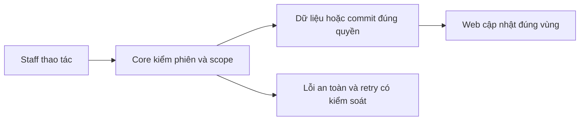

# NO01 — Notification recipient/read

04/11/2026 · **Đã triển khai cho handoff; Ticket chưa nối** · [Contract](../06-notifications-contract.md) · [Chung](../00-staff-contract.md).

## 1. Phạm vi và model

FR-013/NFR-001/005/006, Notification.recipientStaffId và conversationId/ticketId nullable. Chưa recipient Customer.

## 2. Vị trí code

`apps/core/src/notifications/notifications.controller.ts`, `notifications.service.ts`, `outbox/services/outbox-dispatcher.service.ts`; policy I01/I06.

## 3. API và dữ liệu

Prefix REST `/api/v1`; `E` là runtime, không endpoint đề xuất mới.

A27 `GET /staff/notifications?limit=20&cursor=` → `{items,pageInfo:{hasMore,nextCursor}}`, limit1–50, scope trước keyset createdAt/id, cursor bound actor. A28 `POST /staff/notifications/:id/read` body{}+CSRF → id/isRead, idempotent. Chỉ recipient còn quyền target; resource ngoài quyền404; không counts hoặc transcript preview.

## 4. Luồng và trạng thái

Handoff/consent commit → outbox lease/retry → current pending recipient → dedup notification → WS invalidation. Read không Accept chat/Ticket và không marker đã đọc tin; deliveredAt/PUBLISHED không delivery/read ACK.

## 5. Kiểm thử

I06 Core tests + `conversation-realtime.spec.mjs` và integration suite: dedup/reassignment/revoke, notification read/cursor/safe payload, restart/reconnect/catch-up. Test Ticket riêng TK05 sau producer/read scope thực.

## 6. Checklist và giới hạn

- [x] Có code runtime trong phạm vi được ghi ở tiêu đề; phase này bổ sung tài liệu cho phần đã làm.
- [x] Có các lớp kiểm thử/bằng chứng được dẫn ở contract; không coi việc dọn docs là chạy lại test.
- [ ] Khi sửa code tiếp: chạy các suite bị ảnh hưởng, ghi kết quả trong phase và dọn fixture/artifact.

Không duplicate worker/notification module. Không thêm Customer center hoặc unread badge Inbox; Ticket event contract còn TK05.

