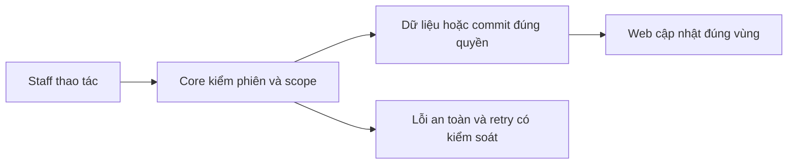
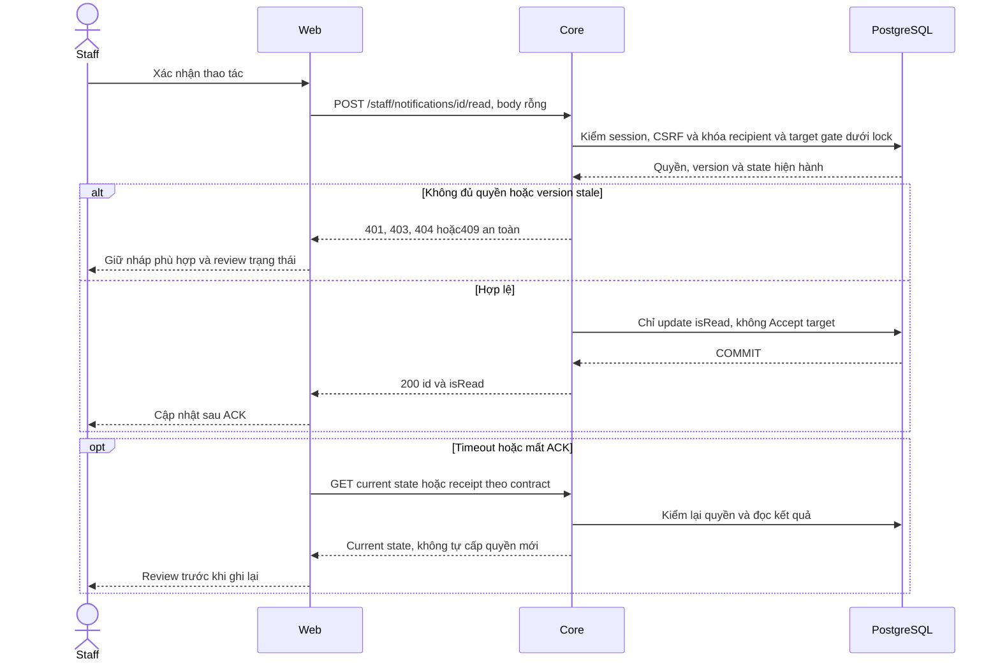

# NO01 — Notification recipient/read

04/11/2026 · **Đã triển khai handoff; Ticket mở rộng bởi TK05** · [Contract](../06-notifications-contract.md) · [Chung](../00-staff-contract.md).

## 1. Phạm vi và model

FR-013/NFR-001/005/006, Notification.recipientStaffId và conversationId/ticketId nullable. Chưa recipient Customer.

## 2. Vị trí code

`apps/core/src/notifications/notifications.controller.ts`, `notifications.service.ts`, `outbox/services/outbox-dispatcher.service.ts`; policy I01/I06.

## 3. API và dữ liệu

Prefix REST `/api/v1`; `E` là runtime, không endpoint đề xuất mới.

A27 `GET /staff/notifications?limit=20&cursor=` → `{items,pageInfo:{hasMore,nextCursor}}`, limit 1–50, scope trước keyset createdAt/id, cursor bound actor. A28 `POST /staff/notifications/:id/read` body{}+CSRF → id/isRead, idempotent. Chỉ recipient còn quyền target; resource ngoài quyền404; không counts hoặc transcript preview.

## 4. Luồng và trạng thái

Handoff/consent commit → outbox lease/retry → current pending recipient → dedup notification → WS invalidation. Read không Accept chat/Ticket và không marker đã đọc tin; deliveredAt/PUBLISHED không delivery/read ACK.

## 5. Test cases

Các ca dưới đây là **đặc tả kiểm thử**, không phải báo cáo kết quả. Kiểm từng lớp API/service/DB/browser đúng nhãn; mock UI không thay kiểm quyền Core hoặc E2E thật.

**Quy ước dữ liệu:** S-A/S-B là hai Staff synthetic; C-A/C-B là hai Customer synthetic khác nhau. Thay alias bằng UUID/token của fixture cô lập; các path HTTP dùng prefix /api/v1 nếu chưa ghi đầy đủ. Chỉ thay assignment, khóa account, inject lỗi hoặc migration trong harness/môi trường test, không trên tài khoản/dữ liệu đang sử dụng.

### NO01-T01 — Danh sách mixed target và scope trước cursor

**Lớp kiểm thử:** API.
**Điều kiện và dữ liệu:** S-A có handoff và Ticket notifications; S-B có mục riêng; hơn1 batch.

**Các bước:**

1. GET /staff/notifications?limit=1 tới trang cuối bằng S-A.
2. Thu hồi quyền một target rồi đọc lại.
3. Dùng cursor S-A với S-B.

**Kết quả mong đợi:** Không lộ mục ngoài scope, không page dùng raw tập rồi lọc ở FE; cursor actor sai400; target type/id đúng loại.

### NO01-T02 — Mark read idempotent và CSRF

**Lớp kiểm thử:** API.
**Điều kiện và dữ liệu:** S-A có notification unread N-A; S-B không quyền N-A.

**Các bước:**

1. S-A POST N-A/read body{} với CSRF.
2. Replay rồi thử bằng S-B/CSRF sai.
3. GET target Ticket/chat sau read.

**Kết quả mong đợi:** Read chỉ đổi isRead; S-B404, CSRF403; không Accept target hoặc mở quyền transcript.

### NO01-T03 — Không trả preview hoặc kind không hỗ trợ

**Lớp kiểm thử:** API + DB.
**Điều kiện và dữ liệu:** Fixture có kind typed hợp lệ, legacy null và tài liệu/title private giả trong body.

**Các bước:**

1. GET notifications.
2. Kiểm allowlist response và target.
3. Thử deep link target sau revoke.

**Kết quả mong đợi:** Chỉ kind được runtime hỗ trợ đúng scope; title generic, không body/Private preview; target bị revoke vẫn kiểm lại quyền.

### NO01-T04 — Revoke trong lúc mark read

**Lớp kiểm thử:** API + DB barrier.
**Điều kiện và dữ liệu:** N-A hợp lệ trước request; barrier trước target lock.

**Các bước:**

1. Bắt đầu A28.
2. Commit revoke assignment rồi thả barrier.
3. Đọc lại N-A và target bằng S-A.

**Kết quả mong đợi:** Recheck chặn thao tác sau revoke; không ghi read cho target ngoài scope hoặc leak DTO.

**Dọn sau kiểm thử:** xóa đúng fixture/session/object/schema theo runId; phục hồi fault injection và đóng context/socket test. Không reset DB/credential, sửa bootstrap hoặc xóa volumes. Với PDF kiểm metadata/bytes/hash; với UI kiểm DOM/focus/network, không cần screenshot.

## 6. Checklist và giới hạn

- [x] Có code runtime trong phạm vi được ghi ở tiêu đề; phase này bổ sung tài liệu cho phần đã làm.
- [x] Có các lớp kiểm thử/bằng chứng được dẫn ở contract; không coi việc dọn docs là chạy lại test.
- [ ] Khi sửa code tiếp: chạy các suite bị ảnh hưởng, ghi kết quả trong phase và dọn fixture/artifact.

Không duplicate worker/notification module. Không thêm Customer center hoặc unread badge Inbox; Ticket event contract đã có ở TK05; producer I07 riêng.

## Sequence diagram

Luồng chính và nhánh quyền/lỗi; test case ở trên chỉ rõ dữ liệu và điểm kiểm tương ứng.

