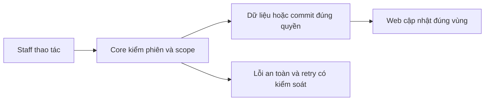

# NO02 — Notification UI và realtime

04/11/2026 · **Đã triển khai handoff; Ticket nối TK05** · [Contract](../06-notifications-contract.md) · [Chung](../00-staff-contract.md).

## 1. Phạm vi và model

NO01/I06; chuông hiện trong Inbox, không dashboard/count endpoint riêng.

## 2. Vị trí code

`apps/web/src/components/staff-notifications.tsx`, `staff-inbox.tsx`, `lib/chat-realtime.ts`, `lib/realtime.ts`.

## 3. API và dữ liệu

Prefix REST `/api/v1`; `E` là runtime, không endpoint đề xuất mới.

Dùng A27/A28; cursor/load more, read/open request. GET target sau click recheck metadata gate; pending không transcript. Session/CSRF từ auth boundary hiện có. WS receive-only chỉ invalidation, không mang content hoặc cấp quyền.

## 4. Luồng và trạng thái

Mở chuông → list loading/empty/error → chọn notification → mark read → mở request đúng id. Escape/Close trả focus; mất quyền xóa row/target; reconnect/visible/online REST resync. Không yêu cầu F5; notification error không làm dừng gửi chat.

## 5. Kiểm thử

`conversation-realtime.spec.mjs` notification navigation/CSRF/no-count; real realtime integration backlog/reconnect/scope. Kiểm375px/keyboard/focus/error bằng DOM; không screenshot. Không hứa NFR latency5s khi chưa đo workload.

## 6. Checklist và giới hạn

- [x] Có code runtime trong phạm vi được ghi ở tiêu đề; phase này bổ sung tài liệu cho phần đã làm.
- [x] Có các lớp kiểm thử/bằng chứng được dẫn ở contract; không coi việc dọn docs là chạy lại test.
- [ ] Khi sửa code tiếp: chạy các suite bị ảnh hưởng, ghi kết quả trong phase và dọn fixture/artifact.

Các nút Refresh Inbox/chat đã bỏ; Retry lỗi giữ riêng. TK05 đã bỏ Refresh notification thường trực; Try again chỉ tại lỗi. Target TICKET mở Tickets sau A28, không đi Inbox.

### Vị trí và tính năng Notifications hiện hành — 05/11/2026

Chuông chuyển khỏi Inbox/Tickets header riêng sang toolbar chung Staff Workspace. Popup portal document.body, position fixed theo chuông, clamp trong viewport và z-index trên workspace. Không phụ thuộc overflow/scroll của cột Inbox. Keyboard Escape/Close trả focus; test DOM375px kiểm parent body và bounds. Target Ticket status-change dùng cùng A28/route Tickets.

**Tính năng bổ sung 05/11/2026**:
1. **Unread Badge**: Chuông hiển thị badge đếm số lượng thông báo chưa đọc (badge tròn đỏ, hiển thị `9+` nếu lớn hơn 9). Số lượng tính bằng tổng thông báo chưa đọc + 1 nếu tài khoản có khuyến nghị đổi mật khẩu chưa ẩn.
2. **Đánh dấu đã đọc tại chỗ (Inline Mark As Read)**: Mỗi thông báo chưa đọc có icon checkmark "Mark as read" giúp nhân viên đánh dấu đã đọc trực tiếp tại chỗ qua A28 mà không cần click mở target route.
3. **Đánh dấu tất cả đã đọc (Mark All As Read)**: Nút trên header popover ("Mark all as read") gọi A28 đồng thời cho tất cả các thông báo chưa đọc hiện có.
4. **Security Notice tích hợp**: Thông báo khuyến nghị đổi mật khẩu (trước đây là banner nổi trên workspace) được đưa vào gọn gàng trong popover Notification thành thẻ cảnh báo an ninh ("Security Notice"), kèm nút "Change password now" và nút "Dismiss" (dismiss ghi nhớ trong sessionStorage).
5. **Auto-refresh khi mở**: Popover tự động nạp lại danh sách thông báo mới nhất mỗi khi nhân viên nhấp mở chuông.
6. **Kiểm thử tự động**: Suite Playwright `apps/web/tests/browser/conversation-realtime.spec.mjs` đã bổ sung các ca kiểm thử: unread count badge, inline checkmark mark-read, mark all read, dismiss security notice (8/8 ca pass).
