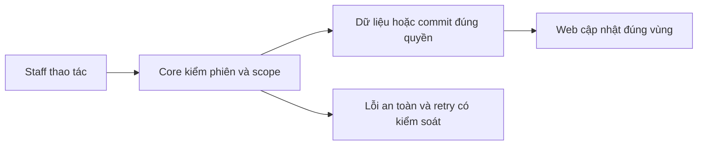
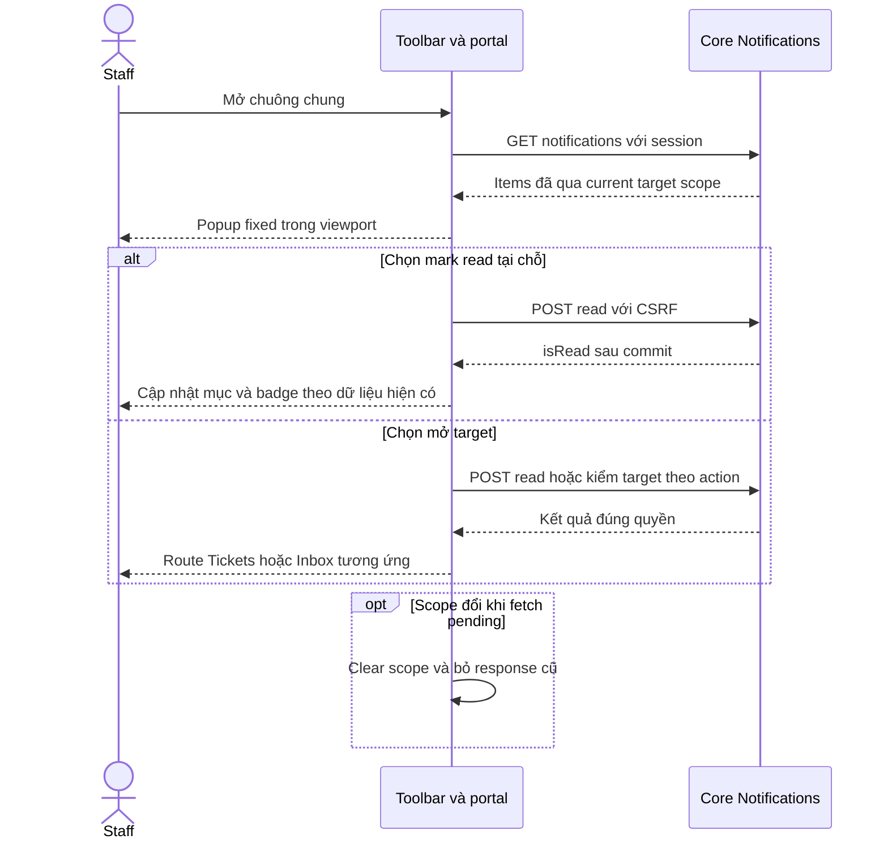

# NO02 — Notification UI và realtime

04/11/2026 · **Đã triển khai handoff; Ticket nối TK05** · [Contract](../06-notifications-contract.md) · [Chung](../00-staff-contract.md).

## 1. Phạm vi và model

NO01/I06; chuông hiện trong Inbox, không dashboard/count endpoint riêng.

## 2. Vị trí code

`apps/web/src/components/staff-notifications.tsx`, `staff-inbox.tsx`, `lib/chat-realtime.ts`, `lib/realtime.ts`.

## 3. API và dữ liệu

Prefix REST `/api/v1`; `E` là runtime, không endpoint đề xuất mới.

Dùng A27/A28; cursor/load more, read/open request. GET target sau click recheck metadata gate; pending không transcript. Session/CSRF từ auth boundary hiện có. WS receive-only chỉ invalidation, không mang content hoặc cấp quyền.

## 4. Luồng và trạng thái

Mở chuông → list loading/empty/error → chọn notification → mark read → mở request đúng id. Escape/Close trả focus; mất quyền xóa row/target; reconnect/visible/online REST resync. Không yêu cầu F5; notification error không làm dừng gửi chat.

## 5. Test cases

Các ca dưới đây là **đặc tả kiểm thử**, không phải báo cáo kết quả. Kiểm từng lớp API/service/DB/browser đúng nhãn; mock UI không thay kiểm quyền Core hoặc E2E thật.

**Quy ước dữ liệu:** S-A/S-B là hai Staff synthetic; C-A/C-B là hai Customer synthetic khác nhau. Thay alias bằng UUID/token của fixture cô lập; các path HTTP dùng prefix /api/v1 nếu chưa ghi đầy đủ. Chỉ thay assignment, khóa account, inject lỗi hoặc migration trong harness/môi trường test, không trên tài khoản/dữ liệu đang sử dụng.

### NO02-T01 — Toolbar chung và popup không bị che

**Lớp kiểm thử:** Browser.
**Điều kiện và dữ liệu:** S-A mở Inbox rồi Tickets; viewport desktop và 375px.

**Các bước:**

1. Bấm chuông trên toolbar.
2. Cuộn cột Inbox và kiểm parent/bounds popup.
3. Resize, Escape rồi mở bằng Enter.

**Kết quả mong đợi:** Một chuông chung, popup portal document.body nằm trong viewport, không clipping; Escape/Close trả focus về chuông.

### NO02-T02 — Read tại chỗ khác mở target

**Lớp kiểm thử:** Browser + Network.
**Điều kiện và dữ liệu:** Có một Ticket notification và một handoff notification unread.

**Các bước:**

1. Bấm control đánh dấu đọc của một mục.
2. Kiểm URL rồi bấm link mở target của mục còn lại.
3. Quan sát body/CSRF của A28.

**Kết quả mong đợi:** Read tại chỗ không điều hướng; link mở đúng Tickets hoặc Inbox; body{} và CSRF đúng; không tạo Accept.

### NO02-T03 — Badge và Mark all read theo tập đang tải

**Lớp kiểm thử:** Browser + API mock.
**Điều kiện và dữ liệu:** Danh sách đang tải có 2 unread/1 read; password notice là biến thể riêng.

**Các bước:**

1. Kiểm badge, bấm Mark all read.
2. Đối chiếu A28 chỉ cho các mục unread đã tải.
3. Giả lập một request lỗi rồi mở lại panel.

**Kết quả mong đợi:** Trạng thái/badge theo dữ liệu hiện có, không khẳng định total toàn DB; lỗi không giả tất cả đã đọc; không gửi read lặp cho mục read.

### NO02-T04 — Thông báo mật khẩu và scope invalidation

**Lớp kiểm thử:** Browser + API mock.
**Điều kiện và dữ liệu:** passwordChangeRecommended=true; có request notifications cũ đang pending.

**Các bước:**

1. Dismiss password notice hoặc mở Change password.
2. Phát scope/session invalidation.
3. Trả notifications cũ muộn.

**Kết quả mong đợi:** Notice không ghi read vào Ticket/chat; link account đúng; response cũ không khôi phục dữ liệu sau scope clear,401 chuyển login.

**Dọn sau kiểm thử:** xóa đúng fixture/session/object/schema theo runId; phục hồi fault injection và đóng context/socket test. Không reset DB/credential, sửa bootstrap hoặc xóa volumes. Với PDF kiểm metadata/bytes/hash; với UI kiểm DOM/focus/network, không cần screenshot.

## 6. Checklist và giới hạn

- [x] Có code runtime trong phạm vi được ghi ở tiêu đề; phase này bổ sung tài liệu cho phần đã làm.
- [x] Có các lớp kiểm thử/bằng chứng được dẫn ở contract; không coi việc dọn docs là chạy lại test.
- [ ] Khi sửa code tiếp: chạy các suite bị ảnh hưởng, ghi kết quả trong phase và dọn fixture/artifact.

Các nút Refresh Inbox/chat đã bỏ; Retry lỗi giữ riêng. TK05 đã bỏ Refresh notification thường trực; Try again chỉ tại lỗi. Target TICKET mở Tickets sau A28, không đi Inbox.

### Vị trí và tính năng Notifications hiện hành — 05/11/2026

Chuông chuyển khỏi Inbox/Tickets header riêng sang toolbar chung Staff Workspace. Popup portal document.body, position fixed theo chuông, clamp trong viewport và z-index trên workspace. Không phụ thuộc overflow/scroll của cột Inbox. Keyboard Escape/Close trả focus; test DOM375px kiểm parent body và bounds. Target Ticket status-change dùng cùng A28/route Tickets.

**Tính năng bổ sung 05/11/2026**:
1. **Unread Badge**: Chuông hiển thị badge đếm số lượng thông báo chưa đọc (badge tròn đỏ, hiển thị `9+` nếu lớn hơn 9). Số lượng tính bằng tổng thông báo chưa đọc + 1 nếu tài khoản có khuyến nghị đổi mật khẩu chưa ẩn.
2. **Đánh dấu đã đọc tại chỗ (Inline Mark As Read)**: Mỗi thông báo chưa đọc có icon checkmark "Mark as read" giúp nhân viên đánh dấu đã đọc trực tiếp tại chỗ qua A28 mà không cần click mở target route.
3. **Đánh dấu tất cả đã đọc (Mark All As Read)**: Nút trên header popover ("Mark all as read") gọi A28 đồng thời cho tất cả các thông báo chưa đọc hiện có.
4. **Security Notice tích hợp**: Thông báo khuyến nghị đổi mật khẩu (trước đây là banner nổi trên workspace) được đưa vào gọn gàng trong popover Notification thành thẻ cảnh báo an ninh ("Security Notice"), kèm nút "Change password now" và nút "Dismiss" (dismiss ghi nhớ trong sessionStorage).
5. **Auto-refresh khi mở**: Popover tự động nạp lại danh sách thông báo mới nhất mỗi khi nhân viên nhấp mở chuông.

## Sequence diagram

Luồng chính và nhánh quyền/lỗi; test case ở trên chỉ rõ dữ liệu và điểm kiểm tương ứng.

