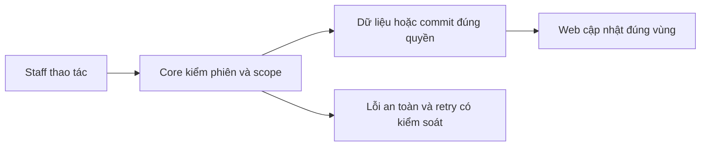

# NO02 — Notification UI và realtime

04/11/2026 · **Đã triển khai cho handoff** · [Contract](../06-notifications-contract.md) · [Chung](../00-staff-contract.md).

## 1. Phạm vi và model

NO01/I06; chuông hiện trong Inbox, không dashboard/count endpoint riêng.

## 2. Vị trí code

`apps/web/src/components/staff-notifications.tsx`, `staff-inbox.tsx`, `lib/chat-realtime.ts`, `lib/realtime.ts`.

## 3. API và dữ liệu

Prefix REST `/api/v1`; `E` là runtime, không endpoint đề xuất mới.

Dùng A27/A28; cursor/load more, read/open request. GET target sau click recheck metadata gate; pending không transcript. Session/CSRF từ auth boundary hiện có. WS receive-only chỉ invalidation, không mang content hoặc cấp quyền.

## 4. Luồng và trạng thái

Mở chuông → list loading/empty/error → chọn notification → mark read → mở request đúng id. Escape/Close trả focus; mất quyền xóa row/target; reconnect/visible/online REST resync. Không yêu cầu F5; notification error không làm dừng gửi chat.

## 5. Kiểm thử

`conversation-realtime.spec.mjs` notification navigation/CSRF/no-count; real realtime integration backlog/reconnect/scope. Kiểm375px/keyboard/focus/error bằng DOM; không screenshot. Không hứa NFR latency5s khi chưa đo workload.

## 6. Checklist và giới hạn

- [x] Có code runtime trong phạm vi được ghi ở tiêu đề; phase này bổ sung tài liệu cho phần đã làm.
- [x] Có các lớp kiểm thử/bằng chứng được dẫn ở contract; không coi việc dọn docs là chạy lại test.
- [ ] Khi sửa code tiếp: chạy các suite bị ảnh hưởng, ghi kết quả trong phase và dọn fixture/artifact.

Các nút Refresh Inbox/chat đã bỏ; Retry lỗi giữ riêng. Refresh riêng notification nếu source còn có không được ghi thành đã loại mà chưa đổi code; UX phase sau chỉ theo yêu cầu.

