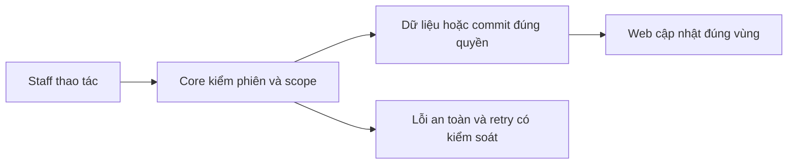
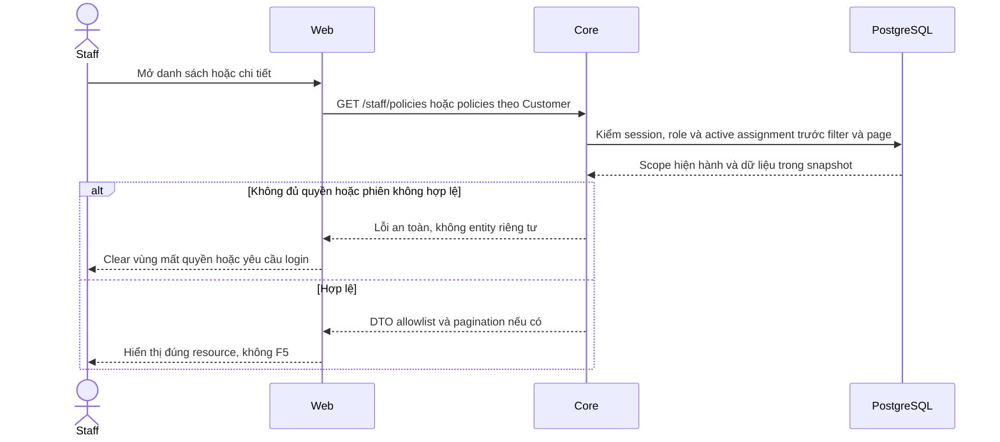

# PL01 — Policy list/detail và lookup Core

04/11/2026 · **Đã triển khai; baseline Core** · [Contract](../05-policies-contract.md) · [Chung](../00-staff-contract.md).

## Bổ sung bảo vệ dữ liệu Customer — 12/11/2026

**P — chưa triển khai phần bảo vệ bổ sung; giữ trạng thái baseline của phase.** Theo [ma trận dữ liệu chung](../../../../configuration-and-data.md#customer-sensitive-data); email/phone Customer được che mặc định theo định dạng A ngày 13/11, Staff có Hiện/Ẩn để liên hệ theo cập nhật 14/11. Core kiểm lại quyền khi reveal, phần triển khai và các quyết định còn mở theo ma trận chung. Vị trí code/API và data model của phase bên dưới là nơi rà tác động; bổ sung này không tự yêu cầu migration hoặc sửa dữ liệu gốc.

**Thay đổi của phase:** Rà policy.service/policy-snapshot và DTO list/detail: customer label, người được bảo hiểm/thụ hưởng, policy number theo tác vụ. Giữ assignment/ownership, financial facts và exact binding.

**Kiểm thử cần bổ sung, chưa chạy:** API/DB: list/detail/quick lookup cùng ma trận, snapshot canary không rò; scope trước search/count, Decimal/null không đổi.

**Số hợp đồng — A đã chốt 14/11/2026.** policyNumber được hiển thị đầy đủ trong scope phân công và gate tài nguyên, khớp source hiện tại. Giữ nguyên chuỗi nghiệp vụ, kiểm ký tự/số đầu và phân biệt policyNumber với policyId. Contact email/phone dùng che mặc định + Hiện/Ẩn theo CU01/CU02. [Policy chuẩn](../../../../configuration-and-data.md#staff-policy-number).

**Liên hệ Customer — cập nhật 14/11/2026, triển khai P.** Contact card che email/phone mặc định và có Hiện/Ẩn để Staff liên hệ. Core kiểm lại quyền/phân công tại thời điểm reveal, response riêng từng trường. Raw được xóa khỏi UI state khi Ẩn/đổi khách/logout/revoke. [CU01/CU02 và policy chuẩn](../../../../configuration-and-data.md#staff-contact-reveal).

## Data model và phạm vi ảnh hưởng

Bảng bên dưới mô tả tác động của phase, gồm cả ghi gián tiếp qua Core. Tên bảng thuộc schema `business` trừ nơi ghi rõ; cột còn đề xuất được đánh dấu **P**. Web không truy cập DB trực tiếp.

| Bảng/model | Cột hoặc dữ liệu liên quan | Thao tác của phase | Quan hệ/ràng buộc cần giữ | Mức ảnh hưởng và nơi bị tác động |
| --- | --- | --- | --- | --- |
| users + auth_sessions | users.id/role/status, auth_sessions.user_id/token_hash/expires_at/revoked_at | Đọc | AuthSession.user_id → User.id; session phải còn hạn, không bị thu hồi | Cao — mọi API dùng session; không trả token/hash trong DTO |
| staff_assignments + customer_profiles + staff_profiles | staff_id/customer_id/is_active/ended_at, assignment_version, user_id/full_name | Đọc | Assignment gắn đúng Customer/Staff; Inbox còn ràng buộc assignment id cụ thể | Cao — Customers, Policy Lookup, Ticket và Inbox cùng phụ thuộc phân công |
| insurance_policies + insurance_products | customer_id/product_id/policy_number/status, premium_amount/payment_frequency/next_due_date, effective_date/expiry_date/sum_assured/benefits_snapshot, product_code/name | Đọc | Policy.customer_id → CustomerProfile.user_id; product_id → InsuranceProduct.id; unique policy_number | Cao — DTO tiền/ngày/snapshot dùng chung Staff/Customer; không OCR PDF để cập nhật DB |

**Schema/migration:** Không migration; giữ Decimal/date-only/null và index customer_id hiện có; index mới chỉ đề xuất khi có query plan.

**Nhất quán và hồi quy:** Filter ownership/assignment/search/status trước count/page; read nhất quán, không ghi policy/snapshot. Kiểm ngoài scope/khách hết assignment và DTO dùng chung Customer.

## 1. Phạm vi và model

FR-008/UC-007/NFR-001. InsurancePolicy.customerId theo active StaffAssignment, InsuranceProduct.isActive không làm mất hợp đồng lịch sử.

## 2. Vị trí code

`apps/core/src/policies/controllers/staff-policy.controller.ts`, `services/policy.service.ts`, `services/policy-snapshot.ts`, `dto/policy-query.dto.ts`, `dto/policy-response.dto.ts`.

| Vị trí từ root repo | Hiện trạng | Trách nhiệm trong phase | Mức ảnh hưởng | Phạm vi cần kiểm lại |
| --- | --- | --- | --- | --- |
| [apps/core/src/policies/controllers/staff-policy.controller.ts](<../../../../../apps/core/src/policies/controllers/staff-policy.controller.ts>) | Hiện có | A14/A15/A16 và document access Staff | Cao | Customers policies, Policy Lookup và Inbox panel |
| [apps/core/src/policies/services/policy.service.ts](<../../../../../apps/core/src/policies/services/policy.service.ts>) | Hiện có | Scope/query/projection/catalog, dùng chung owner methods | Cao | Staff và Customer policies |
| [apps/core/src/policies/services/policy-snapshot.ts](<../../../../../apps/core/src/policies/services/policy-snapshot.ts>) | Hiện có | Whitelist financial/benefits snapshot | Cao | DB JSON, seed và DTO hai role |
| [apps/core/src/policies/dto/policy-response.dto.ts](<../../../../../apps/core/src/policies/dto/policy-response.dto.ts>) | Hiện có | OpenAPI summaries/detail/documents | Trung bình | policy-api.ts và UI format tiền/null/ngày |

## 3. API và dữ liệu

Prefix REST `/api/v1`; `E` là runtime, không endpoint đề xuất mới.

A14 `GET /staff/customers/:customerId/policies?page=1&pageSize=10` → items/total/page/pageSize, không search/status.

A15 `GET /staff/policies?search=&status=ACTIVE&page=1&pageSize=10` → thêm customer summary. search0–100 literal số policy/tên-mã khách/tên-mã sản phẩm; không CCCD/phone. status ACTIVE/LAPSED/MATURED/PENDING, vắng=all. Scope/filter trước count/page, sort createdAt DESC,id ASC; snapshot đồng nhất.

A16 `GET /staff/policies/:policyId` → safe summary/detail/customer/product/snapshot whitelist/status. Decimal string2/null; date-only/null; nextDueDate không chứng minh đã thanh toán.404 parity; UUID/query sai400.

## 4. Luồng và trạng thái

Staff → auth/active assignment → policy projection/snapshot parser → safe DTO. Policy đang đọc vẫn được xem khi không còn khớp filter nhưng còn quyền. Mở policy không sửa Conversation.linkedPolicyId.

## 5. Test cases

Các ca dưới đây là **đặc tả kiểm thử**, không phải báo cáo kết quả. Kiểm từng lớp API/service/DB/browser đúng nhãn; mock UI không thay kiểm quyền Core hoặc E2E thật.

**Quy ước dữ liệu:** S-A/S-B là hai Staff synthetic; C-A/C-B là hai Customer synthetic khác nhau. Thay alias bằng UUID/token của fixture cô lập; các path HTTP dùng prefix /api/v1 nếu chưa ghi đầy đủ. Chỉ thay assignment, khóa account, inject lỗi hoặc migration trong harness/môi trường test, không trên tài khoản/dữ liệu đang sử dụng.

### PL01-T01 — Danh sách theo khách và lookup toàn scope

**Lớp kiểm thử:** API.
**Điều kiện và dữ liệu:** S-A phụ trách C-A có 12 policy; C-B ngoài scope có policyB.

**Các bước:**

1. GET /staff/customers/C-A/policies hai trang.
2. GET /staff/policies?search=mã-policy-trang2.
3. Tìm policyB bằng S-A.

**Kết quả mong đợi:** Count/page và search đúng tập được gán; policyB không có trong list hoặc total.

### PL01-T02 — Filter và detail projection

**Lớp kiểm thử:** API.
**Điều kiện và dữ liệu:** C-A có đủ ACTIVE/LAPSED/MATURED/PENDING, có decimal/null/date-only.

**Các bước:**

1. Lọc từng status trên /staff/policies.
2. GET detail một policy mỗi biến thể.
3. Đối chiếu các field với fixture.

**Kết quả mong đợi:** Không lẫn status; decimal giữ chính xác, null không thành0; ngày không lệch; nextDueDate không được gán là đã thanh toán.

### PL01-T03 — Revoke và 404 parity

**Lớp kiểm thử:** API + DB.
**Điều kiện và dữ liệu:** S-A ban đầu đọc được policyA; policyB ngoài scope; UUID khác không tồn tại.

**Các bước:**

1. GET detail policyB và UUID không tồn tại.
2. Thu hồi assignment của policyA bằng harness.
3. GET detail/list lại policyA.

**Kết quả mong đợi:** Các detail ngoài quyền cùng safe 404; list không trả policyA sau revoke; không leak qua Customer/product summary.

### PL01-T04 — Input và session

**Lớp kiểm thử:** API.
**Điều kiện và dữ liệu:** Chạy từng request với session Staff và Customer riêng.

**Các bước:**

1. Gửi status lạ, pageSize=51, search quá 100/query lạ.
2. Thử search chỉ khớp phone/CCCD synthetic.
3. Gọi Staff endpoint bằng Customer/không session.

**Kết quả mong đợi:** Input400; phone/CCCD không mở rộng search; Customer 403 và thiếu session 401.

**Dọn sau kiểm thử:** xóa đúng fixture/session/object/schema theo runId; phục hồi fault injection và đóng context/socket test. Không reset DB/credential, sửa bootstrap hoặc xóa volumes. Với PDF kiểm metadata/bytes/hash; với UI kiểm DOM/focus/network, không cần screenshot.

## 6. Checklist và giới hạn

- [x] Có code runtime trong phạm vi được ghi ở tiêu đề; phase này bổ sung tài liệu cho phần đã làm.
- [x] Có các lớp kiểm thử/bằng chứng được dẫn ở contract; không coi việc dọn docs là chạy lại test.

**Quy tắc khi bảo trì:** Khi thay đổi code, chạy các suite bị ảnh hưởng theo test case của phase và dọn fixture/artifact do lượt kiểm thử tạo ra. Báo kết quả ngắn trong trao đổi, không ghi nhật ký kiểm thử vào phase. Đây là quy tắc áp dụng mỗi lần sửa, không phải hạng mục chức năng còn thiếu.

Không thêm payment/claims/contract edit; Customer owner API PO01 riêng. Không trả raw benefitsSnapshot hoặc metadata file trong response detail.

## Tự động hóa test case

| Suite/vị trí | Phạm vi và giới hạn |
| --- | --- |
| [staff-foundation.integration.spec.mjs](../../../../../apps/web/tests/browser/staff-foundation.integration.spec.mjs) | Staff assignment và Customer ownership thật, đối chứng foreign owner/resource, không dùng Staff API cho Customer. |
| [browser-staff-fixture.cjs](../../../../../apps/core/test/support/browser-staff-fixture.cjs) | Dữ liệu synthetic UUID qua test Docker, session/password trong memory; finally dọn đúng fixture/object, không reset seed |
| [test-staff.mjs](../../../../../apps/web/scripts/test-staff.mjs) | Chạy Chromium/Firefox/WebKit, gom JSON tạm rồi tự dọn artifact; Web/Core chỉ chạy Docker |

Ca lỗi mạng dùng fault injection rõ ràng; native PDF toolbar/zoom không được xác minh bằng iframe DOM. Các bảng/test case là đặc tả duy trì, không ghi nhật ký từng lần chạy tại đây.

### PL01-T05 — Số hợp đồng đầy đủ theo scope

**P — ca hồi quy bổ sung chưa chạy.** Fixture synthetic có policyNumber với số 0 đầu/ký tự phân tách và Staff đúng/sai assignment. Kiểm list/detail/lookup, policy link trong Ticket và Inbox panel, search literal và revoke.

**Kết quả mong đợi.** Staff đủ quyền nhận đúng chuỗi policyNumber đầy đủ, policyId tiếp tục dùng cho binding/API. Ngoài scope bị chặn theo từng tài nguyên, reveal contact không mở thêm quyền policy/chat/PDF. UI PL03/PL05 và TK04 hiển thị cùng số hợp đồng. Customer self-read theo ownership. Dữ liệu gửi model theo chính sách B tại Agent Design.

## Sequence diagram

Luồng chính và nhánh quyền/lỗi; test case ở trên chỉ rõ dữ liệu và điểm kiểm tương ứng.

