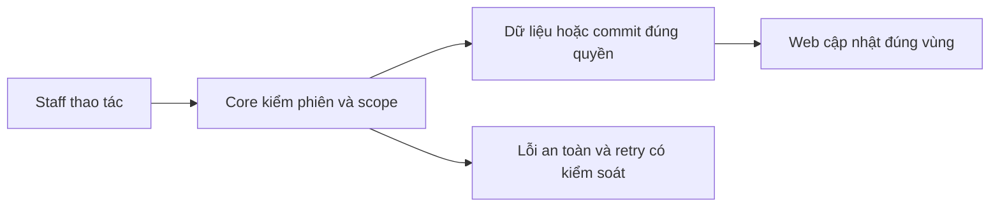
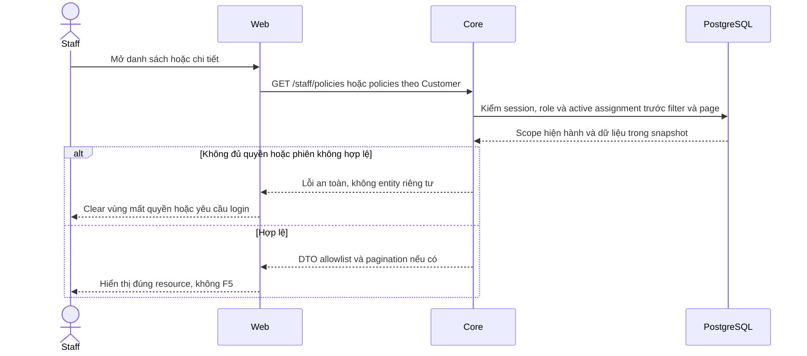

# PL01 — Policy list/detail và lookup Core

04/11/2026 · **Đã triển khai; baseline Core** · [Contract](../05-policies-contract.md) · [Chung](../00-staff-contract.md).

## 1. Phạm vi và model

FR-008/UC-007/NFR-001. InsurancePolicy.customerId theo active StaffAssignment, InsuranceProduct.isActive không làm mất hợp đồng lịch sử.

## 2. Vị trí code

`apps/core/src/policies/controllers/staff-policy.controller.ts`, `services/policy.service.ts`, `services/policy-snapshot.ts`, `dto/policy-query.dto.ts`, `dto/policy-response.dto.ts`.

## 3. API và dữ liệu

Prefix REST `/api/v1`; `E` là runtime, không endpoint đề xuất mới.

A14 `GET /staff/customers/:customerId/policies?page=1&pageSize=10` → items/total/page/pageSize, không search/status.

A15 `GET /staff/policies?search=&status=ACTIVE&page=1&pageSize=10` → thêm customer summary. search0–100 literal số policy/tên-mã khách/tên-mã sản phẩm; không CCCD/phone. status ACTIVE/LAPSED/MATURED/PENDING, vắng=all. Scope/filter trước count/page, sort createdAt DESC,id ASC; snapshot đồng nhất.

A16 `GET /staff/policies/:policyId` → safe summary/detail/customer/product/snapshot whitelist/status. Decimal string2/null; date-only/null; nextDueDate không chứng minh đã thanh toán.404 parity; UUID/query sai400.

## 4. Luồng và trạng thái

Staff → auth/active assignment → policy projection/snapshot parser → safe DTO. Policy đang đọc vẫn được xem khi không còn khớp filter nhưng còn quyền. Mở policy không sửa Conversation.linkedPolicyId.

## 5. Test cases

Các ca dưới đây là **đặc tả kiểm thử**, không phải báo cáo kết quả. Kiểm từng lớp API/service/DB/browser đúng nhãn; mock UI không thay kiểm quyền Core hoặc E2E thật.

**Quy ước dữ liệu:** S-A/S-B là hai Staff synthetic; C-A/C-B là hai Customer synthetic khác nhau. Thay alias bằng UUID/token của fixture cô lập; các path HTTP dùng prefix /api/v1 nếu chưa ghi đầy đủ. Chỉ thay assignment, khóa account, inject lỗi hoặc migration trong harness/môi trường test, không trên tài khoản/dữ liệu đang sử dụng.

### PL01-T01 — Danh sách theo khách và lookup toàn scope

**Lớp kiểm thử:** API.
**Điều kiện và dữ liệu:** S-A phụ trách C-A có 12 policy; C-B ngoài scope có policyB.

**Các bước:**

1. GET /staff/customers/C-A/policies hai trang.
2. GET /staff/policies?search=mã-policy-trang2.
3. Tìm policyB bằng S-A.

**Kết quả mong đợi:** Count/page và search đúng tập được gán; policyB không có trong list hoặc total.

### PL01-T02 — Filter và detail projection

**Lớp kiểm thử:** API.
**Điều kiện và dữ liệu:** C-A có đủ ACTIVE/LAPSED/MATURED/PENDING, có decimal/null/date-only.

**Các bước:**

1. Lọc từng status trên /staff/policies.
2. GET detail một policy mỗi biến thể.
3. Đối chiếu các field với fixture.

**Kết quả mong đợi:** Không lẫn status; decimal giữ chính xác, null không thành0; ngày không lệch; nextDueDate không được gán là đã thanh toán.

### PL01-T03 — Revoke và 404 parity

**Lớp kiểm thử:** API + DB.
**Điều kiện và dữ liệu:** S-A ban đầu đọc được policyA; policyB ngoài scope; UUID khác không tồn tại.

**Các bước:**

1. GET detail policyB và UUID không tồn tại.
2. Thu hồi assignment của policyA bằng harness.
3. GET detail/list lại policyA.

**Kết quả mong đợi:** Các detail ngoài quyền cùng safe 404; list không trả policyA sau revoke; không leak qua Customer/product summary.

### PL01-T04 — Input và session

**Lớp kiểm thử:** API.
**Điều kiện và dữ liệu:** Chạy từng request với session Staff và Customer riêng.

**Các bước:**

1. Gửi status lạ, pageSize=51, search quá 100/query lạ.
2. Thử search chỉ khớp phone/CCCD synthetic.
3. Gọi Staff endpoint bằng Customer/không session.

**Kết quả mong đợi:** Input400; phone/CCCD không mở rộng search; Customer 403 và thiếu session 401.

**Dọn sau kiểm thử:** xóa đúng fixture/session/object/schema theo runId; phục hồi fault injection và đóng context/socket test. Không reset DB/credential, sửa bootstrap hoặc xóa volumes. Với PDF kiểm metadata/bytes/hash; với UI kiểm DOM/focus/network, không cần screenshot.

## 6. Checklist và giới hạn

- [x] Có code runtime trong phạm vi được ghi ở tiêu đề; phase này bổ sung tài liệu cho phần đã làm.
- [x] Có các lớp kiểm thử/bằng chứng được dẫn ở contract; không coi việc dọn docs là chạy lại test.
- [ ] Khi sửa code tiếp: chạy các suite bị ảnh hưởng, ghi kết quả trong phase và dọn fixture/artifact.

Không thêm payment/claims/contract edit; Customer owner API PO01 riêng. Không trả raw benefitsSnapshot hoặc metadata file trong response detail.

## Sequence diagram

Luồng chính và nhánh quyền/lỗi; test case ở trên chỉ rõ dữ liệu và điểm kiểm tương ứng.

