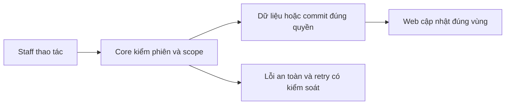

# PL01 — Policy list/detail và lookup Core

04/11/2026 · **Đã triển khai; baseline Core** · [Contract](../05-policies-contract.md) · [Chung](../00-staff-contract.md).

## 1. Phạm vi và model

FR-008/UC-007/NFR-001. InsurancePolicy.customerId theo active StaffAssignment, InsuranceProduct.isActive không làm mất hợp đồng lịch sử.

## 2. Vị trí code

`apps/core/src/policies/controllers/staff-policy.controller.ts`, `services/policy.service.ts`, `services/policy-snapshot.ts`, `dto/policy-query.dto.ts`, `dto/policy-response.dto.ts`.

## 3. API và dữ liệu

Prefix REST `/api/v1`; `E` là runtime, không endpoint đề xuất mới.

A14 `GET /staff/customers/:customerId/policies?page=1&pageSize=10` → items/total/page/pageSize, không search/status.

A15 `GET /staff/policies?search=&status=ACTIVE&page=1&pageSize=10` → thêm customer summary. search0–100 literal số policy/tên-mã khách/tên-mã sản phẩm; không CCCD/phone. status ACTIVE/LAPSED/MATURED/PENDING, vắng=all. Scope/filter trước count/page, sort createdAt DESC,id ASC; snapshot đồng nhất.

A16 `GET /staff/policies/:policyId` → safe summary/detail/customer/product/snapshot whitelist/status. Decimal string2/null; date-only/null; nextDueDate không chứng minh đã thanh toán.404 parity; UUID/query sai400.

## 4. Luồng và trạng thái

Staff → auth/active assignment → policy projection/snapshot parser → safe DTO. Policy đang đọc vẫn được xem khi không còn khớp filter nhưng còn quyền. Mở policy không sửa Conversation.linkedPolicyId.

## 5. Kiểm thử

`npm run test:policies`: scope, nullable/large decimal, date-only, invalid snapshot, inactive product, search/status/page/unknown params, assignment revoke. Storage mock trong suite policy không chứng minh MinIO.

## 6. Checklist và giới hạn

- [x] Có code runtime trong phạm vi được ghi ở tiêu đề; phase này bổ sung tài liệu cho phần đã làm.
- [x] Có các lớp kiểm thử/bằng chứng được dẫn ở contract; không coi việc dọn docs là chạy lại test.
- [ ] Khi sửa code tiếp: chạy các suite bị ảnh hưởng, ghi kết quả trong phase và dọn fixture/artifact.

Không thêm payment/claims/contract edit; Customer owner API PO01 riêng. Không trả raw benefitsSnapshot hoặc metadata file trong response detail.

