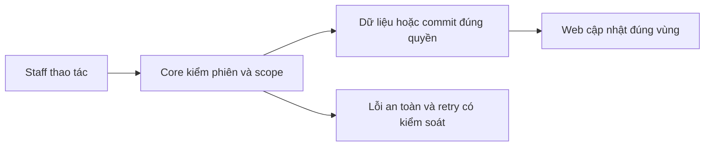

# PL02 — Applied version và PDF access

04/11/2026 · **Đã triển khai; baseline Core/MinIO** · [Contract](../05-policies-contract.md) · [Chung](../00-staff-contract.md).

## 1. Phạm vi và model

PL01 + NFR-007; Document/DocumentVersion và benefitsSnapshot.documents. Schema không có Document.kind; AccessScope PUBLIC/PRIVATE_POLICY.

## 2. Vị trí code

`policy.service.ts`, `policy-storage.service.ts`, `policy-snapshot.ts`, `document-access.dto.ts`; storage reader runtime, writer chỉ job fixture/bootstrap.

## 3. API và dữ liệu

Prefix REST `/api/v1`; `E` là runtime, không endpoint đề xuất mới.

A18 `GET /staff/policies/:policyId/documents` → policyId/items/total/availability/mainDocumentStatus/issues; không URL/bucket/key. POLICY/POLICY_DRAFT/TERMS/PRODUCT_GUIDE/ENDORSEMENT từ binding exact documentId+versionNumber đã validate, không title/currentVersion.

A20 POST `/staff/documents/:documentId/versions/:versionId/view|download` body `{policyId}` → `{url,expiresAt}`. Session/CSRF/assignment/binding/version active, HEAD PDF, recheck quyền và audit trước link; view inline/download attachment. Storage thiếu/lỗi trả safe error theo contract, không SDK exception. Không cho client chọn bucket/key/filename/URL.

## 4. Luồng và trạng thái

Core authorize → exact applied binding → HEAD/sign ở storage → recheck/audit → grant → browser GET/Range. TTL900 local mặc định, grant cũ có residual TTL khi logout/revoke; không hứa thu hồi file tải. Metadata binding bất biến, không overwrite object/version cũ.

## 5. Kiểm thử

Policy suite kiểm scope/binding/inactive/malformed/CSRF; storage smoke kiểm real bytes/checksum/MIME/Range/CORS/expiry/tamper; browser E2E cần thêm qua Core/MinIO thật, kiểm đúng hash/version được cấp. Fixtures hoàn toàn synthetic và tự dọn, không rotate env/volumes.

## 6. Checklist và giới hạn

- [x] Có code runtime trong phạm vi được ghi ở tiêu đề; phase này bổ sung tài liệu cho phần đã làm.
- [x] Có các lớp kiểm thử/bằng chứng được dẫn ở contract; không coi việc dọn docs là chạy lại test.
- [ ] Khi sửa code tiếp: chạy các suite bị ảnh hưởng, ghi kết quả trong phase và dọn fixture/artifact.

Không dùng product guide/terms thay bản chính bị thiếu. Product PUBLIC current catalog/access P02 khác applied version policy; không mở rộng lẫn quyền.

