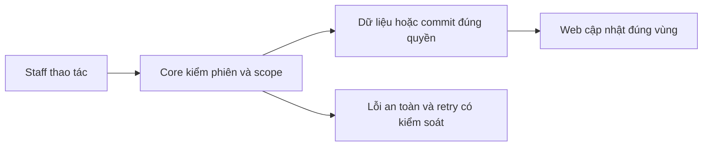
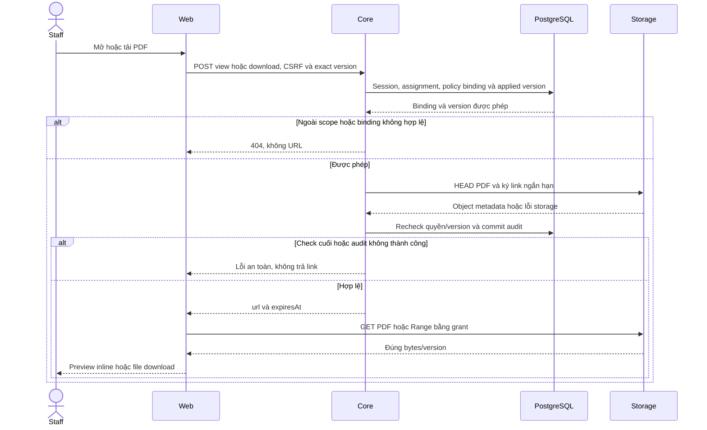

# PL02 — Applied version và PDF access

04/11/2026 · **Đã triển khai; baseline Core/MinIO** · [Contract](../05-policies-contract.md) · [Chung](../00-staff-contract.md).

## Bổ sung bảo vệ dữ liệu Customer — 12/11/2026

**P — chưa triển khai phần bảo vệ bổ sung; giữ trạng thái baseline của phase.** Theo [ma trận dữ liệu chung](../../../../configuration-and-data.md#customer-sensitive-data); mức che/quyền xem đầy đủ còn chờ chốt. Vị trí code/API và data model của phase bên dưới là nơi rà tác động; bổ sung này không tự yêu cầu migration hoặc sửa dữ liệu gốc.

**Thay đổi của phase:** Rà title/filename/metadata có định danh. Signed URL/PDF gốc chưa được redaction bởi masking profile; không overwrite version hoặc thay nguồn bằng bản che âm thầm.

**Kiểm thử cần bổ sung, chưa chạy:** API/storage: metadata/audit/error không rò canary/URL ký ngoài contract; đúng applied version và assignment.

## Data model và phạm vi ảnh hưởng

Bảng bên dưới mô tả tác động của phase, gồm cả ghi gián tiếp qua Core. Tên bảng thuộc schema `business` trừ nơi ghi rõ; cột còn đề xuất được đánh dấu **P**. Web không truy cập DB trực tiếp.

| Bảng/model | Cột hoặc dữ liệu liên quan | Thao tác của phase | Quan hệ/ràng buộc cần giữ | Mức ảnh hưởng và nơi bị tác động |
| --- | --- | --- | --- | --- |
| users + auth_sessions | users.id/role/status, auth_sessions.user_id/token_hash/expires_at/revoked_at | Đọc | AuthSession.user_id → User.id; session phải còn hạn, không bị thu hồi | Cao — mọi API dùng session; không trả token/hash trong DTO |
| staff_assignments + customer_profiles + staff_profiles | staff_id/customer_id/is_active/ended_at, assignment_version, user_id/full_name | Đọc | Assignment gắn đúng Customer/Staff; Inbox còn ràng buộc assignment id cụ thể | Cao — Customers, Policy Lookup, Ticket và Inbox cùng phụ thuộc phân công |
| insurance_policies + insurance_products | customer_id/product_id/policy_number/status, premium_amount/payment_frequency/next_due_date, effective_date/expiry_date/sum_assured/benefits_snapshot, product_code/name | Đọc | Policy.customer_id → CustomerProfile.user_id; product_id → InsuranceProduct.id; unique policy_number | Cao — DTO tiền/ngày/snapshot dùng chung Staff/Customer; không OCR PDF để cập nhật DB |
| documents + document_versions | access_scope/policy_id/owner_customer_id/product_id/current_version, document_id/version_number/is_active/checksum_sha256/storage_bucket/storage_object_key | Đọc | FK (policy_id,owner_customer_id) → Policy(id,customer_id); unique (document_id,version_number); policy dùng exact binding trong benefits_snapshot, Products dùng current_version | Cao — đổi version/scope ảnh hưởng viewer, download và nguồn retrieval; bucket/key không ra DTO |
| MinIO/S3 — ngoài PostgreSQL | Object PDF theo storage_bucket/storage_object_key, checksum SHA-256, Content-Type | HEAD + ký GET/Range, không upload từ viewer | Không FK xuyên DB/object store; exact version/checksum do Core đối chiếu | Cao — DB transaction không rollback storage; URL đã cấp còn residual TTL, không log URL/key |
| audit_logs | actor_id/action/target_type/target_id/outcome/request_id/metadata/created_at | Thêm khi mutation/cấp PDF theo service | actor_id → User.id; không sửa/xóa audit cũ; chỉ metadata allowlist | Cao — phải giữ bằng chứng đúng transaction nghiệp vụ; không lưu transcript/password/signed URL |

**Schema/migration:** Không migration, không thêm Document.kind; phân loại nằm trong applied bindings JSON hiện có. Không tự đổi current_version hoặc ghi snapshot khi xem PDF.

**Nhất quán và hồi quy:** GET catalog không ký URL; POST access kiểm đúng binding/version, audit trước trả grant. Kiểm version cũ còn áp dụng, cross-policy, storage fail và TTL; không tuyên bố DB/S3 atomic.

## 1. Phạm vi và model

PL01 + NFR-007; Document/DocumentVersion và benefitsSnapshot.documents. Schema không có Document.kind; AccessScope PUBLIC/PRIVATE_POLICY.

## 2. Vị trí code

`policy.service.ts`, `policy-storage.service.ts`, `policy-snapshot.ts`, `document-access.dto.ts`; storage reader runtime, writer chỉ job fixture/bootstrap.

| Vị trí từ root repo | Hiện trạng | Trách nhiệm trong phase | Mức ảnh hưởng | Phạm vi cần kiểm lại |
| --- | --- | --- | --- | --- |
| [apps/core/src/policies/services/policy.service.ts](<../../../../../apps/core/src/policies/services/policy.service.ts>) | Hiện có | Exact applied binding và auth trước cấp link | Cao | Hai role, main policy/terms/endorsement |
| [apps/core/src/policies/services/policy-storage.service.ts](<../../../../../apps/core/src/policies/services/policy-storage.service.ts>) | Hiện có | HEAD/sign, inline vs attachment, TTL | Cao | Policy PDF và Products PDF dùng chung |
| [apps/core/src/policies/services/policy-snapshot.ts](<../../../../../apps/core/src/policies/services/policy-snapshot.ts>) | Hiện có | Đọc binding trong benefits_snapshot | Cao | Không suy Document.kind/title/current publication |
| [apps/core/src/policies/dto/document-access.dto.ts](<../../../../../apps/core/src/policies/dto/document-access.dto.ts>) | Hiện có | policyId body và url/expiresAt response | Trung bình | Viewer/download API client |

## 3. API và dữ liệu

Prefix REST `/api/v1`; `E` là runtime, không endpoint đề xuất mới.

A18 `GET /staff/policies/:policyId/documents` → policyId/items/total/availability/mainDocumentStatus/issues; không URL/bucket/key. POLICY/POLICY_DRAFT/TERMS/PRODUCT_GUIDE/ENDORSEMENT từ binding exact documentId+versionNumber đã validate, không title/currentVersion.

A20 POST `/staff/documents/:documentId/versions/:versionId/view|download` body `{policyId}` → `{url,expiresAt}`. Session/CSRF/assignment/binding/version active, HEAD PDF, recheck quyền và audit trước link; view inline/download attachment. Storage thiếu/lỗi trả safe error theo contract, không SDK exception. Không cho client chọn bucket/key/filename/URL.

## 4. Luồng và trạng thái

Core authorize → exact applied binding → HEAD/sign ở storage → recheck/audit → grant → browser GET/Range. TTL900 local mặc định, grant cũ có residual TTL khi logout/revoke; không hứa thu hồi file tải. Metadata binding bất biến, không overwrite object/version cũ.

## 5. Test cases

Các ca dưới đây là **đặc tả kiểm thử**, không phải báo cáo kết quả. Kiểm từng lớp API/service/DB/browser đúng nhãn; mock UI không thay kiểm quyền Core hoặc E2E thật.

**Quy ước dữ liệu:** S-A/S-B là hai Staff synthetic; C-A/C-B là hai Customer synthetic khác nhau. Thay alias bằng UUID/token của fixture cô lập; các path HTTP dùng prefix /api/v1 nếu chưa ghi đầy đủ. Chỉ thay assignment, khóa account, inject lỗi hoặc migration trong harness/môi trường test, không trên tài khoản/dữ liệu đang sử dụng.

### PL02-T01 — Applied version khác product current

**Lớp kiểm thử:** API + Storage.
**Điều kiện và dữ liệu:** PolicyA bind D1/v1; product của D1 đã current v2, hai PDF hash khác nhau.

**Các bước:**

1. GET /staff/policies/PolicyA/documents.
2. POST view/download D1/v1 với body policyId=PolicyA.
3. Đối chiếu version và hash.

**Kết quả mong đợi:** Catalog/access dùng applied v1, không trôi sang current v2; view inline và download attachment đúng bản.

### PL02-T02 — Binding và scope không thể giả

**Lớp kiểm thử:** API.
**Điều kiện và dữ liệu:** PolicyA của C-A; PolicyB ngoài scope; D2 không bind PolicyA.

**Các bước:**

1. Gửi PolicyA với D2 hoặc version chưa bind.
2. Gửi D1/v1 nhưng policyId=PolicyB.
3. Đổi body thêm bucket/key/url.

**Kết quả mong đợi:** Ngoài binding/scope 404, trường lạ 400; không trả URL hoặc storage metadata.

### PL02-T03 — PDF chính thiếu vẫn có catalog an toàn

**Lớp kiểm thử:** API.
**Điều kiện và dữ liệu:** PolicyA có binding chính thiếu/invalid và tài liệu liên quan hợp lệ.

**Các bước:**

1. GET catalog.
2. Kiểm availability/mainDocumentStatus/issues.
3. Xin access tài liệu chính không hợp lệ rồi tài liệu liên quan hợp lệ.

**Kết quả mong đợi:** Metadata phản ánh đúng thiếu/invalid, không tự chọn current/thay thế; chỉ tài liệu liên quan có binding đúng được cấp link.

### PL02-T04 — Mất quyền, storage và audit failure

**Lớp kiểm thử:** API + DB/Storage barrier.
**Điều kiện và dữ liệu:** Có phiên Staff, CSRF và policy binding hợp lệ; các lỗi được inject trong harness.

**Các bước:**

1. Revoke assignment trong lúc cấp link.
2. Lặp với storage timeout và audit commit failure.
3. Kiểm response và số audit/URL được trả.

**Kết quả mong đợi:** Không trả link sau check cuối mất quyền hoặc audit lỗi; storage error an toàn; không để credential/URL ký trong log.

**Dọn sau kiểm thử:** xóa đúng fixture/session/object/schema theo runId; phục hồi fault injection và đóng context/socket test. Không reset DB/credential, sửa bootstrap hoặc xóa volumes. Với PDF kiểm metadata/bytes/hash; với UI kiểm DOM/focus/network, không cần screenshot.

## 6. Checklist và giới hạn

- [x] Có code runtime trong phạm vi được ghi ở tiêu đề; phase này bổ sung tài liệu cho phần đã làm.
- [x] Có các lớp kiểm thử/bằng chứng được dẫn ở contract; không coi việc dọn docs là chạy lại test.

**Quy tắc khi bảo trì:** Khi thay đổi code, chạy các suite bị ảnh hưởng theo test case của phase và dọn fixture/artifact do lượt kiểm thử tạo ra. Báo kết quả ngắn trong trao đổi, không ghi nhật ký kiểm thử vào phase. Đây là quy tắc áp dụng mỗi lần sửa, không phải hạng mục chức năng còn thiếu.

Không dùng product guide/terms thay bản chính bị thiếu. Product PUBLIC current catalog/access P02 khác applied version policy; không mở rộng lẫn quyền.

## Tự động hóa test case

| Suite/vị trí | Phạm vi và giới hạn |
| --- | --- |
| [staff-foundation.integration.spec.mjs](../../../../../apps/web/tests/browser/staff-foundation.integration.spec.mjs) | Applied v1 giữ nguyên dù current v2, view/download hash/Range, unbound version/foreign owner denied và missing object thật. |
| [browser-staff-fixture.cjs](../../../../../apps/core/test/support/browser-staff-fixture.cjs) | Dữ liệu synthetic UUID qua test Docker, session/password trong memory; finally dọn đúng fixture/object, không reset seed |
| [test-staff.mjs](../../../../../apps/web/scripts/test-staff.mjs) | Chạy Chromium/Firefox/WebKit, gom JSON tạm rồi tự dọn artifact; Web/Core chỉ chạy Docker |

Ca lỗi mạng dùng fault injection rõ ràng; native PDF toolbar/zoom không được xác minh bằng iframe DOM. Các bảng/test case là đặc tả duy trì, không ghi nhật ký từng lần chạy tại đây.

## Sequence diagram

Luồng chính và nhánh quyền/lỗi; test case ở trên chỉ rõ dữ liệu và điểm kiểm tương ứng.

