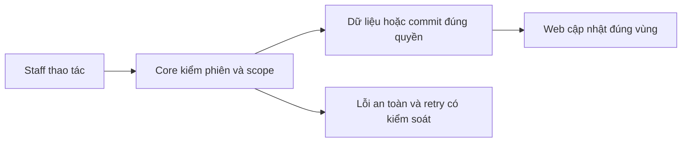
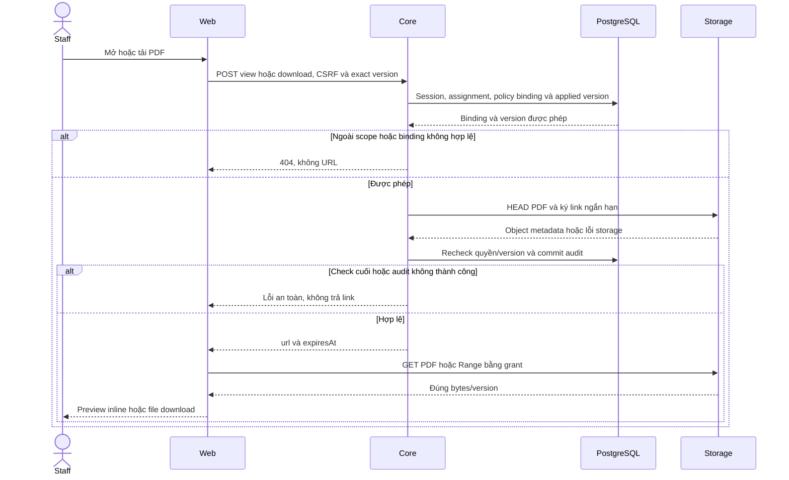

# PL02 — Applied version và PDF access

04/11/2026 · **Đã triển khai; baseline Core/MinIO** · [Contract](../05-policies-contract.md) · [Chung](../00-staff-contract.md).

## 1. Phạm vi và model

PL01 + NFR-007; Document/DocumentVersion và benefitsSnapshot.documents. Schema không có Document.kind; AccessScope PUBLIC/PRIVATE_POLICY.

## 2. Vị trí code

`policy.service.ts`, `policy-storage.service.ts`, `policy-snapshot.ts`, `document-access.dto.ts`; storage reader runtime, writer chỉ job fixture/bootstrap.

## 3. API và dữ liệu

Prefix REST `/api/v1`; `E` là runtime, không endpoint đề xuất mới.

A18 `GET /staff/policies/:policyId/documents` → policyId/items/total/availability/mainDocumentStatus/issues; không URL/bucket/key. POLICY/POLICY_DRAFT/TERMS/PRODUCT_GUIDE/ENDORSEMENT từ binding exact documentId+versionNumber đã validate, không title/currentVersion.

A20 POST `/staff/documents/:documentId/versions/:versionId/view|download` body `{policyId}` → `{url,expiresAt}`. Session/CSRF/assignment/binding/version active, HEAD PDF, recheck quyền và audit trước link; view inline/download attachment. Storage thiếu/lỗi trả safe error theo contract, không SDK exception. Không cho client chọn bucket/key/filename/URL.

## 4. Luồng và trạng thái

Core authorize → exact applied binding → HEAD/sign ở storage → recheck/audit → grant → browser GET/Range. TTL900 local mặc định, grant cũ có residual TTL khi logout/revoke; không hứa thu hồi file tải. Metadata binding bất biến, không overwrite object/version cũ.

## 5. Test cases

Các ca dưới đây là **đặc tả kiểm thử**, không phải báo cáo kết quả. Kiểm từng lớp API/service/DB/browser đúng nhãn; mock UI không thay kiểm quyền Core hoặc E2E thật.

**Quy ước dữ liệu:** S-A/S-B là hai Staff synthetic; C-A/C-B là hai Customer synthetic khác nhau. Thay alias bằng UUID/token của fixture cô lập; các path HTTP dùng prefix /api/v1 nếu chưa ghi đầy đủ. Chỉ thay assignment, khóa account, inject lỗi hoặc migration trong harness/môi trường test, không trên tài khoản/dữ liệu đang sử dụng.

### PL02-T01 — Applied version khác product current

**Lớp kiểm thử:** API + Storage.
**Điều kiện và dữ liệu:** PolicyA bind D1/v1; product của D1 đã current v2, hai PDF hash khác nhau.

**Các bước:**

1. GET /staff/policies/PolicyA/documents.
2. POST view/download D1/v1 với body policyId=PolicyA.
3. Đối chiếu version và hash.

**Kết quả mong đợi:** Catalog/access dùng applied v1, không trôi sang current v2; view inline và download attachment đúng bản.

### PL02-T02 — Binding và scope không thể giả

**Lớp kiểm thử:** API.
**Điều kiện và dữ liệu:** PolicyA của C-A; PolicyB ngoài scope; D2 không bind PolicyA.

**Các bước:**

1. Gửi PolicyA với D2 hoặc version chưa bind.
2. Gửi D1/v1 nhưng policyId=PolicyB.
3. Đổi body thêm bucket/key/url.

**Kết quả mong đợi:** Ngoài binding/scope 404, trường lạ 400; không trả URL hoặc storage metadata.

### PL02-T03 — PDF chính thiếu vẫn có catalog an toàn

**Lớp kiểm thử:** API.
**Điều kiện và dữ liệu:** PolicyA có binding chính thiếu/invalid và tài liệu liên quan hợp lệ.

**Các bước:**

1. GET catalog.
2. Kiểm availability/mainDocumentStatus/issues.
3. Xin access tài liệu chính không hợp lệ rồi tài liệu liên quan hợp lệ.

**Kết quả mong đợi:** Metadata phản ánh đúng thiếu/invalid, không tự chọn current/thay thế; chỉ tài liệu liên quan có binding đúng được cấp link.

### PL02-T04 — Mất quyền, storage và audit failure

**Lớp kiểm thử:** API + DB/Storage barrier.
**Điều kiện và dữ liệu:** Có phiên Staff, CSRF và policy binding hợp lệ; các lỗi được inject trong harness.

**Các bước:**

1. Revoke assignment trong lúc cấp link.
2. Lặp với storage timeout và audit commit failure.
3. Kiểm response và số audit/URL được trả.

**Kết quả mong đợi:** Không trả link sau check cuối mất quyền hoặc audit lỗi; storage error an toàn; không để credential/URL ký trong log.

**Dọn sau kiểm thử:** xóa đúng fixture/session/object/schema theo runId; phục hồi fault injection và đóng context/socket test. Không reset DB/credential, sửa bootstrap hoặc xóa volumes. Với PDF kiểm metadata/bytes/hash; với UI kiểm DOM/focus/network, không cần screenshot.

## 6. Checklist và giới hạn

- [x] Có code runtime trong phạm vi được ghi ở tiêu đề; phase này bổ sung tài liệu cho phần đã làm.
- [x] Có các lớp kiểm thử/bằng chứng được dẫn ở contract; không coi việc dọn docs là chạy lại test.
- [ ] Khi sửa code tiếp: chạy các suite bị ảnh hưởng, ghi kết quả trong phase và dọn fixture/artifact.

Không dùng product guide/terms thay bản chính bị thiếu. Product PUBLIC current catalog/access P02 khác applied version policy; không mở rộng lẫn quyền.

## Sequence diagram

Luồng chính và nhánh quyền/lỗi; test case ở trên chỉ rõ dữ liệu và điểm kiểm tương ứng.

