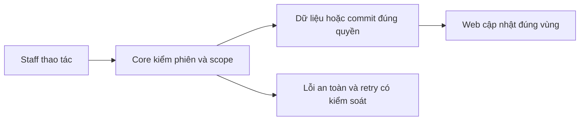
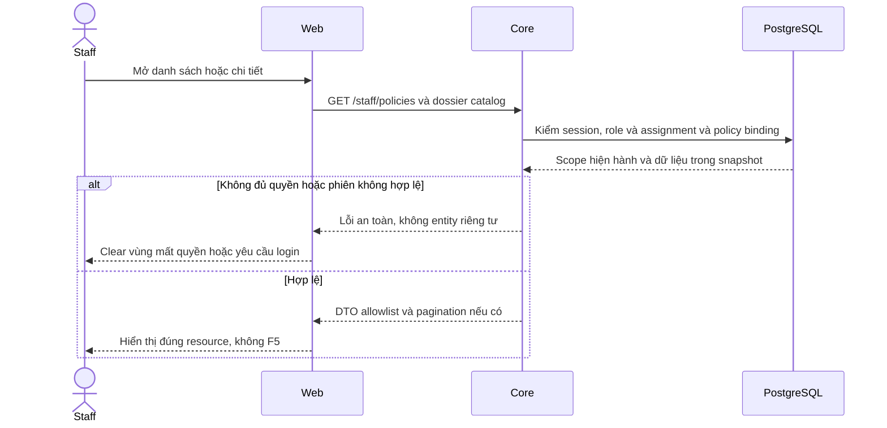

# PL03 — Lookup và dossier/PDF Staff

04/11/2026 · **Đã triển khai; baseline FE** · [Contract](../05-policies-contract.md) · [Chung](../00-staff-contract.md).

## Bổ sung bảo vệ dữ liệu Customer — 12/11/2026

**P — chưa triển khai phần bảo vệ bổ sung; giữ trạng thái baseline của phase.** Theo [ma trận dữ liệu chung](../../../../configuration-and-data.md#customer-sensitive-data); email/phone Customer được che mặc định theo định dạng A ngày 13/11, Staff có Hiện/Ẩn để liên hệ theo cập nhật 14/11. Core kiểm lại quyền khi reveal, phần triển khai và các quyết định còn mở theo ma trận chung. Vị trí code/API và data model của phase bên dưới là nơi rà tác động; bổ sung này không tự yêu cầu migration hoặc sửa dữ liệu gốc.

**Thay đổi của phase:** Lookup/dossier chỉ dùng DTO Core đã che; rà label/copy/tooltip/search/URL, không tải raw rồi che React. Giữ deep link/Back/no-F5 theo search contract mới.

**Kiểm thử cần bổ sung, chưa chạy:** DOM/network: canary không ở JSON/hidden DOM/history ngoài ma trận; revoke/selection cũ không hồi raw.

**Số hợp đồng — A đã chốt 14/11/2026.** policyNumber được hiển thị đầy đủ trong scope phân công và gate tài nguyên, khớp source hiện tại. Giữ nguyên chuỗi nghiệp vụ, kiểm ký tự/số đầu và phân biệt policyNumber với policyId. Contact email/phone dùng che mặc định + Hiện/Ẩn theo CU01/CU02. [Policy chuẩn](../../../../configuration-and-data.md#staff-policy-number).

**Liên hệ Customer — cập nhật 14/11/2026, triển khai P.** Contact card che email/phone mặc định và có Hiện/Ẩn để Staff liên hệ. Core kiểm lại quyền/phân công tại thời điểm reveal, response riêng từng trường. Raw được xóa khỏi UI state khi Ẩn/đổi khách/logout/revoke. [CU01/CU02 và policy chuẩn](../../../../configuration-and-data.md#staff-contact-reveal).

## Data model và phạm vi ảnh hưởng

Bảng bên dưới mô tả tác động của phase, gồm cả ghi gián tiếp qua Core. Tên bảng thuộc schema `business` trừ nơi ghi rõ; cột còn đề xuất được đánh dấu **P**. Web không truy cập DB trực tiếp.

| Bảng/model | Cột hoặc dữ liệu liên quan | Thao tác của phase | Quan hệ/ràng buộc cần giữ | Mức ảnh hưởng và nơi bị tác động |
| --- | --- | --- | --- | --- |
| users + auth_sessions | users.id/role/status, auth_sessions.user_id/token_hash/expires_at/revoked_at | Đọc | AuthSession.user_id → User.id; session phải còn hạn, không bị thu hồi | Cao — mọi API dùng session; không trả token/hash trong DTO |
| staff_assignments + customer_profiles + staff_profiles | staff_id/customer_id/is_active/ended_at, assignment_version, user_id/full_name | Đọc | Assignment gắn đúng Customer/Staff; Inbox còn ràng buộc assignment id cụ thể | Cao — Customers, Policy Lookup, Ticket và Inbox cùng phụ thuộc phân công |
| insurance_policies + insurance_products | customer_id/product_id/policy_number/status, premium_amount/payment_frequency/next_due_date, effective_date/expiry_date/sum_assured/benefits_snapshot, product_code/name | Đọc | Policy.customer_id → CustomerProfile.user_id; product_id → InsuranceProduct.id; unique policy_number | Cao — DTO tiền/ngày/snapshot dùng chung Staff/Customer; không OCR PDF để cập nhật DB |
| documents + document_versions | access_scope/policy_id/owner_customer_id/product_id/current_version, document_id/version_number/is_active/checksum_sha256/storage_bucket/storage_object_key | Đọc | FK (policy_id,owner_customer_id) → Policy(id,customer_id); unique (document_id,version_number); policy dùng exact binding trong benefits_snapshot, Products dùng current_version | Cao — đổi version/scope ảnh hưởng viewer, download và nguồn retrieval; bucket/key không ra DTO |
| MinIO/S3 — ngoài PostgreSQL | Object PDF theo storage_bucket/storage_object_key, checksum SHA-256, Content-Type | HEAD + ký GET/Range, không upload từ viewer | Không FK xuyên DB/object store; exact version/checksum do Core đối chiếu | Cao — DB transaction không rollback storage; URL đã cấp còn residual TTL, không log URL/key |
| audit_logs | actor_id/action/target_type/target_id/outcome/request_id/metadata/created_at | Thêm khi mutation/cấp PDF theo service | actor_id → User.id; không sửa/xóa audit cũ; chỉ metadata allowlist | Cao — phải giữ bằng chứng đúng transaction nghiệp vụ; không lưu transcript/password/signed URL |

**Schema/migration:** Không migration. Chọn/xem policy không ghi conversations.linked_policy_id; không cập nhật PDF/version/snapshot.

**Nhất quán và hồi quy:** Web không ghi DB trực tiếp; audit access chỉ khi gọi POST cấp PDF, không theo mỗi invalidation. Core vẫn kiểm assignment riêng dù mở từ Inbox. Kiểm race đổi customer/actor, version/revoke và giữ viewer/focus khi refetch cùng tài nguyên.

## 1. Phạm vi và model

PL01/PL02 + NFR-007. Hai điểm vào: Customers policies của một khách và Policy Lookup toàn tập phân công.

## 2. Vị trí code

`staff-policy-lookup.tsx`, `staff-policies.tsx`, `signed-pdf-preview.tsx`, `use-authorized-read.ts`, `lib/policy-api.ts`; routes /staff/policies và /staff/policies/:policyId.

| Vị trí từ root repo | Hiện trạng | Trách nhiệm trong phase | Mức ảnh hưởng | Phạm vi cần kiểm lại |
| --- | --- | --- | --- | --- |
| [apps/web/src/components/staff-policy-lookup.tsx](<../../../../../apps/web/src/components/staff-policy-lookup.tsx>) | Hiện có | Lookup search/status/page/collapse | Trung bình | URL/Back/selection |
| [apps/web/src/components/staff-policies.tsx](<../../../../../apps/web/src/components/staff-policies.tsx>) | Hiện có | Dossier, details, exact document selection | Trung bình | Customers và Lookup dùng chung |
| [apps/web/src/components/signed-pdf-preview.tsx](<../../../../../apps/web/src/components/signed-pdf-preview.tsx>) | Hiện có | Giữ viewer theo exact version, grant/download | Cao | Staff/Customer policy và product PDFs |
| [apps/web/src/lib/policy-api.ts](<../../../../../apps/web/src/lib/policy-api.ts>) | Hiện có | Read/access DTO và AbortSignal | Cao | Tất cả caller policy |

## 3. API và dữ liệu

Prefix REST `/api/v1`; `E` là runtime, không endpoint đề xuất mới.

Lookup search Enter, xóa rồi Enter bỏ từ khóa; status select cập nhật trực tiếp, reset page 1, không nút Search/Clear. Giữ URL/search/status/page khi chọn/Back; collapse icon trong search. Client dùng A14/A15/A16/A18/A20, download grant riêng.

## 4. Luồng và trạng thái

PDF chính tự hiển thị; Policy information đóng mặc định, từ DB chứ không OCR. Supporting TERMS/ENDORSEMENT riêng, Back to main policy; PRODUCT_GUIDE ở Products. Thiếu main hiện lỗi/empty rõ. Same version giữ iframe/src/focus/scroll; đổi actor/binding/quyền xóa đúng scope. Mobile list→detail; không nút Customer profile trên dossier.

## 5. Test cases

Các ca dưới đây là **đặc tả kiểm thử**, không phải báo cáo kết quả. Kiểm từng lớp API/service/DB/browser đúng nhãn; mock UI không thay kiểm quyền Core hoặc E2E thật.

**Quy ước dữ liệu:** S-A/S-B là hai Staff synthetic; C-A/C-B là hai Customer synthetic khác nhau. Thay alias bằng UUID/token của fixture cô lập; các path HTTP dùng prefix /api/v1 nếu chưa ghi đầy đủ. Chỉ thay assignment, khóa account, inject lỗi hoặc migration trong harness/môi trường test, không trên tài khoản/dữ liệu đang sử dụng.

### PL03-T01 — Lookup → detail → Back giữ bộ lọc

**Lớp kiểm thử:** Browser.
**Điều kiện và dữ liệu:** S-A có nhiều policy; biết policy ở trang2.

**Các bước:**

1. Tìm tên/mã sản phẩm bằng Enter, lọc status rồi sang trang2.
2. Chọn policy và xem dossier.
3. Back, mở rộng/thu gọn list bằng icon.

**Kết quả mong đợi:** Search/status/page giữ đúng, không Back to Inbox ở lookup độc lập, không F5.

### PL03-T02 — PDF chính và thông tin thu gọn

**Lớp kiểm thử:** Browser.
**Điều kiện và dữ liệu:** PolicyA có PDF chính và phụ lục; PolicyZ chưa có PDF chính.

**Các bước:**

1. Mở PolicyA, đọc PDF và mở thông tin policy.
2. Đổi sang phụ lục, Download.
3. Mở PolicyZ.

**Kết quả mong đợi:** Không nhầm tài liệu chính với related; metadata lấy API không trích xuất PDF; policy thiếu PDF vẫn đọc summary.

### PL03-T03 — Race selection và scope loss

**Lớp kiểm thử:** Browser + API mock.
**Điều kiện và dữ liệu:** Giữ response policyA, chọn policyB trong khi A pending.

**Các bước:**

1. Trả responseA muộn.
2. Cho refresh B cùng dữ liệu.
3. Cho detail/catalog B trả 404 sau revoke.

**Kết quả mong đợi:** Không hiển thị A trong B; refresh không phá vùng đang đọc; mất quyền xóa dossier/viewer/link cũ.

### PL03-T04 — Lỗi theo vùng và responsive

**Lớp kiểm thử:** Browser + API mock.
**Điều kiện và dữ liệu:** List/detail/PDF có biến thể 503 độc lập, viewport 375px.

**Các bước:**

1. Retry từng vùng lỗi.
2. Dùng Back và Tab qua list/PDF/download.
3. Đặt zoom 200%.

**Kết quả mong đợi:** Không reload document hoặc mất filters; lỗi PDF không làm hỏng list; controls/focus không tràn.

**Dọn sau kiểm thử:** xóa đúng fixture/session/object/schema theo runId; phục hồi fault injection và đóng context/socket test. Không reset DB/credential, sửa bootstrap hoặc xóa volumes. Với PDF kiểm metadata/bytes/hash; với UI kiểm DOM/focus/network, không cần screenshot.

## 6. Checklist và giới hạn

- [x] Có code runtime trong phạm vi được ghi ở tiêu đề; phase này bổ sung tài liệu cho phần đã làm.
- [x] Có các lớp kiểm thử/bằng chứng được dẫn ở contract; không coi việc dọn docs là chạy lại test.

**Quy tắc khi bảo trì:** Khi thay đổi code, chạy các suite bị ảnh hưởng theo test case của phase và dọn fixture/artifact do lượt kiểm thử tạo ra. Báo kết quả ngắn trong trao đổi, không ghi nhật ký kiểm thử vào phase. Đây là quy tắc áp dụng mỗi lần sửa, không phải hạng mục chức năng còn thiếu.

Lifecycle chi tiết PL04 đã chuyển từ plan sửa lỗi cũ. Giữ policy view lifecycle khi cải tiến product viewer; không thêm PDF.js/dependency mặc định.

## Tự động hóa test case

| Suite/vị trí | Phạm vi và giới hạn |
| --- | --- |
| [staff-foundation.integration.spec.mjs](../../../../../apps/web/tests/browser/staff-foundation.integration.spec.mjs) | Hai role mở PDF đúng binding; shared viewer giữ scope khi assignment đổi; browser regression kiểm filter/deep link/state. |
| [browser-staff-fixture.cjs](../../../../../apps/core/test/support/browser-staff-fixture.cjs) | Dữ liệu synthetic UUID qua test Docker, session/password trong memory; finally dọn đúng fixture/object, không reset seed |
| [test-staff.mjs](../../../../../apps/web/scripts/test-staff.mjs) | Chạy Chromium/Firefox/WebKit, gom JSON tạm rồi tự dọn artifact; Web/Core chỉ chạy Docker |

Ca lỗi mạng dùng fault injection rõ ràng; native PDF toolbar/zoom không được xác minh bằng iframe DOM. Các bảng/test case là đặc tả duy trì, không ghi nhật ký từng lần chạy tại đây.

## Sequence diagram

Luồng chính và nhánh quyền/lỗi; test case ở trên chỉ rõ dữ liệu và điểm kiểm tương ứng.

