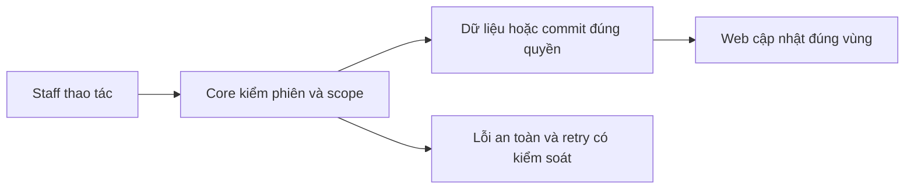

# PL03 — Lookup và dossier/PDF Staff

04/11/2026 · **Đã triển khai; baseline FE** · [Contract](../05-policies-contract.md) · [Chung](../00-staff-contract.md).

## 1. Phạm vi và model

PL01/PL02 + NFR-007. Hai điểm vào: Customers policies của một khách và Policy Lookup toàn tập phân công.

## 2. Vị trí code

`staff-policy-lookup.tsx`, `staff-policies.tsx`, `signed-pdf-preview.tsx`, `use-authorized-read.ts`, `lib/policy-api.ts`; routes /staff/policies và /staff/policies/:policyId.

## 3. API và dữ liệu

Prefix REST `/api/v1`; `E` là runtime, không endpoint đề xuất mới.

Lookup search Enter, xóa rồi Enter bỏ từ khóa; status select cập nhật trực tiếp, reset page1, không nút Search/Clear. Giữ URL/search/status/page khi chọn/Back; collapse icon trong search. Client dùng A14/A15/A16/A18/A20, download grant riêng.

## 4. Luồng và trạng thái

PDF chính tự hiển thị; Policy information đóng mặc định, từ DB chứ không OCR. Supporting TERMS/ENDORSEMENT riêng, Back to main policy; PRODUCT_GUIDE ở Products. Thiếu main hiện lỗi/empty rõ. Same version giữ iframe/src/focus/scroll; đổi actor/binding/quyền xóa đúng scope. Mobile list→detail; không nút Customer profile trên dossier.

## 5. Kiểm thử

`staff-policies.spec.mjs`26 browser mock: metadata refresh/iframe identity, scope/session/version/late response, download denial, expiry, collapse/filter/page, draft và no-F5. Test Core/MinIO theo PL02; bổ sung browser E2E policy thật trong PL03; không tuyên bố kiểm page/zoom bên trong native iframe.

## 6. Checklist và giới hạn

- [x] Có code runtime trong phạm vi được ghi ở tiêu đề; phase này bổ sung tài liệu cho phần đã làm.
- [x] Có các lớp kiểm thử/bằng chứng được dẫn ở contract; không coi việc dọn docs là chạy lại test.
- [ ] Khi sửa code tiếp: chạy các suite bị ảnh hưởng, ghi kết quả trong phase và dọn fixture/artifact.

Lifecycle chi tiết PL04 đã chuyển từ plan sửa lỗi cũ. Giữ policy view lifecycle khi cải tiến product viewer; không thêm PDF.js/dependency mặc định.

