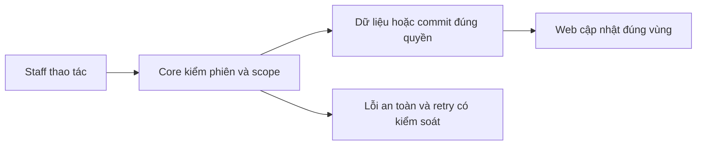
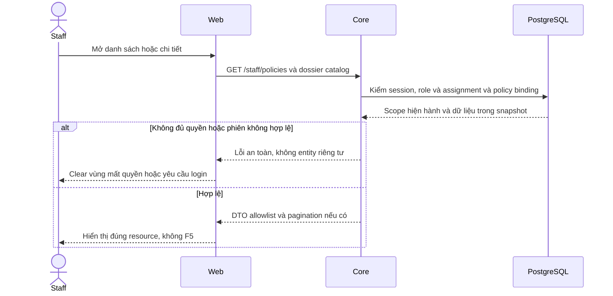

# PL03 — Lookup và dossier/PDF Staff

04/11/2026 · **Đã triển khai; baseline FE** · [Contract](../05-policies-contract.md) · [Chung](../00-staff-contract.md).

## 1. Phạm vi và model

PL01/PL02 + NFR-007. Hai điểm vào: Customers policies của một khách và Policy Lookup toàn tập phân công.

## 2. Vị trí code

`staff-policy-lookup.tsx`, `staff-policies.tsx`, `signed-pdf-preview.tsx`, `use-authorized-read.ts`, `lib/policy-api.ts`; routes /staff/policies và /staff/policies/:policyId.

## 3. API và dữ liệu

Prefix REST `/api/v1`; `E` là runtime, không endpoint đề xuất mới.

Lookup search Enter, xóa rồi Enter bỏ từ khóa; status select cập nhật trực tiếp, reset page 1, không nút Search/Clear. Giữ URL/search/status/page khi chọn/Back; collapse icon trong search. Client dùng A14/A15/A16/A18/A20, download grant riêng.

## 4. Luồng và trạng thái

PDF chính tự hiển thị; Policy information đóng mặc định, từ DB chứ không OCR. Supporting TERMS/ENDORSEMENT riêng, Back to main policy; PRODUCT_GUIDE ở Products. Thiếu main hiện lỗi/empty rõ. Same version giữ iframe/src/focus/scroll; đổi actor/binding/quyền xóa đúng scope. Mobile list→detail; không nút Customer profile trên dossier.

## 5. Test cases

Các ca dưới đây là **đặc tả kiểm thử**, không phải báo cáo kết quả. Kiểm từng lớp API/service/DB/browser đúng nhãn; mock UI không thay kiểm quyền Core hoặc E2E thật.

**Quy ước dữ liệu:** S-A/S-B là hai Staff synthetic; C-A/C-B là hai Customer synthetic khác nhau. Thay alias bằng UUID/token của fixture cô lập; các path HTTP dùng prefix /api/v1 nếu chưa ghi đầy đủ. Chỉ thay assignment, khóa account, inject lỗi hoặc migration trong harness/môi trường test, không trên tài khoản/dữ liệu đang sử dụng.

### PL03-T01 — Lookup → detail → Back giữ bộ lọc

**Lớp kiểm thử:** Browser.
**Điều kiện và dữ liệu:** S-A có nhiều policy; biết policy ở trang2.

**Các bước:**

1. Tìm tên/mã sản phẩm bằng Enter, lọc status rồi sang trang2.
2. Chọn policy và xem dossier.
3. Back, mở rộng/thu gọn list bằng icon.

**Kết quả mong đợi:** Search/status/page giữ đúng, không Back to Inbox ở lookup độc lập, không F5.

### PL03-T02 — PDF chính và thông tin thu gọn

**Lớp kiểm thử:** Browser.
**Điều kiện và dữ liệu:** PolicyA có PDF chính và phụ lục; PolicyZ chưa có PDF chính.

**Các bước:**

1. Mở PolicyA, đọc PDF và mở thông tin policy.
2. Đổi sang phụ lục, Download.
3. Mở PolicyZ.

**Kết quả mong đợi:** Không nhầm tài liệu chính với related; metadata lấy API không trích xuất PDF; policy thiếu PDF vẫn đọc summary.

### PL03-T03 — Race selection và scope loss

**Lớp kiểm thử:** Browser + API mock.
**Điều kiện và dữ liệu:** Giữ response policyA, chọn policyB trong khi A pending.

**Các bước:**

1. Trả responseA muộn.
2. Cho refresh B cùng dữ liệu.
3. Cho detail/catalog B trả 404 sau revoke.

**Kết quả mong đợi:** Không hiển thị A trong B; refresh không phá vùng đang đọc; mất quyền xóa dossier/viewer/link cũ.

### PL03-T04 — Lỗi theo vùng và responsive

**Lớp kiểm thử:** Browser + API mock.
**Điều kiện và dữ liệu:** List/detail/PDF có biến thể 503 độc lập, viewport 375px.

**Các bước:**

1. Retry từng vùng lỗi.
2. Dùng Back và Tab qua list/PDF/download.
3. Đặt zoom 200%.

**Kết quả mong đợi:** Không reload document hoặc mất filters; lỗi PDF không làm hỏng list; controls/focus không tràn.

**Dọn sau kiểm thử:** xóa đúng fixture/session/object/schema theo runId; phục hồi fault injection và đóng context/socket test. Không reset DB/credential, sửa bootstrap hoặc xóa volumes. Với PDF kiểm metadata/bytes/hash; với UI kiểm DOM/focus/network, không cần screenshot.

## 6. Checklist và giới hạn

- [x] Có code runtime trong phạm vi được ghi ở tiêu đề; phase này bổ sung tài liệu cho phần đã làm.
- [x] Có các lớp kiểm thử/bằng chứng được dẫn ở contract; không coi việc dọn docs là chạy lại test.
- [ ] Khi sửa code tiếp: chạy các suite bị ảnh hưởng, ghi kết quả trong phase và dọn fixture/artifact.

Lifecycle chi tiết PL04 đã chuyển từ plan sửa lỗi cũ. Giữ policy view lifecycle khi cải tiến product viewer; không thêm PDF.js/dependency mặc định.

## Sequence diagram

Luồng chính và nhánh quyền/lỗi; test case ở trên chỉ rõ dữ liệu và điểm kiểm tương ứng.

