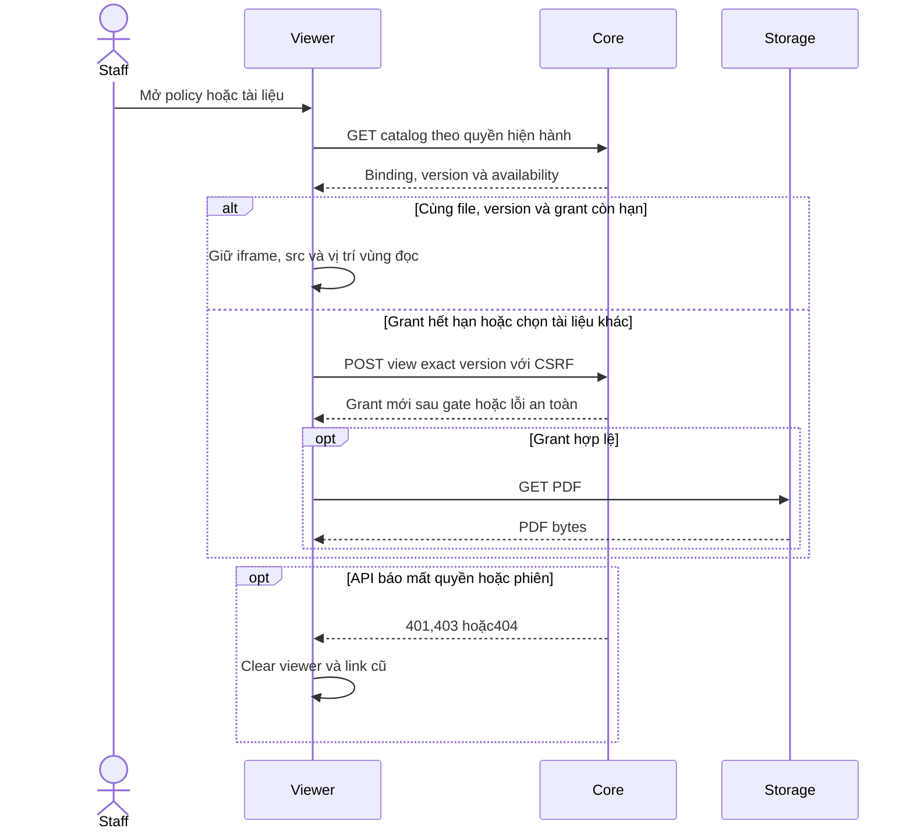

# Việc 02 — Refresh Policy/PDF không làm mất vùng đang đọc

Ngày **03/11/2026**. Trạng thái: **đã triển khai và kiểm chứng ngày 03/11/2026**. Làm sau [01 session retry](../auth/03-session-lifecycle.md), trước [03 chốt Inbox](../03-inbox-contract.md). [Phạm vi hôm nay](../../../../next-steps.md#kế-hoạch-hôm-nay--03112026).

## 1. Kết quả cần đạt

Staff mở một policy/điều khoản, đang đọc PDF hoặc mở Policy information; realtime invalidation xuất hiện nhưng quyền và version không đổi → dữ liệu được kiểm lại nền, viewer không bị tháo/dựng lại, không đổi src chỉ vì refetch và không mất lựa chọn/bộ lọc/focus.

Khi phiên/quyền/version thực sự thay đổi, xử lý theo Core; không giữ tài liệu không còn quyền để đạt cảm giác mượt. Giới hạn signed URL đã cấp vẫn theo [Policies](../05-policies-contract.md), không hứa thu hồi tức thì tại MinIO.

## 2. Điểm xuất phát và phạm vi code

| File / thành phần | Điểm cần xử lý |
| --- | --- |
| [staff-policies.tsx](../../../../../apps/web/src/components/staff-policies.tsx), usePolicyRead | Trước sửa: gộp logical key/revision gây mất data tạm. Hiện tách key khỏi lượt tải, giữ data cùng key và clear 401/403/404 |
| StaffPolicyDetail / Documents | Khi data mất tạm thời, Documents/PdfPreview biến mất, state details/chọn phụ lục có thể bị reset |
| PdfPreview | Đã tách grant khỏi realtime; metadata cha kiểm lại quyền/binding, cùng file/version giữ URL/src còn hạn |
| [policy-api.ts](../../../../../apps/web/src/lib/policy-api.ts) | Giữ API/binding/version; documentAccess đã truyền AbortSignal qua cả me() và grant request |
| [staff-policy-lookup.tsx](../../../../../apps/web/src/components/staff-policy-lookup.tsx) | Dùng usePolicyRead cho list; cần bảo toàn search/page/collapse/draft khi refactor hook |
| [realtime.ts](../../../../../apps/web/src/lib/realtime.ts) | Event hiện không mang resource scope; không bỏ qua reauthorization chỉ vì event không có policyId |

Đọc guide Next trong node_modules/next/dist/docs trước sửa. Không đổi layout/typography hoặc thêm PDF.js, thư viện cache, backend/migration/storage trong việc này.

## 3. Contract và định danh dữ liệu

A14/A15/A16/A18/A20 hiện có giữ nguyên. Core kiểm assignment/ownership/exact applied version; FE không suy quyền từ URL cũ hoặc badge.

Tách ba loại định danh:

1. **Chủ thể và tài nguyên**: actor/session lifecycle + customerId/policyId/query. Đổi actor/logout/đổi tài nguyên không được hiển thị lại data của key cũ.
2. **Lượt tải**: revision/request generation. Refetch cùng key không đồng nghĩa đổi tài nguyên; response cũ không ghi đè lần mới.
3. **File đang xem**: policyId + documentId + versionId. Chỉ giữ iframe khi định danh này và quyền còn hợp lệ; phiên bản/file đổi mới được phép dựng lại viewer.

Không tạo cache toàn cục chứa signed URL/transcript. State chỉ theo lifecycle đang có; logout/đổi actor hoặc mất quyền phải clear đúng phạm vi.

## 4. State đích

| Tình huống | Hành vi |
| --- | --- |
| Lần đầu/chuyển policy/customer/query | Loading cho tài nguyên mới, không render data key cũ như kết quả mới |
| Refetch cùng key | Giữ data hiện tại, refreshing nhẹ; form/sidebar/viewer không remount |
| 200 cùng policy/document/version | Cập nhật metadata, giữ iframe identity/src và lựa chọn/chỗ mở details |
| Catalog không còn document đang chọn hoặc version đổi | Loại viewer cũ, chọn lại theo contract main/attachments, hiển thị trạng thái thay đổi; không dùng version cũ làm fallback |
| 401 | Clear data/URL/viewer, chuyển Staff login |
| 403/404 ở policy/catalog/access | Clear dữ liệu không còn quyền và viewer liên quan; không giữ vì đang refresh nền |
| Mạng/timeout/5xx khi refetch metadata | Giữ nội dung đã tải với cảnh báo chưa đồng bộ và retry tại vùng; không coi dữ liệu cũ là xác nhận quyền mới |
| Auth lỗi/không xác minh được phiên | Theo AuthScreen fail-closed; việc này không thay chính sách auth của việc 01 |
| URL view hết hạn | Đánh dấu hết hạn, chỉ xin URL mới khi Reload preview; được phép nạp lại iframe bởi hành động này |
| Download | Luôn xin grant download mới qua Core; không tái dùng URL view làm bằng chứng quyền |

Quyền thực tế do Core chặn mọi request mới. FE không thể xác minh thu hồi trong lúc mất kết nối, signed URL có TTL riêng; UI cảnh báo offline và không tự cấp mới/retry vô hạn. Mọi điều chỉnh policy offline vượt mức trên phải review trước khi mở rộng scope.

## 5. Các bước triển khai

1. Tách logical key khỏi request revision trong usePolicyRead. Giữ data chỉ khi đúng logical key/actor, phân biệt initial loading và refreshing; giữ error/retry riêng, abort và stale-response guard.
2. Rà tất cả callers của hook: list trong Customer, list Lookup, detail, catalog và access. Không chỉ sửa một return statement rồi để nested child reset hoặc response cũ hồi sinh data.
3. Giữ Documents/PdfPreview mounted trong metadata refetch cùng key. Không dùng key={revision}, không conditionally tháo viewer vì refreshing.
4. Tách vòng đời URL preview khỏi invalidation tổng quát: detail/catalog vẫn revalidate mỗi sự kiện; nếu quyền/binding/version không đổi thì giữ URL/src còn hạn. Xin view grant ở lần mở file, đổi file hoặc Reload preview khi cần; không tự ký/thay src mỗi event.
5. Truyền kết quả revalidation xuống để clear preview khi 401/403/404/binding đổi; Catalog refresh không được trở thành cơ chế bỏ qua quyền hoặc tự fallback currentVersion.
6. Timer expiry phải gắn với **URL thực đang hiển thị**. Không kéo dài expiresAt của URL cũ bằng expiry của grant khác. Hủy timer cũ và reset expired khi nhận URL mới, tránh stale callback.
7. Giữ download lifecycle, abort và revoke blob URLs; tránh refetch làm mất thông báo download hoặc tạo nhiều grant do loop. Không đưa signed URL vào log/browser storage/test report.
8. Bổ sung regression browser có mục đích lâu dài cho các ca dưới; có thể dùng `staff-policies.spec.mjs`. Nếu thêm lệnh test root, đặt tên rõ và giữ config screenshot/video/trace off.

## 6. Test cases

Các ca dưới đây là **đặc tả kiểm thử**, không phải báo cáo kết quả. Kiểm từng lớp API/service/DB/browser đúng nhãn; mock UI không thay kiểm quyền Core hoặc E2E thật.

**Quy ước dữ liệu:** S-A/S-B là hai Staff synthetic; C-A/C-B là hai Customer synthetic khác nhau. Thay alias bằng UUID/token của fixture cô lập; các path HTTP dùng prefix /api/v1 nếu chưa ghi đầy đủ. Chỉ thay assignment, khóa account, inject lỗi hoặc migration trong harness/môi trường test, không trên tài khoản/dữ liệu đang sử dụng.

### PL04-T01 — Refresh cùng file giữ viewer

**Lớp kiểm thử:** Browser + API mock.
**Điều kiện và dữ liệu:** PolicyA/D1/v1 đang mở; lưu tham chiếu iframe, src và scroll container ngoài PDF.

**Các bước:**

1. Cuộn dossier, mở vùng thông tin thu gọn.
2. Phát nhiều metadata invalidation cùng version.
3. So sánh iframe identity/src và vị trí đọc ngoài iframe.

**Kết quả mong đợi:** Không remount hoặc xin grant lặp vô hạn; disclosure/focus/parent scroll giữ nguyên. Không suy ra page/zoom bên trong native PDF từ assertion này.

### PL04-T02 — Response cũ không thay viewer mới

**Lớp kiểm thử:** Browser + API barrier.
**Điều kiện và dữ liệu:** View request policyA bị giữ; policyB có PDF khác.

**Các bước:**

1. Mở A rồi chọn B.
2. Cho B trả grant trước; trả grantA muộn.
3. Quay lại A qua navigation hợp lệ.

**Kết quả mong đợi:** ViewerB không bịA ghi đè; grant thuộc selection/actor cũ bị bỏ; Back giữ context đúng, không F5.

### PL04-T03 — Phân biệt expired với revoked

**Lớp kiểm thử:** Browser + API mock.
**Điều kiện và dữ liệu:** ViewerA có grant sắp hết hạn; chuẩn bị biến thể metadata 403/404 riêng.

**Các bước:**

1. Cho grant hết hạn rồi regrant cùng binding.
2. Sau đó cho metadata báo mất quyền.
3. Kích hoạt retry/update nền.

**Kết quả mong đợi:** Expiry có thể xin lại đúng version; revoke phải clear viewer/link, không giữ Private stale hoặc fallback version khác.

### PL04-T04 — Download và không lộ URL ký

**Lớp kiểm thử:** Browser + E2E Storage.
**Điều kiện và dữ liệu:** PDF synthetic hash xác định, storage có hỗ trợ Range.

**Các bước:**

1. Download bản đang xem và đối chiếu hash/filename.
2. Kiểm request Range bằng API harness.
3. Kiểm URL app, browser storage và log test.

**Kết quả mong đợi:** Download đúng exact version, Range hoạt động; signed URL không nằm trong route/localStorage/log. Không coi PDF mock là bằng chứng Storage thật.

**Dọn sau kiểm thử:** xóa đúng fixture/session/object/schema theo runId; phục hồi fault injection và đóng context/socket test. Không reset DB/credential, sửa bootstrap hoặc xóa volumes. Với PDF kiểm metadata/bytes/hash; với UI kiểm DOM/focus/network, không cần screenshot.

## 7. Chạy kiểm thử theo phạm vi thay đổi

## 8. Điều kiện hoàn thành

- [x] Refetch metadata cùng key không unmount viewer hoặc thay src vô cớ.
- [x] Binding/version/actor/quyền đổi clear đúng; không response cũ hồi sinh PDF.
- [x] Expiry/reload/download đúng lifecycle; không giữ/log signed URL ngoài memory.
- [x] List/detail/Lookup/Customer policyPage cũ vẫn đúng; regression mới và liên quan pass.
- [x] Tài liệu ghi đúng phần đã kiểm và giới hạn native PDF/browser mock.

## 9. Ghi chú triển khai

- usePolicyRead giữ data đúng logical key khi refetch, phân biệt loading/refreshing; network/5xx giữ nội dung kèm cảnh báo cũ, 401/403/404 clear và 401 chuyển login. Abort/stale guard ngăn response cũ hồi sinh nội dung.
- Metadata detail/catalog vẫn kiểm lại qua REST khi invalidation. Preview không tự xin grant mới theo event; giữ iframe/src nếu policy/document/version không đổi. Actor đổi reset workspace private; đổi version/tài liệu chọn tạo viewer mới, thiếu binding không giữ PDF cũ.
- Expiry gắn object grant thực đang hiển thị; reload lỗi không làm link cũ sống lại, grant mới có timer riêng. Download luôn xin grant riêng; 401/403/404 lúc download loại preview ngay cả khi metadata trả chậm. documentAccess dùng signal xuyên bước auth/me.
- Suite mới apps/web/tests/browser/staff-policies.spec.mjs, chạy riêng bằng npm run test:browser:policies. Dùng API/WebSocket và PDF synthetic sinh trong bộ nhớ; download mock được đối chiếu byte, không để PDF/report/ảnh trong repo.
- Bằng chứng viewer là iframe DOM identity/src, parent scroll/focus/disclosure và số grant; không tuyên bố đo được page/zoom/scroll bên trong native PDF hoặc E2E Core/DB/MinIO. Tests screenshot/video/trace tắt, artifact được dọn sau kiểm.

Việc 02 đã đạt gate; việc 03 chưa triển khai/review trong lượt này.

## Sequence diagram

Luồng chính và nhánh quyền/lỗi; test case ở trên chỉ rõ dữ liệu và điểm kiểm tương ứng.

