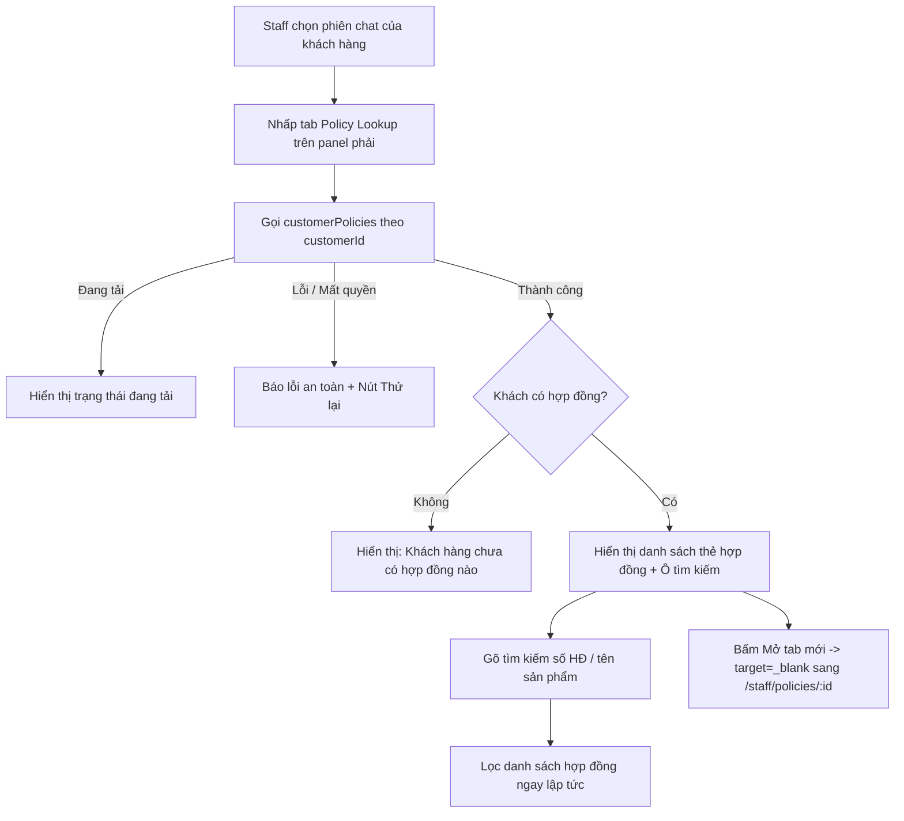

# PL05 — Quick Policy Lookup trong Inbox Staff

05/11/2026 · **Kế hoạch triển khai** · [Contract](../05-policies-contract.md) · [Inbox Contract](../03-inbox-contract.md) · [Chung](../00-staff-contract.md).

## 1. Phạm vi và mục tiêu

* **Mục tiêu**: Bổ sung tính năng tra cứu danh sách hợp đồng bảo hiểm của khách hàng đang tương tác (`visible.customer.id`) ngay tại panel bên phải của màn hình Staff Inbox (`rightPanelTab === 'lookup'`).
* **Hiện trạng**:
  * Tab icon kính lúp (`Policy Lookup`) ở rail bên phải của màn hình Inbox hiện đang render một card thông tin tĩnh với nút bấm `Open Policy Dossier` điều hướng rời khỏi trang sang `/staff/policies`.
  * Tư vấn viên khi đang nhắn tin hỗ trợ khách hàng không thể xem nhanh danh sách các hợp đồng/sản phẩm mà khách hàng đó đang tham gia nếu không rời khỏi phòng chat.
* **Yêu cầu mới**:
  * Thay thế card tĩnh bằng component tra cứu hợp đồng nhanh (Quick Customer Policy Lookup) hoạt động ngay tại chỗ (in-place).
  * Hiển thị danh sách các hợp đồng của chính khách hàng này kèm ô lọc tìm kiếm nhanh theo mã/số hợp đồng hoặc tên gói sản phẩm.
  * Cho phép bấm xem chi tiết hoặc mở trực tiếp hồ sơ PDF đầy đủ trên Policy Dossier mà không làm mất ngữ cảnh phiên chat hiện tại.

## 2. **Vị trí code và phân chia trách nhiệm**:

| Vị trí file | Trách nhiệm |
| --- | --- |
| `apps/web/src/components/staff-inbox-policy-lookup.tsx` | Component tra cứu nhanh hợp đồng của khách hàng hiện tại: fetch dữ liệu, tìm kiếm/lọc client-side, render danh sách thẻ hợp đồng, trạng thái loading/empty/error, mở modal xem hồ sơ tại chỗ hoặc mở tab mới độc lập. |
| `apps/web/src/components/staff-inbox.tsx` | Nhúng `StaffInboxPolicyLookup` vào tab `rightPanelTab === 'lookup'`, truyền `customerId={visible.customer.id}` và `customerName={visible.customer.fullName}`; nút chuyển tab nhanh từ Case Details. |
| `apps/web/src/lib/policy-api.ts` | Tái sử dụng hàm `customerPolicies(id, page, signal)` đã được xây dựng sẵn để gọi API Core. |
| `apps/core/src/policies/controllers/staff-policy.controller.ts` | Endpoint `GET /api/v1/staff/customers/:customerId/policies` đã hoạt động ổn định trong Core, không cần sửa đổi backend. |

## 3. API và cấu trúc dữ liệu

* **Endpoint sử dụng**:
  * `GET /api/v1/staff/customers/:customerId/policies?page=1&pageSize=20`
  * **Header**: Cookie phiên `session`, `Cache-Control: no-store`.
  * **Xác thực & phân quyền**: Core backend kiểm tra session nhân viên và bảng `StaffAssignment` để đảm bảo nhân viên chỉ đọc được hợp đồng của khách hàng thuộc quyền phụ trách. Trả về `404` nếu ngoài quyền hoặc khách hàng không tồn tại (fail-closed).
* **Cấu trúc DTO trả về (`PolicyList`)**:
  ```typescript
  type Policy = {
    id: string;
    policyNumber: string;
    customerId: string;
    productName: string;
    productCode: string;
    status: 'ACTIVE' | 'LAPSED' | 'MATURED' | 'PENDING';
    sumAssured: string;
    currency: string;
    effectiveDate: string | null;
    nextDueDate: string | null;
    premiumAmount: string;
    paymentFrequency: string;
  };
  ```
* **Lọc tìm kiếm tại chỗ (Client-side Search)**:
  * Sau khi tải danh sách từ API `customerPolicies`, nhân viên có thể gõ từ khóa vào ô tìm kiếm trên panel để lọc tức thì theo `policyNumber`, `productName`, hoặc `productCode`.
  * Không phát sinh thêm network request khi gõ tìm kiếm, tối ưu tốc độ phản hồi và trải nghiệm.

## 4. Luồng xử lý và trạng thái UI



### Chi tiết các trạng thái:
1. **Loading**: Hiển thị placeholder/skeleton đang lấy dữ liệu hợp đồng từ hệ thống (`Loading policy list…`).
2. **Empty**: Khi `items.length === 0`, hiển thị thông điệp thân thiện: *"No policies found - This customer has no active insurance policies registered in the system."*
3. **Filtered Empty**: Khi có từ khóa tìm kiếm nhưng không khớp hợp đồng nào: *"No matching policies - No policies matched “{search}”."* kèm nút *"Clear search filter"*.
4. **Error**: Khi request bị lỗi mạng hoặc 500: hiển thị thông báo lỗi nhẹ nhàng và nút `Try again` (retry in-place), không làm reload cả trang.
5. **Success / Card List**:
   * Toàn bộ nhãn hiển thị bằng tiếng Anh (English labels) chuẩn xác:
     * Số hợp đồng: Font mono in đậm (`#POL-884920`).
     * Tên gói sản phẩm: Font medium (`Kế hoạch Bảo An Toàn Diện`).
     * Badge trạng thái: `Active` (xanh lá), `Lapsed` (đỏ cam), `Pending` (vàng), `Matured` (xanh dương).
     * Quyền lợi bảo hiểm: `Sum assured` và `Periodic premium`, cùng `Effective date`.
     * **Mở tab mới (New Tab)**: Nút "Open in new tab" (`target="_blank" rel="noopener noreferrer"`) trên thẻ và liên kết "Browse all policies" ở cuối panel mở trang Policy Lookup `/staff/policies` trong tab mới độc lập, giúp tư vấn viên vừa xem toàn bộ PDF điều khoản vừa tiếp tục trò chuyện với khách hàng mà không bị che khuất màn hình.

## 5. Kế hoạch kiểm thử (Test Cases)

Kiểm thử bằng Playwright trong suite `apps/web/tests/browser/staff-inbox.spec.mjs`:
1. **Hiển thị danh sách hợp đồng**:
   * Khi chọn khách hàng có hợp đồng và mở tab Policy Lookup, kiểm tra danh sách render đúng số lượng thẻ hợp đồng, đúng số HĐ và tên sản phẩm.
2. **Tìm kiếm tại chỗ**:
   * Nhập số hợp đồng vào ô tìm kiếm: chỉ hiển thị thẻ hợp đồng tương ứng.
   * Xóa ô tìm kiếm: hiển thị lại đầy đủ tất cả các hợp đồng.
3. **Khách hàng không có hợp đồng**:
   * Khi khách hàng có danh sách rỗng từ API: render đúng thông báo empty state.
4. **Xử lý lỗi mạng và Thử lại**:
   * Giả lập API lỗi (network error): giao diện hiện nút "Thử lại", click thử lại thành công sẽ nạp lại danh sách mà không F5.
5. **Cách ly ngữ cảnh phiên chat**:
   * Chuyển sang khách hàng khác: panel lập tức hủy request cũ, tải danh sách hợp đồng của khách hàng mới, không để lẫn dữ liệu của khách cũ.
6. **Mở hồ sơ trên tab mới**:
   * Kiểm tra liên kết mở tab mới có thuộc tính `target="_blank"` và `href` chính xác trỏ đến `/staff/policies/:policyId`.

## 6. Checklist và giới hạn an toàn

- [x] Giữ nguyên các ràng buộc phân quyền của Core: chỉ gọi API `staff/customers/:customerId/policies` qua cookie phiên, không vượt quyền bằng LLM hay ID giả.
- [x] Tuân thủ nghiêm ngặt Tailwind CSS v4 với tiền tố `tw:`.
- [x] Không làm ảnh hưởng đến các tab khác trên Case Details (Case Overview, Customer Profile, Copilot).
- [x] Mở xem chi tiết hợp đồng đầy đủ qua tab mới độc lập mà không điều hướng rời khỏi phiên chat hoặc che khuất giao diện chat.
- [x] Dọn dẹp sạch sẽ tài nguyên sau khi triển khai và kiểm thử.

## 7. Kết quả triển khai 05/11/2026

* **Thực thi**:
  * Tạo component `apps/web/src/components/staff-inbox-policy-lookup.tsx`.
  * Nhúng vào tab lookup trong `apps/web/src/components/staff-inbox.tsx` với đầy đủ liên kết khách hàng.
  * Hiển thị thẻ hợp đồng tinh gọn kèm đầy đủ thông tin quyền lợi, phí định kỳ, hiệu lực; nút "Mở tab mới" sử dụng `target="_blank" rel="noopener noreferrer"`.
  * Toàn bộ link mở trang ngoài đều dùng `target="_blank" rel="noopener noreferrer"`.
* **Kiểm chứng**:
  * Suite Playwright `apps/web/tests/browser/staff-inbox.spec.mjs`: **20/20 test pass**, gồm 5 ca kiểm thử quick policy lookup, lọc tìm kiếm, empty state và new tab links.
  * Không phát sinh lỗi hồi quy trên toàn bộ workspace Inbox.

