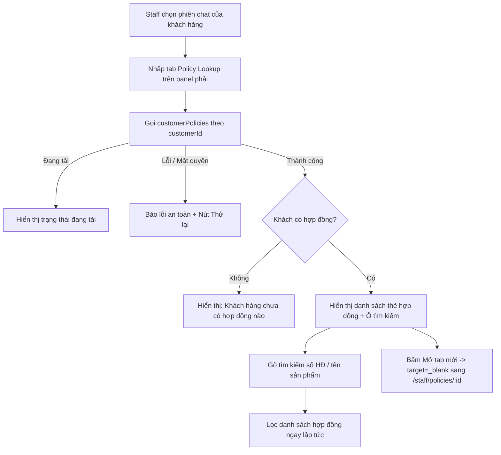
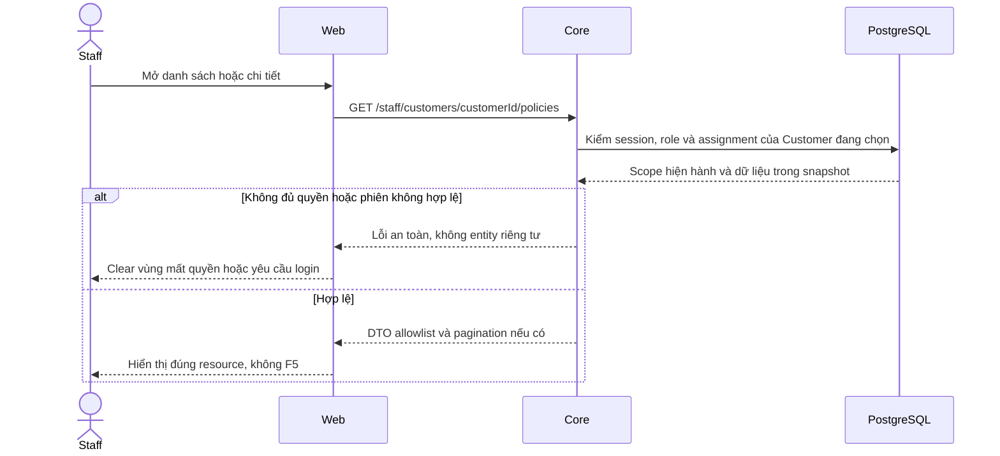

# PL05 — Quick Policy Lookup trong Inbox Staff

05/11/2026 · **Kế hoạch triển khai** · [Contract](../05-policies-contract.md) · [Inbox Contract](../03-inbox-contract.md) · [Chung](../00-staff-contract.md).

## Bổ sung bảo vệ dữ liệu Customer — 12/11/2026

**Chính sách thông tin liên hệ:** [Ma trận dữ liệu chung](../../../../configuration-and-data.md#customer-sensitive-data) quy định che email/phone Customer mặc định và Hiện/Ẩn sau kiểm quyền Core. Phase 1 đã triển khai tại Customers; DTO Customer ở Policy/Inbox/Ticket hiện chỉ có tên/mã, không có contact card raw. Quy định này không thay quyền đọc PDF/transcript hoặc trạng thái triển khai của chức năng trong plan.

**Thay đổi của phase:** Quick Lookup dùng cùng projection Staff, không bypass bằng customerId hoặc lấy raw profile bổ sung modal. Mở PDF/tab mới không tăng quyền hay đổi linkedPolicy/Agent context.

**Kiểm thử cần bổ sung, chưa chạy:** API/network/DOM: modal/tab/dossier cùng projection, query không contact; revoke giữa lookup và cấp file chặn đúng.

**Số hợp đồng — A đã chốt 14/11/2026.** policyNumber được hiển thị đầy đủ trong scope phân công và gate tài nguyên, khớp source hiện tại. Giữ nguyên chuỗi nghiệp vụ, kiểm ký tự/số đầu và phân biệt policyNumber với policyId. Contact email/phone dùng che mặc định + Hiện/Ẩn theo CU01/CU02. [Policy chuẩn](../../../../configuration-and-data.md#staff-policy-number).

**Liên hệ Customer — cập nhật 14/11/2026.** Hiện không có contact card raw trong chức năng này. Hiện/Ẩn tại Customers đã triển khai theo CU01/CU02; Contact card che email/phone mặc định và có Hiện/Ẩn để Staff liên hệ. Core kiểm lại quyền/phân công tại thời điểm reveal, response riêng từng trường. Raw được xóa khỏi UI state khi Ẩn/đổi khách/logout/revoke. [CU01/CU02 và policy chuẩn](../../../../configuration-and-data.md#staff-contact-reveal).

## Data model và phạm vi ảnh hưởng

Bảng bên dưới mô tả tác động của phase, gồm cả ghi gián tiếp qua Core. Tên bảng thuộc schema `business` trừ nơi ghi rõ; cột còn đề xuất được đánh dấu **P**. Web không truy cập DB trực tiếp.

| Bảng/model | Cột hoặc dữ liệu liên quan | Thao tác của phase | Quan hệ/ràng buộc cần giữ | Mức ảnh hưởng và nơi bị tác động |
| --- | --- | --- | --- | --- |
| users + auth_sessions | users.id/role/status, auth_sessions.user_id/token_hash/expires_at/revoked_at | Đọc | AuthSession.user_id → User.id; session phải còn hạn, không bị thu hồi | Cao — mọi API dùng session; không trả token/hash trong DTO |
| staff_assignments + customer_profiles + staff_profiles | staff_id/customer_id/is_active/ended_at, assignment_version, user_id/full_name | Đọc | Assignment gắn đúng Customer/Staff; Inbox còn ràng buộc assignment id cụ thể | Cao — Customers, Policy Lookup, Ticket và Inbox cùng phụ thuộc phân công |
| insurance_policies + insurance_products | customer_id/product_id/policy_number/status, premium_amount/payment_frequency/next_due_date, effective_date/expiry_date/sum_assured/benefits_snapshot, product_code/name | Đọc | Policy.customer_id → CustomerProfile.user_id; product_id → InsuranceProduct.id; unique policy_number | Cao — DTO tiền/ngày/snapshot dùng chung Staff/Customer; không OCR PDF để cập nhật DB |
| documents + document_versions | access_scope/policy_id/owner_customer_id/product_id/current_version, document_id/version_number/is_active/checksum_sha256/storage_bucket/storage_object_key | Đọc | FK (policy_id,owner_customer_id) → Policy(id,customer_id); unique (document_id,version_number); policy dùng exact binding trong benefits_snapshot, Products dùng current_version | Cao — đổi version/scope ảnh hưởng viewer, download và nguồn retrieval; bucket/key không ra DTO |

**Schema/migration:** Không migration. Chọn/xem policy không ghi conversations.linked_policy_id; không cập nhật PDF/version/snapshot.

**Nhất quán và hồi quy:** Web không ghi DB trực tiếp; audit access chỉ khi gọi POST cấp PDF, không theo mỗi invalidation. Core vẫn kiểm assignment riêng dù mở từ Inbox. Kiểm race đổi customer/actor, version/revoke và giữ viewer/focus khi refetch cùng tài nguyên.

## 1. Phạm vi và mục tiêu

* **Mục tiêu**: Bổ sung tính năng tra cứu danh sách hợp đồng bảo hiểm của khách hàng đang tương tác (`visible.customer.id`) ngay tại panel bên phải của màn hình Staff Inbox (`rightPanelTab === 'lookup'`).
* **Hiện trạng**:
  * Tab icon kính lúp (`Policy Lookup`) ở rail bên phải của màn hình Inbox hiện đang render một card thông tin tĩnh với nút bấm `Open Policy Dossier` điều hướng rời khỏi trang sang `/staff/policies`.
  * Tư vấn viên khi đang nhắn tin hỗ trợ khách hàng không thể xem nhanh danh sách các hợp đồng/sản phẩm mà khách hàng đó đang tham gia nếu không rời khỏi phòng chat.
* **Yêu cầu mới**:
  * Thay thế card tĩnh bằng component tra cứu hợp đồng nhanh (Quick Customer Policy Lookup) hoạt động ngay tại chỗ (in-place).
  * Hiển thị danh sách các hợp đồng của chính khách hàng này kèm ô lọc tìm kiếm nhanh theo mã/số hợp đồng hoặc tên gói sản phẩm.
  * Cho phép bấm xem chi tiết hoặc mở trực tiếp hồ sơ PDF đầy đủ trên Policy Dossier mà không làm mất ngữ cảnh phiên chat hiện tại.

## 2. **Vị trí code và phân chia trách nhiệm**:

| Vị trí từ root repo | Hiện trạng | Trách nhiệm trong phase | Mức ảnh hưởng | Phạm vi cần kiểm lại |
| --- | --- | --- | --- | --- |
| [apps/web/src/components/staff-inbox-policy-lookup.tsx](<../../../../../apps/web/src/components/staff-inbox-policy-lookup.tsx>) | Hiện có | Panel list policy cho visible customer | Trung bình | Selection/paging tại Inbox |
| [apps/web/src/components/staff-inbox.tsx](<../../../../../apps/web/src/components/staff-inbox.tsx>) | Hiện có | Truyền customerId theo metadata đã cấp quyền | Cao | Không suy grant policy từ transcript |
| [apps/web/src/lib/policy-api.ts](<../../../../../apps/web/src/lib/policy-api.ts>) | Hiện có | Reuse customerPolicies theo assignment | Trung bình | Policy directory và panel |
| [apps/core/src/policies/controllers/staff-policy.controller.ts](<../../../../../apps/core/src/policies/controllers/staff-policy.controller.ts>) | Hiện có | A14/A15/A16 và document access Staff | Cao | Customers policies, Policy Lookup và Inbox panel |
| [apps/core/src/policies/services/policy.service.ts](<../../../../../apps/core/src/policies/services/policy.service.ts>) | Hiện có | Scope/query/projection/catalog, dùng chung owner methods | Cao | Staff và Customer policies |

## 3. API và cấu trúc dữ liệu

* **Endpoint sử dụng**:
  * `GET /api/v1/staff/customers/:customerId/policies?page=1&pageSize=20`
  * **Header**: Cookie phiên `session`, `Cache-Control: no-store`.
  * **Xác thực & phân quyền**: Core backend kiểm tra session nhân viên và bảng `StaffAssignment` để đảm bảo nhân viên chỉ đọc được hợp đồng của khách hàng thuộc quyền phụ trách. Trả về `404` nếu ngoài quyền hoặc khách hàng không tồn tại (fail-closed).
* **Cấu trúc DTO trả về (`PolicyList`)**:
  ```typescript
  type Policy = {
    id: string;
    policyNumber: string;
    customerId: string;
    productName: string;
    productCode: string;
    status: 'ACTIVE' | 'LAPSED' | 'MATURED' | 'PENDING';
    sumAssured: string;
    currency: string;
    effectiveDate: string | null;
    nextDueDate: string | null;
    premiumAmount: string;
    paymentFrequency: string;
  };
  ```
* **Lọc tìm kiếm tại chỗ (Client-side Search)**:
  * Sau khi tải danh sách từ API `customerPolicies`, nhân viên có thể gõ từ khóa vào ô tìm kiếm trên panel để lọc tức thì theo `policyNumber`, `productName`, hoặc `productCode`.
  * Không phát sinh thêm network request khi gõ tìm kiếm, tối ưu tốc độ phản hồi và trải nghiệm.

## 4. Luồng xử lý và trạng thái UI



### Chi tiết các trạng thái:
1. **Loading**: Hiển thị placeholder/skeleton đang lấy dữ liệu hợp đồng từ hệ thống (`Loading policy list…`).
2. **Empty**: Khi `items.length === 0`, hiển thị thông điệp thân thiện: *"No policies found - This customer has no active insurance policies registered in the system."*
3. **Filtered Empty**: Khi có từ khóa tìm kiếm nhưng không khớp hợp đồng nào: *"No matching policies - No policies matched “{search}”."* kèm nút *"Clear search filter"*.
4. **Error**: Khi request bị lỗi mạng hoặc 500: hiển thị thông báo lỗi nhẹ nhàng và nút `Try again` (retry in-place), không làm reload cả trang.
5. **Success / Card List**:
   * Toàn bộ nhãn hiển thị bằng tiếng Anh (English labels) chuẩn xác:
     * Số hợp đồng: Font mono in đậm (`#POL-884920`).
     * Tên gói sản phẩm: Font medium (`Kế hoạch Bảo An Toàn Diện`).
     * Badge trạng thái: `Active` (xanh lá), `Lapsed` (đỏ cam), `Pending` (vàng), `Matured` (xanh dương).
     * Quyền lợi bảo hiểm: `Sum assured` và `Periodic premium`, cùng `Effective date`.
     * **Mở tab mới (New Tab)**: Nút "Open in new tab" (`target="_blank" rel="noopener noreferrer"`) trên thẻ và liên kết "Browse all policies" ở cuối panel mở trang Policy Lookup `/staff/policies` trong tab mới độc lập, giúp tư vấn viên vừa xem toàn bộ PDF điều khoản vừa tiếp tục trò chuyện với khách hàng mà không bị che khuất màn hình.

**Copilot — B chốt 14/11/2026.** Panel lookup/PDF chỉ đọc dữ liệu theo quyền, Staff nêu hợp đồng khi hỏi Copilot. Mở panel hoặc PDF không sửa linkedPolicy/controlVersion, trường hợp mơ hồ được hỏi lại theo CP01/CP04. [Quyết định chuẩn](../../../../specifications/Agent_Design.md#copilot-policy-selection).

## 5. Test cases

Các ca dưới đây là **đặc tả kiểm thử**, không phải báo cáo kết quả. Kiểm từng lớp API/service/DB/browser đúng nhãn; mock UI không thay kiểm quyền Core hoặc E2E thật.

**Quy ước dữ liệu:** S-A/S-B là hai Staff synthetic; C-A/C-B là hai Customer synthetic khác nhau. Thay alias bằng UUID/token của fixture cô lập; các path HTTP dùng prefix /api/v1 nếu chưa ghi đầy đủ. Chỉ thay assignment, khóa account, inject lỗi hoặc migration trong harness/môi trường test, không trên tài khoản/dữ liệu đang sử dụng.

### PL05-T01 — Mở lookup theo khách đang chat

**Lớp kiểm thử:** Browser.
**Điều kiện và dữ liệu:** S-A có cuộc của C-A; C-A có 2 policy; C-B có policy riêng.

**Các bước:**

1. Chọn cuộc của C-A rồi mở Quick Policy Lookup.
2. Đối chiếu các thẻ với GET customer policies.
3. Mở chi tiết policy trong modal hoặc tab mới theo control hiện có.

**Kết quả mong đợi:** Chỉ hợp đồng C-A; link đúng policyId; modal không thay cuộc chat hoặc làm mất draft.

### PL05-T02 — Lọc tại chỗ và khách không hợp đồng

**Lớp kiểm thử:** Browser + Network.
**Điều kiện và dữ liệu:** Catalog policy C-A đã tải; C-Z không có hợp đồng.

**Các bước:**

1. Gõ số hợp đồng rồi tên/mã sản phẩm trong panel.
2. Xóa từ khóa.
3. Chuyển sang C-Z và mở lookup.

**Kết quả mong đợi:** Lọc đúng catalog đang tải, không request search mới nếu client-side theo contract; C-Z empty, không giữ thẻ C-A.

### PL05-T03 — Đổi khách khi request pending

**Lớp kiểm thử:** Browser + API barrier.
**Điều kiện và dữ liệu:** Giữ response policies C-A; có cuộc C-B khác.

**Các bước:**

1. Mở lookupA rồi chọn cuộc B.
2. Trả responseB rồi responseA muộn.
3. Kiểm header/thẻ/link trong panel.

**Kết quả mong đợi:** Chỉ render B; responseA bị abort/bỏ, không mở link dựa trên context A.

### PL05-T04 — Retry, quyền và focus

**Lớp kiểm thử:** Browser + API mock.
**Điều kiện và dữ liệu:** LookupA có biến thể network 503 và 404; popup đang mở.

**Các bước:**

1. Retry lỗi mạng tại panel.
2. Cho request tiếp theo404 sau revoke.
3. Dùng Escape để đóng modal và quay focus.

**Kết quả mong đợi:** Retry không F5;404 clear thẻ/link cũ; focus về control mở lookup, composer/draft không bị thay đổi.

**Suite tham khảo:** [staff-inbox.spec.mjs](../../../../../apps/web/tests/browser/staff-inbox.spec.mjs). Tên suite là vị trí tự động hóa, không phải chứng nhận các ca đã chạy.

**Dọn sau kiểm thử:** xóa đúng fixture/session/object/schema theo runId; phục hồi fault injection và đóng context/socket test. Không reset DB/credential, sửa bootstrap hoặc xóa volumes. Với PDF kiểm metadata/bytes/hash; với UI kiểm DOM/focus/network, không cần screenshot.

## 6. Checklist và giới hạn an toàn

- [x] Giữ nguyên các ràng buộc phân quyền của Core: chỉ gọi API `staff/customers/:customerId/policies` qua cookie phiên, không vượt quyền bằng LLM hay ID giả.
- [x] Tuân thủ nghiêm ngặt Tailwind CSS v4 với tiền tố `tw:`.
- [x] Không làm ảnh hưởng đến các tab khác trên Case Details (Case Overview, Customer Profile, Copilot).
- [x] Mở xem chi tiết hợp đồng đầy đủ qua tab mới độc lập mà không điều hướng rời khỏi phiên chat hoặc che khuất giao diện chat.
- [x] Dọn dẹp sạch sẽ tài nguyên sau khi triển khai và kiểm thử.

## 7. Ghi chú triển khai

* **Thực thi**:
  * Tạo component `apps/web/src/components/staff-inbox-policy-lookup.tsx`.
  * Nhúng vào tab lookup trong `apps/web/src/components/staff-inbox.tsx` với đầy đủ liên kết khách hàng.
  * Hiển thị thẻ hợp đồng tinh gọn kèm đầy đủ thông tin quyền lợi, phí định kỳ, hiệu lực; nút "Mở tab mới" sử dụng `target="_blank" rel="noopener noreferrer"`.
  * Toàn bộ link mở trang ngoài đều dùng `target="_blank" rel="noopener noreferrer"`.
* **Kiểm chứng**:
  * Không phát sinh lỗi hồi quy trên toàn bộ workspace Inbox.

## Sequence diagram

Luồng chính và nhánh quyền/lỗi; test case ở trên chỉ rõ dữ liệu và điểm kiểm tương ứng.


