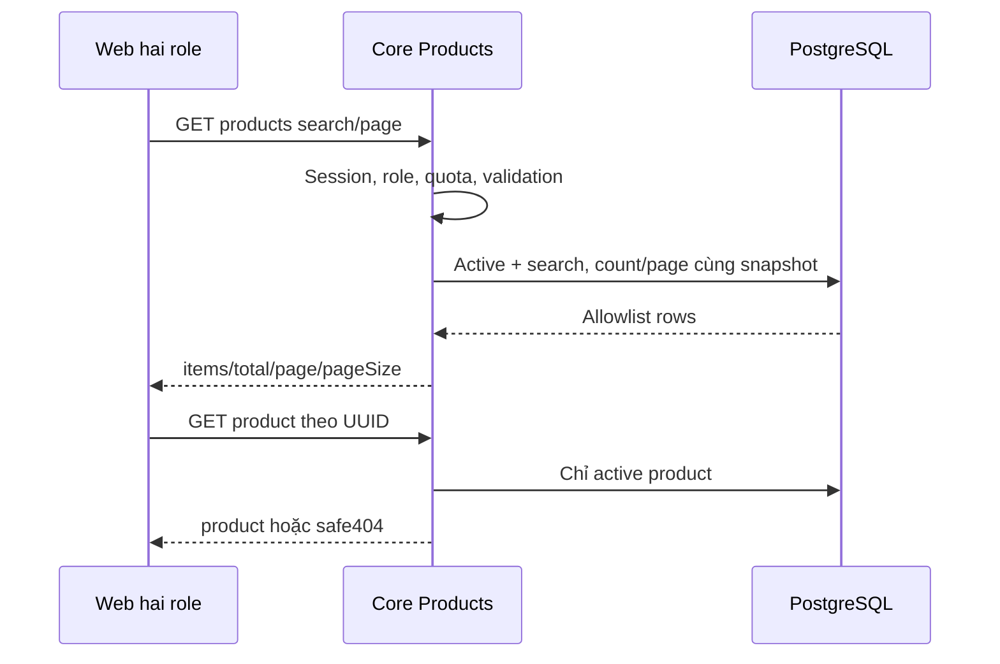

# P01 — Catalog sản phẩm: Core read API

04/11/2026 · **Đã triển khai và kiểm chứng Core/gateway** · [Contract P](../04-products-contract.md) · Tiếp: [P02](02-document-access.md).

Nghiệp vụ đã chốt tại contract P: active catalog, hai role đã đăng nhập, tên/mã/summary từ DB; nội dung đầy đủ trong PDF. A17/DTO/query bên dưới đã E; P02 tài liệu/access hiện cũng đã E theo phase riêng, UI P03 đã triển khai.

## 1. Kết quả và file

FR-008: hai role tìm/chọn sản phẩm đang công bố, không cần Agent. Đã thêm `apps/core/src/products/products.module.ts`, `controllers/product.controller.ts`, `services/product.service.ts`, `dto/product-query.dto.ts`, `dto/product-response.dto.ts`; import ProductsModule tại `app.module.ts`. Dùng AuthService/DatabaseService và RepeatableRead, không thay schema hoặc dependency. Không đọc business DB từ Web/Agent.

## 2. API spec đã triển khai — A17 E

`GET /api/v1/products?search=...&page=1&pageSize=10`

| Query | Quy tắc hiện có |
| --- | --- |
| search | Trim, tối đa100 ký tự sau trim, không control character còn lại; literal substring name/productCode, không tìm summary/PDF; case-insensitive, không bỏ dấu |
| page | Integer1–100000, mặc định1; giới hạn đồng nhất policy lookup để chặn offset vô hạn |
| pageSize | Integer1–50, mặc định10 |

Không nhận isActive/customerId/role/sort hoặc query lạ. Auth hai role; cùng DTO. Lọc isActive=true và search **trước** total/page, sort productCode ASC rồi id ASC. Escape LIKE `%`, `_`, `\`; parameterized query. Page vượt cuối trả items rỗng, total đúng; UI điều chỉnh một lần khi dữ liệu đổi.

Quota `PRODUCT_READ`: tổng list/detail120 request/phút/actor, bucket DB hashed actor, không theo cookie hoặc assignment. Upsert quota autocommit riêng, sau đó recheck session trong read transaction RepeatableRead; count/page cùng snapshot.429 dùng RATE_LIMITED + Retry-After. Không ghi product, policy hoặc assignment từ GET.

```json
{
  "items": [{"id":"10000000-0000-4000-8000-000000000001","productCode":"SIM-LIFE-01","name":"Synthetic Life","summary":null,"isActive":true}],
  "total":1,"page":1,"pageSize":10
}
```

`GET /api/v1/products/:productId` → `200 {product:{id,productCode,name,summary,isActive}}`; UUID sai400, không có/inactive404. Không trả policies/customers/documents cùng detail. Không giả summary khi null. Các trạng thái/auth/quota theo contract P. Total catalog này độc lập với quyết định **không counts của Inbox**.

## 3. Data và an toàn

Chỉ select allowlist InsuranceProduct, không raw relations. Không bảng giá/benefit mới, không gắn policy cá nhân để đọc sản phẩm. Inactive bị loại ở catalog nhưng không sửa quan hệ/DTO lịch sử policy hiện có. Không migration mặc định: kiểm index hiện tại; chỉ đề xuất migration mới nếu query plan cần, không sửa migration đã apply.

## 4. Luồng



## 5. Các bước và kiểm thử

1. DTO validation/Swagger trước service; thống nhất response với `lib/product-api.ts` tương lai.
2. Auth/role/quota, scoped queries, response projection.
3. Thêm `apps/core/test/products.test.cjs` theo container harness hiện có. Fixture active/inactive/null, tên có dấu/ký tự LIKE, trùng timestamp, >2 page; teardown theo runId.

| ID | Thao tác | Kỳ vọng |
| --- | --- | --- |
| P01-T01 | Anonymous/expired và hai role hợp lệ | 401 hoặc cùng catalog; không nhận role giả |
| P01-T02 | Search theo code/name, `%_\`, đổi page | Literal search; total trước page; thứ tự ổn định |
| P01-T03 | Inactive detail/list và policy lịch sử tham chiếu nó | Catalog404/ẩn; Staff policy vẫn đọc đúng quyền |
| P01-T04 | Null summary, page rỗng, input/query lạ | Null/rỗng đúng;400 cho input sai |
| P01-T05 | Inspect JSON/logs, quota burst | Không policy/customer/storage data;429 an toàn |

## 6. Gate hoàn tất

- [x] DTO/query/quota khớp nghiệp vụ đã chốt; PostgreSQL thật, no-store và Swagger đã kiểm.
- [x] Account/Customers/Policies/Inbox smoke gateway pass; không thêm dependency/migration.
- [x] A17 đã E; P02 hiện đã E theo phase riêng, P03 đã triển khai.

## 7. Kết quả kiểm chứng — 04/11/2026

`apps/core/test/products.test.cjs`: **10 test Core/HTTP/PostgreSQL pass**, **1 test gateway pass** riêng sau cập nhật runtime. Có fixture hai role, có/không assignment,13 sản phẩm active và1 inactive, ký tự LIKE/dấu/null, nhiều trang; kiểm race đổi publication giữa count/page, session locked/expired/revoked, quota đồng thời/reset và projection/Swagger. Fixture synthetic cô lập tự dọn; không sửa seed chung.

**78 test hồi quy** permissions/Inbox/workflow/send/realtime pass; lint Core và Docker build TypeScript pass. Smoke gateway gồm auth/me, staff/me, customers/me, Staff Customers list/detail, policy inactive lịch sử và Inbox. Đây là backend/gateway integration, không browser E2E hoặc UI Products đã hoàn thành.

```powershell
docker compose --profile tests build core-tests
docker compose --profile tests run --rm --no-deps core-tests node --test test/products.test.cjs
# Sau khi Core runtime đã build/cập nhật P01:
docker compose --profile tests run --rm --no-deps -e P01_GATEWAY=1 core-tests node --test --test-name-pattern=gateway test/products.test.cjs
```

Core đã build và `docker compose up -d --no-deps --wait core` thành công. App qua `http://localhost:8080`, Swagger nhóm Products tại `http://localhost:8081/api/v1/docs`. Không tạo file riêng/credential trên host; credential runtime đang có trong Docker volumes được giữ nguyên. Bước tiếp theo P02, không thêm UI hoặc PDF trong P01.
