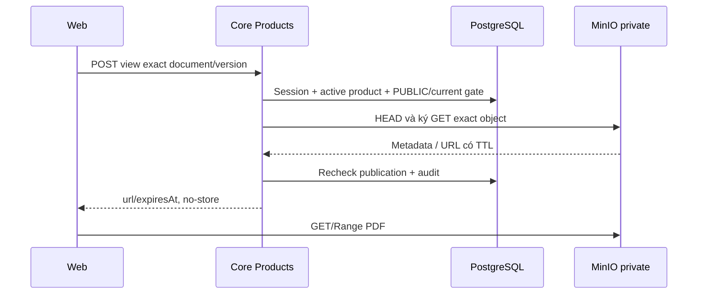

# P02 — Tài liệu sản phẩm PUBLIC và cấp quyền PDF

04/11/2026 · **Đã triển khai và kiểm chứng Core/MinIO/gateway** · [Contract P](../04-products-contract.md) · Trước: [P01](01-catalog-read-api.md) · Tiếp: [P03](03-staff-products-ui.md).

Nghiệp vụ đã chốt tại contract P: PUBLIC cho hai role đã đăng nhập không cần assignment, dùng currentVersion công bố; hợp đồng cá nhân giữ applied version riêng. A19 và hai POST access bên dưới đã E; UI P03 đã triển khai.

## Data model và phạm vi ảnh hưởng

Bảng bên dưới mô tả tác động của phase, gồm cả ghi gián tiếp qua Core. Tên bảng thuộc schema `business` trừ nơi ghi rõ; cột còn đề xuất được đánh dấu **P**. Web không truy cập DB trực tiếp.

| Bảng/model | Cột hoặc dữ liệu liên quan | Thao tác của phase | Quan hệ/ràng buộc cần giữ | Mức ảnh hưởng và nơi bị tác động |
| --- | --- | --- | --- | --- |
| users + auth_sessions | users.id/role/status, auth_sessions.user_id/token_hash/expires_at/revoked_at | Đọc | AuthSession.user_id → User.id; session phải còn hạn, không bị thu hồi | Cao — mọi API dùng session; không trả token/hash trong DTO |
| insurance_products | id/product_code/name/summary/is_active | Đọc | Unique product_code; chỉ catalog active, không sửa hợp đồng đã tham gia khi sản phẩm inactive | Trung bình — catalog và tài liệu dùng chung hai role |
| documents + document_versions | product_id/access_scope/policy_id/owner_customer_id/current_version, document_id/version_number/is_active | Đọc | PUBLIC, policy_id/owner_customer_id null; current FK (id,current_version) → (document_id,version_number) | Cao — công bố nhầm Private hoặc chọn version mới nhất bằng timestamp sẽ sai quyền |
| rate_limit_buckets | client_token/endpoint_group/window_start/request_count/blocked_until | Ghi phụ trợ khi endpoint áp quota | PK (client_token,endpoint_group); tăng atomic, giới hạn theo actor/nhóm endpoint | Trung bình — quota có thể ghi dù nghiệp vụ bị từ chối; không log định danh nhạy cảm |
| MinIO/S3 — ngoài PostgreSQL | Object PDF theo storage_bucket/storage_object_key, checksum SHA-256, Content-Type | HEAD + ký GET/Range, không upload từ viewer | Không FK xuyên DB/object store; exact version/checksum do Core đối chiếu | Cao — DB transaction không rollback storage; URL đã cấp còn residual TTL, không log URL/key |
| audit_logs | actor_id/action/target_type/target_id/outcome/request_id/metadata/created_at | Thêm khi mutation/cấp PDF theo service | actor_id → User.id; không sửa/xóa audit cũ; chỉ metadata allowlist | Cao — phải giữ bằng chứng đúng transaction nghiệp vụ; không lưu transcript/password/signed URL |

**Schema/migration:** Không migration, AccessScope giữ PUBLIC/PRIVATE_POLICY. Không thêm PRIVATE_CUSTOMER hay Document.kind.

**Nhất quán và hồi quy:** Hai transaction kiểm publication trước/sau HEAD/sign; audit SUCCESS commit rồi trả URL. Không transaction DB kéo dài qua network storage. Kiểm current đổi trong lúc cấp, inactive/private, audit failure và cursor.

## 1. Kết quả và vị trí

FR-008/NFR-007: hai role đọc tài liệu đang công bố của sản phẩm active. Bổ sung controller/service/DTO trong `apps/core/src/products/`; tái dùng `apps/core/src/policies/services/policy-storage.service.ts` qua DI/module export. Audit theo cách cấp link Staff hiện có, không chép SDK/credential loader vào controller mới.

Đã thêm `controllers/product-document.controller.ts`, `services/product-document.service.ts`, `services/product-document-cursor.ts`, `dto/product-documents.dto.ts`; helper `services/product-quota.ts` dùng chung P01/P02. PoliciesModule export PolicyStorageService để ProductsModule dùng đúng một provider. Không đổi schema/dependency, không sinh lại PDF khi view/download.

| Vị trí từ root repo | Hiện trạng | Trách nhiệm trong phase | Mức ảnh hưởng | Phạm vi cần kiểm lại |
| --- | --- | --- | --- | --- |
| [apps/core/src/products/controllers/product-document.controller.ts](<../../../../../apps/core/src/products/controllers/product-document.controller.ts>) | Hiện có | Catalog/view/download PUBLIC | Cao | Hai role dùng cùng endpoint |
| [apps/core/src/products/services/product-document.service.ts](<../../../../../apps/core/src/products/services/product-document.service.ts>) | Hiện có | Publication gate, hai lần recheck/audit | Cao | Không lộ policy private hoặc version khác current |
| [apps/core/src/products/services/product-document-cursor.ts](<../../../../../apps/core/src/products/services/product-document-cursor.ts>) | Hiện có | Cursor bind actor/product/limit | Trung bình | Load more và cross-product cursor |
| [apps/core/src/policies/services/policy-storage.service.ts](<../../../../../apps/core/src/policies/services/policy-storage.service.ts>) | Hiện có | Tái sử dụng HEAD/sign PDF | Cao | Không thay storage privilege policy |

## 2. Quy tắc publication và version

Document phải PUBLIC, productId đúng, policyId=null, ownerCustomerId=null. currentVersion không null và khớp DocumentVersion.versionNumber của chính document; version.isActive=true. Không chọn version theo MAX/createdAt, không lấy bản policy đang áp dụng thay publication chung. Model không có Document.kind: chỉ trả title/version, không phân loại bằng title.

Đối chiếu schema thực: AccessScope chỉ có PUBLIC/PRIVATE_POLICY, **không có PRIVATE_CUSTOMER**. Không thêm scope hoặc migration để khớp nhánh thừa trong plan cũ. Quan hệ `Document.current` thực thi liên kết exact documentId/versionNumber.

Catalog chỉ trả binding hợp lệ; tài liệu thiếu currentVersion/inactive bị loại. Nếu không có tài liệu hợp lệ trả items=[], không leak số lượng tài liệu private hoặc metadata lỗi. Product inactive/không có 404. Không biến product inactive thành việc thu hồi hợp đồng cá nhân đã phát hành.

## 3. API spec đã triển khai — A19 và access E

`GET /api/v1/products/:productId/documents?limit=20&cursor=...`

limit 1–50/default20; keyset `(title ASC,id ASC)` sau publication gate, lấy limit+1 để tính hasMore, không COUNT. Cursor base64url canonical tối đa2731 ký tự/2048 byte JSON, đúng keys v/scope/title/id, v=1; scope hash bind endpoint/product/actor/role/limit, title tối đa255 code points và id UUID. Cursor không phải chứng cứ quyền: mọi query vẫn lọc publication, kể cả boundary bị sửa. Cursor sai/sai product/actor/limit trả 400; không lấy raw SQL từ cursor. Không counts. Catalog live có thể đổi thứ tự giữa pages; FE dedup/reset khi refetch.

Catalog dùng chung quota PRODUCT_READ120/phút/actor với P01. View/download dùng PRODUCT_DOCUMENT_ACCESS30/phút/actor chung hai intent, độc lập read quota; DB upsert atomic ngoài transaction snapshot,429 RATE_LIMITED + Retry-After. Unknown query/body field, repeated parameter, UUID/limit sai bị 400. POST chỉ nhận JSON `{}`, không có policyId giả.

```json
{
  "items":[{"documentId":"20000000-0000-4000-8000-000000000001","title":"Synthetic product terms","accessScope":"PUBLIC","versionId":"30000000-0000-4000-8000-000000000001","versionNumber":"1.0","versionCreatedAt":"2026-11-04T00:00:00.000Z"}],
  "pageInfo":{"hasMore":false,"nextCursor":null}
}
```

`POST /api/v1/products/:productId/documents/:documentId/versions/:versionId/view` hoặc `/download`, body `{}`; session hai role và CSRF. Response `200 {url,expiresAt}` tương thích storage service. Không nhận bucket/key/URL/policyId/contentDisposition từ client. UUID sai400, version không còn là current hoặc private/cross-product/thiếu404; quota 429, object thiếu/không PDF404, storage unavailable503. Không auto-fallback sang version khác.

Mỗi POST recheck publication trong DB, rồi HEAD object và ký link đúng version đã được cho phép. Audit actor/action/document/version/outcome; không ghi URL/key/PDF. `view` inline, `download` attachment tên server kiểm soát. TTL local hiện mặc định900 giây có cấu hình; không hứa logout thu hồi ngay URL đã cấp. DB và S3 không chung transaction: mô tả mốc kiểm quyền và TTL residual; recheck publication trước trả kết quả nếu publication đổi trong lúc HEAD/sign, bỏ link khi check cuối fail. Không giữ DB transaction lâu qua mạng storage.

Đã dùng hai transaction RepeatableRead ngắn, trước và sau storage; cả hai recheck session/CSRF/publication. Check cuối đối chiếu thêm bucket/key/checksum/versionNumber, ghi audit SUCCESS cùng transaction, xong mới trả URL. Check hoặc audit commit fail không trả link; audit FAILURE best-effort giữ lỗi gốc an toàn. Metadata audit chỉ productId/documentId/versionId/intent, action PRODUCT_PDF_VIEW_ISSUED/DOWNLOAD_ISSUED hoặc VIEW_FAILED/DOWNLOAD_FAILED. Giới hạn còn lại: kiểm cuối chỉ phản ánh mốc snapshot đó, không thu hồi tức thì URL sau khi trả về.

## 4. Luồng



## 5. Test cases

Các ca dưới đây là **đặc tả kiểm thử**, không phải báo cáo kết quả. Kiểm từng lớp API/service/DB/browser đúng nhãn; mock UI không thay kiểm quyền Core hoặc E2E thật.

**Quy ước dữ liệu:** S-A/S-B là hai Staff synthetic; C-A/C-B là hai Customer synthetic khác nhau. Thay alias bằng UUID/token của fixture cô lập; các path HTTP dùng prefix /api/v1 nếu chưa ghi đầy đủ. Chỉ thay assignment, khóa account, inject lỗi hoặc migration trong harness/môi trường test, không trên tài khoản/dữ liệu đang sử dụng.

### P02-T01 — PUBLIC current và hai intent

**Lớp kiểm thử:** API + Storage.
**Điều kiện và dữ liệu:** P1 active có PUBLIC D1 current v2; lưu hash PDF synthetic v2.

**Các bước:**

1. Đọc catalog P1 bằng Staff và Customer.
2. POST view và download D1/v2 với CSRF hợp lệ.
3. Đọc metadata/bytes trả về trong harness.

**Kết quả mong đợi:** Catalog cùng exact version; view inline/download attachment; hash đúngv2, không credential trong DTO/log.

### P02-T02 — Không cấp Private hoặc tài liệu khác sản phẩm

**Lớp kiểm thử:** API.
**Điều kiện và dữ liệu:** P1 có PUBLIC D1; P2 có D2; có PRIVATE_POLICY D3.

**Các bước:**

1. Gửi access P1/D2 rồi P1/D3 bằng UUID biết trước.
2. Gửi thêm bucket/key/policyId vào body.
3. Đọc catalog P1.

**Kết quả mong đợi:** Cross-product/Private 404, body lạ 400; catalog không hé D2/D3 hoặc object key; không tạo signed URL.

### P02-T03 — Publication đổi trong lúc cấp link

**Lớp kiểm thử:** API + Storage barrier.
**Điều kiện và dữ liệu:** D1/v1 đang current; barrier dừng tại HEAD/sign.

**Các bước:**

1. Bắt đầu view v1.
2. Đổi current sangv2 hoặc vô hiệu D1 trong fixture.
3. Cho request tiếp tục và thử lạiv1.

**Kết quả mong đợi:** Check cuối từ chối link v1 khi không còn hợp lệ; không tự fallback v2; audit không ghi SUCCESS sai.

### P02-T04 — Storage lỗi và quota

**Lớp kiểm thử:** API + Storage harness.
**Điều kiện và dữ liệu:** Các PDF synthetic riêng: thiếu object,0byte, sai MIME; bucket quota riêng.

**Các bước:**

1. Lần lượt xin view các object lỗi.
2. Mô phỏng storage unavailable.
3. Vượt quota access bằng cả view/download.

**Kết quả mong đợi:** 404/503 an toàn theo contract; không SDK exception hoặc URL lỗi;429 Retry-After và quota chung hai intent.

**Suite tham khảo:** [product-documents.test.cjs](../../../../../apps/core/test/product-documents.test.cjs). Tên suite là vị trí tự động hóa, không phải chứng nhận các ca đã chạy.

**Checklist chức năng liên quan** (giữ trạng thái triển khai, không phải kết quả của lần sửa tài liệu):

- [x] Tests Core+MinIO thực, metadata/file hash tương ứng; không dùng ảnh để QA PDF.
- [x] Swagger và API map cập nhật E cho đúng routes đã có.

**Dọn sau kiểm thử:** xóa đúng fixture/session/object/schema theo runId; phục hồi fault injection và đóng context/socket test. Không reset DB/credential, sửa bootstrap hoặc xóa volumes. Với PDF kiểm metadata/bytes/hash; với UI kiểm DOM/focus/network, không cần screenshot.

## 6. Chạy kiểm thử tự động


Test chỉ dùng PDF synthetic tạo trong memory và object dưới `p02-tests/<UUID>/`, không thay bootstrap/corpus đang dùng. Teardown xóa đúng từng key do run tạo, kiểm prefix rỗng, xóa fixtures DB/audit/quota rồi đóng clients. Writer hiện không được DeleteObject, vì vậy service **product-document-tests** riêng trong profile tests mount root credential readonly chỉ để cleanup các key run tạo; Core runtime vẫn chỉ reader, core-tests thường không nhận storage-root. Không tạo/rotate credential hay file trên host, không xóa bucket/volume/dữ liệu người dùng.

```powershell
docker compose --profile tests build core-tests
docker compose --profile tests run --rm --no-deps product-document-tests
# Sau khi Core runtime đã build/cập nhật P02:
docker compose --profile tests run --rm --no-deps -e P02_GATEWAY=1 product-document-tests node --test --test-name-pattern=gateway test/product-documents.test.cjs
```

Core đã build/up healthy qua gateway `http://localhost:8080`; nhóm Products trong Swagger `http://localhost:8081/api/v1/docs`. Không tạo file riêng/credential ngoài repo; credentials đang dùng giữ trong Docker volumes. P03 hiện đã nối Staff UI/PDF tự mở; Customer PR02 vẫn là kế hoạch, dùng lại A19/access này.
