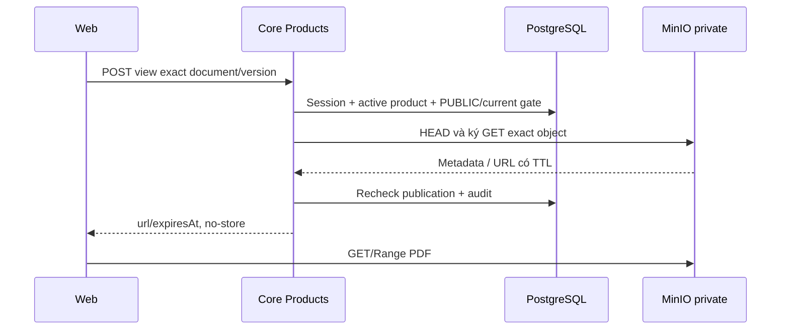

# P02 — Tài liệu sản phẩm PUBLIC và cấp quyền PDF

04/11/2026 · **Đã triển khai và kiểm chứng Core/MinIO/gateway** · [Contract P](../04-products-contract.md) · Trước: [P01](01-catalog-read-api.md) · Tiếp: [P03](03-staff-products-ui.md).

Nghiệp vụ đã chốt tại contract P: PUBLIC cho hai role đã đăng nhập không cần assignment, dùng currentVersion công bố; hợp đồng cá nhân giữ applied version riêng. A19 và hai POST access bên dưới đã E; UI P03 đã triển khai.

## 1. Kết quả và vị trí

FR-008/NFR-007: hai role đọc tài liệu đang công bố của sản phẩm active. Bổ sung controller/service/DTO trong `apps/core/src/products/`; tái dùng `apps/core/src/policies/services/policy-storage.service.ts` qua DI/module export. Audit theo cách cấp link Staff hiện có, không chép SDK/credential loader vào controller mới.

Đã thêm `controllers/product-document.controller.ts`, `services/product-document.service.ts`, `services/product-document-cursor.ts`, `dto/product-documents.dto.ts`; helper `services/product-quota.ts` dùng chung P01/P02. PoliciesModule export PolicyStorageService để ProductsModule dùng đúng một provider. Không đổi schema/dependency, không sinh lại PDF khi view/download.

## 2. Quy tắc publication và version

Document phải PUBLIC, productId đúng, policyId=null, ownerCustomerId=null. currentVersion không null và khớp DocumentVersion.versionNumber của chính document; version.isActive=true. Không chọn version theo MAX/createdAt, không lấy bản policy đang áp dụng thay publication chung. Model không có Document.kind: chỉ trả title/version, không phân loại bằng title.

Đối chiếu schema thực: AccessScope chỉ có PUBLIC/PRIVATE_POLICY, **không có PRIVATE_CUSTOMER**. Không thêm scope hoặc migration để khớp nhánh thừa trong plan cũ. Quan hệ `Document.current` thực thi liên kết exact documentId/versionNumber.

Catalog chỉ trả binding hợp lệ; tài liệu thiếu currentVersion/inactive bị loại. Nếu không có tài liệu hợp lệ trả items=[], không leak số lượng tài liệu private hoặc metadata lỗi. Product inactive/không có404. Không biến product inactive thành việc thu hồi hợp đồng cá nhân đã phát hành.

## 3. API spec đã triển khai — A19 và access E

`GET /api/v1/products/:productId/documents?limit=20&cursor=...`

limit1–50/default20; keyset `(title ASC,id ASC)` sau publication gate, lấy limit+1 để tính hasMore, không COUNT. Cursor base64url canonical tối đa2731 ký tự/2048 byte JSON, đúng keys v/scope/title/id, v=1; scope hash bind endpoint/product/actor/role/limit, title tối đa255 code points và id UUID. Cursor không phải chứng cứ quyền: mọi query vẫn lọc publication, kể cả boundary bị sửa. Cursor sai/sai product/actor/limit trả400; không lấy raw SQL từ cursor. Không counts. Catalog live có thể đổi thứ tự giữa pages; FE dedup/reset khi refetch.

Catalog dùng chung quota PRODUCT_READ120/phút/actor với P01. View/download dùng PRODUCT_DOCUMENT_ACCESS30/phút/actor chung hai intent, độc lập read quota; DB upsert atomic ngoài transaction snapshot,429 RATE_LIMITED + Retry-After. Unknown query/body field, repeated parameter, UUID/limit sai bị400. POST chỉ nhận JSON `{}`, không có policyId giả.

```json
{
  "items":[{"documentId":"20000000-0000-4000-8000-000000000001","title":"Synthetic product terms","accessScope":"PUBLIC","versionId":"30000000-0000-4000-8000-000000000001","versionNumber":"1.0","versionCreatedAt":"2026-11-04T00:00:00.000Z"}],
  "pageInfo":{"hasMore":false,"nextCursor":null}
}
```

`POST /api/v1/products/:productId/documents/:documentId/versions/:versionId/view` hoặc `/download`, body `{}`; session hai role và CSRF. Response `200 {url,expiresAt}` tương thích storage service. Không nhận bucket/key/URL/policyId/contentDisposition từ client. UUID sai400, version không còn là current hoặc private/cross-product/thiếu404; quota429, object thiếu/không PDF404, storage unavailable503. Không auto-fallback sang version khác.

Mỗi POST recheck publication trong DB, rồi HEAD object và ký link đúng version đã được cho phép. Audit actor/action/document/version/outcome; không ghi URL/key/PDF. `view` inline, `download` attachment tên server kiểm soát. TTL local hiện mặc định900 giây có cấu hình; không hứa logout thu hồi ngay URL đã cấp. DB và S3 không chung transaction: mô tả mốc kiểm quyền và TTL residual; recheck publication trước trả kết quả nếu publication đổi trong lúc HEAD/sign, bỏ link khi check cuối fail. Không giữ DB transaction lâu qua mạng storage.

Đã dùng hai transaction RepeatableRead ngắn, trước và sau storage; cả hai recheck session/CSRF/publication. Check cuối đối chiếu thêm bucket/key/checksum/versionNumber, ghi audit SUCCESS cùng transaction, xong mới trả URL. Check hoặc audit commit fail không trả link; audit FAILURE best-effort giữ lỗi gốc an toàn. Metadata audit chỉ productId/documentId/versionId/intent, action PRODUCT_PDF_VIEW_ISSUED/DOWNLOAD_ISSUED hoặc VIEW_FAILED/DOWNLOAD_FAILED. Giới hạn còn lại: kiểm cuối chỉ phản ánh mốc snapshot đó, không thu hồi tức thì URL sau khi trả về.

## 4. Luồng



## 5. Test plan và nghiệm thu

Đề xuất `apps/core/test/product-documents.test.cjs`, fixtures DB/object synthetic runId qua Docker; bảo toàn bucket/object/volumes đang dùng. Không tạo seed chung để phục vụ test.

| ID | Kiểm tra | Kỳ vọng |
| --- | --- | --- |
| P02-T01 | CUSTOMER/STAFF mở cùng PUBLIC current | Cùng version/file, inline/attachment đúng |
| P02-T02 | UUID biết trước của PRIVATE_POLICY/cross-product | 404 cả catalog/access, không signed URL |
| P02-T03 | currentVersion đổi, version inactive, thiếu binding | Không trả bản cũ hay fallback bản mới tự động |
| P02-T04 | Object mất/zero byte/non-PDF/storage timeout | 404/503 an toàn; không raw SDK error |
| P02-T05 | Origin/CSRF sai, input lạ, burst | 403/400/429; không cấp link |
| P02-T06 | Range/CORS, TTL hết, audit/log scan | Đọc được đúng PDF; regrant sau expiry; không log URL/secret |
| P02-T07 | Publication đổi giữa check và sign, catalog >1 batch | Không trả link sau check cuối fail; cursor không trùng/leak |

- [x] Tests Core+MinIO thực, metadata/file hash tương ứng; không dùng ảnh để QA PDF.
- [x] Swagger và API map cập nhật E cho đúng routes đã có.
- [x] Staff catalog/access vẫn đọc appliedv1 khi product công bố currentv2; hồi quy P01/chat pass. UI không đổi trong phase này.

## 6. Kiểm chứng và cách chạy — 04/11/2026

**13 test P02 Core/HTTP/PostgreSQL/MinIO pass**, **1 gateway integration pass** sau cập nhật Core; **88 regression pass** (10 P01 +78 permissions/Inbox/workflow/send/realtime). Core lint và Docker build TypeScript pass. Test gồm nhiều batch/title trùng/Unicode, cursor bind/forged boundary, private-deny trước storage, actual PDF/hash/Range/CORS/inline/attachment, missing/zero/non-PDF/timeout5 giây, đổi publication/object/session giữa sign/recheck, audit failure, quota, CSRF, expired/tampered URL và TTL residual sau revoke. Đây không phải browser E2E/P03 UI.

Test chỉ dùng PDF synthetic tạo trong memory và object dưới `p02-tests/<UUID>/`, không thay bootstrap/corpus đang dùng. Teardown xóa đúng từng key do run tạo, kiểm prefix rỗng, xóa fixtures DB/audit/quota rồi đóng clients. Writer hiện không được DeleteObject, vì vậy service **product-document-tests** riêng trong profile tests mount root credential readonly chỉ để cleanup các key run tạo; Core runtime vẫn chỉ reader, core-tests thường không nhận storage-root. Không tạo/rotate credential hay file trên host, không xóa bucket/volume/dữ liệu người dùng.

```powershell
docker compose --profile tests build core-tests
docker compose --profile tests run --rm --no-deps product-document-tests
# Sau khi Core runtime đã build/cập nhật P02:
docker compose --profile tests run --rm --no-deps -e P02_GATEWAY=1 product-document-tests node --test --test-name-pattern=gateway test/product-documents.test.cjs
```

Core đã build/up healthy qua gateway `http://localhost:8080`; nhóm Products trong Swagger `http://localhost:8081/api/v1/docs`. Không tạo file riêng/credential ngoài repo; credentials đang dùng giữ trong Docker volumes. P03 hiện đã nối Staff UI/PDF tự mở; Customer PR02 vẫn là kế hoạch, dùng lại A19/access này.
