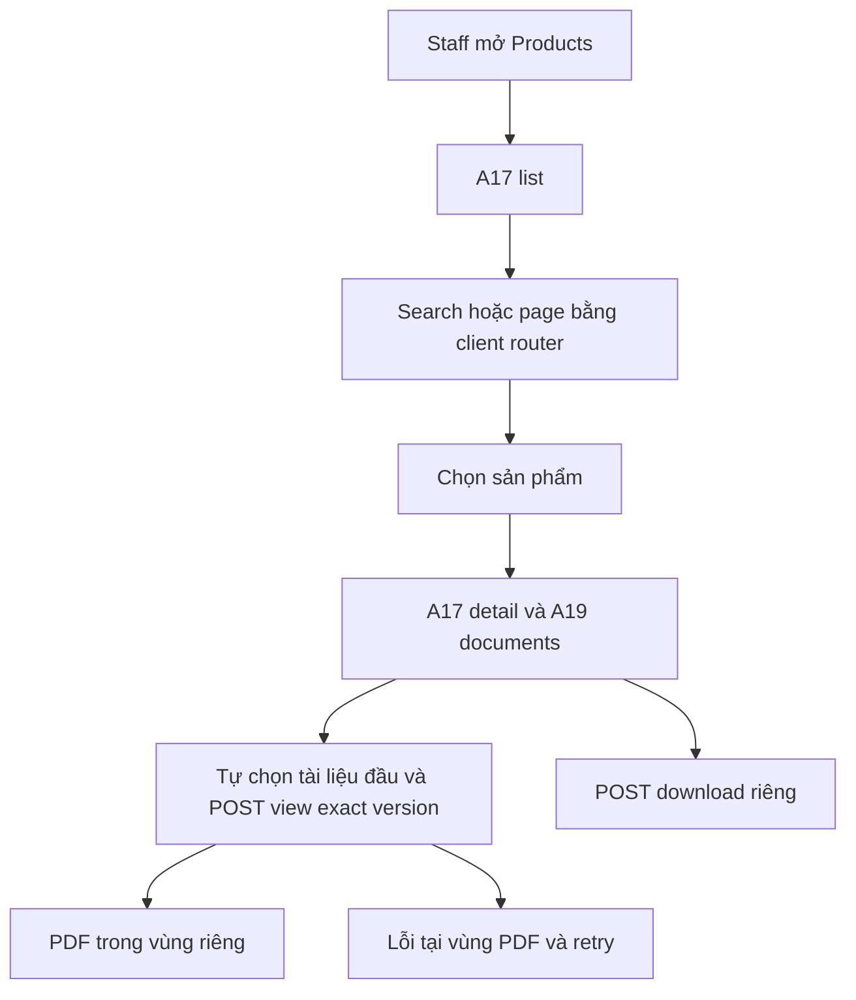

# P03 — Staff Products: danh sách, chi tiết và PDF

04/11/2026 · **Đã triển khai và kiểm chứng** · P01/P02/P03 hoàn tất; Customer UI còn phase riêng.

Products đã có trong Staff Tools, gồm danh sách/chi tiết và tự hiển thị PDF PUBLIC gốc để xem/tải.

## 1. Phạm vi và vị trí

Thêm một mục **Products** trong Tools, độc lập Policy Lookup, theo FR-008. Route đề xuất `/staff/products` và `/staff/products/:productId`; files `apps/web/src/app/staff/(workspace)/products/page.tsx`, `products/[productId]/page.tsx`, `components/staff-products.tsx`, `lib/product-api.ts`. Tích hợp router/sidebar tại Staff portal hiện có; đọc Next docs cài trong repo trước code. Không đổi route policy/account/inbox hoặc tạo app mới.

## 2. UI và state

- Cùng Tailwind4 `tw:`, Lexend, blue tokens và border/surface Staff; không stylesheet cũ hoặc inline styles. List gọn gồm tên/mã/summary; không fake premium/benefit cards.
- Search tên/mã bằng Enter; không có nút Search/Clear search. Xóa nội dung rồi Enter để xem lại toàn bộ. Search/page/productId nằm URL an toàn, không URL ký; không F5. Header Staff và khoảng cách chi tiết sản phẩm được thu gọn.
- Detail có tên/mã/summary và **Product documents**. Đây là PDF chung, ghi rõ không phải hợp đồng cá nhân. Không có dropdown trộn main policy và product guide.
- PDF tự hiển thị tài liệu đầu tiên khi chọn sản phẩm; không lấy focus hoặc tự cuộn trang. Một tài liệu không cần bộ chọn; nhiều tài liệu dùng ô Document, tải thêm bằng cursor khi cần. Bỏ View PDF/Refresh documents/Close preview và Reload preview thường trực; giữ Download, mở tab riêng và Retry/Reload khi lỗi hoặc hết hạn.
- Viewer/download dùng chung lifecycle Policies: cấp link riêng cho từng intent, giữ iframe/src khi metadata cập nhật nền. Có current version mới thì thông báo và nút Open version; giữ bản đang đọc tới khi người dùng chuyển. Tài liệu bị gỡ/mất quyền thì xóa preview, không tự chuyển sang tài liệu khác. Link/download mới vẫn do Core kiểm current version; link cũ chỉ còn residual TTL theo P02. Không thêm PDF library.
- Desktop list/detail có thứ bậc rõ; mobile list → detail, Back giữ search/page; icon thu gọn danh sách có accessible name, focus return. Không cần ô khách hàng vì catalog không gắn customer.

## 3. API sử dụng

Chỉ A17/P01 và A19/access P02. Không thêm Web API proxy riêng hoặc gọi MinIO bằng credential. API client abort theo actor/query/selected product; sequence/generation guard bỏ response cũ sau logout/đổi selection. Không `location.reload`, form document submit hoặc navigation ép hard reload. Quota429 tôn trọng thời gian retry; không retry vô hạn.

State cần có: loading đầu; catalog rỗng/search không kết quả; detail404; summary null; không tài liệu; object/storage lỗi; link hết hạn; session401. Lỗi PDF không che summary/catalog. Mất phiên xóa private memory; PUBLIC trong app vẫn phải qua session. Link đã tải có TTL residual như contract P02.

## 4. Luồng

## 5. Các bước triển khai

1. API client/types từ Swagger P01/P02; chưa backend thì dùng mock chỉ trong test, không runtime fixture.
2. List/detail/router/URL state, empty/errors và scope cleanup.
3. Document chooser/viewer/download; keyboard/mobile/refresh lifecycle.
4. Kiểm DOM/network, hồi quy workspace hiện có, rồi E2E gateway Core thật.

## 6. Test plan

Đã có `apps/web/tests/browser/staff-products.spec.mjs` cho route/mock behavior và `product-flow.integration.spec.mjs` cho Core thật. Screenshot/video/trace tắt; PDF kiểm metadata/hash.

| ID | Thao tác tay/automation | Kỳ vọng |
| --- | --- | --- |
| P03-T01 | Mở Products, tìm code/name, sang page2 rồi mở/Back | Kết quả/URL/page giữ đúng, không F5 |
| P03-T02 | Đổi sản phẩm nhanh, response thứ nhất về muộn | Detail/PDF không bị nội dung cũ ghi đè |
| P03-T03 | Mở PDF, refresh metadata cùng version rồi tải | src/scroll không reset; tải đúng version |
| P03-T04 | Current đổi; tài liệu bị gỡ; product inactive/401 | Current đổi: giữ bản đọc và chủ động chuyển; bị gỡ/mất quyền: xóa preview |
| P03-T05 | Keyboard/375px/zoom200%/thu gọn list | Focus không mất, thao tác đủ, không tràn workspace |
| P03-T06 | Storage503/429/offline | Retry vùng lỗi, summary/list còn dùng được |

- [x] P01/P02 và browser tests pass; E2E thật ghi riêng, không nhầm với mock.
- [x] Account/Customers/Policy/Inbox/notification không hồi quy.
- [x] Cập nhật Staff routes/API/checklist; Customer catalog UI vẫn ở phase riêng.

## 7. Verification

Bản tự hiển thị PDF: **45 test pass**, gồm18 Products browser mock,26 Policy/PDF regression và1 E2E thật qua gateway/Core/PostgreSQL/MinIO. Kiểm tự mở PDF không cần View, chọn tài liệu qua Document, tải đúng SHA256, giữ iframe khi cùng version hoặc chờ chuyển version mới, xóa khi bị gỡ/mất quyền, expiry/retry, mobile và keyboard. Lint và Docker build/typecheck pass; fixture/artifact đã dọn. Không thêm dependency/schema/bootstrap. Các số111/88 bên dưới là kết quả của các mốc trước, không phải số ca chạy lại ở đợt này.

Điều chỉnh UI tiếp theo: bỏ Search/Clear search ở Products, xóa nội dung rồi Enter để bỏ lọc. Thu gọn header Staff và khoảng cách mô tả sản phẩm. Lint, Docker build/typecheck và 88 browser regression Products/Account/Customers/Policy/Inbox pass; không screenshot, đã dọn artifact kiểm thử.

17 Products browser tests with mocked APIs + 1 real gateway/Core/PostgreSQL/MinIO browser E2E passed. PDF SHA256, publication v1/v2, private document exclusion and role authorization verified. 93 Account/Session/Customers/Policies/Inbox regressions passed: total 111 passed, zero skipped/flaky. DOM/network checks cover keyboard,375px,zoom200%, focus, iframe identity and no document reload. Fixtures cleaned after E2E.

Shared use-authorized-read.ts and signed-pdf-preview.tsx preserve Policies lifecycle. Product grants reuse session CSRF; separate view/download, expiry, abort and Retry-After handling. No schema/dependency/env/bootstrap changes. Customer UI remains separate; issued signed URLs retain residual TTL per P02.
