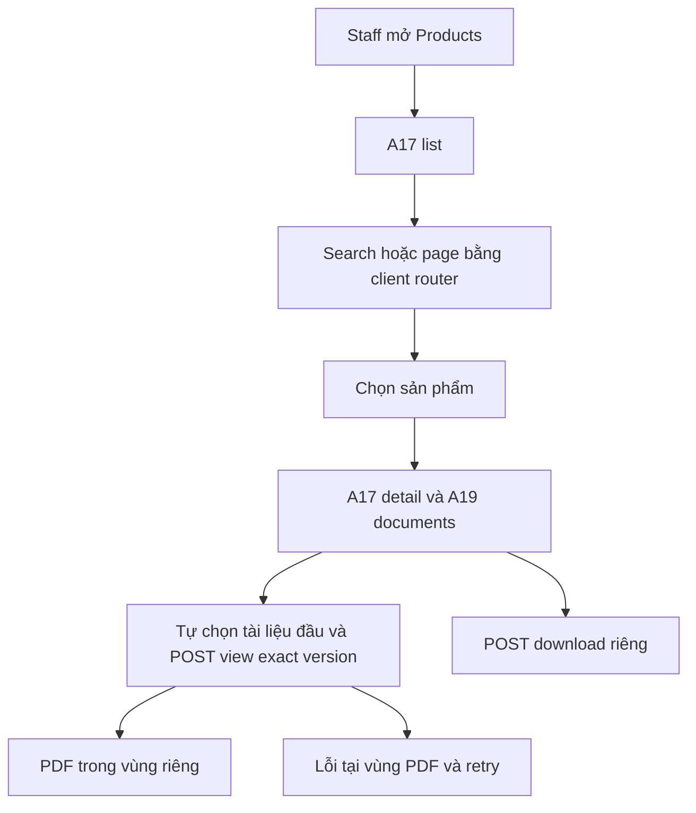
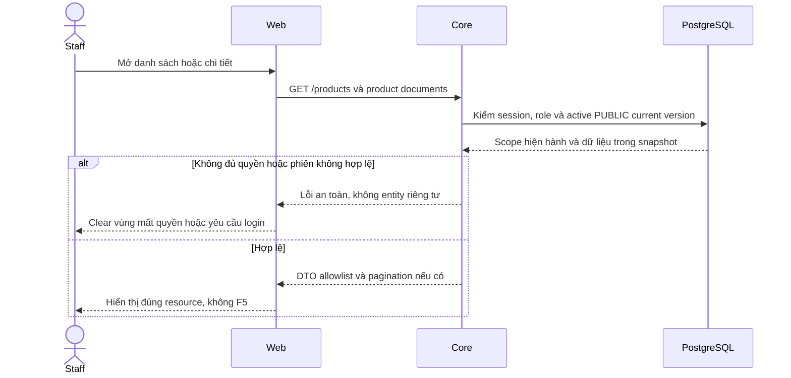

# P03 — Staff Products: danh sách, chi tiết và PDF

04/11/2026 · **Đã triển khai và kiểm chứng** · P01/P02/P03 hoàn tất; Customer UI còn phase riêng.

Products đã có trong Staff Tools, gồm danh sách/chi tiết và tự hiển thị PDF PUBLIC gốc để xem/tải.

## Data model và phạm vi ảnh hưởng

Bảng bên dưới mô tả tác động của phase, gồm cả ghi gián tiếp qua Core. Tên bảng thuộc schema `business` trừ nơi ghi rõ; cột còn đề xuất được đánh dấu **P**. Web không truy cập DB trực tiếp.

| Bảng/model | Cột hoặc dữ liệu liên quan | Thao tác của phase | Quan hệ/ràng buộc cần giữ | Mức ảnh hưởng và nơi bị tác động |
| --- | --- | --- | --- | --- |
| users + auth_sessions | users.id/role/status, auth_sessions.user_id/token_hash/expires_at/revoked_at | Đọc | AuthSession.user_id → User.id; session phải còn hạn, không bị thu hồi | Cao — mọi API dùng session; không trả token/hash trong DTO |
| insurance_products | id/product_code/name/summary/is_active | Đọc | Unique product_code; chỉ catalog active, không sửa hợp đồng đã tham gia khi sản phẩm inactive | Trung bình — catalog và tài liệu dùng chung hai role |
| documents + document_versions | product_id/access_scope/policy_id/owner_customer_id/current_version, document_id/version_number/is_active | Đọc | PUBLIC, policy_id/owner_customer_id null; current FK (id,current_version) → (document_id,version_number) | Cao — công bố nhầm Private hoặc chọn version mới nhất bằng timestamp sẽ sai quyền |
| rate_limit_buckets | client_token/endpoint_group/window_start/request_count/blocked_until | Ghi phụ trợ khi endpoint áp quota | PK (client_token,endpoint_group); tăng atomic, giới hạn theo actor/nhóm endpoint | Trung bình — quota có thể ghi dù nghiệp vụ bị từ chối; không log định danh nhạy cảm |
| MinIO/S3 — ngoài PostgreSQL | Object PDF theo storage_bucket/storage_object_key, checksum SHA-256, Content-Type | HEAD + ký GET/Range, không upload từ viewer | Không FK xuyên DB/object store; exact version/checksum do Core đối chiếu | Cao — DB transaction không rollback storage; URL đã cấp còn residual TTL, không log URL/key |
| audit_logs | actor_id/action/target_type/target_id/outcome/request_id/metadata/created_at | Thêm khi mutation/cấp PDF theo service | actor_id → User.id; không sửa/xóa audit cũ; chỉ metadata allowlist | Cao — phải giữ bằng chứng đúng transaction nghiệp vụ; không lưu transcript/password/signed URL |

**Schema/migration:** Không migration; UI không upload/sinh PDF hoặc sửa publication.

**Nhất quán và hồi quy:** Mở sản phẩm tự cấp view đúng current file qua P02; download grant riêng. Realtime không liên tục đổi src, version thay phải revalidate. Kiểm Viewer dùng chung Customer/policies, search Enter và Back không F5.

## 1. Phạm vi và vị trí

Thêm một mục **Products** trong Tools, độc lập Policy Lookup, theo FR-008. Route đề xuất `/staff/products` và `/staff/products/:productId`; files `apps/web/src/app/staff/(workspace)/products/page.tsx`, `products/[productId]/page.tsx`, `components/staff-products.tsx`, `lib/product-api.ts`. Tích hợp router/sidebar tại Staff portal hiện có; đọc Next docs cài trong repo trước code. Không đổi route policy/account/inbox hoặc tạo app mới.

| Vị trí từ root repo | Hiện trạng | Trách nhiệm trong phase | Mức ảnh hưởng | Phạm vi cần kiểm lại |
| --- | --- | --- | --- | --- |
| [apps/web/src/components/staff-products.tsx](<../../../../../apps/web/src/components/staff-products.tsx>) | Hiện có | List/detail/document selection | Trung bình | Staff Tools và routes products |
| [apps/web/src/lib/product-api.ts](<../../../../../apps/web/src/lib/product-api.ts>) | Hiện có | Catalog/document/access wrapper dùng hai role | Cao | Customer Products |
| [apps/web/src/components/signed-pdf-preview.tsx](<../../../../../apps/web/src/components/signed-pdf-preview.tsx>) | Hiện có | Auto view và version lifecycle | Cao | Policy viewer dùng chung |
| [apps/web/src/app/staff/(workspace)/products/page.tsx](<../../../../../apps/web/src/app/staff/(workspace)/products/page.tsx>) | Hiện có | Route entry dưới Staff shell | Thấp | Không mount thêm auth boundary |

## 2. UI và state

- Cùng Tailwind4 `tw:`, Lexend, blue tokens và border/surface Staff; không stylesheet cũ hoặc inline styles. List gọn gồm tên/mã/summary; không fake premium/benefit cards.
- Search tên/mã bằng Enter; không có nút Search/Clear search. Xóa nội dung rồi Enter để xem lại toàn bộ. Search/page/productId nằm URL an toàn, không URL ký; không F5. Header Staff và khoảng cách chi tiết sản phẩm được thu gọn.
- Detail có tên/mã/summary và **Product documents**. Đây là PDF chung, ghi rõ không phải hợp đồng cá nhân. Không có dropdown trộn main policy và product guide.
- PDF tự hiển thị tài liệu đầu tiên khi chọn sản phẩm; không lấy focus hoặc tự cuộn trang. Một tài liệu không cần bộ chọn; nhiều tài liệu dùng ô Document, tải thêm bằng cursor khi cần. Bỏ View PDF/Refresh documents/Close preview và Reload preview thường trực; giữ Download, mở tab riêng và Retry/Reload khi lỗi hoặc hết hạn.
- Viewer/download dùng chung lifecycle Policies: cấp link riêng cho từng intent, giữ iframe/src khi metadata cập nhật nền. Có current version mới thì thông báo và nút Open version; giữ bản đang đọc tới khi người dùng chuyển. Tài liệu bị gỡ/mất quyền thì xóa preview, không tự chuyển sang tài liệu khác. Link/download mới vẫn do Core kiểm current version; link cũ chỉ còn residual TTL theo P02. Không thêm PDF library.
- Desktop list/detail có thứ bậc rõ; mobile list → detail, Back giữ search/page; icon thu gọn danh sách có accessible name, focus return. Không cần ô khách hàng vì catalog không gắn customer.

## 3. API sử dụng

Chỉ A17/P01 và A19/access P02. Không thêm Web API proxy riêng hoặc gọi MinIO bằng credential. API client abort theo actor/query/selected product; sequence/generation guard bỏ response cũ sau logout/đổi selection. Không `location.reload`, form document submit hoặc navigation ép hard reload. Quota429 tôn trọng thời gian retry; không retry vô hạn.

State cần có: loading đầu; catalog rỗng/search không kết quả; detail 404; summary null; không tài liệu; object/storage lỗi; link hết hạn; session 401. Lỗi PDF không che summary/catalog. Mất phiên xóa private memory; PUBLIC trong app vẫn phải qua session. Link đã tải có TTL residual như contract P02.

## 4. Luồng

## 5. Các bước triển khai

1. API client/types từ Swagger P01/P02; chưa backend thì dùng mock chỉ trong test, không runtime fixture.
2. List/detail/router/URL state, empty/errors và scope cleanup.
3. Document chooser/viewer/download; keyboard/mobile/refresh lifecycle.
4. Kiểm DOM/network, hồi quy workspace hiện có, rồi E2E gateway Core thật.

## 6. Test cases

Các ca dưới đây là **đặc tả kiểm thử**, không phải báo cáo kết quả. Kiểm từng lớp API/service/DB/browser đúng nhãn; mock UI không thay kiểm quyền Core hoặc E2E thật.

**Quy ước dữ liệu:** S-A/S-B là hai Staff synthetic; C-A/C-B là hai Customer synthetic khác nhau. Thay alias bằng UUID/token của fixture cô lập; các path HTTP dùng prefix /api/v1 nếu chưa ghi đầy đủ. Chỉ thay assignment, khóa account, inject lỗi hoặc migration trong harness/môi trường test, không trên tài khoản/dữ liệu đang sử dụng.

### P03-T01 — Danh sách, search và mở giải pháp

**Lớp kiểm thử:** Browser.
**Điều kiện và dữ liệu:** Catalog có hơn10 sản phẩm, P11 có mã riêng.

**Các bước:**

1. Tìm mã P11 bằng Enter.
2. Mở sản phẩm, Back; bỏ search và chuyển trang.
3. Quan sát URL và main-frame navigation.

**Kết quả mong đợi:** Filter/page giữ đúng, không F5; chỉ render sản phẩm được API cấp; không nút Search/Clear.

### P03-T02 — Tự mở PDF và tải đúng bản

**Lớp kiểm thử:** Browser + E2E Storage.
**Điều kiện và dữ liệu:** P1 có ít nhất2 tài liệu PUBLIC; có hash từng PDF synthetic.

**Các bước:**

1. Chọn P1 và chờ preview tự hiển thị.
2. Đổi tài liệu trong selector.
3. Download bản đang chọn.

**Kết quả mong đợi:** Không cần View PDF/Refresh thường trực; label/version/src đúng tài liệu; file tải có bytes/hash tương ứng.

### P03-T03 — Cập nhật publication và request về muộn

**Lớp kiểm thử:** Browser + API mock.
**Điều kiện và dữ liệu:** Preview P1/v1 đang mở; giữ chậm detail/PDF P1 rồi chọn P2.

**Các bước:**

1. Trả response P1 sau khi P2 được chọn.
2. Phát metadata refresh cùng version cho P2.
3. Đổi current của P2 rồi vô hiệu tài liệu đang mở.

**Kết quả mong đợi:** Response cũ không ghi đè P2; cùng version giữ iframe/src; có bản mới không ép reset, mất publication xóa preview.

### P03-T04 — Retry và thao tác bàn phím

**Lớp kiểm thử:** Browser + API mock.
**Điều kiện và dữ liệu:** PDF503/429 và session 401 là các biến thể riêng; viewport 375px.

**Các bước:**

1. Mở sản phẩm rồi cho PDF503 và retry.
2. Kiểm cooldown 429.
3. Tab qua selector/download ở zoom 200%, sau đó giả lập401.

**Kết quả mong đợi:** Summary/list không bị lỗi PDF che mất; retry không F5; controls không tràn;401 xóa vùng dữ liệu theo session.

**Suite tham khảo:** [staff-products.spec.mjs](../../../../../apps/web/tests/browser/staff-products.spec.mjs). Tên suite là vị trí tự động hóa, không phải chứng nhận các ca đã chạy.

**Checklist chức năng liên quan** (giữ trạng thái triển khai, không phải kết quả của lần sửa tài liệu):

- [x] Account/Customers/Policy/Inbox/notification không hồi quy.
- [x] Cập nhật Staff routes/API/checklist; Customer catalog UI vẫn ở phase riêng.

**Dọn sau kiểm thử:** xóa đúng fixture/session/object/schema theo runId; phục hồi fault injection và đóng context/socket test. Không reset DB/credential, sửa bootstrap hoặc xóa volumes. Với PDF kiểm metadata/bytes/hash; với UI kiểm DOM/focus/network, không cần screenshot.

## 7. Ghi chú triển khai

Điều chỉnh UI tiếp theo: bỏ Search/Clear search ở Products, xóa nội dung rồi Enter để bỏ lọc. Thu gọn header Staff và khoảng cách mô tả sản phẩm.

Shared use-authorized-read.ts and signed-pdf-preview.tsx preserve Policies lifecycle. Product grants reuse session CSRF; separate view/download, expiry, abort and Retry-After handling. No schema/dependency/env/bootstrap changes. Customer UI remains separate; issued signed URLs retain residual TTL per P02.

## Sequence diagram

Luồng chính và nhánh quyền/lỗi; test case ở trên chỉ rõ dữ liệu và điểm kiểm tương ứng.

