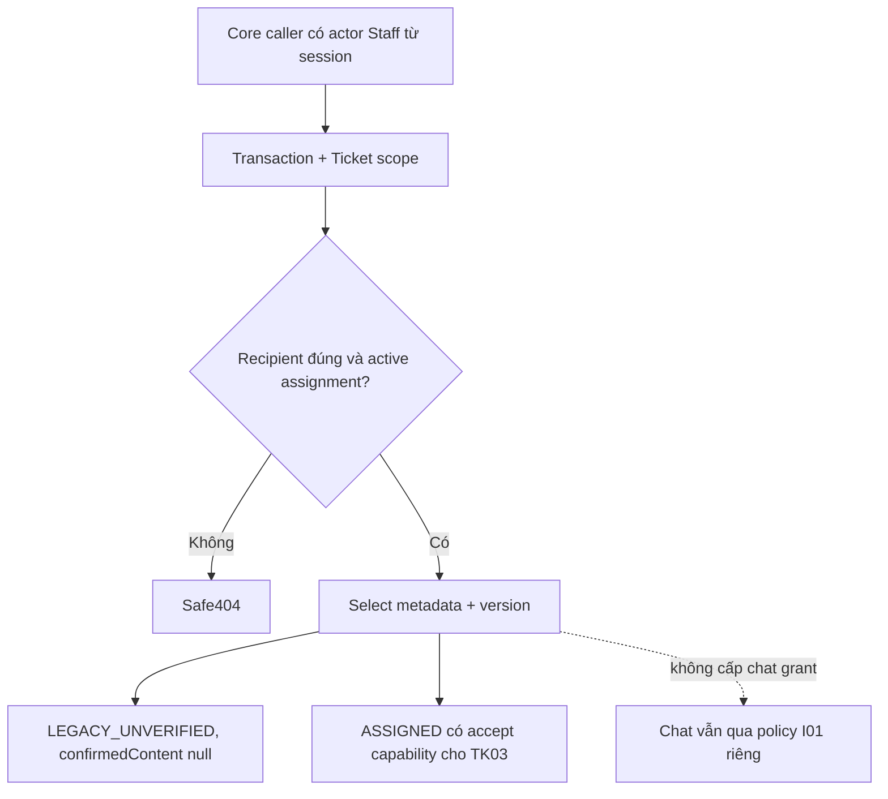

# TK01 — Quyền, dữ liệu và version Ticket

04/11/2026 · **Đã triển khai nền Core và kiểm chứng** · [Contract](../07-tickets-contract.md) · [Chung](../00-staff-contract.md). A21–A23/UI vẫn P ở TK02–TK04.

## 1. Phạm vi đã chốt

FR-010/NFR-001/002/005. Staff đọc/nhận Ticket chỉ khi **active assignment với khách và Ticket.assignedStaffId đúng actor**. Staff phải ACTIVE và không đang lockedUntil; Customer bị khóa vẫn có thể được Staff còn quyền phục vụ, giống hồ sơ readonly. Ticket chưa recipient không thành global queue; không claim OPEN hoặc tự chuyển recipient khi đổi phân công.

Ticket không cấp Conversation metadata/transcript grant. Ticket tham chiếu AI riêng không mở quyền đọc AI; conversationId/link không được dùng thay gate I01. Cuộc chat không bị đổi status/controller/controlVersion khi đọc Ticket.

Chỉ ASSIGNED trả allowedActions.accept=true cho TK03 sau này. OPEN/IN_PROGRESS/RESOLVED/CLOSED còn đọc được nếu đúng scope nhưng không tự tạo action nhận/đóng/hoàn tất. Staff phải xác thực tại boundary TK02/TK03; service TK01 nhận actorId đáng tin từ Core, không nhận role từ browser.

## 2. Schema và migration đã triển khai

SupportTicket giữ các trường/quan hệ hiện có và thêm **version Int NOT NULL default0**, CHECK version>=0 qua migration mới 202611040003_ticket_foundation. Đây là migration thứ8, không thêm bảng; dữ liệu cũ backfill0. Không sửa migration đã apply, xóa Ticket, đổi status/recipient/confirmedAt/AI content hoặc tạo confirmation evidence.

Chưa có updatedAt/confirmedContent/sourceDraftId hay TicketDraft. Quyết định thêm snapshot/draft thuộc I07; không backfill từ aiSummary/extractedDetails. Hiện projection trả confirmationSource=LEGACY_UNVERIFIED và confirmedContent=null; confirmedAt không chứng minh nội dung nào đã được duyệt.

## 3. Code và API boundary

| Vị trí | Vai trò |
| --- | --- |
| apps/core/prisma/schema.prisma | SupportTicket.version |
| prisma/migrations/202611040003_ticket_foundation/migration.sql | Default/backfill/check, DDL transaction |
| src/tickets/services/ticket-access.service.ts | staffScope áp trước query, requireTicket safe404 + projection nhỏ |
| src/tickets/dto/ticket-confirmation.ts | Legacy confirmation label, không suy content từ AI |
| src/tickets/tickets.module.ts và AppModule | Provider nội bộ; chưa controller/public API |
| src/database/database.service.ts, src/admin/main.ts | Compatibility/readiness theo migration mới |

Service dùng caller transaction. staffScope dùng được cho list/count/detail trước filter/page; requireTicket chỉ select id/customerId/recipient/status/version và trả confirmation label/allowedActions. Không raw aiSummary/extractedDetails, không đọc transcript hoặc tạo side effect.

**Không endpoint mới trong TK01.** A21/A22 đọc và A23 mutation còn P. TK02 phải lấy session Staff từ AuthService trong read transaction trước gọi policy; TK03 phải lock/recheck/CAS và increment version atomic. Không version giả trong DTO hoặc dùng User.updatedAt làm Ticket token.

## 4. Luồng



Read hiện chỉ là policy nội bộ. Quyền HTTP/session/CSRF ở TK02/TK03, UI/late responses ở TK04; TK01 không tuyên bố đã kiểm browser/no-F5 cho Ticket chưa có UI.

## 5. Kiểm thử và lệnh

```powershell
node --test apps/core/test/ticket-model-migration.test.cjs
docker compose --profile tests build core-tests
docker compose --profile tests run --rm --no-deps core-tests node --test test/ticket-foundation.test.cjs test/conversation-permissions.test.cjs
```

App/PostgreSQL chạy Docker theo Getting Started. Migration test chỉ dùng psql qua Docker trên schema UUID cô lập, không host Core/Web server. Policy tests trong explicit core-tests container dùng role Core thật và fixture runId riêng; cleanup chỉ dữ liệu fixture. Không đổi bootstrap/env/volumes hoặc seed chat/Ticket dùng chung.

| Nhóm | Kết quả04/11 |
| --- | --- |
| Migration PostgreSQL thật | 3 pass: upgrade/default/check, bảo toàn legacy, rollback DDL khi lỗi |
| Ticket policy PostgreSQL thật | 7 pass: recipient+assignment, OPEN unassigned, capabilities/status, revoke/reassignment, locked Staff/Customer, AI private link, confirmation/projection |
| Conversation permission regression | 16 pass: gate/sequence/idempotency/fence/reassignment, không hồi quy |
| HTTP/realtime foundation regression | 6 pass: public module graph, DTO/error/Swagger/CORS và WS session/scope/revoke |
| Source/build | Core lint/typecheck, admin build và Docker Core/core-tests/migrator build pass |
| Runtime | Migration deploy, Core healthy và gateway readiness200; chưa endpoint Ticket (404) |

Tổng32 test pass; không browser E2E vì TK01 chưa HTTP/UI. Fixture assertions xác nhận users/Tickets đã dọn; migration test dọn schema riêng. Host/generated Prisma và build admin là artifact chuẩn của quy trình, không script dùng một lần.

## 6. Checklist và phần tiếp

- [x] Chốt scope recipient+assignment, locked behavior, không OPEN queue/claim hoặc transcript grant.
- [x] Migration version/bảo toàn dữ liệu/rollback/default/check đã kiểm.
- [x] Internal policy/projection/module và readiness/operator compatibility đã có.
- [x] Tests đúng lớp pass và docs cập nhật, không stage/commit.
- [x] TK02 A21/A22/session/cursor/quota/DTO/Swagger và HTTP tests; xem kết quả tại phase02.
- [x] TK03 A23 lock/recheck/CAS/idempotent-state reconciliation.
- [ ] TK04 UI rồi TK05 notification; Agent producer/confirmation I07 để riêng.

Khi triển khai TK02, chatLink chỉ tính sau kiểm conversation.customerId khớp Ticket.customerId và gate I01; biết raw conversationId trong DB không đủ. Khi I07 thêm confirmed snapshot thật, mở rộng projection với bằng chứng server hợp lệ; không giả nhãn CONFIRMED_SNAPSHOT từ trường AI hoặc timestamp.
