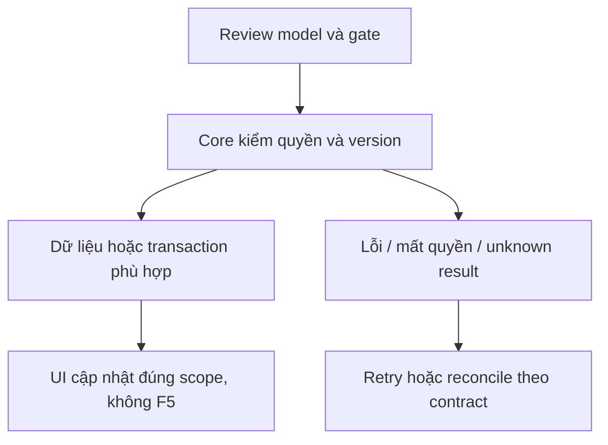

# TK01 — Quyền, dữ liệu và version Ticket

04/11/2026 · **Chưa triển khai; chốt contract trước code** · [Contract](../07-tickets-contract.md) · [Chung](../00-staff-contract.md).

## 1. Phạm vi và điều kiện bắt đầu

FR-010, NFR-001/002/005; đọc/tiếp nhận Ticket đã tồn tại có thể làm trước Agent. FR-009/012 tạo draft/xác nhận/tóm tắt là I07 riêng. Không thêm nút tạo Ticket giả hoặc route public giả Agent.

## 2. Model và vị trí thay đổi

Model hiện có SupportTicket(id,ticketCode,customerId,assignedStaffId,conversationId?,policyId?,title,aiSummary?,extractedDetails?,status,idempotencyKey,confirmedAt,createdAt). **Chưa có version/updatedAt/confirmedContent/sourceDraftId.** Notification có ticketId nhưng producer/scope Ticket chưa chạy.

## 3. API spec và quyền

Prefix REST `/api/v1`; mọi API trong phase này là **P** trừ API nền được dẫn rõ là E. Quyết định kỹ thuật đề xuất phải review trước code; không sửa schema chỉ từ file plan.

Đề xuất cho nhánh Staff trước Agent: chỉ Staff có active assignment với customer **và** ticket.assignedStaffId=actor.id được đọc/nhận. Ticket OPEN chưa recipient không tự thành global queue hoặc tự claim; routing/unassigned queue để I07 review riêng. Theo filter vẫn nhận enum TicketStatus, nhưng state enum không tạo action resolve/close.

Đề xuất thống nhất từ TK01: migration mới thêm SupportTicket.version Int default0 (backfill0), không sửa migration cũ; triển khai migration trước A22/TK02 để response có version thật, sau đó A23/TK03 dùng CAS. Không trả version giả trong DTO khi DB chưa có. Đây là kế hoạch cần review trước code, chưa đổi schema ở lượt tài liệu.

Legacy chỉ có confirmedAt, chưa immutable confirmed snapshot: DTO `confirmationSource=LEGACY_UNVERIFIED`, confirmedContent=null; aiSummary/extractedDetails không được ghi là nội dung Customer đã duyệt. Khi I07 có schema snapshot thì `CONFIRMED_SNAPSHOT` theo dữ liệu thật, không backfill giả.

## 4. Luồng thực hiện

`apps/core/src/tickets/services/ticket-access.service.ts`, DTO/projection; migration mới nếu bật version. StaffAssignment và recipient gate độc lập ConversationAccess; chatLink tính riêng bằng policy I01, AI riêng=null. Reassignment mất scope ngay, không kế thừa Ticket/chat acceptance.

## 5. Test cần có

Chốt contract → review version/legacy → migrate nếu cần → implement read rồi accept. API TK02/TK03 là P; chưa thay Prisma/schema trong đợt docs.

## 6. Gate hoàn tất

- [ ] Model/API/quyền/điểm còn mở đã review trước code phụ thuộc.
- [ ] Tests đúng lớp pass; HTTP/mock/browser E2E thật được phân biệt.
- [ ] Scope/phiên/late-response/concurrency/error và no-F5 được kiểm tương ứng.
- [ ] Cập nhật API map/checklist theo code thật, cleanup fixture/artifact; không tự commit.

Test schema upgrade/rollback-safe, legacy preservation, actor/recipient khác, active assignment đổi, Customer biết UUID404/403 theo role; Ticket có private AI conversation vẫn xem Ticket được nhưng chatLink null/A10 denied. Không xóa Ticket cũ hoặc gán consent giả.

