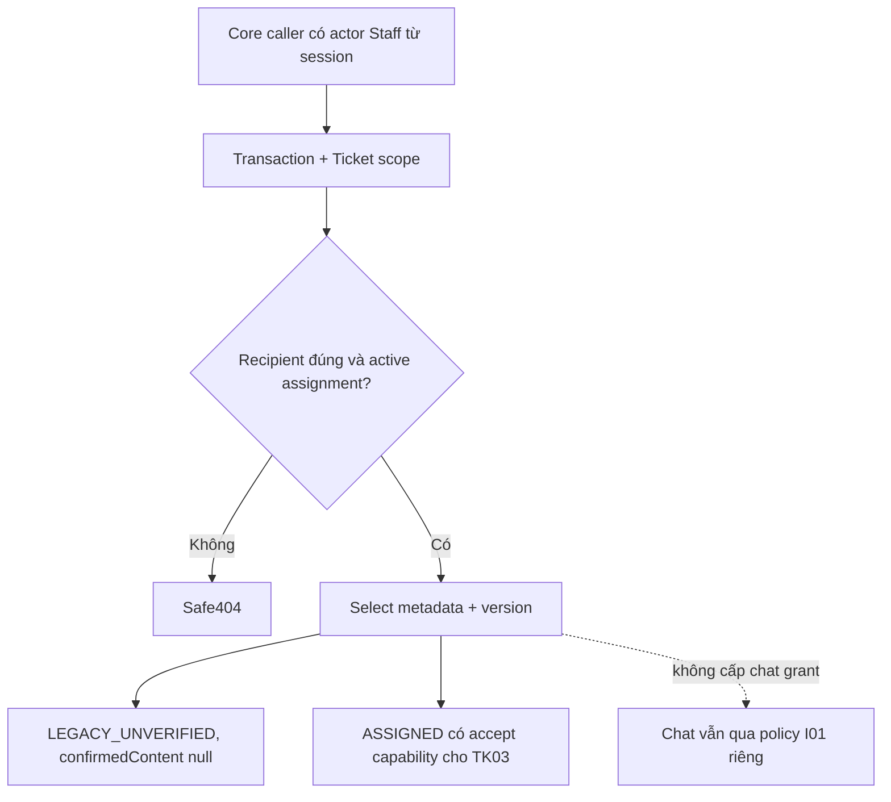
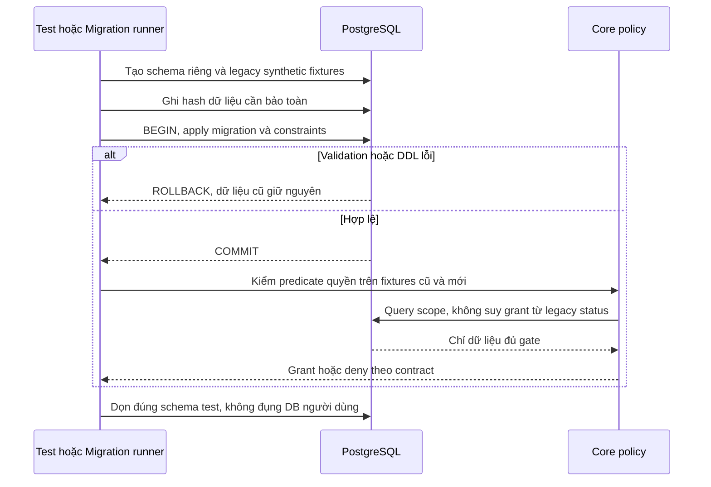

# TK01 — Quyền, dữ liệu và version Ticket

04/11/2026 · **Đã triển khai nền Core và kiểm chứng** · [Contract](../07-tickets-contract.md) · [Chung](../00-staff-contract.md). A21–A23/UI vẫn P ở TK02–TK04.

## Data model và phạm vi ảnh hưởng

Bảng bên dưới mô tả tác động của phase, gồm cả ghi gián tiếp qua Core. Tên bảng thuộc schema `business` trừ nơi ghi rõ; cột còn đề xuất được đánh dấu **P**. Web không truy cập DB trực tiếp.

| Bảng/model | Cột hoặc dữ liệu liên quan | Thao tác của phase | Quan hệ/ràng buộc cần giữ | Mức ảnh hưởng và nơi bị tác động |
| --- | --- | --- | --- | --- |
| users + auth_sessions | users.id/role/status, auth_sessions.user_id/token_hash/expires_at/revoked_at | Đọc | AuthSession.user_id → User.id; session phải còn hạn, không bị thu hồi | Cao — mọi API dùng session; không trả token/hash trong DTO |
| staff_assignments + customer_profiles + staff_profiles | staff_id/customer_id/is_active/ended_at, assignment_version, user_id/full_name | Đọc | Assignment gắn đúng Customer/Staff; Inbox còn ràng buộc assignment id cụ thể | Cao — Customers, Policy Lookup, Ticket và Inbox cùng phụ thuộc phân công |
| support_tickets | id/ticket_code/customer_id/assigned_staff_id/conversation_id/policy_id/status/version/title/ai_summary/extracted_details/confirmed_at | Đọc | Policy FK (policy_id,customer_id); Ticket quyền riêng, không cấp transcript grant; legacy không có confirmedContent/TicketDraft | Cao — list/detail/status và notification dùng cùng Ticket scope; confirmed_at không chứng minh AI text đã được duyệt |

**Schema/migration:** TK01 đã thêm SupportTicket.version default0/CHECK >=0; migration additive không reset status/recipient/nội dung. Không TicketDraft/confirmedContent mới trong TK01.

**Nhất quán và hồi quy:** staffScope dùng chung trước filter/page/detail; legacy label UNVERIFIED. Kiểm migration rollback/legacy và scope độc lập transcript.

## 1. Phạm vi đã chốt

FR-010/NFR-001/002/005. Staff đọc/nhận Ticket chỉ khi **active assignment với khách và Ticket.assignedStaffId đúng actor**. Staff phải ACTIVE và không đang lockedUntil; Customer bị khóa vẫn có thể được Staff còn quyền phục vụ, giống hồ sơ readonly. Ticket chưa recipient không thành global queue; không claim OPEN hoặc tự chuyển recipient khi đổi phân công.

Ticket không cấp Conversation metadata/transcript grant. Ticket tham chiếu AI riêng không mở quyền đọc AI; conversationId/link không được dùng thay gate I01. Cuộc chat không bị đổi status/controller/controlVersion khi đọc Ticket.

OPEN và ASSIGNED trả allowedActions.accept=true khi đúng scope; Staff Accept chuyển IN_PROGRESS. Các status còn lại đọc theo quyền và transitions của TK03. Staff phải xác thực tại boundary TK02/TK03; service TK01 nhận actorId đáng tin từ Core, không nhận role từ browser.

## 2. Schema và migration đã triển khai

SupportTicket giữ các trường/quan hệ hiện có và thêm **version Int NOT NULL default0**, CHECK version>=0 qua migration mới 202611040003_ticket_foundation. Đây là migration thứ 8, không thêm bảng; dữ liệu cũ backfill0. Không sửa migration đã apply, xóa Ticket, đổi status/recipient/confirmedAt/AI content hoặc tạo confirmation evidence.

Schema đã có TicketDraft/sourceDraftId/confirmedContent qua migration 202611130001. Phase 2 đã project snapshot cơ bản hợp lệ thành CUSTOMER_SUBMITTED/CUSTOMER_CONFIRMED; legacy/invalid vẫn LEGACY_UNVERIFIED/null, không backfill từ aiSummary/extractedDetails. requestFingerprint nullable/CHECK được thêm bằng migration 202611140001.

## 3. Code và API boundary

Service dùng caller transaction. staffScope dùng được cho list/count/detail trước filter/page; requireTicket chỉ select id/customerId/recipient/status/version và trả confirmation label/allowedActions. Không raw aiSummary/extractedDetails, không đọc transcript hoặc tạo side effect.

**Không endpoint mới trong TK01.** A21/A22 đọc và A23 mutation còn P. TK02 phải lấy session Staff từ AuthService trong read transaction trước gọi policy; TK03 phải lock/recheck/CAS và increment version atomic. Không version giả trong DTO hoặc dùng User.updatedAt làm Ticket token.

| Vị trí từ root repo | Hiện trạng | Trách nhiệm trong phase | Mức ảnh hưởng | Phạm vi cần kiểm lại |
| --- | --- | --- | --- | --- |
| [apps/core/prisma/schema.prisma](<../../../../../apps/core/prisma/schema.prisma>) | Hiện có | SupportTicket.version và relations | Cao | Generated client và mutations TK03 |
| [apps/core/prisma/migrations/202611040003_ticket_foundation/migration.sql](<../../../../../apps/core/prisma/migrations/202611040003_ticket_foundation/migration.sql>) | Hiện có | Backfill0 và CHECK version | Cao | Ticket legacy không đổi nghĩa |
| [apps/core/src/tickets/services/ticket-access.service.ts](<../../../../../apps/core/src/tickets/services/ticket-access.service.ts>) | Hiện có | Ticket scope và allowedActions | Cao | Notifications và deep link, không cấp chat grant |
| [apps/core/src/tickets/dto/ticket-confirmation.ts](<../../../../../apps/core/src/tickets/dto/ticket-confirmation.ts>) | Hiện có | Legacy-unverified projection | Cao | Customer confirmation I07 sau này |

## 4. Luồng

Read hiện chỉ là policy nội bộ. Quyền HTTP/session/CSRF ở TK02/TK03, UI/late responses ở TK04; TK01 không tuyên bố đã kiểm browser/no-F5 cho Ticket chưa có UI.

## 5. Test cases

Các ca dưới đây là **đặc tả kiểm thử**, không phải báo cáo kết quả. Kiểm từng lớp API/service/DB/browser đúng nhãn; mock UI không thay kiểm quyền Core hoặc E2E thật.

**Quy ước dữ liệu:** S-A/S-B là hai Staff synthetic; C-A/C-B là hai Customer synthetic khác nhau. Thay alias bằng UUID/token của fixture cô lập; các path HTTP dùng prefix /api/v1 nếu chưa ghi đầy đủ. Chỉ thay assignment, khóa account, inject lỗi hoặc migration trong harness/môi trường test, không trên tài khoản/dữ liệu đang sử dụng.

### TK01-T01 — Recipient và assignment đều bắt buộc

**Lớp kiểm thử:** Service + DB.
**Điều kiện và dữ liệu:** Ticket T-A assigned S-A/C-A; T-B assigned S-B nhưng C-A; OPEN không recipient.

**Các bước:**

1. Gọi requireTicket bằng S-A/S-B cho từng Ticket.
2. Chỉ thêm assignment mà không đổi recipient.
3. Gọi lại scope.

**Kết quả mong đợi:** Chỉ actor đồng thời đúng recipient+active assignment đọc được; OPEN unassigned không thành queue/claim.

### TK01-T02 — Khóa Staff khác khóa Customer

**Lớp kiểm thử:** Service + DB.
**Điều kiện và dữ liệu:** T-A đúng scope S-A; fixture có status/lockedUntil riêng.

**Các bước:**

1. Khóa Customer C-A rồi requireTicket bằng S-A.
2. Khóa S-A hoặc đặt lockedUntil tương lai.
3. Khôi phục Staff trong fixture rồi đọc lại.

**Kết quả mong đợi:** Customer khóa vẫn được Staff phục vụ; Staff khóa mất quyền; không thay assignment/password để né lỗi.

### TK01-T03 — Ticket không mở chat AI

**Lớp kiểm thử:** Service + DB.
**Điều kiện và dữ liệu:** T-A liên kết cuộc AI riêng; confirmedAt có nhưng chưa immutable snapshot.

**Các bước:**

1. Đọc Ticket metadata.
2. Gọi metadata/transcript của chat qua gate I01.
3. Kiểm projection confirmation.

**Kết quả mong đợi:** Đọc Ticket không tạo grant hoặc sửa chat; AI riêng vẫn404; confirmationSource legacy và confirmedContent=null.

### TK01-T04 — Migration version giữ dữ liệu

**Lớp kiểm thử:** Migration harness.
**Điều kiện và dữ liệu:** Schema riêng có Ticket ở nhiều status và field cũ đã hash.

**Các bước:**

1. Apply TK01 migration.
2. Thử version âm/null và increment hợp lệ.
3. Inject lỗi migration trên schema riêng khác.

**Kết quả mong đợi:** Backfill version 0, dữ liệu cũ giữ nguyên; CHECK từ chối âm/null; failure rollback và không tạo confirmation evidence.

**Suite tham khảo:** [ticket-model-migration.test.cjs](../../../../../apps/core/test/ticket-model-migration.test.cjs). Tên suite là vị trí tự động hóa, không phải chứng nhận các ca đã chạy.

**Dọn sau kiểm thử:** xóa đúng fixture/session/object/schema theo runId; phục hồi fault injection và đóng context/socket test. Không reset DB/credential, sửa bootstrap hoặc xóa volumes. Với PDF kiểm metadata/bytes/hash; với UI kiểm DOM/focus/network, không cần screenshot.

## 6. Checklist và phần tiếp

- [x] Chốt scope recipient+assignment, locked behavior, không OPEN queue/claim hoặc transcript grant.
- [x] Migration version/bảo toàn dữ liệu/rollback/default/check đã kiểm.
- [x] Internal policy/projection/module và readiness/operator compatibility đã có.
- [x] Tests đúng lớp pass và docs cập nhật, không stage/commit.
- [x] TK02 A21/A22/session/cursor/quota/DTO/Swagger và HTTP tests; xem kết quả tại phase02.
- [x] TK03 A23 lock/recheck/CAS/idempotent-state reconciliation.
- [x] TK04 UI và TK05 notification đã triển khai; producer/confirmation I07 giữ ở phase Agent riêng.

Khi triển khai TK02, chatLink chỉ tính sau kiểm conversation.customerId khớp Ticket.customerId và gate I01; biết raw conversationId trong DB không đủ. Khi I07 thêm confirmed snapshot thật, mở rộng projection với bằng chứng server hợp lệ; không giả nhãn CONFIRMED_SNAPSHOT từ trường AI hoặc timestamp.

## Sequence diagram

Luồng chính và nhánh quyền/lỗi; test case ở trên chỉ rõ dữ liệu và điểm kiểm tương ứng.

