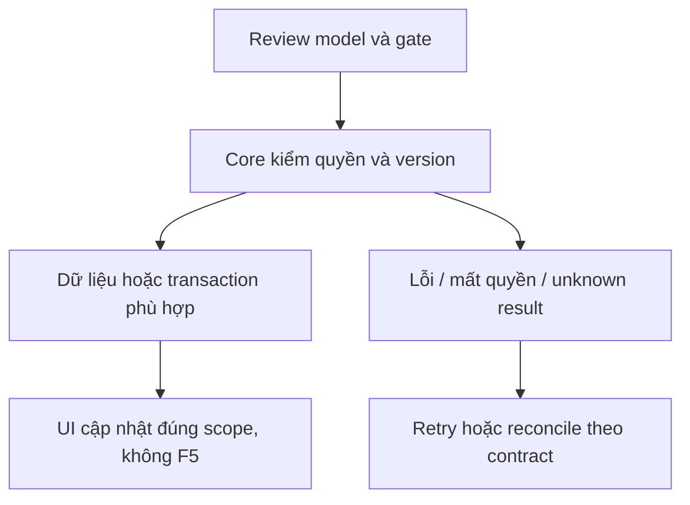

# TK02 — Staff Tickets list/detail

04/11/2026 · **P, chưa có endpoint** · [Contract](../07-tickets-contract.md) · [Chung](../00-staff-contract.md).

## 1. Phạm vi và điều kiện bắt đầu

TK01; FR-010 xem/theo dõi. Không cần Agent chạy để đọc các Ticket có sẵn, không chứng minh nguồn tạo Ticket thật.

## 2. Model và vị trí thay đổi

Module/controller đề xuất `apps/core/src/tickets/{tickets.module.ts,controllers/staff-ticket.controller.ts,services/ticket.service.ts,services/ticket-access.service.ts,dto/ticket-query.dto.ts,dto/ticket-response.dto.ts}`; import AppModule khi code.

## 3. API spec và quyền

Prefix REST `/api/v1`; mọi API trong phase này là **P** trừ API nền được dẫn rõ là E. Quyết định kỹ thuật đề xuất phải review trước code; không sửa schema chỉ từ file plan.

A21 GET `/staff/tickets?search=&status=ASSIGNED&customerId=<uuid>&limit=20&cursor=`. search0–100 literal tên/mã khách/ticketCode; status optional đúng5 enum; customerId UUID optional cho deep link, không quyền mới. limit1–50; keyset createdAt DESC,id DESC, cursor HMAC bound actor/query/scope; scope trước pagination. Quota đề xuất120 reads/phút/actor, chốt khi code. Response `{items:[{id,ticketCode,title,status,createdAt,customer}],pageInfo:{hasMore,nextCursor}}`, không total/unread.

A22 GET `/staff/tickets/:ticketId` → `{ticket:{id,ticketCode,title,status,version,customer,policy,createdAt,confirmedAt,confirmationSource,confirmedContent,aiSummary,allowedActions:{accept},chatLink}}`. policy chỉ projection đúng quyền; nullable; confirmedContent theo TK01, không raw extractedDetails. Legacy aiSummary phải gắn nhãn AI summary chưa có bằng chứng content confirmation. chatLink null nếu không qua I01. Không signed URL/raw prompts/checkpoint.

401 session;403 role; resource/scope/cursor ngoài quyền404 hoặc invalid-cursor400 không lộ ID; query lạ400;429 Retry-After;5xx safe envelope. GET no-store. Version field chỉ public E khi migration/backend TK01 thật có.

## 4. Luồng thực hiện

Staff session → active assignment+Ticket recipient → search/cursor snapshot → safe projection. Detail quyền Ticket độc lập transcript. Policy link không thay linkedPolicy chat; click chat recheck A09/A10.

## 5. Test cần có

API: synthetic fixtures legacy/no policy/no chat/many pages/two Staff/Customer locked/Staff locked/reassignment. Concurrent assignment change/cursor reuse actor khác phải denied. Đề xuất `apps/core/test/tickets-read.test.cjs`, HTTP/PostgreSQL thật; không fake browser-only test quyền.

## 6. Gate hoàn tất

- [ ] Model/API/quyền/điểm còn mở đã review trước code phụ thuộc.
- [ ] Tests đúng lớp pass; HTTP/mock/browser E2E thật được phân biệt.
- [ ] Scope/phiên/late-response/concurrency/error và no-F5 được kiểm tương ứng.
- [ ] Cập nhật API map/checklist theo code thật, cleanup fixture/artifact; không tự commit.

Swagger/API map vẫn P tới khi controller/test pass. Test fixtures runId riêng và teardown; không sửa bootstrap để làm trang có dữ liệu.

