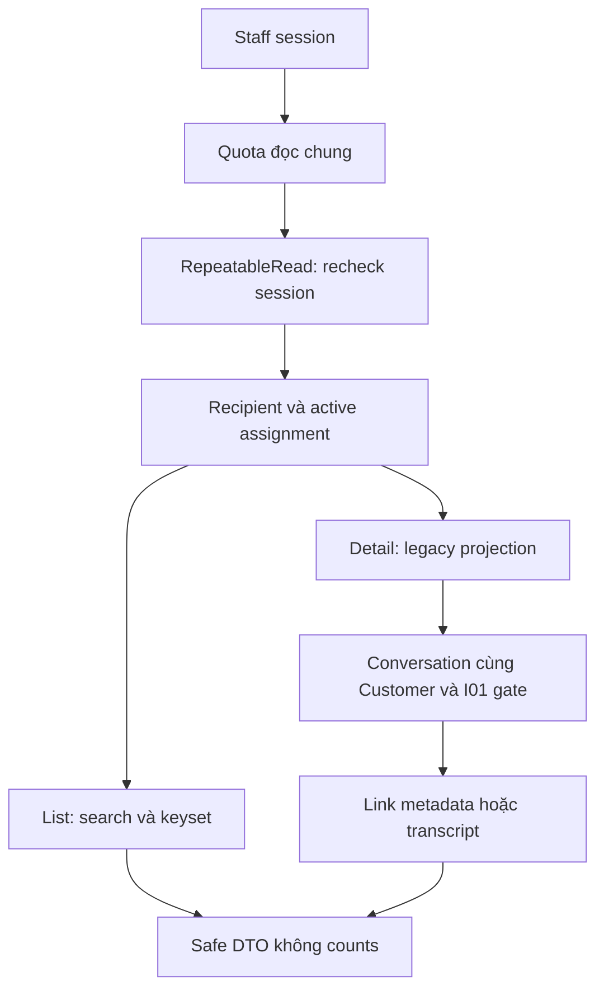
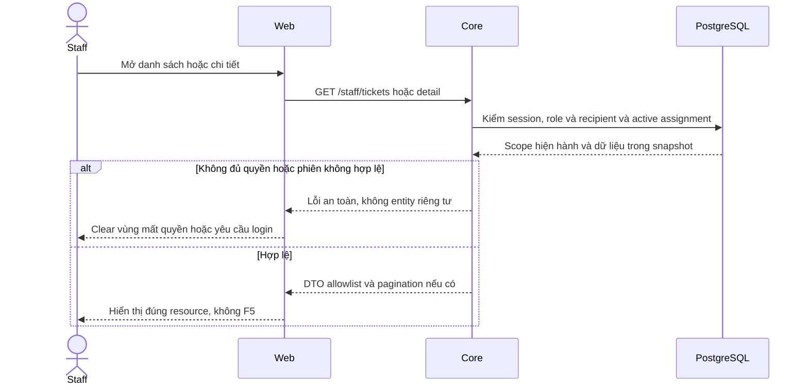

# TK02 — Staff Tickets list/detail

04/11/2026 · **E: Core read API đã triển khai; UI thuộc TK04** · [Contract](../07-tickets-contract.md) · [Chung](../00-staff-contract.md).

## Bổ sung bảo vệ dữ liệu Customer — 12/11/2026

**P — chưa triển khai phần bảo vệ bổ sung; giữ trạng thái baseline của phase.** Theo [ma trận dữ liệu chung](../../../../configuration-and-data.md#customer-sensitive-data); mức che/quyền xem đầy đủ còn chờ chốt. Vị trí code/API và data model của phase bên dưới là nơi rà tác động; bổ sung này không tự yêu cầu migration hoặc sửa dữ liệu gốc.

**Thay đổi của phase:** Rà customer labels/title/summary/extractedDetails/confirmedContent trong DTO. Recipient/assignment không cho mọi PII hay transcript; projection không sửa immutable snapshot, legacy vẫn UNVERIFIED.

**Kiểm thử cần bổ sung, chưa chạy:** API: list/detail scoped trước cursor/search, raw canary không ngoài ma trận; legacy không thành confirmation/chat grant.

## Data model và phạm vi ảnh hưởng

Bảng bên dưới mô tả tác động của phase, gồm cả ghi gián tiếp qua Core. Tên bảng thuộc schema `business` trừ nơi ghi rõ; cột còn đề xuất được đánh dấu **P**. Web không truy cập DB trực tiếp.

| Bảng/model | Cột hoặc dữ liệu liên quan | Thao tác của phase | Quan hệ/ràng buộc cần giữ | Mức ảnh hưởng và nơi bị tác động |
| --- | --- | --- | --- | --- |
| users + auth_sessions | users.id/role/status, auth_sessions.user_id/token_hash/expires_at/revoked_at | Đọc | AuthSession.user_id → User.id; session phải còn hạn, không bị thu hồi | Cao — mọi API dùng session; không trả token/hash trong DTO |
| staff_assignments + customer_profiles + staff_profiles | staff_id/customer_id/is_active/ended_at, assignment_version, user_id/full_name | Đọc | Assignment gắn đúng Customer/Staff; Inbox còn ràng buộc assignment id cụ thể | Cao — Customers, Policy Lookup, Ticket và Inbox cùng phụ thuộc phân công |
| support_tickets | id/ticket_code/customer_id/assigned_staff_id/conversation_id/policy_id/status/version/title/ai_summary/extracted_details/confirmed_at | Đọc | Policy FK (policy_id,customer_id); Ticket quyền riêng, không cấp transcript grant; legacy không có confirmedContent/TicketDraft | Cao — list/detail/status và notification dùng cùng Ticket scope; confirmed_at không chứng minh AI text đã được duyệt |
| rate_limit_buckets | client_token/endpoint_group/window_start/request_count/blocked_until | Ghi phụ trợ khi endpoint áp quota | PK (client_token,endpoint_group); tăng atomic, giới hạn theo actor/nhóm endpoint | Trung bình — quota có thể ghi dù nghiệp vụ bị từ chối; không log định danh nhạy cảm |

**Schema/migration:** Không migration sau TK01. Không tạo Ticket/draft hoặc gắn lại policy từ GET.

**Nhất quán và hồi quy:** Scope/search/status trước pagination; confirmed_at không là confirmed content. Kiểm ngoài scope, Ticket có link AI private, version/allowedActions và cursor.

## 1. Phạm vi và code

TK01; FR-010 xem/theo dõi. Đọc Ticket có sẵn không cần Agent. Chưa có producer nghiệp vụ, API tạo. Accept đã có ở TK03, UI đã nối ở TK04. Fixture không chứng minh Agent gợi ý → Customer xác nhận → Core tạo.

Module tại apps/core/src/tickets gồm controllers/staff-ticket.controller.ts, DTO query/response/legacy và services ticket.service.ts, ticket-access.service.ts, ticket-cursor.service.ts, ticket-rate-limit.ts. AppModule import TicketsModule; dùng AuthModule, DatabaseModule, ConversationsModule. Không thêm dependency/schema/migration ở TK02.

| Vị trí từ root repo | Hiện trạng | Trách nhiệm trong phase | Mức ảnh hưởng | Phạm vi cần kiểm lại |
| --- | --- | --- | --- | --- |
| [apps/core/src/tickets/controllers/staff-ticket.controller.ts](<../../../../../apps/core/src/tickets/controllers/staff-ticket.controller.ts>) | Hiện có | List/detail/accept/status endpoints | Cao | Staff Ticket list/detail |
| [apps/core/src/tickets/services/ticket.service.ts](<../../../../../apps/core/src/tickets/services/ticket.service.ts>) | Hiện có | Scope, lock, expectedVersion/CAS, audit/outbox | Cao | Status dropdown và notification source |
| [apps/core/src/tickets/services/ticket-access.service.ts](<../../../../../apps/core/src/tickets/services/ticket-access.service.ts>) | Hiện có | Ticket scope và allowedActions | Cao | Notifications và deep link, không cấp chat grant |
| [apps/core/src/tickets/services/ticket-cursor.service.ts](<../../../../../apps/core/src/tickets/services/ticket-cursor.service.ts>) | Hiện có | Cursor actor/filter boundary | Trung bình | List search/filter/load more |

## 2. API spec

Prefix /api/v1; A21/A22 **E**, cookie session hiện hành, Cache-Control: no-store. GET không yêu cầu CSRF header; vẫn cần cặp session/CSRF cookie hợp lệ theo Auth hiện có.

### A21 — GET /staff/tickets

| Query | Quy tắc |
| --- | --- |
| search | Optional, trim, 0–100 ký tự, không control characters; literal case-insensitive tên/mã Customer hoặc ticketCode. Không tìm title/aiSummary/chat/CCCD/email/phone |
| status | Optional, đúng OPEN/ASSIGNED/IN_PROGRESS/RESOLVED/CLOSED |
| customerId | Optional UUID, chỉ thu hẹp scope. Không assignment hiện hành trả 404; có assignment nhưng không Ticket đúng recipient trả items rỗng |
| limit | Số nguyên1–50, default20 |
| cursor | Opaque HMAC cursor gắn actor/search/status/customerId/limit |

Không nhận query lạ/mảng/field lặp. Áp quyền **Ticket recipient chính Staff và active assignment** trước search/keyset. Không OPEN queue/claim unassigned. Staff khóa mất quyền; Customer khóa vẫn được phục vụ theo TK01, không mở chat.

Response:
```json
{
  "items": [{
    "id": "<uuid>", "ticketCode": "<code>", "title": "<title>",
    "status": "ASSIGNED", "createdAt": "<ISO timestamp>",
    "customer": {"id": "<uuid>", "fullName": "<name>", "accountCode": "<code>"}
  }],
  "pageInfo": {"hasMore": true, "nextCursor": "<opaque signed cursor>"}
}
```

createdAt DESC,id DESC; lấy limit+1, không total/count/unread; trang cuối nextCursor=null. Mỗi trang kiểm quyền theo snapshot hiện hành, không đóng băng danh sách qua nhiều request. Ticket mới hơn boundary hiện khi đọc lại trang đầu.

Cursor TTL15 phút, khóa random trong memory singleton Core. Restart làm cursor cũ invalid; trả 400 INVALID_CURSOR và client bắt đầu lại trang đầu. Không lấy khóa từ cookie/DB password hoặc ghi file credential. Cơ chế hiện tại dành cho một Core process; nhiều replica cần khóa ký dùng chung trước triển khai. Cursor không cấp quyền; assignment thu hồi làm Ticket biến mất ở trang kế tiếp.

### A22 — GET /staff/tickets/:ticketId

Không nhận query. Response:
```text
{ticket:{id,ticketCode,title,status,version,customer,policy,createdAt,
 confirmedAt,confirmationSource,confirmedContent,aiSummary,
 allowedActions:{accept},chatLink}}
```

| Field | Projection |
| --- | --- |
| customer | id/fullName/accountCode như list |
| policy | null hoặc id/policyNumber cùng Customer; hợp đồng lịch sử được giữ dù sản phẩm inactive; không benefitsSnapshot/storage fields |
| confirmationSource / confirmedContent | LEGACY_UNVERIFIED / null. Không suy snapshot từ confirmedAt/aiSummary/extractedDetails |
| aiSummary | Nullable, tách riêng như nội dung AI chưa có bằng chứng xác nhận; UI ghi đúng nhãn |
| allowedActions.accept | status===ASSIGNED, chỉ capability cho TK03, mutation endpoint thuộc TK03 |
| chatLink | null nếu không cùng Customer/không qua I01; không lộ conversationId ngoài field này |

chatLink hợp lệ gồm conversationId/capability/href. Pending handoff chỉ REQUEST_METADATA, href /staff/inbox/:id?filter=requests; Direct/đã Accept là TRANSCRIPT, filter=active. AI riêng/Copilot không được lộ link dù Ticket gắn conversationId. Khi mở chat, API hội thoại kiểm lại gate; Ticket không tạo grant.

### Session, snapshot, lỗi, quota

Auth kiểm trước quota và kiểm lại cùng transaction RepeatableRead chứa Ticket query (timeout15s). Scope/projection/link đọc cùng snapshot.

Quota PostgreSQL chung list/detail **120 lượt/phút/actor**, upsert atomic ngoài read transaction; lỗi nghiệp vụ không rollback lượt đã tiêu thụ. DTO chặn trước service không tiêu quota.

401 thiếu/hết hạn/thu hồi/khóa phiên;403 sai role;404 vắng/ngoài quyền;400 DTO/UUID/query/cursor sai/hết hạn/sai actor hoặc bộ lọc;429 Retry-After;5xx safe envelope. Không log cookie/token/cursor/nội dung riêng.

## 3. Luồng



## 4. Test cases

Các ca dưới đây là **đặc tả kiểm thử**, không phải báo cáo kết quả. Kiểm từng lớp API/service/DB/browser đúng nhãn; mock UI không thay kiểm quyền Core hoặc E2E thật.

**Quy ước dữ liệu:** S-A/S-B là hai Staff synthetic; C-A/C-B là hai Customer synthetic khác nhau. Thay alias bằng UUID/token của fixture cô lập; các path HTTP dùng prefix /api/v1 nếu chưa ghi đầy đủ. Chỉ thay assignment, khóa account, inject lỗi hoặc migration trong harness/môi trường test, không trên tài khoản/dữ liệu đang sử dụng.

### TK02-T01 — Search/filter/keyset toàn scope

**Lớp kiểm thử:** API.
**Điều kiện và dữ liệu:** S-A có hơn20 Ticket, tên/mã khách synthetic; S-B có Ticket ngoài scope.

**Các bước:**

1. GET list, lấy trang sau rồi search ticketCode ở trang sau từ trang đầu.
2. Lọc từng status và customerId hợp lệ.
3. Đối chiếu items/pageInfo với fixture.

**Kết quả mong đợi:** Search toàn tập đúng quyền; keyset createdAt/id ổn định, không thiếu/trùng hoặc counts/total.

### TK02-T02 — Search literal và cursor bị đổi

**Lớp kiểm thử:** API.
**Điều kiện và dữ liệu:** Tên Customer có %/_; cursor của S-A với limit 2/filter cố định.

**Các bước:**

1. Search literal và từ chỉ có trong title/aiSummary.
2. Dùng cursor bằng S-B hoặc đổi search/status/limit.
3. Sửa một byte cursor hoặc làm cursor hết hạn.

**Kết quả mong đợi:** Chỉ tên/mã khách/ticketCode được tìm; cursor sai400, không lộ dữ liệu. Retry list từ trang đầu khi cursor invalid.

### TK02-T03 — Detail legacy và policy/chat link

**Lớp kiểm thử:** API.
**Điều kiện và dữ liệu:** T-A có policy cùng Customer và liên kết AI riêng; T-D có Direct đủ grant.

**Các bước:**

1. GET detail T-A/T-D.
2. Đối chiếu allowlist, confirmation, version/actions.
3. Gọi chat đích bằng quyền đã mất trong biến thể riêng.

**Kết quả mong đợi:** Không raw extractedDetails; legacy snapshot null; policy chỉ id/number; AI riêng chatLink=null, Direct có link nhưng API chat vẫn recheck.

### TK02-T04 — Revoke, session và input

**Lớp kiểm thử:** API + DB.
**Điều kiện và dữ liệu:** S-A đọc được T-A; có Customer session, UUID thiếu và bucket quota riêng.

**Các bước:**

1. Revoke assignment giữa hai trang rồi GET detail/list.
2. Thử Customer/no session, query lạ, UUID/limit sai.
3. Vượt quota read chung list/detail.

**Kết quả mong đợi:** Sau revoke không trả Ticket; lỗi401/403/404/400 đúng loại;429 Retry-After, không trả stale entity.

**Suite tham khảo:** [tickets-read.test.cjs](../../../../../apps/core/test/tickets-read.test.cjs). Tên suite là vị trí tự động hóa, không phải chứng nhận các ca đã chạy.

**Dọn sau kiểm thử:** xóa đúng fixture/session/object/schema theo runId; phục hồi fault injection và đóng context/socket test. Không reset DB/credential, sửa bootstrap hoặc xóa volumes. Với PDF kiểm metadata/bytes/hash; với UI kiểm DOM/focus/network, không cần screenshot.

## 5. Checklist và bước tiếp

- [x] A21/A22, DTO/Swagger/session/scope/snapshot/cursor/quota.
- [x] Không lộ chat riêng/nhầm AI summary với confirmed content.
- [x] Tests/gateway pass, fixture dọn; không sửa bootstrap.
- [x] Contract/index/tiến độ đồng bộ; không stage/commit.
- [x] TK03 Accept/version/CAS/reconcile; TK04 UI đã nối; TK05 consumer events đã có; I07 producer riêng.

Nguồn tạo/xác nhận Ticket thật tiếp tục thuộc I07 và Customer T01/T02.

## Sequence diagram

Luồng chính và nhánh quyền/lỗi; test case ở trên chỉ rõ dữ liệu và điểm kiểm tương ứng.


