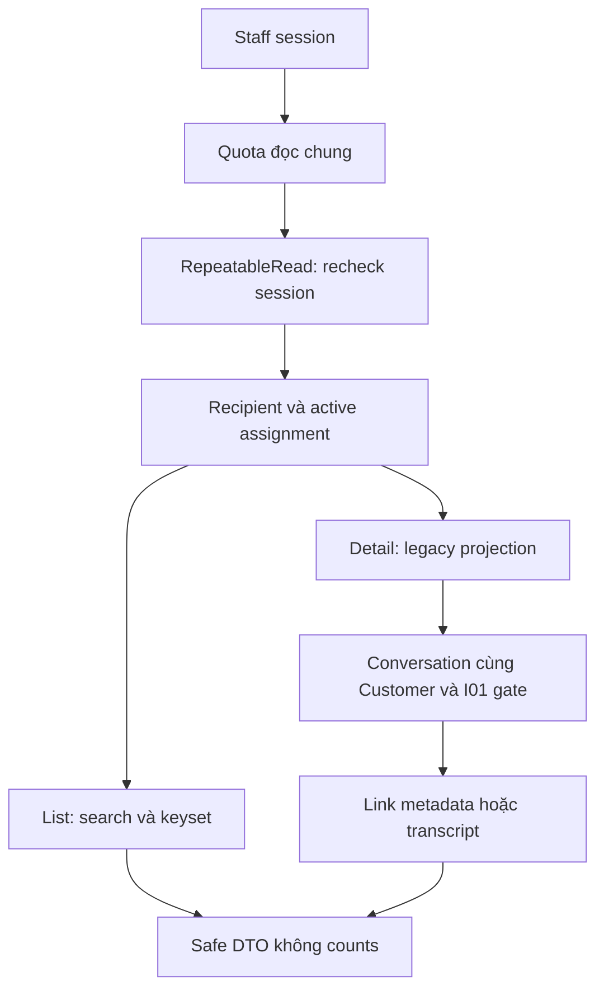

# TK02 — Staff Tickets list/detail

04/11/2026 · **E: Core read API đã triển khai; UI thuộc TK04** · [Contract](../07-tickets-contract.md) · [Chung](../00-staff-contract.md).

## 1. Phạm vi và code

TK01; FR-010 xem/theo dõi. Đọc Ticket có sẵn không cần Agent. Chưa có producer nghiệp vụ, API tạo. Accept đã có ở TK03, UI đã nối ở TK04. Fixture không chứng minh Agent gợi ý → Customer xác nhận → Core tạo.

Module tại apps/core/src/tickets gồm controllers/staff-ticket.controller.ts, DTO query/response/legacy và services ticket.service.ts, ticket-access.service.ts, ticket-cursor.service.ts, ticket-rate-limit.ts. AppModule import TicketsModule; dùng AuthModule, DatabaseModule, ConversationsModule. Không thêm dependency/schema/migration ở TK02.

## 2. API spec

Prefix /api/v1; A21/A22 **E**, cookie session hiện hành, Cache-Control: no-store. GET không yêu cầu CSRF header; vẫn cần cặp session/CSRF cookie hợp lệ theo Auth hiện có.

### A21 — GET /staff/tickets

| Query | Quy tắc |
| --- | --- |
| search | Optional, trim, 0–100 ký tự, không control characters; literal case-insensitive tên/mã Customer hoặc ticketCode. Không tìm title/aiSummary/chat/CCCD/email/phone |
| status | Optional, đúng OPEN/ASSIGNED/IN_PROGRESS/RESOLVED/CLOSED |
| customerId | Optional UUID, chỉ thu hẹp scope. Không assignment hiện hành trả404; có assignment nhưng không Ticket đúng recipient trả items rỗng |
| limit | Số nguyên1–50, default20 |
| cursor | Opaque HMAC cursor gắn actor/search/status/customerId/limit |

Không nhận query lạ/mảng/field lặp. Áp quyền **Ticket recipient chính Staff và active assignment** trước search/keyset. Không OPEN queue/claim unassigned. Staff khóa mất quyền; Customer khóa vẫn được phục vụ theo TK01, không mở chat.

Response:
```json
{
  "items": [{
    "id": "<uuid>", "ticketCode": "<code>", "title": "<title>",
    "status": "ASSIGNED", "createdAt": "<ISO timestamp>",
    "customer": {"id": "<uuid>", "fullName": "<name>", "accountCode": "<code>"}
  }],
  "pageInfo": {"hasMore": true, "nextCursor": "<opaque signed cursor>"}
}
```

createdAt DESC,id DESC; lấy limit+1, không total/count/unread; trang cuối nextCursor=null. Mỗi trang kiểm quyền theo snapshot hiện hành, không đóng băng danh sách qua nhiều request. Ticket mới hơn boundary hiện khi đọc lại trang đầu.

Cursor TTL15 phút, khóa random trong memory singleton Core. Restart làm cursor cũ invalid; trả400 INVALID_CURSOR và client bắt đầu lại trang đầu. Không lấy khóa từ cookie/DB password hoặc ghi file credential. Cơ chế hiện tại dành cho một Core process; nhiều replica cần khóa ký dùng chung trước triển khai. Cursor không cấp quyền; assignment thu hồi làm Ticket biến mất ở trang kế tiếp.

### A22 — GET /staff/tickets/:ticketId

Không nhận query. Response:
```text
{ticket:{id,ticketCode,title,status,version,customer,policy,createdAt,
 confirmedAt,confirmationSource,confirmedContent,aiSummary,
 allowedActions:{accept},chatLink}}
```

| Field | Projection |
| --- | --- |
| customer | id/fullName/accountCode như list |
| policy | null hoặc id/policyNumber cùng Customer; hợp đồng lịch sử được giữ dù sản phẩm inactive; không benefitsSnapshot/storage fields |
| confirmationSource / confirmedContent | LEGACY_UNVERIFIED / null. Không suy snapshot từ confirmedAt/aiSummary/extractedDetails |
| aiSummary | Nullable, tách riêng như nội dung AI chưa có bằng chứng xác nhận; UI ghi đúng nhãn |
| allowedActions.accept | status===ASSIGNED, chỉ capability cho TK03, mutation endpoint thuộc TK03 |
| chatLink | null nếu không cùng Customer/không qua I01; không lộ conversationId ngoài field này |

chatLink hợp lệ gồm conversationId/capability/href. Pending handoff chỉ REQUEST_METADATA, href /staff/inbox/:id?filter=requests; Direct/đã Accept là TRANSCRIPT, filter=active. AI riêng/Copilot không được lộ link dù Ticket gắn conversationId. Khi mở chat, API hội thoại kiểm lại gate; Ticket không tạo grant.

### Session, snapshot, lỗi, quota

Auth kiểm trước quota và kiểm lại cùng transaction RepeatableRead chứa Ticket query (timeout15s). Scope/projection/link đọc cùng snapshot.

Quota PostgreSQL chung list/detail **120 lượt/phút/actor**, upsert atomic ngoài read transaction; lỗi nghiệp vụ không rollback lượt đã tiêu thụ. DTO chặn trước service không tiêu quota.

401 thiếu/hết hạn/thu hồi/khóa phiên;403 sai role;404 vắng/ngoài quyền;400 DTO/UUID/query/cursor sai/hết hạn/sai actor hoặc bộ lọc;429 Retry-After;5xx safe envelope. Không log cookie/token/cursor/nội dung riêng.

## 3. Luồng



## 4. Kiểm thử và kết quả

apps/core/test/tickets-read.test.cjs: **15 test** HTTP/PostgreSQL thật và cursor unit, fixtures synthetic có teardown. Bao phủ auth/role/khóa/thu hồi, recipient+assignment, search literal/case/trim/code, trạng thái, DTO/query lặp, tied timestamps/keyset, cursor tamper/query/actor/expiry/restart, legacy projection, Direct/private/cross-customer chat, pending metadata/Accept transcript, policy lịch sử/FK khác Customer, revoke assignment giữa trang, quota chung/concurrent reads/Retry-After, gateway và Swagger.

```powershell
docker compose --profile tests run --rm --no-deps core-tests node --test test/tickets-read.test.cjs test/ticket-foundation.test.cjs test/conversation-permissions.test.cjs test/http-foundation.test.cjs test/realtime.test.cjs
```

04/11: **44/44 pass** (15 TK02 +7 TK01 policy +16 Conversation +6 HTTP/WS). Core lint/typecheck, Docker build pass; Core healthy, list/detail gateway200. Teardown xóa fixture/session/bucket và kiểm users/Tickets còn0. Đây là HTTP/DB/unit/regression, không browser E2E; no-F5/browser thuộc TK04.

## 5. Checklist và bước tiếp

- [x] A21/A22, DTO/Swagger/session/scope/snapshot/cursor/quota.
- [x] Không lộ chat riêng/nhầm AI summary với confirmed content.
- [x] Tests/gateway pass, fixture dọn; không sửa bootstrap.
- [x] Contract/index/tiến độ đồng bộ; không stage/commit.
- [x] TK03 Accept/version/CAS/reconcile; TK04 UI đã nối; TK05 consumer events đã có; I07 producer riêng.

Nguồn tạo/xác nhận Ticket thật tiếp tục thuộc I07 và Customer T01/T02.
