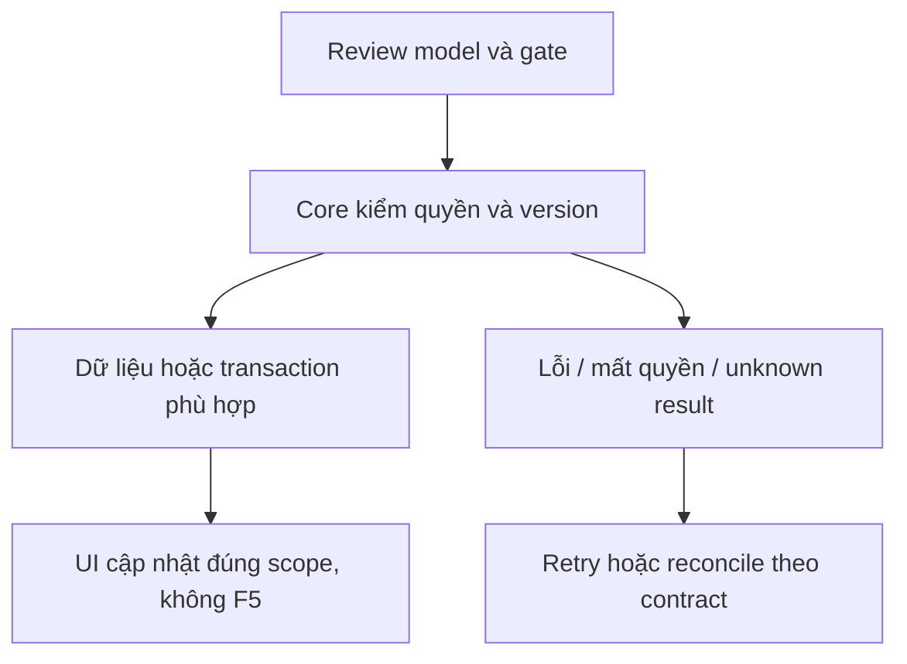

# TK03 — Nhận Ticket độc lập chat

04/11/2026 · **P, chờ TK01/TK02** · [Contract](../07-tickets-contract.md) · [Chung](../00-staff-contract.md).

## 1. Phạm vi và điều kiện bắt đầu

FR-010 tiếp nhận, không workflow hoàn tất/phản hồi. Không A11 Accept chat, không handoff consent.

## 2. Model và vị trí thay đổi

Staff Ticket controller/service, `dto/accept-ticket.dto.ts`, audit/outbox; migration version TK01 trước mutation. Reuse auth/CSRF/rate foundation, không ConversationCommandReceipt sai operation để giả receipt Ticket.

## 3. API spec và quyền

Prefix REST `/api/v1`; mọi API trong phase này là **P** trừ API nền được dẫn rõ là E. Quyết định kỹ thuật đề xuất phải review trước code; không sửa schema chỉ từ file plan.

A23 POST `/staff/tickets/:ticketId/accept` body `{expectedVersion: integer>=0}`. Ticket assigned đúng Staff+active customer, status ASSIGNED → IN_PROGRESS, version+1, audit/outbox atomic. Đề xuất OPEN chỉ khi đã recipient đúng và policy TK01 cho phép; mặc định không claim unassigned. Không status khác từ client.

200 safe detail current. Replay khi IN_PROGRESS bởi chính Staff còn quyền trả200 current, không audit/event thêm; trạng thái không hợp lệ/version stale409 STALE_TICKET;404 ngoài scope; CSRF403; quota đề xuất30/phút/actor. Chốt quota trước code.

Timeout: GET A22 đọc lại; nếu IN_PROGRESS cùng Staff thì xác nhận current state, không suy đã do click này tạo receipt. Nếu chưa chắc, cho thử cùng payload expectedVersion, không tự POST bằng version mới. Kết quả không rõ hiển thị checking/unknown; mutation không success trước commit.

## 4. Luồng thực hiện

Lock auth/customer assignment theo thứ tự dùng chung I01 → Ticket row FOR UPDATE → recheck recipient/state/version → update+audit+outbox → commit → response. Nhận Ticket không sửa Conversation.status/controlVersion/controller/handoff hoặc transcript grant.

## 5. Test cần có

Đề xuất `apps/core/test/tickets-accept.test.cjs`: double click/concurrent requests/replayed200; stale version409; actor khác404; reassignment giữa precheck/lock denied; rollback trước commit; outbox fail sau commit không mất Ticket; A10 vẫn404 nếu AI riêng. Browser mock kiểm unknown outcome riêng TK04.

## 6. Gate hoàn tất

- [ ] Model/API/quyền/điểm còn mở đã review trước code phụ thuộc.
- [ ] Tests đúng lớp pass; HTTP/mock/browser E2E thật được phân biệt.
- [ ] Scope/phiên/late-response/concurrency/error và no-F5 được kiểm tương ứng.
- [ ] Cập nhật API map/checklist theo code thật, cleanup fixture/artifact; không tự commit.

TK03 không phụ thuộc Agent nhưng cần version migration/quyền đã review; TK05 nhận event, không tự thêm Notification loại mới trong consumer chưa có policy.

