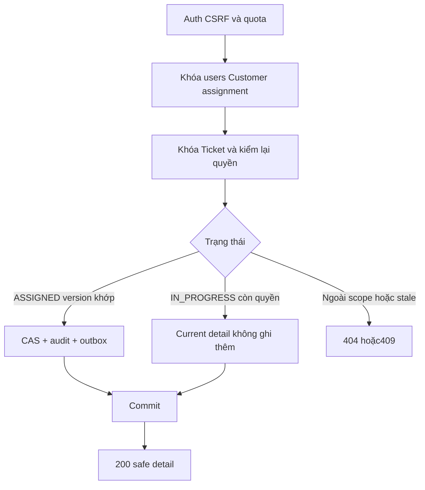

# TK03 — Nhận Ticket độc lập chat

04/11/2026 · **E: A23 Core đã triển khai** · [Contract](../07-tickets-contract.md) · [Chung](../00-staff-contract.md).

## 1. Phạm vi và model

FR-010 tiếp nhận; lifecycle status được người dùng bổ sung ở mục7, chưa có nghiệp vụ phản hồi/Claim/payment. Không A11 Accept chat/consent, không Agent producer. Dùng version từ TK01; không thêm migration/dependency. UI thuộc TK04, consumer notification thuộc TK05.

Code: apps/core/src/tickets/controllers/staff-ticket.controller.ts, services/ticket.service.ts, services/ticket-rate-limit.ts, dto/accept-ticket.dto.ts và STALE_TICKET trong http/safe-api.exception.ts. Reuse ConversationCommandService cho transaction retry và thứ tự khóa; không dùng ConversationCommandReceipt hoặc operation chat để giả receipt Ticket.

## 2. API spec

**A23 E — POST /api/v1/staff/tickets/:ticketId/accept**

Cookie session/CSRF hiện hành; Origin được phép, Content-Type application/json, X-Auth-Request: 1, X-CSRF-Token hợp lệ. Body duy nhất:
```json
{"expectedVersion": 0}
```

expectedVersion là JSON integer0–2147483646; không coerce string/null. UUID hợp lệ, không query/field lạ. Quyền: Staff đang active, Ticket recipient chính Staff **và** active assignment của Customer; Customer bị khóa vẫn được phục vụ. Không queue OPEN/unassigned claim.

| Trạng thái hiện hành | Kết quả |
| --- | --- |
| ASSIGNED, version khớp | IN_PROGRESS, version+1, audit+outbox cùng transaction |
| IN_PROGRESS, Staff còn quyền | 200 current detail; không audit/event mới; không yêu cầu version cũ khớp |
| ASSIGNED version sai hoặc OPEN/RESOLVED/CLOSED | 409 STALE_TICKET |
| Không tồn tại/ngoài scope | Safe404 |
| Session hết hạn/thu hồi/Staff khóa | 401 |
| Sai role/Origin/CSRF/header bảo vệ ghi | 403 |
| DTO/query sai | 400 |
| Quá quota riêng30 lệnh/phút/actor | 429, Retry-After |

200 trả safe detail như A22; Cache-Control: no-store. allowedActions.accept=false sau nhận; legacy confirmation giữ LEGACY_UNVERIFIED/null. Không status/recipient từ client. Quota atomic PostgreSQL TICKET_ACCEPT, độc lập quota đọc; tính trước transaction, không rollback theo lỗi nghiệp vụ.

## 3. Lock, concurrency và commit

1. Auth/CSRF/role, quota.
2. Đọc customerId để tìm khóa; sorted users → Customer profile → assignment theo thứ tự chung với operator/chat.
3. Lock Ticket FOR UPDATE cuối cùng; recheck auth/CSRF/session, recipient+assignment và customerId sau lock.
4. Reconcile IN_PROGRESS hoặc kiểm state/version. Update có CAS status/version/recipient.
5. Ghi AuditLog TICKET_ACCEPTED (actor/target/previousVersion/version), OutboxEvent aggregateType=TICKET/eventType=TICKET_ACCEPTED, payload chỉ schemaVersion=1/version.
6. Project detail và commit trước trả success.

Transaction ReadCommitted có row locks; reuse retry giới hạn3 attempts cho routing race/serialization/deadlock. Không ghi nội dung Ticket/chat/AI vào event. Không sửa Conversation.status/controlVersion/assignedStaff/handoff/messages hoặc tạo transcript grant.

TK03 tạo outbox pending; từ TK05 dispatcher claim cả Conversation và Ticket events. Consumer/routing/dedup/notification/invalidation đã có ở TK05. PUBLISHED không chứng minh delivered/read ACK.



## 4. Timeout và thử lại

GET A22 để đọc lại. IN_PROGRESS chỉ xác nhận trạng thái hiện hành, không chứng minh click cụ thể này tạo receipt. Retry payload cũ trả current state nếu còn quyền; không tự POST bằng version mới. Nếu vẫn ASSIGNED nhưng version thay đổi, hiển thị conflict cho người dùng kiểm lại. Không success trước commit. Browser checking/unknown/reconcile thuộc TK04.

## 5. Kiểm thử

Dùng chung fixtures/teardown tại apps/core/test/tickets-read.test.cjs: 15 read tests TK02 và **7 command tests TK03**. Không tạo file test setup trùng hoặc seed/bootstrap dữ liệu riêng.

TK03 gồm concurrent5 requests+replay chỉ một version/audit/event; stale/unsupported state; wrong actor/missing Ticket; CSRF/Origin/role/strict DTO; replay sau revoke/Staff khóa và Customer khóa; assignment đổi trước lock; injected outbox write failure rollback status/version/audit rồi retry; quota ghi riêng và Retry-After. Chat AI giữ nguyên, transcript vẫn404. Kiểm gateway bằng session synthetic, không log credential.

```powershell
docker compose --profile tests run --rm --no-deps core-tests node --test test/tickets-read.test.cjs test/ticket-foundation.test.cjs test/conversation-permissions.test.cjs test/http-foundation.test.cjs test/realtime.test.cjs
```

Kết quả04/11: **51/51 pass** (22 Ticket +16 Conversation +7 Ticket foundation +6 HTTP/WS), bao gồm Accept replay qua gateway. Core lint/typecheck và Docker build pass. Kiểm HTTP/PostgreSQL thật và fault injection có chủ đích, không browser E2E. Fixture audit/outbox/session/bucket/Ticket/chat/users đều teardown; không sửa bootstrap hoặc thêm producer giả.

## 6. Checklist

- [x] A23/DTO/Swagger/session/CSRF/quota/state/version và lock order.
- [x] Audit/outbox atomic, replay không thêm event, không grant chat.
- [x] Tests đúng lớp, fixture cleanup, contract/index cập nhật.
- [x] TK04 UI/browser unknown outcome/no-F5.
- [x] TK05 consumer Ticket notification/realtime; I07 producer/xác nhận vẫn để riêng.

## 7. Mở rộng lifecycle do người dùng chốt — 05/11/2026

Theo yêu cầu quản lý Ticket như task, Staff được đổi status và mở lại Resolved/Closed. Đây là mở rộng được người dùng chọn, không suy thêm workflow từ enum/SRS.

PATCH /api/v1/staff/tickets/:ticketId/status body {expectedVersion,status}; session/Origin/CSRF/role/scope như A23. Không query/field lạ. ExpectedVersion integer0–2147483646. Response200 safe detail hiện hành;400 input,401 session,403 role/CSRF,404 scope,409 STALE_TICKET,429 quota. Dùng chung quota command30/phút với Accept; không bypass bằng đổi endpoint.

| Từ | Đích được phép |
| --- | --- |
| OPEN / ASSIGNED / IN_PROGRESS / RESOLVED / CLOSED | Chọn trực tiếp bất kỳ status nào trong 5 giá trị; không bắt buộc đi tuần tự |

Người dùng05/11 chốt dropdown luôn đủ5 status, cho phép chọn trực tiếp. Không claim Ticket unassigned hoặc đổi recipient. Core trả4 status còn lại trong allowedActions.transitions; FE thêm current status để hiển thị đủ5. Target đã là current status trả200 current, không thêm audit/event; đây là reconcile trạng thái, không receipt của thao tác. Thay đổi thật kiểm expectedVersion sau khóa, CAS, version+1, audit+outbox atomic. Giữ POST accept tương thích, chỉ ASSIGNED→IN_PROGRESS và replay IN_PROGRESS như trước.

ASSIGNED→IN_PROGRESS phát TICKET_ACCEPTED; các bước còn lại phát TICKET_STATUS_CHANGED, payload {schemaVersion:1,version}. Consumer/dedup/realtime như TK05. Migration thứ10 202611050002_ticket_status_notifications chỉ mở rộng kind/typed-target CHECK, không thêm cột/bảng/enum. Đóng/mở lại Ticket không sửa chat/handoff/grant và không thực hiện Claim/payment.

Thêm3 Core tests: toàn lifecycle/reopen/replay; forbidden jump/stale/CSRF/role/scope; concurrent status change và notification consumer. Migration có test rollback/bảo toàn dữ liệu/typed target. Browser hai tab thật kiểm resolve→close→reopen và invalidation/notification.
