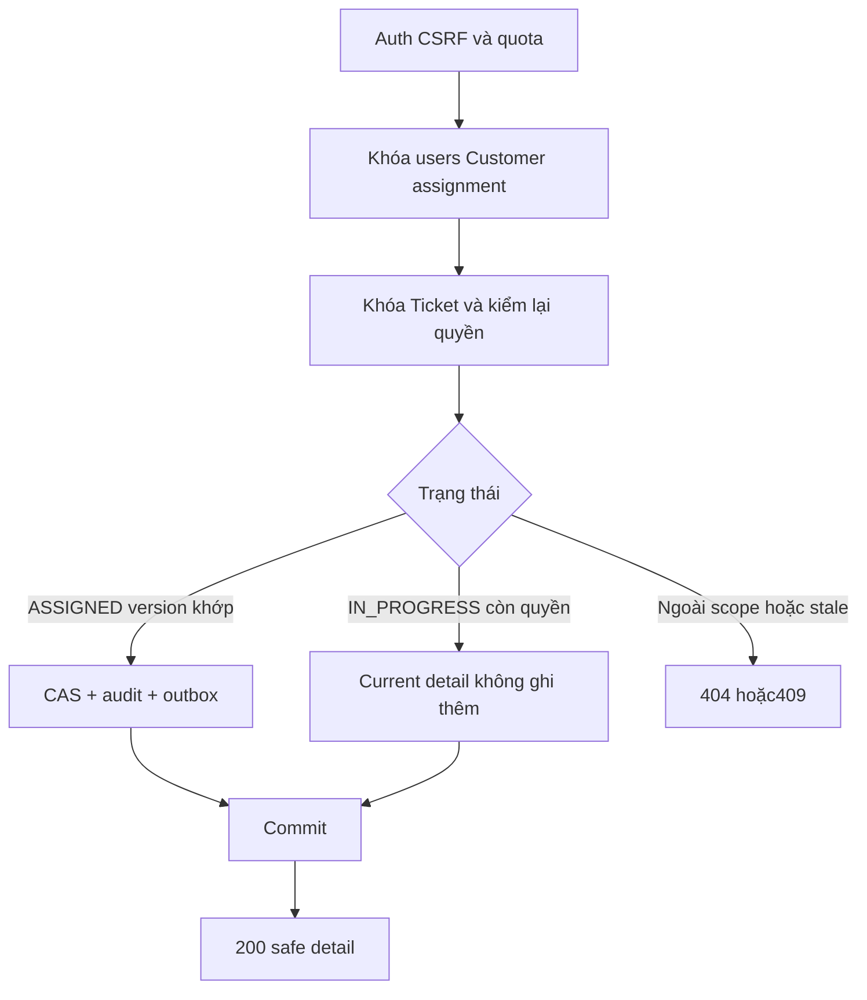
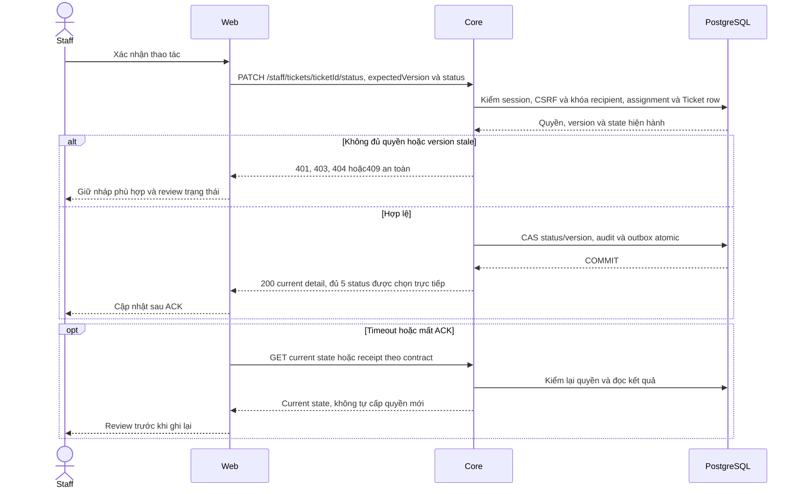

# TK03 — Nhận Ticket độc lập chat

04/11/2026 · **E: A23 Core đã triển khai** · [Contract](../07-tickets-contract.md) · [Chung](../00-staff-contract.md).

## Data model và phạm vi ảnh hưởng

Bảng bên dưới mô tả tác động của phase, gồm cả ghi gián tiếp qua Core. Tên bảng thuộc schema `business` trừ nơi ghi rõ; cột còn đề xuất được đánh dấu **P**. Web không truy cập DB trực tiếp.

| Bảng/model | Cột hoặc dữ liệu liên quan | Thao tác của phase | Quan hệ/ràng buộc cần giữ | Mức ảnh hưởng và nơi bị tác động |
| --- | --- | --- | --- | --- |
| users + auth_sessions | users.id/role/status, auth_sessions.user_id/token_hash/expires_at/revoked_at | Đọc | AuthSession.user_id → User.id; session phải còn hạn, không bị thu hồi | Cao — mọi API dùng session; không trả token/hash trong DTO |
| staff_assignments + customer_profiles + staff_profiles | staff_id/customer_id/is_active/ended_at, assignment_version, user_id/full_name | Đọc | Assignment gắn đúng Customer/Staff; Inbox còn ràng buộc assignment id cụ thể | Cao — Customers, Policy Lookup, Ticket và Inbox cùng phụ thuộc phân công |
| support_tickets | id/ticket_code/customer_id/assigned_staff_id/conversation_id/policy_id/status/version/title/ai_summary/extracted_details/confirmed_at | Đọc | Policy FK (policy_id,customer_id); Ticket quyền riêng, không cấp transcript grant; legacy không có confirmedContent/TicketDraft | Cao — list/detail/status và notification dùng cùng Ticket scope; confirmed_at không chứng minh AI text đã được duyệt |
| support_tickets | status/version; đọc assigned_staff_id/customer_id | Ghi status và tăng version khi đổi hợp lệ | Lock row + expectedVersion/CAS + current assignment; không tạo confirmation evidence | Cao — đủ TicketStatus theo transitions hiện hành, reopen riêng Ticket; ConversationStatus không CLOSED |
| rate_limit_buckets | client_token/endpoint_group/window_start/request_count/blocked_until | Ghi phụ trợ khi endpoint áp quota | PK (client_token,endpoint_group); tăng atomic, giới hạn theo actor/nhóm endpoint | Trung bình — quota có thể ghi dù nghiệp vụ bị từ chối; không log định danh nhạy cảm |
| audit_logs | actor_id/action/target_type/target_id/outcome/request_id/metadata/created_at | Thêm khi mutation/cấp PDF theo service | actor_id → User.id; không sửa/xóa audit cũ; chỉ metadata allowlist | Cao — phải giữ bằng chứng đúng transaction nghiệp vụ; không lưu transcript/password/signed URL |
| outbox_events | aggregate_type/aggregate_id/event_type/payload/status/retry_count/next_attempt_at/lease_owner/lease_expires_at/last_error | Thêm trong transaction nguồn; worker cập nhật trạng thái/lease | Index status/next_attempt_at/lease_expires_at; aggregate_id là reference kiểm bởi service, không FK đa loại | Cao — retry/reclaim/dedup, commit nghiệp vụ khác delivery; REST vẫn là nguồn dữ liệu |

**Schema/migration:** Không DDL cho command; version TK01, outbox TK05. Không dùng ConversationCommandReceipt làm idempotency Ticket.

**Nhất quán và hồi quy:** Lock/recheck/CAS và audit+event atomic; no-op/409 theo contract, không blind retry đổi token. Kiểm status/reopen/lost response/race reassignment và conversation không đổi.

## Vị trí code và mức ảnh hưởng


| Vị trí từ root repo | Hiện trạng | Trách nhiệm trong phase | Mức ảnh hưởng | Phạm vi cần kiểm lại |
| --- | --- | --- | --- | --- |
| [apps/core/src/tickets/controllers/staff-ticket.controller.ts](<../../../../../apps/core/src/tickets/controllers/staff-ticket.controller.ts>) | Hiện có | List/detail/accept/status endpoints | Cao | Staff Ticket list/detail |
| [apps/core/src/tickets/services/ticket.service.ts](<../../../../../apps/core/src/tickets/services/ticket.service.ts>) | Hiện có | Scope, lock, expectedVersion/CAS, audit/outbox | Cao | Status dropdown và notification source |
| [apps/core/src/tickets/services/ticket-access.service.ts](<../../../../../apps/core/src/tickets/services/ticket-access.service.ts>) | Hiện có | Ticket scope và allowedActions | Cao | Notifications và deep link, không cấp chat grant |
| [apps/core/src/tickets/dto/update-ticket-status.dto.ts](<../../../../../apps/core/src/tickets/dto/update-ticket-status.dto.ts>) | Hiện có | Enum/status/version allowlist | Trung bình | ticket-api.ts và Swagger |

## 1. Phạm vi và model

FR-010 tiếp nhận; lifecycle status được người dùng bổ sung ở mục7, chưa có nghiệp vụ phản hồi/Claim/payment. Không A11 Accept chat/consent, không Agent producer. Dùng version từ TK01; không thêm migration/dependency. UI thuộc TK04, consumer notification thuộc TK05.

Code: apps/core/src/tickets/controllers/staff-ticket.controller.ts, services/ticket.service.ts, services/ticket-rate-limit.ts, dto/accept-ticket.dto.ts và STALE_TICKET trong http/safe-api.exception.ts. Reuse ConversationCommandService cho transaction retry và thứ tự khóa; không dùng ConversationCommandReceipt hoặc operation chat để giả receipt Ticket.

## 2. API spec

**A23 E — POST /api/v1/staff/tickets/:ticketId/accept**

Cookie session/CSRF hiện hành; Origin được phép, Content-Type application/json, X-Auth-Request: 1, X-CSRF-Token hợp lệ. Body duy nhất:
```json
{"expectedVersion": 0}
```

expectedVersion là JSON integer0–2147483646; không coerce string/null. UUID hợp lệ, không query/field lạ. Quyền: Staff đang active, Ticket recipient chính Staff **và** active assignment của Customer; Customer bị khóa vẫn được phục vụ. Không queue OPEN/unassigned claim.

| Trạng thái hiện hành | Kết quả |
| --- | --- |
| ASSIGNED, version khớp | IN_PROGRESS, version+1, audit+outbox cùng transaction |
| IN_PROGRESS, Staff còn quyền | 200 current detail; không audit/event mới; không yêu cầu version cũ khớp |
| ASSIGNED version sai hoặc OPEN/RESOLVED/CLOSED | 409 STALE_TICKET |
| Không tồn tại/ngoài scope | Safe404 |
| Session hết hạn/thu hồi/Staff khóa | 401 |
| Sai role/Origin/CSRF/header bảo vệ ghi | 403 |
| DTO/query sai | 400 |
| Quá quota riêng30 lệnh/phút/actor | 429, Retry-After |

200 trả safe detail như A22; Cache-Control: no-store. allowedActions.accept=false sau nhận; legacy confirmation giữ LEGACY_UNVERIFIED/null. Không status/recipient từ client. Quota atomic PostgreSQL TICKET_ACCEPT, độc lập quota đọc; tính trước transaction, không rollback theo lỗi nghiệp vụ.

## 3. Lock, concurrency và commit

1. Auth/CSRF/role, quota.
2. Đọc customerId để tìm khóa; sorted users → Customer profile → assignment theo thứ tự chung với operator/chat.
3. Lock Ticket FOR UPDATE cuối cùng; recheck auth/CSRF/session, recipient+assignment và customerId sau lock.
4. Reconcile IN_PROGRESS hoặc kiểm state/version. Update có CAS status/version/recipient.
5. Ghi AuditLog TICKET_ACCEPTED (actor/target/previousVersion/version), OutboxEvent aggregateType=TICKET/eventType=TICKET_ACCEPTED, payload chỉ schemaVersion=1/version.
6. Project detail và commit trước trả success.

Transaction ReadCommitted có row locks; reuse retry giới hạn3 attempts cho routing race/serialization/deadlock. Không ghi nội dung Ticket/chat/AI vào event. Không sửa Conversation.status/controlVersion/assignedStaff/handoff/messages hoặc tạo transcript grant.

TK03 tạo outbox pending; từ TK05 dispatcher claim cả Conversation và Ticket events. Consumer/routing/dedup/notification/invalidation đã có ở TK05. PUBLISHED không chứng minh delivered/read ACK.



## 4. Timeout và thử lại

GET A22 để đọc lại. IN_PROGRESS chỉ xác nhận trạng thái hiện hành, không chứng minh click cụ thể này tạo receipt. Retry payload cũ trả current state nếu còn quyền; không tự POST bằng version mới. Nếu vẫn ASSIGNED nhưng version thay đổi, hiển thị conflict cho người dùng kiểm lại. Không success trước commit. Browser checking/unknown/reconcile thuộc TK04.

## 5. Test cases

Các ca dưới đây là **đặc tả kiểm thử**, không phải báo cáo kết quả. Kiểm từng lớp API/service/DB/browser đúng nhãn; mock UI không thay kiểm quyền Core hoặc E2E thật.

**Quy ước dữ liệu:** S-A/S-B là hai Staff synthetic; C-A/C-B là hai Customer synthetic khác nhau. Thay alias bằng UUID/token của fixture cô lập; các path HTTP dùng prefix /api/v1 nếu chưa ghi đầy đủ. Chỉ thay assignment, khóa account, inject lỗi hoặc migration trong harness/môi trường test, không trên tài khoản/dữ liệu đang sử dụng.

### TK03-T01 — Chọn trực tiếp đủ 5 status

**Lớp kiểm thử:** API + DB.
**Điều kiện và dữ liệu:** T-A đúng scope S-A; A22 trả version n và transitions 4 đích còn lại.

**Các bước:**

1. PATCH status theo thứ tự CLOSED→OPEN→RESOLVED→ASSIGNED→IN_PROGRESS, mỗi lần dùng version vừa nhận.
2. GET detail sau mỗi lần.
3. Đối chiếu audit/outbox.

**Kết quả mong đợi:** Mọi status đều chọn trực tiếp được; mỗi thay đổi thật version+1 và một audit/event; không ép tuần tự.

### TK03-T02 — Hai tab và replay current state

**Lớp kiểm thử:** API + DB barrier.
**Điều kiện và dữ liệu:** Hai context S-A cùng đọc T-A ở version n.

**Các bước:**

1. Cùng PATCH target RESOLVED bằng n.
2. Replay target hiện tại bằng payload cũ.
3. Từ context còn giữ n PATCH sang status khác.

**Kết quả mong đợi:** Một transition/audit/event; replay current trả current không ghi thêm; đổi target bằng version stale 409, không overwrite.

### TK03-T03 — Authority và CSRF

**Lớp kiểm thử:** API.
**Điều kiện và dữ liệu:** T-A thuộc S-A; S-B/Customer không quyền; session synthetic độc lập.

**Các bước:**

1. PATCH bằng S-B, Customer, không cookie hoặc CSRF sai.
2. Gửi status lạ, expectedVersion âm/string và trường ngoài DTO.
3. GET T-A bằng actor có quyền.

**Kết quả mong đợi:** Lỗi404/403/401/400 đúng contract, Ticket/version/audit/outbox không bị thay đổi.

### TK03-T04 — Rollback và unknown outcome

**Lớp kiểm thử:** API + DB/Network barrier.
**Điều kiện và dữ liệu:** Harness inject lỗi sau update Ticket trước audit/outbox; biến thể khác ngắt ACK sau commit.

**Các bước:**

1. Gửi PATCH với version hiện hành.
2. Đọc Ticket/audit/outbox khi lỗi trước commit.
3. Với ACK mất, GET reconcile rồi chỉ retry payload cũ nếu cần.

**Kết quả mong đợi:** Failure trước commit rollback toàn bộ; ACK mất không chứng minh rollback; không tự PATCH version mới hoặc tạo event trùng.

### TK03-T05 — POST Accept tương thích và độc lập chat

**Lớp kiểm thử:** API + DB.
**Điều kiện và dữ liệu:** T-A ASSIGNED liên kết AI riêng; T-B CLOSED; command quota riêng.

**Các bước:**

1. POST accept T-A rồi replay.
2. POST accept T-B.
3. GET transcript AI và vượt quota bằng PATCH/accept xen kẽ.

**Kết quả mong đợi:** Accept cũ chỉ ASSIGNED→IN_PROGRESS/replay; T-B409; chat vẫn deny; PATCH/accept chung quota 30/phút,429 có Retry-After.

**Suite tham khảo:** [tickets-read.test.cjs](../../../../../apps/core/test/tickets-read.test.cjs). Tên suite là vị trí tự động hóa, không phải chứng nhận các ca đã chạy.

**Dọn sau kiểm thử:** xóa đúng fixture/session/object/schema theo runId; phục hồi fault injection và đóng context/socket test. Không reset DB/credential, sửa bootstrap hoặc xóa volumes. Với PDF kiểm metadata/bytes/hash; với UI kiểm DOM/focus/network, không cần screenshot.

## 6. Checklist

- [x] A23/DTO/Swagger/session/CSRF/quota/state/version và lock order.
- [x] Audit/outbox atomic, replay không thêm event, không grant chat.
- [x] Tests đúng lớp, fixture cleanup, contract/index cập nhật.
- [x] TK04 UI/browser unknown outcome/no-F5.
- [x] TK05 consumer Ticket notification/realtime; I07 producer/xác nhận vẫn để riêng.

## 7. Mở rộng lifecycle do người dùng chốt — 05/11/2026

Theo yêu cầu quản lý Ticket như task, Staff được đổi status và mở lại Resolved/Closed. Đây là mở rộng được người dùng chọn, không suy thêm workflow từ enum/SRS.

PATCH /api/v1/staff/tickets/:ticketId/status body {expectedVersion,status}; session/Origin/CSRF/role/scope như A23. Không query/field lạ. ExpectedVersion integer0–2147483646. Response200 safe detail hiện hành;400 input,401 session,403 role/CSRF,404 scope,409 STALE_TICKET,429 quota. Dùng chung quota command30/phút với Accept; không bypass bằng đổi endpoint.

| Từ | Đích được phép |
| --- | --- |
| OPEN / ASSIGNED / IN_PROGRESS / RESOLVED / CLOSED | Chọn trực tiếp bất kỳ status nào trong 5 giá trị; không bắt buộc đi tuần tự |

Người dùng05/11 chốt dropdown luôn đủ 5 status, cho phép chọn trực tiếp. Không claim Ticket unassigned hoặc đổi recipient. Core trả 4 status còn lại trong allowedActions.transitions; FE thêm current status để hiển thị đủ 5. Target đã là current status trả 200 current, không thêm audit/event; đây là reconcile trạng thái, không receipt của thao tác. Thay đổi thật kiểm expectedVersion sau khóa, CAS, version+1, audit+outbox atomic. Giữ POST accept tương thích, chỉ ASSIGNED→IN_PROGRESS và replay IN_PROGRESS như trước.

ASSIGNED→IN_PROGRESS phát TICKET_ACCEPTED; các bước còn lại phát TICKET_STATUS_CHANGED, payload {schemaVersion:1,version}. Consumer/dedup/realtime như TK05. Migration thứ 10 202611050002_ticket_status_notifications chỉ mở rộng kind/typed-target CHECK, không thêm cột/bảng/enum. Đóng/mở lại Ticket không sửa chat/handoff/grant và không thực hiện Claim/payment.

Thêm3 Core tests: toàn lifecycle/reopen/replay; forbidden jump/stale/CSRF/role/scope; concurrent status change và notification consumer. Migration có test rollback/bảo toàn dữ liệu/typed target. Browser hai tab thật kiểm resolve→close→reopen và invalidation/notification.

## Sequence diagram

Luồng chính và nhánh quyền/lỗi; test case ở trên chỉ rõ dữ liệu và điểm kiểm tương ứng.


