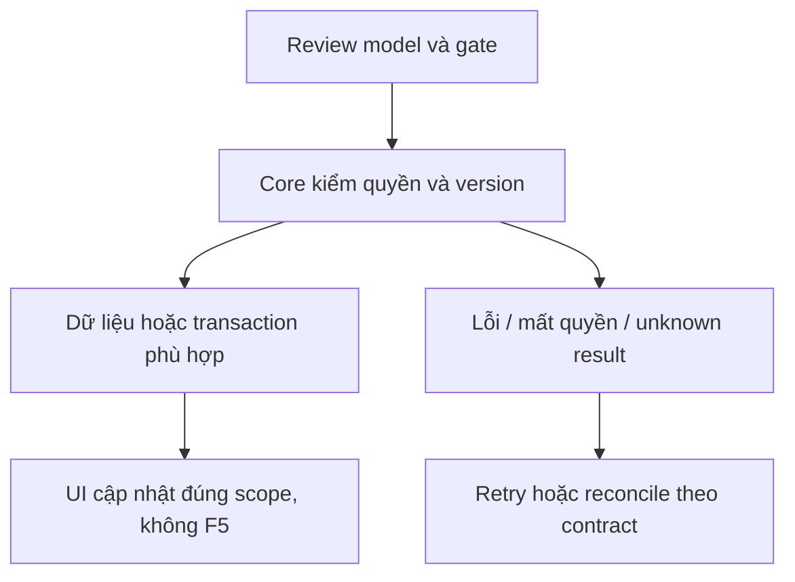

# TK04 — Trang Tickets Staff

04/11/2026 · **P, chờ TK02/TK03** · [Contract](../07-tickets-contract.md) · [Chung](../00-staff-contract.md).

## 1. Phạm vi và điều kiện bắt đầu

FR-010; màn riêng `/staff/tickets`, `/staff/tickets/:ticketId`. Không thay chat Inbox bằng bảng Ticket.

## 2. Model và vị trí thay đổi

`apps/web/src/components/staff-tickets.tsx`, `lib/ticket-api.ts`, slot Tickets trong `staff-reference-workspace.tsx`, routes hiện có. Tailwind/Lexend cùng Staff; không UI library mới.

## 3. API spec và quyền

Prefix REST `/api/v1`; mọi API trong phase này là **P** trừ API nền được dẫn rõ là E. Quyết định kỹ thuật đề xuất phải review trước code; không sửa schema chỉ từ file plan.

Dùng A21/A22/A23. Search tên/mã khách/ticketCode Enter hoặc debounce một cơ chế; không Search/Clear; xóa rồi Enter bỏ lọc. Status label rõ là Ticket, không Closed filter Inbox. Cursor load more, URL search/status/customerId/ticketId, không signed URL/cursor transcript. Accept chỉ enabled từ allowedActions backend.

## 4. Luồng thực hiện

List → detail title/code/status/customer/confirmed-or-legacy source → nhận Ticket → IN_PROGRESS sau ACK commit. Legacy content nêu chưa có snapshot đã xác nhận. Link chat chỉ khi chatLink backend không null; không nút mở AI chat từ conversationId. Refresh realtime giữ DOM/scroll/focus/draft và các page đã load; Retry chỉ khi lỗi. Unknown accept GET reconcile, không tự dùng version mới. Mobile list→detail/back.

## 5. Test cần có

Đề xuất `staff-tickets.spec.mjs`: search/status/lazy/URL/Back/empty/error/401/403/404/409/429, legacy labels, no-F5, focus375px/200%, disable duplicate, unknown GET reconcile, ticket-link cannot open transcript. Browser E2E thật fixture assigned Ticket không Agent; ghi nguồn synthetic.

## 6. Gate hoàn tất

- [ ] Model/API/quyền/điểm còn mở đã review trước code phụ thuộc.
- [ ] Tests đúng lớp pass; HTTP/mock/browser E2E thật được phân biệt.
- [ ] Scope/phiên/late-response/concurrency/error và no-F5 được kiểm tương ứng.
- [ ] Cập nhật API map/checklist theo code thật, cleanup fixture/artifact; không tự commit.

Chỉ bật menu/action đã có API thật. Không resolve/close/reply-to-completion/claim/payment/manual creation; không báo Agent/Ticket creation E2E hoàn tất.

