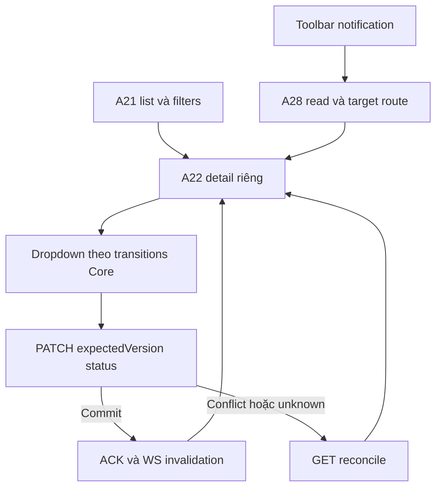
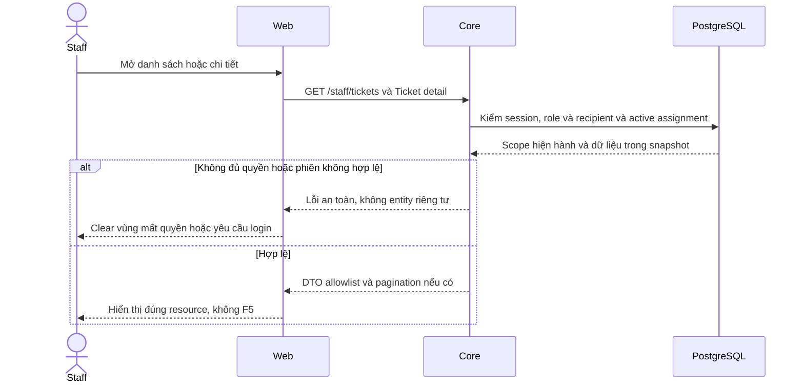

# TK04 — Staff Tickets UI

05/11/2026 · **E: list/detail/status + Notifications chung** · [Contract](../07-tickets-contract.md) · [Chung](../00-staff-contract.md).

## 1. Phạm vi và code

Tickets riêng /staff/tickets và /staff/tickets/:ticketId. FR-010 read/Accept đã có; người dùng05/11 yêu cầu quản lý status như task, gồm resolve/close/reopen. Không thêm tạo Ticket thủ công, phản hồi, Claim/payment hoặc Agent producer.

Code: apps/web/src/components/staff-tickets.tsx, lib/ticket-api.ts, slot Tickets của staff-reference-workspace.tsx. Dùng useAuthorizedRead/useCooldown, Tailwind/Lexend và session/realtime chung; không dependency mới.

## 2. Bố cục và điều hướng

- Danh sách **toàn chiều rộng** có mã/tiêu đề Ticket, Customer, status, created time. Dòng là Next Link, không underline/visited tím.
- Chọn một dòng → **trang chi tiết riêng**, không giữ sidebar kết quả. Detail luôn có Back to tickets trên desktop/mobile.
- Search tên/mã Customer hoặc ticketCode bằng Enter; không Search/Clear. Xóa rồi Enter bỏ lọc. Ticket status filter đúng5 enum; không lẫn chat Closed.
- Load more keyset, không counts. URL giữ search/status/customerId/path ticketId; cursor chỉ memory. Back giữ filters/pages, không reload document.
- Key/AbortController chặn response cũ khi đổi filters/selection. Background invalidation giữ DOM/pages/search draft/focus; lỗi cursor retry từ trang đầu và tải lại số page đã xem.
- Legacy data hiển thị nguồn chưa có confirmed snapshot, AI summary unverified; policy nullable; không raw extractedDetails.
- Chat link chỉ từ backend chatLink. Ticket không tạo quyền xem chat AI riêng.

## 3. Dropdown status

A21 list/A22 detail và PATCH /api/v1/staff/tickets/:ticketId/status theo [TK03 mục7](03-accept-command.md#7-mở-rộng-lifecycle-do-người-dùng-chốt--05112026).

Dropdown luôn đủ 5 status: Open, Assigned, In progress, Resolved, Closed. Theo quyết định người dùng05/11, được chọn trực tiếp bất kỳ status nào; không bắt buộc đi tuần tự. Core trả 4 đích trong allowedActions.transitions, FE thêm current status; quyền/version/CSRF vẫn do Core kiểm tra.

Gửi {expectedVersion,status} + CSRF. Lock đồng bộ chống thao tác trùng; disable pending/blocked/session error/refresh/unknown/cooldown. Chỉ cập nhật sau ACK commit hoặc GET reconcile; ACK version mới không bị read nền cũ ghi đè. UI bỏ nút Accept riêng; POST Accept cũ giữ tương thích API.

- 401 clear nội dung và Staff login.
- 403/404 clear Private/capability, không giữ stale.
- 409 GET current, không tự PATCH bằng version mới.
- 429 cooldown Retry-After, không auto retry.
- Timeout/network/5xx GET kiểm lại; nếu GET cũng lỗi thì chỉ Check status, không mutation.
- Reconcile xác nhận current state, không chứng minh receipt của click cụ thể. Người dùng review trước thao tác tiếp.
- Abort khi rời detail; không cập nhật Ticket khác.

## 4. Notifications cố định

Một chuông tại **toolbar chung Staff Workspace**, ngoài Inbox/Tickets và các cột cuộn. Popup portal vào document.body, position fixed neo theo chuông, clamp viewport và z-index trên workspace; không bị overflow Inbox cắt mất. Resize tính lại vị trí. Escape/Close trả focus; A28 mark read thành công mới chuyển target.

TICKET → /staff/tickets/:id, CONVERSATION → Inbox requests. Không Refresh thường trực; Retry tại lỗi. TK05 WS chỉ invalidation, REST reauthorize; không auth/me theo từng message.

## 5. Luồng

## 6. Test cases

Các ca dưới đây là **đặc tả kiểm thử**, không phải báo cáo kết quả. Kiểm từng lớp API/service/DB/browser đúng nhãn; mock UI không thay kiểm quyền Core hoặc E2E thật.

**Quy ước dữ liệu:** S-A/S-B là hai Staff synthetic; C-A/C-B là hai Customer synthetic khác nhau. Thay alias bằng UUID/token của fixture cô lập; các path HTTP dùng prefix /api/v1 nếu chưa ghi đầy đủ. Chỉ thay assignment, khóa account, inject lỗi hoặc migration trong harness/môi trường test, không trên tài khoản/dữ liệu đang sử dụng.

### TK04-T01 — Danh sách → chi tiết → Back

**Lớp kiểm thử:** Browser.
**Điều kiện và dữ liệu:** S-A có hơn20 Ticket và một mã ở trang sau.

**Các bước:**

1. Search bằng Enter, lọc status và Load more.
2. Bấm dòng Ticket để mở detail.
3. Back về list và dùng Back/Forward trình duyệt.

**Kết quả mong đợi:** Detail riêng không sidebar kết quả; query/pages giữ đúng; dòng không underline/visited tím; không F5.

### TK04-T02 — Dropdown đủ 5 và status cập nhật sau ACK

**Lớp kiểm thử:** Browser + API mock.
**Điều kiện và dữ liệu:** Detail T-A đang IN_PROGRESS; Core trả 4 transitions còn lại.

**Các bước:**

1. Mở dropdown và đếm5 option.
2. Chọn CLOSED rồi OPEN rồi ASSIGNED.
3. Giữ chậm một ACK và thử thao tác lần2.

**Kết quả mong đợi:** Cho chọn trực tiếp; current chỉ đổi theo ACK/reconcile; pending khóa control, không gửi mutation trùng.

### TK04-T03 — Unknown và 409 không auto-write

**Lớp kiểm thử:** Browser + API barrier.
**Điều kiện và dữ liệu:** Giữ/ngắt ACK sau commit; biến thể riêng PATCH409.

**Các bước:**

1. Chọn status mới rồi làm ACK mất.
2. Cho GET reconcile cũng lỗi, bấm Check status sau khi khôi phục.
3. Với409 quan sát request tiếp theo.

**Kết quả mong đợi:** Unknown chỉ kiểm GET, không PATCH version mới; current state được cập nhật để người dùng review, không false success.

### TK04-T04 — Detail denied và response cũ

**Lớp kiểm thử:** Browser + API mock.
**Điều kiện và dữ liệu:** T-A đang mở; giữ responseA rồi chọn B; sau đó B bị revoke.

**Các bước:**

1. Trả responseA muộn.
2. Cho detail B403/404 hoặc session 401.
3. Kiểm nội dung/actions và điều hướng.

**Kết quả mong đợi:** Không dữ liệu A ghi đè B; denied clear Ticket/actions,401 về login; không giữ Private dưới thông báo lỗi.

### TK04-T05 — Notification và hai tab realtime

**Lớp kiểm thử:** Browser E2E.
**Điều kiện và dữ liệu:** Hai tab S-A cùng T-A; worker/WS đang chạy, fixture riêng.

**Các bước:**

1. Tab1 đổi status.
2. Tab2 chờ update và mở Notifications.
3. Đánh dấu đọc/mở target, kiểm version qua API.

**Kết quả mong đợi:** Tab2 tự cập nhật đúng status; target là Tickets, không Inbox; thông báo generic; read không đổi status; không F5.

### TK04-T06 — Mobile và zoom

**Lớp kiểm thử:** Browser.
**Điều kiện và dữ liệu:** Ticket/title/Customer có chuỗi dài, viewport 375px.

**Các bước:**

1. Mở list rồi detail.
2. Zoom200%, Tab tới Back/dropdown/chat link nếu có.
3. Đo bounds các panel và popup Notifications.

**Kết quả mong đợi:** Không tràn ngang hoặc popup bị clipping; focus thấy được; không cần hiển thị dòng nhắc Enter để search vẫn hoạt động.

**Dọn sau kiểm thử:** xóa đúng fixture/session/object/schema theo runId; phục hồi fault injection và đóng context/socket test. Không reset DB/credential, sửa bootstrap hoặc xóa volumes. Với PDF kiểm metadata/bytes/hash; với UI kiểm DOM/focus/network, không cần screenshot.

## 7. Checklist

- [x] List → detail riêng, filters/Back/keyset/no-F5.
- [x] Status dropdown đúng Core transitions/version/CSRF, resolve/close/reopen.
- [x] Pending/unknown/reconcile/denied/cooldown và late response.
- [x] Notifications toolbar/portal không bị che, keyboard/mobile/zoom.
- [x] Browser mock + E2E thật và fixture/artifact cleanup.
- [ ] I07 producer tạo/xác nhận và immutable snapshot; không thuộc UI phase này.

## Sequence diagram

Luồng chính và nhánh quyền/lỗi; test case ở trên chỉ rõ dữ liệu và điểm kiểm tương ứng.

