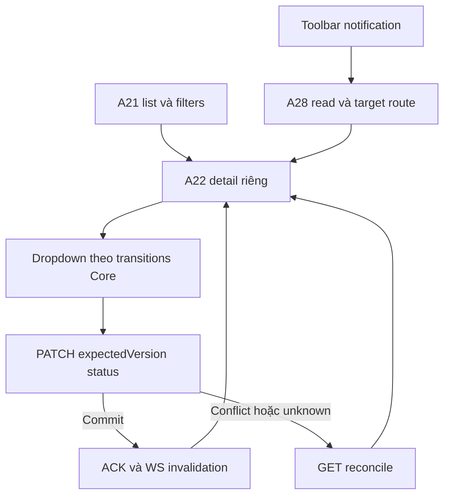

# TK04 — Staff Tickets UI

05/11/2026 · **E: list/detail/status + Notifications chung** · [Contract](../07-tickets-contract.md) · [Chung](../00-staff-contract.md).

## 1. Phạm vi và code

Tickets riêng /staff/tickets và /staff/tickets/:ticketId. FR-010 read/Accept đã có; người dùng05/11 yêu cầu quản lý status như task, gồm resolve/close/reopen. Không thêm tạo Ticket thủ công, phản hồi, Claim/payment hoặc Agent producer.

Code: apps/web/src/components/staff-tickets.tsx, lib/ticket-api.ts, slot Tickets của staff-reference-workspace.tsx. Dùng useAuthorizedRead/useCooldown, Tailwind/Lexend và session/realtime chung; không dependency mới.

## 2. Bố cục và điều hướng

- Danh sách **toàn chiều rộng** có mã/tiêu đề Ticket, Customer, status, created time. Dòng là Next Link, không underline/visited tím.
- Chọn một dòng → **trang chi tiết riêng**, không giữ sidebar kết quả. Detail luôn có Back to tickets trên desktop/mobile.
- Search tên/mã Customer hoặc ticketCode bằng Enter; không Search/Clear. Xóa rồi Enter bỏ lọc. Ticket status filter đúng5 enum; không lẫn chat Closed.
- Load more keyset, không counts. URL giữ search/status/customerId/path ticketId; cursor chỉ memory. Back giữ filters/pages, không reload document.
- Key/AbortController chặn response cũ khi đổi filters/selection. Background invalidation giữ DOM/pages/search draft/focus; lỗi cursor retry từ trang đầu và tải lại số page đã xem.
- Legacy data hiển thị nguồn chưa có confirmed snapshot, AI summary unverified; policy nullable; không raw extractedDetails.
- Chat link chỉ từ backend chatLink. Ticket không tạo quyền xem chat AI riêng.

## 3. Dropdown status

A21 list/A22 detail và PATCH /api/v1/staff/tickets/:ticketId/status theo [TK03 mục7](03-accept-command.md#7-mở-rộng-lifecycle-do-người-dùng-chốt--05112026).

Dropdown luôn đủ5 status: Open, Assigned, In progress, Resolved, Closed. Theo quyết định người dùng05/11, được chọn trực tiếp bất kỳ status nào; không bắt buộc đi tuần tự. Core trả4 đích trong allowedActions.transitions, FE thêm current status; quyền/version/CSRF vẫn do Core kiểm tra.

Gửi {expectedVersion,status} + CSRF. Lock đồng bộ chống thao tác trùng; disable pending/blocked/session error/refresh/unknown/cooldown. Chỉ cập nhật sau ACK commit hoặc GET reconcile; ACK version mới không bị read nền cũ ghi đè. UI bỏ nút Accept riêng; POST Accept cũ giữ tương thích API.

- 401 clear nội dung và Staff login.
- 403/404 clear Private/capability, không giữ stale.
- 409 GET current, không tự PATCH bằng version mới.
- 429 cooldown Retry-After, không auto retry.
- Timeout/network/5xx GET kiểm lại; nếu GET cũng lỗi thì chỉ Check status, không mutation.
- Reconcile xác nhận current state, không chứng minh receipt của click cụ thể. Người dùng review trước thao tác tiếp.
- Abort khi rời detail; không cập nhật Ticket khác.

## 4. Notifications cố định

Một chuông tại **toolbar chung Staff Workspace**, ngoài Inbox/Tickets và các cột cuộn. Popup portal vào document.body, position fixed neo theo chuông, clamp viewport và z-index trên workspace; không bị overflow Inbox cắt mất. Resize tính lại vị trí. Escape/Close trả focus; A28 mark read thành công mới chuyển target.

TICKET → /staff/tickets/:id, CONVERSATION → Inbox requests. Không Refresh thường trực; Retry tại lỗi. TK05 WS chỉ invalidation, REST reauthorize; không auth/me theo từng message.

## 5. Luồng



## 6. Kiểm thử và kết quả

staff-tickets.spec.mjs:14 browser tests với API mock, gồm full-width list/detail/Back/query/load more/no-F5; workflow/reopen; legacy/chat link; pending/unknown/409/429/denied/session; late response; mobile375px/zoom200%; popup portal parent body/bounds/keyboard/Escape; background DOM/pages/draft/focus.

ticket-flow.integration.spec.mjs:1 **browser E2E thật hai tab** Web→gateway→Core/PostgreSQL/outbox/WS. Search/detail/status IN_PROGRESS→RESOLVED→CLOSED→IN_PROGRESS; tab còn lại cập nhật, notification mark read/target và3 status notifications. Helper browser-ticket-fixture.cjs tạo isolated synthetic/session và teardown theo lock order, không bootstrap/seed riêng.

conversation-realtime.spec.mjs:7 regression tests handoff/notification/transcript/scope/reconnect. Tổng **22 browser tests pass**. Không gộp backend tests thành E2E; không screenshot/trace/video. Web lint/typecheck/build pass.

```powershell
npm run test:browser --workspace apps/web -- staff-tickets.spec.mjs ticket-flow.integration.spec.mjs conversation-realtime.spec.mjs --reporter=list
```

## 7. Checklist

- [x] List → detail riêng, filters/Back/keyset/no-F5.
- [x] Status dropdown đúng Core transitions/version/CSRF, resolve/close/reopen.
- [x] Pending/unknown/reconcile/denied/cooldown và late response.
- [x] Notifications toolbar/portal không bị che, keyboard/mobile/zoom.
- [x] Browser mock + E2E thật và fixture/artifact cleanup.
- [ ] I07 producer tạo/xác nhận và immutable snapshot; không thuộc UI phase này.
