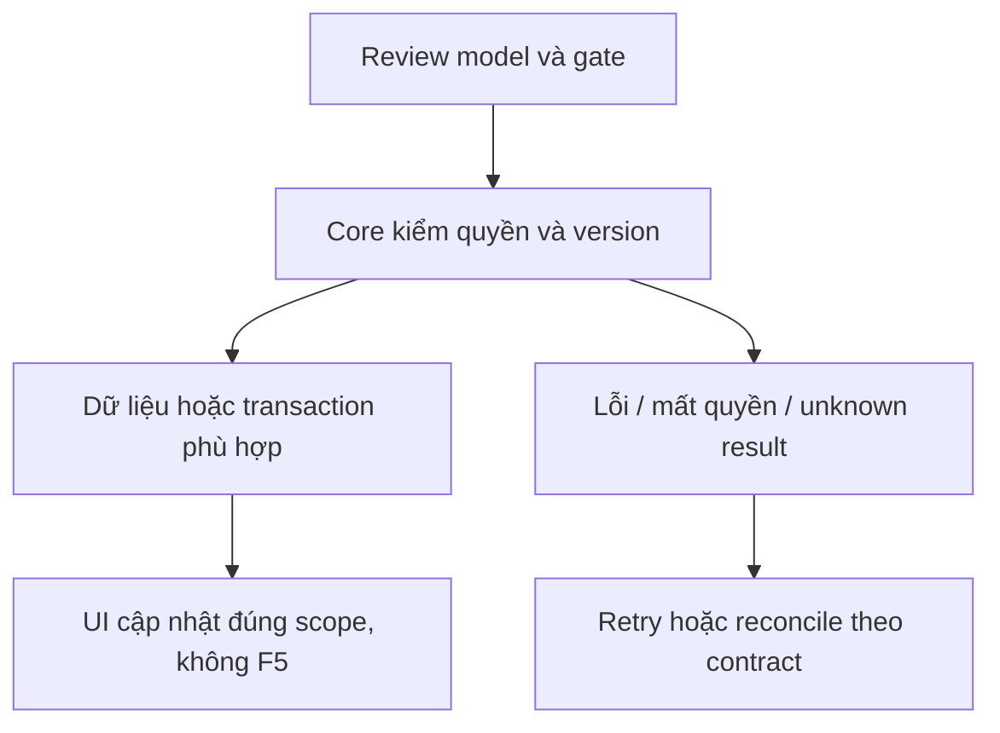

# TK05 — Ticket notification và invalidation

04/11/2026 · **P, sau TK02/TK03** · [Contract](../07-tickets-contract.md) · [Chung](../00-staff-contract.md).

## 1. Phạm vi và điều kiện bắt đầu

FR-013/NFR-005/006: notification khi Ticket được lưu/nhận. Với nguồn tạo I07 chưa có, phase này có thể kiểm consumer bằng committed synthetic event trong test; không thêm producer public giả.

## 2. Model và vị trí thay đổi

`outbox-dispatcher.service.ts`, notification policy/DTO, `staff-notifications.tsx`, realtime frame và Ticket list invalidation. Reuse I06 outbox lease/retry; không broker/cloud mới.

## 3. API spec và quyền

Prefix REST `/api/v1`; mọi API trong phase này là **P** trừ API nền được dẫn rõ là E. Quyết định kỹ thuật đề xuất phải review trước code; không sửa schema chỉ từ file plan.

A27/A28 mở rộng target union `{type:'TICKET',id}` chỉ sau backend thật. TICKET_CREATED (I07 commit) và TICKET_ASSIGNED (TK03 commit) với event schema version, ticketId/recipient minimal, không nội dung Ticket/AI chat. Dedup event/recipient ở DB. WS receive-only invalidation, REST A21/A22 reauthorize.

Ticket recipient policy TK01 áp ở worker, notification read và trước WS send; không reuse transcript gate để quyết định Ticket visibility. Notification không tạo grant chat; invalid scope không emit tài nguyên.

## 4. Luồng thực hiện

Ticket transaction+outbox → worker recheck recipient → Notification dedup → authorized WS invalidation → list/center refetch nền → mở Tickets. Fail worker giữ Ticket committed, retry/backoff không duplicate; scope mất xóa stale notification/selection.

## 5. Test cần có

Core tests event duplicate/retry/restart/scope change/inactive Staff; browser target routing/CSRF/keyboard; E2E delayed delivery không làm mất Ticket. Latency phải đo trên workload cụ thể khi triển khai TK05, không chứng nhận5s từ mock.

## 6. Gate hoàn tất

- [ ] Model/API/quyền/điểm còn mở đã review trước code phụ thuộc.
- [ ] Tests đúng lớp pass; HTTP/mock/browser E2E thật được phân biệt.
- [ ] Scope/phiên/late-response/concurrency/error và no-F5 được kiểm tương ứng.
- [ ] Cập nhật API map/checklist theo code thật, cleanup fixture/artifact; không tự commit.

Khi chỉ TK03 emitter đã có, không đánh dấu TICKET_CREATED production hoặc Agent producer hoàn tất. Không Customer notification center/Inbox counts.

