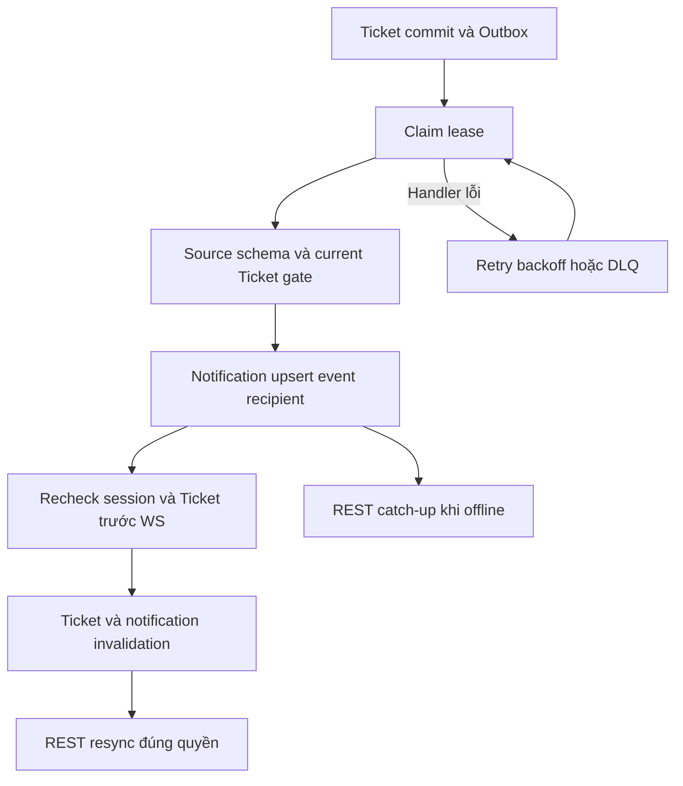

# TK05 — Ticket notification và invalidation

05/11/2026 · **E: consumer/API/UI/realtime đã triển khai** · [Contract](../07-tickets-contract.md) · [Chung](../00-staff-contract.md).

## 1. Phạm vi

FR-013/NFR-005/006: Staff nhận thông báo Ticket trong phạm vi quyền hiện hành. TK03 đã emit TICKET_ACCEPTED; consumer TICKET_CREATED đã có nhưng **producer tạo Ticket từ Agent/Customer confirmation I07 chưa có**. Test event synthetic không chứng minh nguồn tạo nghiệp vụ hoàn tất.

Không Customer notification center, transcript read receipt, chat grant, Agent code, broker hoặc cloud fanout.

## 2. Model, migration và code

19 model giữ nguyên; migration thứ9 **202611050001_ticket_notifications** mở rộng CHECK kind thành NULL legacy/HANDOFF_REQUESTED/TICKET_CREATED/TICKET_ACCEPTED. Typed handoff bắt buộc conversationId, không ticketId; typed Ticket bắt buộc ticketId, không conversationId. Không sửa cột/bảng hoặc dữ liệu legacy kind=NULL. Typed legacy không hợp lệ khiến migration rollback, không tự sửa dữ liệu. Readiness/operator compatibility cùng baseline mới.

Core:
- tickets/services/ticket-event.service.ts: source validation, recipient gate, notification upsert.
- outbox/services/outbox-dispatcher.service.ts: claim/lease/retry cả Conversation và Ticket.
- notifications/{notifications.service.ts,notifications.controller.ts,notification-response.dto.ts}: A27/A28 union target và recheck.
- realtime/realtime.service.ts: publishTicket, session/Ticket gate trước frame.
- TicketsModule export policy/event service; Realtime/Notifications/Outbox dùng chung, không copy quyền.

Web:
- lib/realtime.ts: tickets-invalidated → core:tickets-changed, dedup eventId/type.
- components/use-authorized-read.ts hỗ trợ eventName riêng; StaffTickets list/detail resync mà không kích auth/me theo từng message.
- staff-notifications.tsx dùng cả Inbox/Tickets: target route, CSRF mark read, Escape/focus, resync và chống late response sau scope change. Không Refresh thường trực, chỉ Try again tại lỗi.

## 3. Event contract và quyền

Outbox aggregateType=TICKET, aggregateId=Ticket.id, eventType TICKET_CREATED hoặc TICKET_ACCEPTED. Payload tối thiểu:

```json
{"schemaVersion": 1, "version": 1}
```

version integer>=0, ACCEPTED>=1. Consumer tra source bằng eventId/aggregate/type, không tin đối tượng caller; schema sai gây retry/DLQ. Không gửi title/aiSummary/chat/confirmed snapshot/cookie trong event hoặc frame.

Lock sorted users → Customer → assignment → Ticket; recheck Ticket customer/recipient/active assignment và Staff active sau lock. Ticket.version phải >= event.version; ACCEPTED chỉ khi current IN_PROGRESS/RESOLVED/CLOSED. Không recipient/unassigned/ngoài scope thì không tạo thông báo hoặc gửi frame, không mở queue mới. Customer khóa vẫn được Staff phục vụ theo TK01. Reassignment không biến assignment thành quyền nhận Ticket của Staff khác.

Notification dedupKey=eventId:recipient:kind, DB unique/upsert. Title generic: New support ticket hoặc Support ticket accepted; body null, không private preview. Dedup là theo event/recipient, không theo mọi event cùng Ticket.

## 4. API A27/A28

Prefix /api/v1, no-store, session Staff; không endpoint mới.

GET /staff/notifications?limit=20&cursor=... → items/pageInfo. limit1–50; actor-bound keyset createdAt DESC,id DESC; áp recipient và target scope **trước pagination**, không counts.

```json
{
  "items": [{
    "id": "<uuid>", "kind": "TICKET_ACCEPTED", "title": "Support ticket accepted",
    "isRead": false, "createdAt": "<ISO timestamp>",
    "target": {"type": "TICKET", "id": "<ticket UUID>"}
  }],
  "pageInfo": {"hasMore": false, "nextCursor": null}
}
```

kind HANDOFF_REQUESTED dùng target CONVERSATION và gate metadata I01; hai kind Ticket dùng TICKET và gate TK01, không transcript gate. Legacy kind=NULL không public.

POST /staff/notifications/:notificationId/read body{} + session/Origin/X-Auth-Request/CSRF → {id,isRead:true}. Khóa target theo thứ tự chung, kiểm lại quyền trước update; idempotent. Không Accept Ticket/chat và không tạo transcript grant. Mất scope404, sai role403, session401, input400, quota429 Retry-After. Quota reuse INBOX_READ240/phút và NOTIFICATION_READ120/phút/actor; không thêm bucket mới.

Click notification chỉ điều hướng sau A28 thành công: TICKET → /staff/tickets/:id; CONVERSATION → /staff/inbox/:id?filter=requests. REST target vẫn kiểm quyền khi mở. Không dựng link từ title/AI text.

## 5. Worker và WS

Claim SKIP LOCKED theo allowlist aggregate/type, batch20, lease30s, renew10s; worker tick500ms. Retry exponential có jitter, tối đa8 attempts → FAILED_DLQ; worker khác không ACK lease chưa sở hữu. Notification commit rồi gửi WS lỗi: retry upsert không nhân đôi. Ticket đã commit không mất khi delivery lỗi. PUBLISHED không phải delivered/read ACK; disconnected Staff lấy lại bằng A27.

WS receive-only/exact Origin/session. Trước gửi kiểm lại session role STAFF và Ticket scope. Chỉ hai frame:

```json
{"type":"tickets-invalidated","eventId":"<uuid>"}
{"type":"notifications-invalidated","eventId":"<uuid>"}
```

Không resource ID/nội dung trong frame Ticket. FE dedup type/eventId; Ticket list/detail refetch nền, giữ filters/pages/DOM/search draft/focus. Reconnect/ready và account/assignment invalidation recheck REST; notification scope clear chặn response cũ khôi phục dữ liệu. Local một Core process; chưa multi-replica fanout hoặc SLA workload.



## 6. Tests và kết quả

- apps/core/test/tickets-read.test.cjs: thêm5 TK05 tests, tổng27 Ticket tests. Concurrent dedup, source/version validation, wrong recipient/locked/revoked scope, list/read/CSRF, read không Accept, worker failure sau notification commit/restart/lease ownership/DLQ, real WS isolation/minimal frames/recheck.
- apps/core/test/ticket-notification-migration.test.cjs:2 isolated-schema tests bảo toàn legacy/handoff, kind/target constraints và rollback. Teardown schema riêng.
- Core regression gồm Conversation permissions/realtime, Ticket foundation, HTTP/WS: **67/67 pass**; cộng2 migration tests riêng pass.
- staff-tickets.spec.mjs thêm2 TK05 browser mock tests: keyboard/CSRF/target route/Escape và Ticket invalidation giữ pages/focus/draft.
- ticket-flow.integration.spec.mjs: real browser hai tab → gateway/Core/PostgreSQL/worker/WS → trạng thái tự cập nhật + thông báo + A28 read; fixture teardown notifications/audit/outbox/quota/session/assignment/Ticket/users.
- Kiểm DOM/accessibility/network, không screenshot/trace/video. Đo một event synthetic khoảng1,1s; không chứng nhận NFR5s hoặc workload/SLA.
- Lint/typecheck/build và runtime healthy; không credential/env mới, không seed/bootstrap/Agent producer.

```powershell
node --test apps/core/test/ticket-notification-migration.test.cjs
docker compose --profile tests run --rm --no-deps core-tests node --test test/tickets-read.test.cjs test/conversation-realtime.test.cjs test/conversation-permissions.test.cjs test/ticket-foundation.test.cjs test/http-foundation.test.cjs test/realtime.test.cjs
npm run test:browser --workspace apps/web -- staff-tickets.spec.mjs ticket-flow.integration.spec.mjs --reporter=list
```

## 7. Checklist

- [x] Migration target/kind, source/recipient gate và current-scope A27/A28.
- [x] Lease/retry/DLQ/dedup, Ticket đã commit độc lập delivery.
- [x] WS minimal + session/Ticket recheck; UI routing/catch-up không F5.
- [x] Core/migration/browser tests và fixture cleanup; docs/index đồng bộ.
- [ ] I07 producer tạo Ticket bằng xác nhận hợp lệ và snapshot thật.
- [ ] Benchmark/SLA/multi-replica/cloud nếu được chọn sau này.

Kết quả browser: **18 Ticket tests pass** (17 mock/1 real hai-tab E2E), thêm **7 handoff/realtime browser regression pass**. Fixture cleanup khóa users theo thứ tự chung trước khi xóa Notification/outbox/Ticket để không đua với worker đang chạy. Không để dữ liệu test hoặc artifact cho thành viên tự dọn.

## Mở rộng status notification — 05/11/2026

Ticket status command phát thêm TICKET_STATUS_CHANGED; consumer/outbox allowlist, A27 DTO/target và WS adapter hỗ trợ cùng quyền/dedup như Ticket hiện có. Title generic Support ticket status updated; không đưa nội dung/status vào WS frame. Migration thứ10 202611050002_ticket_status_notifications mở CHECK kind/typed target, giữ các kind cũ. Browser E2E hai tab đã kiểm resolve/close/reopen và3 thông báo cập nhật, không tạo chat grant.
