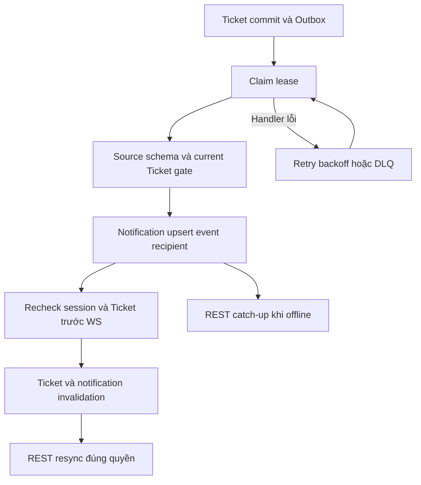
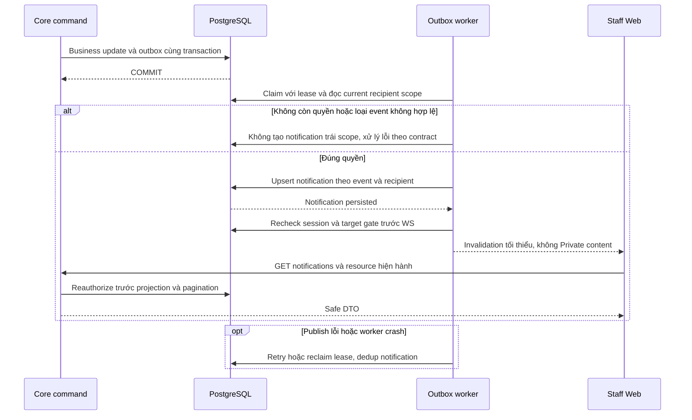

# TK05 — Ticket notification và invalidation

05/11/2026 · **E: consumer/API/UI/realtime đã triển khai** · [Contract](../07-tickets-contract.md) · [Chung](../00-staff-contract.md).

## Bổ sung bảo vệ dữ liệu Customer — 12/11/2026

**Chính sách thông tin liên hệ:** [Ma trận dữ liệu chung](../../../../configuration-and-data.md#customer-sensitive-data) quy định che email/phone Customer mặc định và Hiện/Ẩn sau kiểm quyền Core. Phase 1 đã triển khai tại Customers; DTO Customer ở Policy/Inbox/Ticket hiện chỉ có tên/mã, không có contact card raw. Quy định này không thay quyền đọc PDF/transcript hoặc trạng thái triển khai của chức năng trong plan.

**Thay đổi của phase:** Ticket+outbox atomic nhưng payload tối thiểu, không nhân bản confirmedContent/PII vào notification/WS/log. Consumer/API recheck recipient.

**Kiểm thử cần bổ sung, chưa chạy:** Core/worker/WS: retry/dedup/reconnect không phát canary, revoke trước consume chặn; read/status không cấp quyền raw/transcript.

## Data model và phạm vi ảnh hưởng

Bảng bên dưới mô tả tác động của phase, gồm cả ghi gián tiếp qua Core. Tên bảng thuộc schema `business` trừ nơi ghi rõ; cột còn đề xuất được đánh dấu **P**. Web không truy cập DB trực tiếp.

| Bảng/model | Cột hoặc dữ liệu liên quan | Thao tác của phase | Quan hệ/ràng buộc cần giữ | Mức ảnh hưởng và nơi bị tác động |
| --- | --- | --- | --- | --- |
| users + auth_sessions | users.id/role/status, auth_sessions.user_id/token_hash/expires_at/revoked_at | Đọc | AuthSession.user_id → User.id; session phải còn hạn, không bị thu hồi | Cao — mọi API dùng session; không trả token/hash trong DTO |
| staff_assignments + customer_profiles + staff_profiles | staff_id/customer_id/is_active/ended_at, assignment_version, user_id/full_name | Đọc | Assignment gắn đúng Customer/Staff; Inbox còn ràng buộc assignment id cụ thể | Cao — Customers, Policy Lookup, Ticket và Inbox cùng phụ thuộc phân công |
| support_tickets | id/ticket_code/customer_id/assigned_staff_id/conversation_id/policy_id/status/version/title/ai_summary/extracted_details/confirmed_at | Đọc | Policy FK (policy_id,customer_id); Ticket quyền riêng, không cấp transcript grant; legacy không có confirmedContent/TicketDraft | Cao — list/detail/status và notification dùng cùng Ticket scope; confirmed_at không chứng minh AI text đã được duyệt |
| notifications | recipient_staff_id/ticket_id/conversation_id/kind/title/is_read/dedup_key/delivered_at/created_at | Consumer upsert thông báo; API đọc/mark-read theo NO01 | Recipient FK → StaffProfile; unique dedup_key; typed target đúng một loại theo CHECK SQL | Cao — luồng Staff dùng recipient_staff_id; bảng chung đã có recipient_customer_id theo N01/N02; lọc current target scope trước cursor |
| outbox_events | aggregate_type/aggregate_id/event_type/payload/status/retry_count/next_attempt_at/lease_owner/lease_expires_at/last_error | Thêm trong transaction nguồn; worker cập nhật trạng thái/lease | Index status/next_attempt_at/lease_expires_at; aggregate_id là reference kiểm bởi service, không FK đa loại | Cao — retry/reclaim/dedup, commit nghiệp vụ khác delivery; REST vẫn là nguồn dữ liệu |

**Schema/migration:** TK05 đã có SQL CHECK kind/target và status notification (202611050001/202611050002). Không đổi legacy kind=NULL thành bằng chứng xác nhận; không bảng mới.

**Nhất quán và hồi quy:** TK03 commit source event rồi worker recheck Ticket recipient/scope, dedup notification. Kiểm lease crash/retry, old event/status, reassignment và consumer không tự mutate Ticket.

## 1. Phạm vi

FR-013/NFR-005/006: Staff nhận thông báo Ticket trong phạm vi quyền hiện hành. TK03 đã emit TICKET_ACCEPTED; consumer TICKET_CREATED đã có nhưng **producer tạo Ticket từ Agent/Customer confirmation I07 chưa có**. Test event synthetic không chứng minh nguồn tạo nghiệp vụ hoàn tất.

TK05 phụ trách notification Staff cho Ticket. Customer center/message read status thuộc N01/N02 đã duyệt; source consumer có nhánh Customer nhưng cần sửa schema event và early return theo N02. Phase này không cấp chat grant hoặc triển khai Agent/broker/cloud fanout.

## 2. Model, migration và code

Tại mốc TK05 ngày 05/11/2026, 19 model giữ nguyên; migration thứ 9 **202611050001_ticket_notifications** mở rộng CHECK kind thành NULL legacy/HANDOFF_REQUESTED/TICKET_CREATED/TICKET_ACCEPTED. Typed handoff bắt buộc conversationId, không ticketId; typed Ticket bắt buộc ticketId, không conversationId. Không sửa cột/bảng hoặc dữ liệu legacy kind=NULL. Typed legacy không hợp lệ khiến migration rollback, không tự sửa dữ liệu. Readiness/operator compatibility cùng baseline mới.

Core:
- tickets/services/ticket-event.service.ts: source validation, recipient gate, notification upsert.
- outbox/services/outbox-dispatcher.service.ts: claim/lease/retry cả Conversation và Ticket.
- notifications/{notifications.service.ts,notifications.controller.ts,notification-response.dto.ts}: A27/A28 union target và recheck.
- realtime/realtime.service.ts: publishTicket, session/Ticket gate trước frame.
- TicketsModule export policy/event service; Realtime/Notifications/Outbox dùng chung, không copy quyền.

Web:
- lib/realtime.ts: tickets-invalidated → core:tickets-changed, dedup eventId/type.
- components/use-authorized-read.ts hỗ trợ eventName riêng; StaffTickets list/detail resync mà không kích auth/me theo từng message.
- staff-notifications.tsx dùng cả Inbox/Tickets: target route, CSRF mark read, Escape/focus, resync và chống late response sau scope change. Không Refresh thường trực, chỉ Try again tại lỗi.

| Vị trí từ root repo | Hiện trạng | Trách nhiệm trong phase | Mức ảnh hưởng | Phạm vi cần kiểm lại |
| --- | --- | --- | --- | --- |
| [apps/core/src/tickets/services/ticket-event.service.ts](<../../../../../apps/core/src/tickets/services/ticket-event.service.ts>) | Hiện có | Source validation/current recipient/upsert dedup | Cao | Ticket created/accepted/status notifications |
| [apps/core/src/outbox/services/outbox-dispatcher.service.ts](<../../../../../apps/core/src/outbox/services/outbox-dispatcher.service.ts>) | Hiện có | Claim/lease/retry dùng chung | Cao | Conversation event consumer |
| [apps/core/src/notifications/notifications.service.ts](<../../../../../apps/core/src/notifications/notifications.service.ts>) | Hiện có | Current recipient+target scope, read mark | Cao | Handoff và Ticket notifications |
| [apps/core/src/notifications/notifications.controller.ts](<../../../../../apps/core/src/notifications/notifications.controller.ts>) | Hiện có | A27/A28 DTO/CSRF/cursor | Cao | Staff bell |
| [apps/core/src/realtime/realtime.service.ts](<../../../../../apps/core/src/realtime/realtime.service.ts>) | Hiện có | publishTicket qua session/recipient gate | Cao | Staff bell và Ticket revalidation |
| [apps/web/src/lib/realtime.ts](<../../../../../apps/web/src/lib/realtime.ts>) | Hiện có | tickets-invalidated event/dedup | Trung bình | StaffTickets và notification UI |

## 3. Event contract và quyền

Outbox aggregateType=TICKET, aggregateId=Ticket.id, eventType TICKET_CREATED hoặc TICKET_ACCEPTED. Payload tối thiểu:

```json
{"schemaVersion": 1, "version": 1}
```

version integer>=0, ACCEPTED>=1. Consumer tra source bằng eventId/aggregate/type, không tin đối tượng caller; schema sai gây retry/DLQ. Không gửi title/aiSummary/chat/confirmed snapshot/cookie trong event hoặc frame.

Lock sorted users → Customer → assignment → Ticket; recheck Ticket customer/recipient/active assignment và Staff active sau lock. Ticket.version phải >= event.version; ACCEPTED chỉ khi current IN_PROGRESS/RESOLVED/CLOSED. Không recipient Staff/unassigned/ngoài scope thì không tạo notification hoặc frame cho Staff đó; việc này không được bỏ qua notification Customer theo N02. Source còn early return cần sửa. Customer khóa vẫn được Staff phục vụ theo TK01. Reassignment không biến assignment thành quyền nhận Ticket của Staff khác.

Notification dedupKey=eventId:recipient:kind, DB unique/upsert. Title generic: New support ticket hoặc Support ticket accepted; body null, không private preview. Dedup là theo event/recipient, không theo mọi event cùng Ticket.

## 4. API A27/A28

Prefix /api/v1, no-store, session Staff; không endpoint mới.

GET /staff/notifications?limit=20&cursor=... → items/pageInfo. limit 1–50; actor-bound keyset createdAt DESC,id DESC; áp recipient và target scope **trước pagination**, không counts.

```json
{
  "items": [{
    "id": "<uuid>", "kind": "TICKET_ACCEPTED", "title": "Support ticket accepted",
    "isRead": false, "createdAt": "<ISO timestamp>",
    "target": {"type": "TICKET", "id": "<ticket UUID>"}
  }],
  "pageInfo": {"hasMore": false, "nextCursor": null}
}
```

kind HANDOFF_REQUESTED dùng target CONVERSATION và gate metadata I01; hai kind Ticket dùng TICKET và gate TK01, không transcript gate. Legacy kind=NULL không public.

POST /staff/notifications/:notificationId/read body{} + session/Origin/X-Auth-Request/CSRF → {id,isRead:true}. Khóa target theo thứ tự chung, kiểm lại quyền trước update; idempotent. Không Accept Ticket/chat và không tạo transcript grant. Mất scope 404, sai role403, session 401, input 400, quota 429 Retry-After. Quota reuse INBOX_READ240/phút và NOTIFICATION_READ120/phút/actor; không thêm bucket mới.

Click notification chỉ điều hướng sau A28 thành công: TICKET → /staff/tickets/:id; CONVERSATION → /staff/inbox/:id?filter=requests. REST target vẫn kiểm quyền khi mở. Không dựng link từ title/AI text.

## 5. Worker và WS

Claim SKIP LOCKED theo allowlist aggregate/type, batch20, lease30s, renew10s; worker tick500ms. Retry exponential có jitter, tối đa8 attempts → FAILED_DLQ; worker khác không ACK lease chưa sở hữu. Notification commit rồi gửi WS lỗi: retry upsert không nhân đôi. Ticket đã commit không mất khi delivery lỗi. PUBLISHED không phải delivered/read ACK; disconnected Staff lấy lại bằng A27.

WS receive-only/exact Origin/session. Trước gửi kiểm lại session role STAFF và Ticket scope. Chỉ hai frame:

```json
{"type":"tickets-invalidated","eventId":"<uuid>"}
{"type":"notifications-invalidated","eventId":"<uuid>"}
```

Không resource ID/nội dung trong frame Ticket. FE dedup type/eventId; Ticket list/detail refetch nền, giữ filters/pages/DOM/search draft/focus. Reconnect/ready và account/assignment invalidation recheck REST; notification scope clear chặn response cũ khôi phục dữ liệu. Local một Core process; chưa multi-replica fanout hoặc SLA workload.



## 6. Test cases

Các ca dưới đây là **đặc tả kiểm thử**, không phải báo cáo kết quả. Kiểm từng lớp API/service/DB/browser đúng nhãn; mock UI không thay kiểm quyền Core hoặc E2E thật.

**Quy ước dữ liệu:** S-A/S-B là hai Staff synthetic; C-A/C-B là hai Customer synthetic khác nhau. Thay alias bằng UUID/token của fixture cô lập; các path HTTP dùng prefix /api/v1 nếu chưa ghi đầy đủ. Chỉ thay assignment, khóa account, inject lỗi hoặc migration trong harness/môi trường test, không trên tài khoản/dữ liệu đang sử dụng.

### TK05-T01 — Consumer tạo đúng recipient và chống trùng

**Lớp kiểm thử:** Worker + DB.
**Điều kiện và dữ liệu:** Event TICKET_CREATED synthetic hợp lệ và T-A đúng scope S-A; chưa có producer Agent.

**Các bước:**

1. Route cùng event đồng thời ba lần.
2. Retry bằng worker instance mới.
3. GET notifications bằng S-A và S-B.

**Kết quả mong đợi:** Một Notification theo event/recipient/kind; S-A có target Ticket, S-B không thấy; không suy fixture là Agent E2E.

### TK05-T02 — Nguồn event và current scope

**Lớp kiểm thử:** Worker + DB barrier.
**Điều kiện và dữ liệu:** Có event/version đúng, event giả sai source/schema; barrier trước routing/send.

**Các bước:**

1. Route event sai schema hoặc khác aggregate/type.
2. Revoke assignment hoặc khóa S-A trước route.
3. Cho recipient resolve rồi revoke trước WS send.

**Kết quả mong đợi:** Nguồn sai không tạo notification/grant; schema lỗi đi retry/DLQ theo contract; revoke không phát frame tài nguyên hoặc trả notification qua API.

### TK05-T03 — Failure sau notification commit

**Lớp kiểm thử:** Worker + DB.
**Điều kiện và dữ liệu:** Giữ lease synthetic, inject publishTicket failure sau upsert Notification.

**Các bước:**

1. Process event và kiểm pending retry.
2. Cho lease hết hạn, worker khác claim lại.
3. Lặp đến ngưỡng lỗi ở fixture khác.

**Kết quả mong đợi:** Notification không nhân đôi; Ticket committed còn nguyên; chỉ owner hiện hành ACK; exhausted vào FAILED_DLQ, không raw exception.

### TK05-T04 — Status change qua WS và REST

**Lớp kiểm thử:** Browser E2E.
**Điều kiện và dữ liệu:** Hai tab S-A, T-A; events ACCEPTED/STATUS_CHANGED do Core thật.

**Các bước:**

1. Tab1 đổi IN_PROGRESS→RESOLVED→CLOSED→IN_PROGRESS.
2. Quan sát tab 2 và frames.
3. Mở notification, mark read và truy cập detail.

**Kết quả mong đợi:** Tab2 current/version theo REST, frame chỉ type/eventId; không content/ID tài nguyên; mỗi event tạo thông báo đúng loại.

### TK05-T05 — A28 không tạo quyền hoặc tiếp nhận

**Lớp kiểm thử:** API.
**Điều kiện và dữ liệu:** S-A có notification chưa đọc của T-A; S-B không quyền.

**Các bước:**

1. S-B POST read notification của S-A.
2. S-A mark read hai lần bằng CSRF hợp lệ.
3. GET Ticket và thử transcript AI riêng.

**Kết quả mong đợi:** S-B404; read idempotent, không đổi Ticket/status/chat grant; AI riêng vẫn deny.

**Suite tham khảo:** [tickets-read.test.cjs](../../../../../apps/core/test/tickets-read.test.cjs), [ticket-notification-migration.test.cjs](../../../../../apps/core/test/ticket-notification-migration.test.cjs). Tên suite là vị trí tự động hóa, không phải chứng nhận các ca đã chạy.

**Dọn sau kiểm thử:** xóa đúng fixture/session/object/schema theo runId; phục hồi fault injection và đóng context/socket test. Không reset DB/credential, sửa bootstrap hoặc xóa volumes. Với PDF kiểm metadata/bytes/hash; với UI kiểm DOM/focus/network, không cần screenshot.

## 7. Checklist

- [x] Migration target/kind, source/recipient gate và current-scope A27/A28.
- [x] Lease/retry/DLQ/dedup, Ticket đã commit độc lập delivery.
- [x] WS minimal + session/Ticket recheck; UI routing/catch-up không F5.
- [x] Core/migration/browser tests và fixture cleanup; docs/index đồng bộ.
- [x] Application Phase 2 tạo Ticket/snapshot cơ bản bằng xác nhận hợp lệ; Ticket/audit/outbox commit nguyên tử, có kiểm rollback bằng DB thật.
- [ ] Phase 3 sửa version của event tạo Ticket và delivery tới Customer, kể cả khi chưa có Staff phụ trách; không lấy việc outbox đã ghi làm bằng chứng notification đã giao.
- [ ] I07 tích hợp nguồn Agent thật và sáu nhóm summary/source refs; ngoài Phase 2.
**Phần mở rộng chưa chọn:** Benchmark/SLA/multi-replica/cloud không thuộc checklist hoàn thiện Staff local.


## Mở rộng status notification — 05/11/2026

Ticket status command phát thêm TICKET_STATUS_CHANGED; consumer/outbox allowlist, A27 DTO/target và WS adapter hỗ trợ cùng quyền/dedup như Ticket hiện có. Title generic Support ticket status updated; không đưa nội dung/status vào WS frame. Migration thứ 10 202611050002_ticket_status_notifications mở CHECK kind/typed target, giữ các kind cũ. Browser E2E hai tab đã kiểm resolve/close/reopen và 3 thông báo cập nhật, không tạo chat grant.

## Sequence diagram

Luồng chính và nhánh quyền/lỗi; test case ở trên chỉ rõ dữ liệu và điểm kiểm tương ứng.


