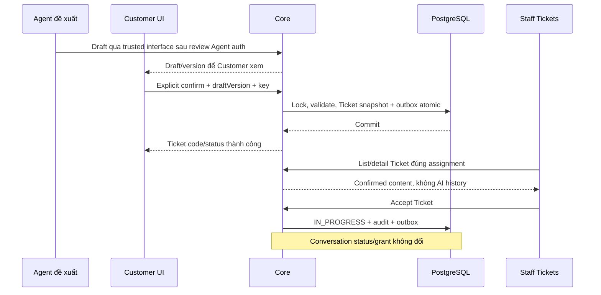

# I07 — Ticket riêng và liên kết với Inbox

Ngày 03/11/2026 · **Kế hoạch đề xuất, chưa implement; mở sau Inbox** · [Chung](../03-inbox-contract.md) · Trước: [I06](../inbox/06-realtime-routing.md) · [Tài liệu Ticket Staff](../07-tickets-contract.md).

## 1. Ranh giới nghiệp vụ

Ticket là yêu cầu nghiệp vụ: Agent đề xuất nội dung → Customer xem và xác nhận → Core tạo Ticket + outbox atomic. Nó không là trạng thái cuộc chat. Handoff/Direct/Accept chat không tự tạo Ticket. Xem/nhận/đóng Ticket không cho Staff đọc AI chat riêng hoặc thay Accept chat.

I07 là nhánh tiếp theo, không chặn nghiệm thu Inbox I06. Không ghép Copilot, attachments, Claim/payment, close/resolve hoặc form Staff tự tạo Ticket vào phase này. Agent dùng custom LangGraph, HTTP + callback JSON và tạm chốt HMAC theo Agent Design; profile xác thực, runtime store/checkpointer và G2/G3 còn phải review; **không tích hợp draft thật trước contract Agent riêng**. Có thể kiểm Core confirmation/Ticket với draft fixture trusted trong test container, phải báo đó là integration test, không AI thật.

## 2. File triển khai

| Vị trí cần thêm/sửa | Trách nhiệm |
| --- | --- |
| `apps/core/src/tickets/tickets.module.ts` | Module nghiệp vụ Ticket, không đưa vào ConversationService |
| `controllers/customer-ticket.controller.ts`, `staff-ticket.controller.ts` trong module | Ownership draft/confirm, Staff list/detail/accept |
| `services/ticket-draft.service.ts`, `ticket.service.ts`, `ticket-access.service.ts` | Draft trusted, transaction confirmation/idempotency, Ticket scope riêng |
| `dto/ticket-query.dto.ts`, `confirm-ticket.dto.ts`, `ticket-response.dto.ts` | OpenAPI và validation, không reuse raw conversation payload |
| Prisma schema/migration mới | Draft/immutable confirmed snapshot/version/hash cần thiết bên dưới |
| Core outbox/notifications I06 | TICKET_CREATED/TICKET_ASSIGNED events; recipient theo Ticket policy |
| Web `components/staff-tickets.tsx`, `customer-ticket-confirmation.tsx`, `lib/ticket-api.ts` | Màn Tickets riêng và Customer review nội dung |
| Staff workspace + routes tickets hiện có | Mount data thật tại slot Tickets; không chuyển về Customers/Inbox để thay trang |

Core AppModule import TicketsModule khi triển khai. Agent không truy cập trực tiếp business DB; browser không gọi Agent để lấy quyền/draft trusted.

## 3. Dữ liệu và xác nhận đề xuất

### 3.1. TicketDraft

Bảng mới lưu draft server-side: id, conversationId/customerId, source=AGENT, version, payload, payloadHash, createdAt, expiresAt, state DRAFT/CONFIRMED/SUPERSEDED. payload allowlist `{title,description,policyId?,sourceMessageIds?}`. Title 1–255, description 1–4000 code points, source tối đa20 message ids thuộc đúng cuộc/Customer-facing; Core validate linkedPolicy ownership.

**Ánh xạ bắt buộc theo Agent Design/plan:** đầu vào Agent là `AgentResult.actions.PROPOSE_TICKET.summary` với sáu nhóm `request`, `context`, `customer_statements`, `verified_findings`, `attempted_steps`, `pending_issues`. G6 phải đặc tả cách Core lưu/hiển thị đủ sáu nhóm và source refs trong draft/confirmedContent; payload title/description ở trên chỉ là đề xuất App, chưa đủ để bỏ hoặc ép mất summary. Không tự rút còn một description, biến lời khách thành verified finding hoặc dùng history summary thay bản Customer đã xem. Nếu vướng giới hạn độ dài phải yêu cầu bản đề xuất phù hợp và cho xem lại trước xác nhận, không cắt ngầm. Tên trường wire/DDL/hash cuối vẫn chờ G1/G6; không thêm tool LLM ghi Ticket.

Agent chỉ đề xuất, không được gán confirmedAt/actor/ticketCode/status. Internal service interface đề xuất `proposeDraft(trustedServiceContext,conversationId,payload)`; chưa định nghĩa public/service HTTP endpoint khi service auth chưa được review. Không chấp nhận body browser `{source:"AGENT"}` làm chứng cứ trusted.

Draft mới version/hash mới; draft đã bị thay thế hoặc hết hạn không xác nhận được. TTL local đề xuất30 phút, cần review; thời gian server. Customer đổi nội dung phải qua revision mới server lưu/hash/hiển thị lại, không gửi payload tùy ý cùng draft version cũ.

### 3.2. SupportTicket

Giữ các field hiện có ticketCode/customerId/conversationId/policyId/title/aiSummary/extractedDetails/status/idempotencyKey/confirmedAt. Bổ sung dự kiến sourceDraftId/version, confirmedByCustomerId, confirmationTextVersion, **confirmedContent Json** và confirmedRequestHash, version integer0.

confirmedContent là snapshot chính xác payload Customer đã xem/duyệt, bất biến sau tạo. aiSummary/extractedDetails chỉ dữ liệu suy dẫn, không nguyên văn xác nhận. Unique sourceDraftId (một draft chỉ tạo một Ticket) và idempotencyKey; composite FK ownership cho source conversation/policy. Không biến mọi aiSummary legacy thành confirmedContent.

Ticket cũ thiếu snapshot vẫn giữ dữ liệu, detail ghi nguồn legacy không có nội dung xác nhận chuẩn; không tự tạo bằng chứng. Muốn migrate/backfill phải có plan riêng và không xóa Ticket cũ.

## 4. API Customer — đề xuất

### 4.1. Xem draft

`GET /api/v1/customers/me/conversations/:conversationId/ticket-drafts/:draftId`, không query; ownership + draft thuộc đúng cuộc, không Copilot. 200:

```json
{
  "draft": {
    "id": "90000000-0000-4000-8000-000000000001", "version": 2, "state": "DRAFT", "confirmedTicket": null,
    "title": "Yêu cầu giải thích quyền lợi",
    "description": "Nội dung giả lập Customer sẽ xem và xác nhận.",
    "policyId": null, "sourceMessageIds": [],
    "expiresAt": "2026-11-03T09:00:00.000Z"
  },
  "confirmation": {"textVersion":"ticket-v1","text":"Đồng ý tạo yêu cầu hỗ trợ với đúng nội dung trên."}
}
```

Không tool trace/LLM prompt/raw extracted payload. Draft ngoài quyền/không tồn tại404; hết hạn còn ownership409 DRAFT_EXPIRED. Đọc draft không tạo Ticket hoặc handoff.

### 4.2. Xác nhận và tạo Ticket

`POST /api/v1/customers/me/tickets`

```json
{
  "clientRequestId": "40000000-0000-4000-8000-000000000007",
  "draftId": "90000000-0000-4000-8000-000000000001", "expectedDraftVersion": 2,
  "confirmation": {"confirmed":true,"textVersion":"ticket-v1"}
}
```

Không nhận confirmedContent/actor/customerId/status từ body để thay draft server. Session/CSRF, review explicit; key UUID, hash canonical draft id/version/confirmation. Core derived idempotencyKey actor+operation+key. 201 lần đầu/200 replay:

`{ticket:{id,ticketCode,status,confirmedAt},replayed:boolean}`.

Có Staff hợp lệ hiện hành → status ASSIGNED và assignedStaffId; chưa có/Staff không khả dụng → OPEN/assignedStaffId null, Ticket vẫn được tạo thành công và event chờ routing. Không báo thất bại chỉ vì thông báo chưa giao. Đây là đề xuất routing Ticket riêng, khác việc Direct/request chat chưa có Staff trả 409; cần review trước code.

Reconcile `GET /api/v1/customers/me/tickets/by-client-request-id/:clientRequestId`: chỉ Ticket của actor; 200 minimal receipt hoặc safe 404, không có kết quả chưa chứng minh chưa commit. Replay cùng POST/key/payload an toàn. Cùng draft/key mới trả 409 DRAFT_ALREADY_CONFIRMED, không tạo Ticket thứ hai; GET draft của owner khi state CONFIRMED trả confirmedTicket={id,ticketCode} để mở kết quả đã tạo. Replay key gốc vẫn200. Không tạo receipt giả cho key mới.

Customer detail `GET /api/v1/customers/me/tickets/:ticketId`: snapshot đã xác nhận/status/ticketCode và link cuộc của mình nếu còn quyền; không Staff Copilot/note. Chưa mở Customer Ticket list lớn ngoài phần cần để theo dõi kết quả tạo.

## 5. API Staff — đề xuất A21–A23

Contract Staff được tách thành [TK01 scope/model](01-scope-model-contract.md), [TK02 read](02-staff-read-api.md), [TK03 accept](03-accept-command.md), [TK04 UI](04-list-detail-ui.md), [TK05 notifications](05-notification-events.md). Nhánh Staff có thể làm trước Agent; không một module Ticket thứ hai.

TK01 đề xuất scope mặc định active assignment + Ticket recipient chính actor; không global/unassigned OPEN queue. Chốt quyền/version/legacy trước code, review lại routing khi nối producer I07. TK01 đã có version/policy nội bộ; confirmed snapshot/draft I07 chưa triển khai, không được giả là E. Read/accept không mở chat grant; Customer confirmation/trusted draft ở mục4 vẫn thuộc I07.

## 6. Luồng và transaction



Create transaction: auth/ownership → lock draft/routing đúng thứ tự I01 → lookup idempotency → validate current draft/hash/expiry/confirmation → allocate unique ticketCode bằng cơ chế atomic/sequence (không MAX+1 không khóa) → insert snapshot/confirmed actor/server time → mark draft confirmed → outbox → commit. Lỗi giữa chừng rollback; worker fail sau commit không mất Ticket.

Concurrent key khác cùng draft có unique sourceDraftId chặn duplicate. Cùng key khác version/hash409 IDEMPOTENCY_CONFLICT. Replay recheck ownership, không leak Ticket người khác bằng key. Notification recipient do Ticket policy xác định, generic payload không tự kèm transcript. Ticket confirmation text khác handoff consent text, không dùng một lần đồng ý thay cả hai.

## 7. UI và thứ tự thực hiện

1. Chốt trusted draft contract/retention/routing/legacy snapshot trước code phụ thuộc.
2. Model/constraints và Core confirmation/idempotency/outbox với synthetic draft tests.
3. A21/A22/A23, Ticket permission riêng, linked chat conditional.
4. Customer review dialog hiển thị chính xác nội dung/nguồn, confirm/cancel/focus/unknown outcome; không confirm tự động từ AI message.
5. Màn Staff Tickets riêng, trạng thái/nhận Ticket, no F5. Không thay Inbox chat bằng Ticket table.
6. Khi Agent thật có contract auth/checkpoint: nối proposal vào cùng flow, kiểm E2E thật. Trước đó báo nguồn test, không endpoint public giả Agent.

## 8. Test cases

Các ca dưới đây là **kịch bản dự kiến**, chỉ thực thi sau dependency/contract đã chốt trong phần phạm vi; không đánh dấu chức năng đã có.

**Quy ước dữ liệu:** S-A/S-B là hai Staff synthetic; C-A/C-B là hai Customer synthetic khác nhau. Thay alias bằng UUID/token của fixture cô lập; các path HTTP dùng prefix /api/v1 nếu chưa ghi đầy đủ. Chỉ thay assignment, khóa account, inject lỗi hoặc migration trong harness/môi trường test, không trên tài khoản/dữ liệu đang sử dụng.

### I07-T01 — Cancel và xác nhận phải gắn draft server

**Lớp kiểm thử:** API + DB dự kiến.
**Điều kiện và dữ liệu:** Sau khi I07 có trusted draft D-A thuộc C-A, version n, chưa hết hạn.

**Các bước:**

1. GET draft bằng owner.
2. Gửi confirm=false, textVersion sai hoặc bỏ confirmation.
3. Cancel review và kiểm DB.

**Kết quả mong đợi:** Không tạo Ticket/receipt/outbox từ các biến thể chưa xác nhận; không dùng confirmedAt/client text làm bằng chứng.

### I07-T02 — Owner, version và draft đã đổi

**Lớp kiểm thử:** API + DB dự kiến.
**Điều kiện và dữ liệu:** D-A của C-A; C-B/Staff có session khác; có bản draft n+1.

**Các bước:**

1. Đọc/xác nhận D-A bằng C-B hoặc Staff.
2. C-A confirm bằng expectedDraftVersion=n sau khi n+1 tồn tại.
3. Lặp với draft hết hạn.

**Kết quả mong đợi:** Cross-owner/role bị chặn; stale/expired conflict, không tạo Ticket hoặc tự nâng version để xác nhận.

### I07-T03 — Idempotency và transaction

**Lớp kiểm thử:** API + DB barrier dự kiến.
**Điều kiện và dữ liệu:** C-A xác nhận D-A bằng key K; harness điều khiển insert/outbox/ACK.

**Các bước:**

1. Gửi đồng thời cùng K và hai K khác nhau cho cùng draft.
2. Replay K với payload khác.
3. Inject failure trước commit và ngắt ACK sau commit ở hai fixture.

**Kết quả mong đợi:** Một Ticket cho draft, replay đúng receipt hoặc conflict; rollback atomic; ACK mất tra receipt, không nhân Ticket do delivery lỗi.

### I07-T04 — Agent không thay Customer xác nhận

**Lớp kiểm thử:** Agent integration dự kiến.
**Điều kiện và dữ liệu:** Trusted Agent/service auth đã được chốt; chỉ corpus synthetic, source version đúng quyền.

**Các bước:**

1. Agent tạo đề xuất Ticket.
2. Không thao tác Confirm, chờ worker hoàn tất.
3. Customer review/xác nhận rồi Staff mở Ticket và thử chat AI riêng.

**Kết quả mong đợi:** Đề xuất không tự ghi Ticket; chỉ xác nhận hợp lệ tạo business record; Ticket không cấp transcript grant. Chưa Agent thật thì không nghiệm thu full E2E.

**Dọn sau kiểm thử:** xóa đúng fixture/session/object/schema theo runId; phục hồi fault injection và đóng context/socket test. Không reset DB/credential, sửa bootstrap hoặc xóa volumes. Với PDF kiểm metadata/bytes/hash; với UI kiểm DOM/focus/network, không cần screenshot.

## 9. Điều kiện hoàn tất

- [ ] Quyết định còn mở đã chốt trong phase, spec/API map đồng bộ.
- [ ] Core transaction/confirmation/dedup/scope tests pass; Ticket và chat độc lập.
- [ ] Browser/E2E qua Docker đúng mức nguồn draft thực tế, không coi fixture là AI thật.
- [ ] Ticket UI riêng, no F5, không thêm close/resolve/Copilot ngoài scope.

**Checkpoint:** Khi I07 dùng draft fixture nhưng Agent chưa nối, ghi rõ “Core/UI Ticket hoàn tất, nguồn Agent chưa tích hợp”; không đánh dấu toàn luồng AI→Ticket đã xong.
